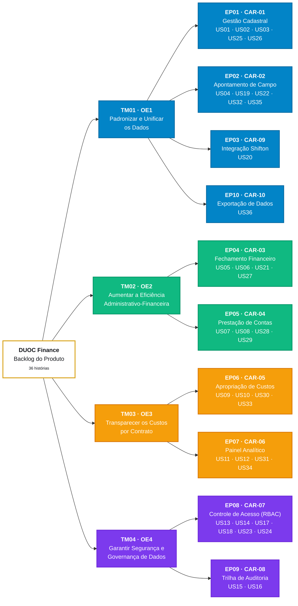
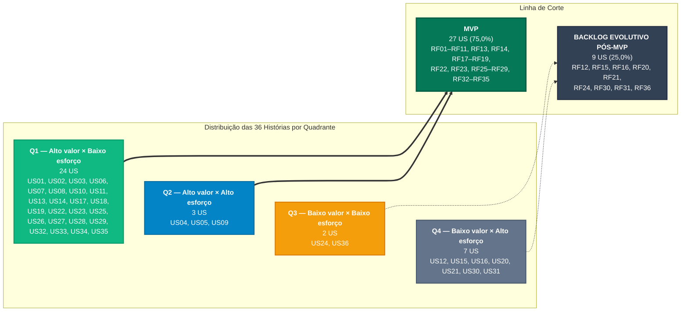

# Capítulo 10: Backlog do Produto e MVP

Este capítulo decompõe o escopo do ***DUOC Finance*** em **Temas, Épicos e Histórias de Usuário (*User Stories*)**, atendendo à **Seção 10 do Template Oficial** da disciplina: a diretriz de [Backlog Geral](#backlog-geral) atende à Seção 10.1 e a [Priorização do Backlog e Linha de Corte do MVP](#priorizacao-do-backlog-e-linha-de-corte-do-mvp) à Seção 10.2.

Os códigos, nomenclaturas, notas de valor e de esforço adotados aqui são reproduzidos sem alteração da [Especificação de Requisitos](../requisitos/index.md) e da [Priorização e MVP](../requisitos/priorizacao.md). Este capítulo organiza o escopo na perspectiva do usuário e o ordena para a construção iterativa e incremental do modelo RAD.

---

## Estrutura Hierárquica do Backlog

O backlog é organizado em três níveis de abstração, com rastreabilidade vertical até os **Objetivos Específicos (OE1 a OE4)** definidos no [Capítulo 2: Solução Proposta](../visao-produto/capitulo-2/index.md):

1. **Tema (TM):** área estratégica de valor do produto. Cada tema corresponde a um **Objetivo Específico**, resultando em **4 temas** (TM01 a TM04).
2. **Épico (EP):** capacidade de negócio de grande porte, entregue ao longo de várias iterações. Cada épico corresponde a uma **Característica do Produto (CAR)** e herda o alinhamento ao OE da característica, resultando em **10 épicos** (EP01 a EP10).
3. **História de Usuário (US):** menor incremento de valor negociável com a cliente, redigido no padrão *"Como [papel], quero [ação], para que [benefício]"*. Cada história deriva de **exatamente um Requisito Funcional**, preservando a numeração (**US*nn*** ↔ **RF*nn***), resultando em **36 histórias** (US01 a US36), que cobrem a totalidade dos 36 RFs da [Especificação de Requisitos](../requisitos/index.md).

### Temas e Épicos

| Tema | Objetivo Específico | Épicos |
| :---: | :--- | :--- |
| **TM01** | **OE1 — Padronizar e Unificar os Dados:** centralização cadastral de colaboradores e coleta estruturada de campo via Relatório de Viagem Técnica (RVT). | EP01, EP02, EP03, EP10 |
| **TM02** | **OE2 — Aumentar a Eficiência Administrativo-Financeira:** automação do fechamento de diárias técnicas e fluxos ágeis de reembolso e adiantamento operacional. | EP04, EP05 |
| **TM03** | **OE3 — Transparecer os Custos por Contrato:** apropriação clara de despesas e mão de obra por obra e centro de custo. | EP06, EP07 |
| **TM04** | **OE4 — Garantir Segurança e Governança de Dados:** autenticação segura, controle de acesso baseado em papéis (RBAC) e rastreabilidade probatória. | EP08, EP09 |

| Épico | Característica (CAR) | Tema / OE | Histórias de Usuário | Total | No MVP | Pós-MVP |
| :---: | :--- | :---: | :--- | :---: | :---: | :---: |
| **EP01** | **CAR-01** — Gestão Cadastral Unificada de Pessoal | TM01 · OE1 | US01, US02, US03, US25, US26 | 5 | 5 | 0 |
| **EP02** | **CAR-02** — Apontamento Móvel de Atividades e Registros de Campo | TM01 · OE1 | US04, US19, US22, US32, US35 | 5 | 5 | 0 |
| **EP03** | **CAR-09** — Integração com Shifton e Presenças Homologadas | TM01 · OE1 | US20 | 1 | 0 | 1 |
| **EP04** | **CAR-03** — Motor de Processamento e Fechamento Financeiro | TM02 · OE2 | US05, US06, US21, US27 | 4 | 3 | 1 |
| **EP05** | **CAR-04** — Fluxo Digital de Prestação de Contas e Reembolsos | TM02 · OE2 | US07, US08, US28, US29 | 4 | 4 | 0 |
| **EP06** | **CAR-05** — Apropriação e Rastreabilidade de Custos por Contrato | TM03 · OE3 | US09, US10, US30, US33 | 4 | 3 | 1 |
| **EP07** | **CAR-06** — Painel Analítico de Custo Apropriado e Desvio Orçamentário | TM03 · OE3 | US11, US12, US31, US34 | 4 | 2 | 2 |
| **EP08** | **CAR-07** — Controle de Acesso Baseado em Papéis (RBAC) | TM04 · OE4 | US13, US14, US17, US18, US23, US24 | 6 | 5 | 1 |
| **EP09** | **CAR-08** — Trilha de Auditoria e Histórico de Operações Sensíveis | TM04 · OE4 | US15, US16 | 2 | 0 | 2 |
| **EP10** | **CAR-10** — Importação e Exportação de Dados com ERPs e Planilhas Legadas | TM01 · OE1 | US36 | 1 | 0 | 1 |
| **Total** | **10 épicos** | **4 temas** | **36 histórias** | **36** | **27** | **9** |

---

## Backlog Geral

Esta seção atende à **Seção 10.1 do Template Oficial**. A tabela canônica a seguir mapeia **100% dos 36 Requisitos Funcionais** (RF01 a RF36) em Histórias de Usuário e vincula a cada história os **Requisitos Não Funcionais** (RNF01 a RNF20) aplicáveis. Os **RF32 a RF36**, incorporados na revisão por pares de 12/10/2026, deixaram de ser tratados como complementares e passaram a ter história própria (US32 a US36), submetida à mesma linha de corte dos demais requisitos.

### Papéis de Usuário

Os papéis citados nas histórias são os **quatro papéis sistêmicos canônicos** da [Matriz Canônica de Papéis (RBAC)](../requisitos/index.md#atores-do-sistema-e-matriz-canonica-de-papeis-rbac) do Capítulo 8, atribuídos pelo **RF14** (US14). Na DUOC, as rotinas de RH/Departamento Pessoal e de finanças são centralizadas no **Administrador Financeiro**; por isso, não são usados cargos como "analista de RH" ou "analista financeiro".

| Papel Canônico (RBAC) | Código | Histórias em que atua |
| :--- | :---: | :--- |
| **Técnico de Campo / Diarista** | `TECNICO_CAMPO` | US04, US07, US19, US22, US28, US35 (US07 também pelo Gestor Operacional de Obras) |
| **Gestor Operacional de Obras** | `GESTOR_OBRAS` | US10, US11, US12, US30, US31, US32, US33, US34 (US10, US11, US12, US30 e US33 compartilhadas com outros papéis) |
| **Administrador Financeiro** | `ADMIN_FINANCEIRO` | US01, US02, US03, US05, US06, US08, US09, US10, US11, US12, US15, US20, US21, US25, US26, US27, US29, US30, US33, US36 |
| **Administrador do Sistema** | `ADMIN_SISTEMA` | US11, US14, US15, US16, US23, US24 |
| **Qualquer usuário autenticado** | — | US13, US17, US18 (histórias transversais de acesso, sem restrição de papel) |

### Convenções de Rastreabilidade dos RNFs

- **RNFs específicos:** vinculados a cada história pela coluna *RFs Vinculados* da [Tabela de Classificação e Vinculação dos RNFs ao MVP](../requisitos/priorizacao.md#tabela-de-classificacao-e-vinculacao-dos-rnfs-ao-mvp). Os vínculos marcados com **¹** vêm da [Matriz-Síntese Geral de Rastreabilidade](../requisitos/index.md#matriz-sintese-geral-de-rastreabilidade), que associa o RNF à Característica (CAR) do épico.
- **Pacote Transversal (T):** **RNF03, RNF14, RNF15, RNF16, RNF17, RNF18, RNF19 e RNF20**. Esses atributos de segurança, auditoria, disponibilidade, acessibilidade e integridade de API são classificados como *Obrigatórios para o MVP* no Capítulo 8 e se aplicam a **todas** as histórias. Por isso, aparecem como **T** em cada linha, ao lado dos RNFs específicos.
- **RNFs evolutivos:** **RNF01** (modo *offline*) e **RNF08** (justificativa em estornos) permanecem vinculados às suas histórias, mas não bloqueiam a conclusão (*Done*) no MVP.
- **† Ratificação pendente:** histórias derivadas de requisitos incorporados ou redefinidos após a [Reunião 05](../atas/reuniao-05.md) (RF22 a RF36), cuja classificação de valor permanece preliminar até nova validação com a cliente.

### Tabela Canônica do Backlog Geral

| US | Épico | História de Usuário | RF de Origem | RNFs Relacionados | Linha de Corte |
| :---: | :---: | :--- | :---: | :--- | :---: |
| **US01** | EP01 · OE1 | Como **Administrador Financeiro**, quero cadastrar um novo colaborador com seus dados pessoais, bancários e trabalhistas, para que exista uma base única e validada por CPF que sustente os apontamentos e os pagamentos de diárias. | RF01 | RNF02 + **T** | **MVP** |
| **US02** | EP01 · OE1 | Como **Administrador Financeiro**, quero atualizar os dados cadastrais e bancários de um colaborador ativo, para que todos os módulos passem a usar imediatamente as informações corretas, sem perder a versão anterior da ficha. | RF02 | RNF02 + **T** | **MVP** |
| **US03** | EP01 · OE1 | Como **Administrador Financeiro**, quero registrar afastamentos, férias e desligamentos de um colaborador, para que sua situação funcional fique atualizada e o acesso de campo seja revogado, evitando pagamentos indevidos. | RF03 | RNF02 + **T** | **MVP** |
| **US25**† | EP01 · OE1 | Como **Administrador Financeiro**, quero classificar o colaborador como Diarista, CLT ou Prestador de Serviço, para que o sistema aplique as regras administrativas e financeiras do vínculo correto. | RF25 | RNF02 + **T** | **MVP** |
| **US26**† | EP01 · OE1 | Como **Administrador Financeiro**, quero consultar o histórico de alterações cadastrais e bancárias de um colaborador, com autor e data de cada mudança, para que divergências administrativas possam ser rastreadas e esclarecidas. | RF26 | RNF02 + **T** | **MVP** |
| **US04** | EP02 · OE1 | Como **Técnico de Campo**, quero enviar pelo dispositivo móvel as horas trabalhadas e o escopo executado ao final da jornada, para que meu apontamento chegue à supervisão sem depender de planilhas ou mensagens de WhatsApp. | RF04 | RNF01 *(evolutivo)*, RNF04 + **T** | **MVP** |
| **US19** | EP02 · OE1 | Como **Técnico de Campo**, quero consultar meus apontamentos e o status de cada um, para que eu acompanhe homologações e rejeições e identifique quais registros ainda posso retificar antes do fechamento. | RF19 | RNF04 + **T** | **MVP** |
| **US22**† | EP02 · OE1 | Como **Técnico de Campo**, quero anexar fotos e comprovantes com geolocalização ao meu apontamento, para que a execução da atividade fique comprovada no RVT. | RF22 | RNF04, RNF07 + **T** | **MVP** |
| **US32**† | EP02 · OE1 | Como **Gestor Operacional de Obras**, quero homologar ou rejeitar, com parecer justificado, os apontamentos pendentes dos contratos sob minha responsabilidade, para que somente horas conferidas sigam para o fechamento financeiro e a apropriação de custos. | RF32 | **T** | **MVP** |
| **US35**† | EP02 · OE1 | Como **Técnico de Campo**, quero corrigir horas, escopo ou anexos de um apontamento ainda pendente de homologação, em até 5 dias úteis após o envio, para que erros de preenchimento sejam ajustados antes da deliberação do gestor. | RF35 | RNF04, RNF07 + **T** | **MVP** |
| **US20** | EP03 · OE1 | Como **Administrador Financeiro**, quero importar as presenças homologadas do *Shifton* por competência e contrato, para que as horas registradas no ponto biométrico sejam aproveitadas sem redigitação. | RF20 | RNF02¹ + **T** | Pós-MVP |
| **US05** | EP04 · OE2 | Como **Administrador Financeiro**, quero gerar a prévia de fechamento da competência com diárias e comissões já calculadas, para que eu confira os valores sem consolidar planilhas manualmente. | RF05 | RNF05, RNF06, RNF10 + **T** | **MVP** |
| **US06** | EP04 · OE2 | Como **Administrador Financeiro**, quero homologar o lote de fechamento após a conferência, para que os lançamentos fiquem bloqueados contra alterações diretas e o extrato final seja emitido com segurança. | RF06 | RNF05, RNF06, RNF10 + **T** | **MVP** |
| **US21** | EP04 · OE2 | Como **Administrador Financeiro**, quero estornar um fechamento já homologado mediante justificativa formal, para que inconsistências sejam corrigidas sem apagar o histórico do fechamento original. | RF21 | RNF08 *(evolutivo)* + **T** | Pós-MVP |
| **US27**† | EP04 · OE2 | Como **Administrador Financeiro**, quero cadastrar as categorias de diária técnica com valor e período de vigência, para que prévias e fechamentos usem sempre o valor vigente da competência. | RF27 | RNF06 + **T** | **MVP** |
| **US07** | EP05 · OE2 | Como **Técnico de Campo ou Gestor Operacional de Obras**, quero solicitar o reembolso de uma despesa operacional anexando o comprovante fiscal, para que eu seja ressarcido sem entregar recibos físicos ou enviar fotos avulsas. | RF07 | RNF07 + **T** | **MVP** |
| **US08** | EP05 · OE2 | Como **Administrador Financeiro**, quero aprovar ou reprovar as solicitações de reembolso com parecer obrigatório na reprovação, para que apenas despesas comprovadas sejam repassadas e o solicitante seja informado da decisão. | RF08 | RNF06 + **T** | **MVP** |
| **US28**† | EP05 · OE2 | Como **Técnico de Campo**, quero solicitar um adiantamento para uma despesa operacional de um contrato ativo, para que eu disponha dos recursos antes de executar a atividade. | RF28 | **T** | **MVP** |
| **US29**† | EP05 · OE2 | Como **Administrador Financeiro**, quero aprovar ou reprovar os adiantamentos pendentes de análise, para que a liberação de recursos seja formal, rastreável e comunicada ao solicitante. | RF29 | RNF06 + **T** | **MVP** |
| **US09** | EP06 · OE3 | Como **Administrador Financeiro**, quero disparar a apropriação dos custos homologados da competência aos respectivos contratos, para que eu conheça o custo real de cada obra sem duplicidade com a folha CLT. | RF09 | RNF10, RNF11 + **T** | **MVP** |
| **US10** | EP06 · OE3 | Como **Gestor Operacional de Obras ou Administrador Financeiro**, quero visualizar a origem completa de cada custo apropriado, para que eu possa justificar e auditar qualquer linha de despesa do contrato. | RF10 | RNF10 + **T** | **MVP** |
| **US30**† | EP06 · OE3 | Como **Gestor Operacional de Obras ou Administrador Financeiro**, quero comparar os custos apropriados de dois ou mais contratos em um período, para que eu utilize o histórico de obras anteriores em orçamentos e decisões futuras. | RF30 | RNF09, RNF10¹, RNF12 + **T** | Pós-MVP |
| **US33**† | EP06 · OE3 | Como **Administrador Financeiro ou Gestor Operacional de Obras**, quero cadastrar e manter os contratos de obras com cliente, vigência, valor global, retenções e responsável pela supervisão, para que apontamentos, reembolsos, adiantamentos e custos sejam sempre vinculados a um contrato ativo. | RF33 | **T** | **MVP** |
| **US11** | EP07 · OE3 | Como **Gestor Operacional de Obras, Administrador Financeiro ou Administrador do Sistema**, quero combinar filtros de período, contrato, colaborador e centro de custo no painel de custos, para que eu analise os custos diretos de cada obra no fechamento. | RF11 | RNF09, RNF10, RNF12 + **T** | **MVP** |
| **US12** | EP07 · OE3 | Como **Gestor Operacional de Obras ou Administrador Financeiro**, quero acompanhar o previsto, o realizado, o desvio e o percentual de execução orçamentária, para que eu identifique extrapolações do orçamento a tempo de agir. | RF12 | RNF09, RNF10¹, RNF12 + **T** | Pós-MVP |
| **US31**† | EP07 · OE3 | Como **Gestor Operacional de Obras**, quero configurar o percentual de execução orçamentária que dispara alertas no painel e por e-mail, para que eu seja avisado antes que o orçamento seja ultrapassado. | RF31 | RNF09, RNF10¹, RNF12 + **T** | Pós-MVP |
| **US34**† | EP07 · OE3 | Como **Gestor Operacional de Obras**, quero cadastrar os centros de custo de cada contrato ativo e definir seus tetos orçamentários por categoria de despesa, para que os custos sejam apropriados ao centro correto e a execução orçamentária possa ser medida. | RF34 | **T** | **MVP** |
| **US13** | EP08 · OE4 | Como **usuário da plataforma**, quero entrar na plataforma com e-mail e senha corporativos, para que eu acesse somente as funcionalidades e os dados permitidos ao meu perfil. | RF13 | RNF13, RNF14 + **T** | **MVP** |
| **US14** | EP08 · OE4 | Como **Administrador do Sistema**, quero atribuir a cada usuário um papel de acesso, para que campo, gestão e financeiro visualizem apenas os dados da sua alçada (princípio do menor privilégio). | RF14 | RNF14 + **T** | **MVP** |
| **US17** | EP08 · OE4 | Como **colaborador que esqueceu a senha**, quero receber no e-mail corporativo um link de redefinição de uso único, para que eu recupere o acesso sem depender de *reset* manual pela gestão. | RF17 | **T** | **MVP** |
| **US18** | EP08 · OE4 | Como **usuário autenticado**, quero encerrar minha sessão manualmente, para que ninguém utilize meu acesso em um dispositivo compartilhado. | RF18 | RNF13¹ + **T** | **MVP** |
| **US23**† | EP08 · OE4 | Como **Administrador do Sistema**, quero que a conta seja bloqueada temporariamente após tentativas de login inválidas consecutivas, para que contas com acesso a dados sensíveis fiquem protegidas contra ataques de força bruta. | RF23 | **T** | **MVP** |
| **US24**† | EP08 · OE4 | Como **Administrador do Sistema**, quero impor a renovação periódica de senhas e impedir a reutilização das últimas credenciais, para que senhas antigas ou vazadas deixem de dar acesso ao sistema. | RF24 | **T** | Pós-MVP |
| **US15** | EP09 · OE4 | Como **Administrador do Sistema ou Administrador Financeiro**, quero pesquisar a trilha de auditoria por período, usuário, operação e módulo, para que eu identifique quem executou cada operação sensível e quando. | RF15 | RNF15¹, RNF16¹, RNF17¹ + **T** | Pós-MVP |
| **US16** | EP09 · OE4 | Como **Administrador do Sistema**, quero exportar um dossiê em PDF/CSV com o histórico imutável das operações auditadas, para que a DUOC comprove conformidade legal e trabalhista (CLT Art. 11). | RF16 | RNF15¹, RNF16¹, RNF17¹ + **T** | Pós-MVP |
| **US36**† | EP10 · OE1 | Como **Administrador Financeiro**, quero exportar em CSV ou XLSX os dados consolidados de apontamentos, presenças e apropriações filtrados por período, contrato e centro de custo, para que a conciliação contábil externa e o arquivamento dispensem redigitação. | RF36 | RNF02¹ + **T** | Pós-MVP |

**Critérios de aceitação e rastreabilidade:** Os critérios de aceitação de cada história correspondem aos **Critérios de Aceitação** do RF de origem na [Especificação Modular dos Requisitos](../requisitos/index.md#especificacao-modular-dos-requisitos), complementados pelos **Critérios Mensuráveis** dos RNFs relacionados. A admissão de entrada e a conclusão de cada história nas iterações do RAD seguem a [Definition of Ready (DoR) e Definition of Done (DoD)](../dor-dod/index.md).

### Matriz de Rastreabilidade RNF × Histórias de Usuário

A matriz inversa garante a rastreabilidade bidirecional: para cada RNF, indica as histórias que devem satisfazer seu critério mensurável dentro e fora do MVP.

| RNF | Atributo de Qualidade | Abrangência | US no MVP | US Pós-MVP | Categoria no MVP (Cap. 8) |
| :---: | :--- | :---: | :--- | :--- | :---: |
| **RNF01** | Operar em modo *offline* em canteiros sem rede | Específica | US04 | — | **Evolutivo** |
| **RNF02** | Garantir tempo de resposta para consulta cadastral inferior a 2,0 s | Específica | US01, US02, US03, US25, US26 | US20¹, US36¹ | **Associado ao MVP** |
| **RNF03** | Criptografia em repouso e em trânsito | Transversal (**T**) | Todas as 27 US do MVP | Todas as 9 US Pós-MVP | **Obrigatório para o MVP** |
| **RNF04** | Usabilidade e agilidade no RVT de campo | Específica | US04, US19, US22, US35 | — | **Associado ao MVP** |
| **RNF05** | Processar rotina de fechamento financeiro em até 5,0 s | Específica | US05, US06 | — | **Associado ao MVP** |
| **RNF06** | Exatidão aritmética centesimal | Específica | US05, US06, US08, US27, US29 | — | **Associado ao MVP** |
| **RNF07** | Validação no upload de comprovantes | Específica | US07, US22, US35 | — | **Associado ao MVP** |
| **RNF08** | Justificativa mandatória em estornos | Específica | — | US21 | **Evolutivo** |
| **RNF09** | Carga do painel analítico ≤ 3 s | Específica | US11 | US12, US30, US31 | **Associado ao MVP** |
| **RNF10** | Restrição de dados financeiros conforme perfil | Específica | US05, US06, US09, US10, US11 | US12¹, US30¹, US31¹ | **Obrigatório para o MVP** |
| **RNF11** | Consistência ACID na apropriação de custos | Específica | US09 | — | **Associado ao MVP** |
| **RNF12** | Responsividade do painel em desktop e tablet | Específica | US11 | US12, US30, US31 | **Associado ao MVP** |
| **RNF13** | Expiração de token temporário em até 8 horas | Específica | US13, US18¹ | — | **Obrigatório para o MVP** |
| **RNF14** | Autorização RBAC em 100% das rotas de API | Transversal (**T**) | Todas as 27 US do MVP; ênfase em US13, US14 | Todas as 9 US Pós-MVP | **Obrigatório para o MVP** |
| **RNF15** | Atomicidade na gravação dos logs de auditoria | Transversal (**T**) | Todas as 27 US do MVP | Todas as 9 US Pós-MVP; ênfase em US15¹, US16¹ | **Obrigatório para o MVP** |
| **RNF16** | Retenção de logs por no mínimo 5 anos | Transversal (**T**) | Todas as 27 US do MVP | Todas as 9 US Pós-MVP; ênfase em US15¹, US16¹ | **Obrigatório para o MVP** |
| **RNF17** | Backup diário automático com restauração verificada | Transversal (**T**) | Todas as 27 US do MVP | Todas as 9 US Pós-MVP; ênfase em US15¹, US16¹ | **Obrigatório para o MVP** |
| **RNF18** | Disponibilidade mensal ≥ 99,5% com aviso de 48h fora do horário comercial | Transversal (**T**) | Todas as 27 US do MVP | Todas as 9 US Pós-MVP | **Obrigatório para o MVP** |
| **RNF19** | Acessibilidade digital nas interfaces | Transversal (**T**) | Todas as 27 US do MVP | Todas as 9 US Pós-MVP | **Obrigatório para o MVP** |
| **RNF20** | Integridade de payloads nas rotas de escrita da API | Transversal (**T**) | Todas as 27 US do MVP | Todas as 9 US Pós-MVP | **Obrigatório para o MVP** |

---

## Priorização do Backlog e Linha de Corte do MVP

Esta seção atende à **Seção 10.2 do Template Oficial**. A priorização das histórias reutiliza integralmente as notas formalizadas na [Tabela Consolidada das Avaliações](../requisitos/priorizacao.md#tabela-consolidada-das-avaliacoes) do Capítulo 8 e as expressa nos indicadores do template.

### Indicadores do Template Oficial

| Indicador | Sigla | Escala | Origem no Capítulo 8 |
| :--- | :---: | :---: | :--- |
| **Valor de Negócio** | **VB** | 1 a 4 | Coluna *Valor Negócio*, atribuída com a cliente na [Reunião 05](../atas/reuniao-05.md) conforme a [Rubrica de Julgamento (D1 a D4)](../requisitos/priorizacao.md#rubrica-de-julgamento-do-valor-de-negocio). |
| **Complexidade Técnica** | **CX** | 1 a 4 | Coluna *Complex.* da [escala de Complexidade Técnica](../requisitos/priorizacao.md#complexidade-tecnica). |
| **Esforço de Implementação** | **ES** | 1 a 4 | Nota da coluna *Esforço (h) / Nota*, da [escala de Esforço de Implementação](../requisitos/priorizacao.md#esforco-de-implementacao-tempo-em-horas). |
| **Lacuna de Capacidade** | **LC** | 1 a 4 | Coluna *Lacuna* da [escala de Lacuna de Capacidade](../requisitos/priorizacao.md#lacuna-de-capacidade-da-equipe). |
| **Esforço Consolidado** | **EC** | 1,00 a 4,00 | Calculado: média de ES, CX e LC, convertida na classe 1 a 4 da [Regra de Conversão](../requisitos/priorizacao.md#formula-de-consolidacao-e-regra-de-conversao) do Capítulo 8. |
| **Índice de Prioridade** | **IP** | 0,25 a 4,00 | Calculado: razão entre VB e a média EC. |

  EC
  =
  
    
      ES + CX + LC
    
    
      3
    
  
  
  IP
  =
  
    
      VB
    
    
      EC
    
  

Quanto **maior o IP**, maior o retorno de negócio por unidade de esforço técnico. O EC reproduz **exatamente** o Esforço Consolidado do Capítulo 8, com as três dimensões (esforço em horas, complexidade e lacuna de capacidade), e a classe 1 a 4 segue as mesmas faixas: 1,00–1,49; 1,50–2,49; 2,50–3,49; 3,50–4,00.

### Quadrantes e Prioridade Sugerida

O quadrante de cada história é obtido pelo cruzamento do **VB** com a **classe do EC** (classes 1 e 2: esforço baixo/moderado, EC < 2,50; classes 3 e 4: esforço alto, EC ≥ 2,50), usando os mesmos cortes da [Matriz 4 × 4](../requisitos/priorizacao.md#matriz-4-x-4-valor-de-negocio-x-esforco-tecnico) do Capítulo 8:

| Quadrante | Critério | Correspondência no Capítulo 8 | Prioridade Sugerida | Destinação |
| :---: | :--- | :--- | :--- | :---: |
| **Q1** | VB ≥ 3 e EC < 2,50 | Alto valor × esforço baixo/moderado — *"Candidatos ao MVP"* | **Alta — implementar no MVP** | MVP |
| **Q2** | VB ≥ 3 e EC ≥ 2,50 | Alto valor × esforço alto — *"Avaliar / Decompor"* | **Alta — MVP com escopo controlado** | MVP |
| **Q3** | VB ≤ 2 e EC < 2,50 | Valor moderado/baixo × esforço baixo/moderado — *"Oportunidade / Futuro"* | **Média — capacidade residual** | Pós-MVP |
| **Q4** | VB ≤ 2 e EC ≥ 2,50 | Valor moderado/baixo × esforço alto — *"Não Priorizar"* | **Baixa — backlog evolutivo** | Pós-MVP |

### Tabela Consolidada de Priorização

A ordem sugerida posiciona primeiro as histórias do MVP e, dentro de cada grupo, ordena por **IP decrescente**. Em caso de empate, prevalece o maior **VB** e, depois, o menor código. A coluna **ES** reproduz as horas e a nota da [Tabela Consolidada das Avaliações](../requisitos/priorizacao.md#tabela-consolidada-das-avaliacoes), única fonte de estimativa do projeto; os cartões das histórias adotam os mesmos valores.

| Ordem | US | RF | História de Usuário (resumo) | Épico | VB | ES (h / nota) | CX | LC | EC (classe) | IP | Quadrante | Prioridade Sugerida | Linha de Corte |
| :---: | :---: | :---: | :--- | :---: | :---: | :---: | :---: | :---: | :---: | :---: | :---: | :--- | :---: |
| 1 | **US13** | RF13 | Efetuar login no sistema | EP08 | **4** | 2h (1) | 1 | 1 | 1,00 (1) | **4,00** | **Q1** | Alta — implementar no MVP | **MVP** |
| 2 | **US18** | RF18 | Encerrar sessão manualmente | EP08 | **3** | 1h (1) | 1 | 1 | 1,00 (1) | **3,00** | **Q1** | Alta — implementar no MVP | **MVP** |
| 3 | **US01** | RF01 | Cadastrar colaborador | EP01 | **4** | 6h (2) | 2 | 1 | 1,67 (2) | **2,40** | **Q1** | Alta — implementar no MVP | **MVP** |
| 4 | **US19** | RF19 | Consultar apontamentos registrados | EP02 | **4** | 4h (2) | 2 | 1 | 1,67 (2) | **2,40** | **Q1** | Alta — implementar no MVP | **MVP** |
| 5 | **US27** | RF27 | Configurar tabela de valores de diárias técnicas | EP04 | **4** | 6h (2) | 2 | 1 | 1,67 (2) | **2,40** | **Q1** | Alta — implementar no MVP | **MVP** |
| 6 | **US32** | RF32 | Deliberar apontamento de campo | EP02 | **4** | 6h (2) | 2 | 1 | 1,67 (2) | **2,40** | **Q1** | Alta — implementar no MVP | **MVP** |
| 7 | **US07** | RF07 | Submeter solicitação de reembolso | EP05 | **4** | 6h (2) | 2 | 2 | 2,00 (2) | **2,00** | **Q1** | Alta — implementar no MVP | **MVP** |
| 8 | **US08** | RF08 | Deliberar solicitação de reembolso | EP05 | **4** | 6h (2) | 2 | 2 | 2,00 (2) | **2,00** | **Q1** | Alta — implementar no MVP | **MVP** |
| 9 | **US02** | RF02 | Atualizar cadastro de colaborador | EP01 | **3** | 6h (2) | 2 | 1 | 1,67 (2) | **1,80** | **Q1** | Alta — implementar no MVP | **MVP** |
| 10 | **US17** | RF17 | Recuperar credenciais de acesso | EP08 | **3** | 4h (2) | 2 | 1 | 1,67 (2) | **1,80** | **Q1** | Alta — implementar no MVP | **MVP** |
| 11 | **US23** | RF23 | Bloquear acesso após tentativas falhas consecutivas | EP08 | **3** | 6h (2) | 2 | 1 | 1,67 (2) | **1,80** | **Q1** | Alta — implementar no MVP | **MVP** |
| 12 | **US25** | RF25 | Cadastrar tipo de contratação do colaborador | EP01 | **3** | 4h (2) | 2 | 1 | 1,67 (2) | **1,80** | **Q1** | Alta — implementar no MVP | **MVP** |
| 13 | **US33** | RF33 | Gerenciar contratos de obras e clientes | EP06 | **3** | 8h (2) | 2 | 1 | 1,67 (2) | **1,80** | **Q1** | Alta — implementar no MVP | **MVP** |
| 14 | **US34** | RF34 | Gerenciar centros de custo e orçamentos de obra | EP07 | **3** | 8h (2) | 2 | 1 | 1,67 (2) | **1,80** | **Q1** | Alta — implementar no MVP | **MVP** |
| 15 | **US35** | RF35 | Retificar apontamento de campo pendente | EP02 | **3** | 4h (2) | 2 | 1 | 1,67 (2) | **1,80** | **Q1** | Alta — implementar no MVP | **MVP** |
| 16 | **US06** | RF06 | Homologar fechamento financeiro | EP04 | **4** | 6h (2) | 3 | 2 | 2,33 (2) | **1,71** | **Q1** | Alta — implementar no MVP | **MVP** |
| 17 | **US03** | RF03 | Registrar movimentação funcional | EP01 | **3** | 6h (2) | 2 | 2 | 2,00 (2) | **1,50** | **Q1** | Alta — implementar no MVP | **MVP** |
| 18 | **US10** | RF10 | Consultar rastreabilidade de custos | EP06 | **3** | 6h (2) | 2 | 2 | 2,00 (2) | **1,50** | **Q1** | Alta — implementar no MVP | **MVP** |
| 19 | **US11** | RF11 | Filtrar indicadores de custos | EP07 | **3** | 6h (2) | 2 | 2 | 2,00 (2) | **1,50** | **Q1** | Alta — implementar no MVP | **MVP** |
| 20 | **US28** | RF28 | Submeter solicitação de adiantamento operacional | EP05 | **3** | 6h (2) | 2 | 2 | 2,00 (2) | **1,50** | **Q1** | Alta — implementar no MVP | **MVP** |
| 21 | **US29** | RF29 | Deliberar solicitação de adiantamento operacional | EP05 | **3** | 8h (2) | 2 | 2 | 2,00 (2) | **1,50** | **Q1** | Alta — implementar no MVP | **MVP** |
| 22 | **US04** | RF04 | Submeter apontamento de campo | EP02 | **4** | 16h (3) | 3 | 3 | 3,00 (3) | **1,33** | **Q2** | Alta — MVP com escopo controlado | **MVP** |
| 23 | **US14** | RF14 | Gerenciar perfis de acesso | EP08 | **3** | 6h (2) | 3 | 2 | 2,33 (2) | **1,29** | **Q1** | Alta — implementar no MVP | **MVP** |
| 24 | **US22** | RF22 | Anexar evidências e geolocalização ao apontamento | EP02 | **3** | 8h (2) | 3 | 2 | 2,33 (2) | **1,29** | **Q1** | Alta — implementar no MVP | **MVP** |
| 25 | **US26** | RF26 | Consultar histórico de alterações cadastrais e bancárias | EP01 | **3** | 8h (2) | 3 | 2 | 2,33 (2) | **1,29** | **Q1** | Alta — implementar no MVP | **MVP** |
| 26 | **US05** | RF05 | Solicitar prévia de fechamento | EP04 | **4** | 16h (3) | 4 | 3 | 3,33 (3) | **1,20** | **Q2** | Alta — MVP com escopo controlado | **MVP** |
| 27 | **US09** | RF09 | Apropriar custos operacionais | EP06 | **3** | 16h (3) | 4 | 3 | 3,33 (3) | **0,90** | **Q2** | Alta — MVP com escopo controlado | **MVP** |
| 28 | **US36** | RF36 | Exportar dados consolidados em planilha CSV/XLSX | EP10 | **2** | 6h (2) | 2 | 1 | 1,67 (2) | **1,20** | **Q3** | Média — capacidade residual | **Pós-MVP** |
| 29 | **US24** | RF24 | Impor renovação periódica de senhas | EP08 | **2** | 6h (2) | 2 | 2 | 2,00 (2) | **1,00** | **Q3** | Média — capacidade residual | **Pós-MVP** |
| 30 | **US21** | RF21 | Estornar fechamento financeiro | EP04 | **2** | 10h (3) | 3 | 2 | 2,67 (3) | **0,75** | **Q4** | Baixa — backlog evolutivo | **Pós-MVP** |
| 31 | **US30** | RF30 | Consultar comparativo histórico de custos entre contratos | EP06 | **2** | 10h (3) | 3 | 2 | 2,67 (3) | **0,75** | **Q4** | Baixa — backlog evolutivo | **Pós-MVP** |
| 32 | **US31** | RF31 | Configurar alertas de execução orçamentária | EP07 | **2** | 10h (3) | 3 | 2 | 2,67 (3) | **0,75** | **Q4** | Baixa — backlog evolutivo | **Pós-MVP** |
| 33 | **US12** | RF12 | Monitorar execução orçamentária | EP07 | **2** | 12h (3) | 3 | 3 | 3,00 (3) | **0,67** | **Q4** | Baixa — backlog evolutivo | **Pós-MVP** |
| 34 | **US15** | RF15 | Consultar trilha de auditoria | EP09 | **2** | 10h (3) | 3 | 3 | 3,00 (3) | **0,67** | **Q4** | Baixa — backlog evolutivo | **Pós-MVP** |
| 35 | **US20** | RF20 | Importar presenças homologadas | EP03 | **2** | 12h (3) | 3 | 3 | 3,00 (3) | **0,67** | **Q4** | Baixa — backlog evolutivo | **Pós-MVP** |
| 36 | **US16** | RF16 | Exportar relatório de auditoria | EP09 | **1** | 12h (3) | 3 | 3 | 3,00 (3) | **0,33** | **Q4** | Baixa — backlog evolutivo | **Pós-MVP** |

### Tratamento das Histórias do Quadrante Q2

As três histórias de **alto valor e alto esforço** permanecem no MVP com a estratégia de redução de escopo definida no [Tratamento dos Requisitos de Alto Valor e Alto Esforço](../requisitos/priorizacao.md#tratamento-dos-requisitos-de-alto-valor-e-alto-esforco) do Capítulo 8:

| História | EC | IP | Estratégia no MVP |
| :---: | :---: | :---: | :--- |
| **US04** — Submeter apontamento de campo | 3,00 | 1,33 | **Escopo controlado:** coleta dos campos essenciais de horas, contrato e escopo executado; a operação *offline* completa (**RNF01**) segue para a fase evolutiva. |
| **US05** — Solicitar prévia de fechamento | 3,33 | 1,20 | **Escopo concentrado:** regras contratuais ativas e valores vigentes de diárias (**US27**), sem encargos e provisões da folha CLT mantidos em sistemas contábeis externos. |
| **US09** — Apropriar custos operacionais | 3,33 | 0,90 | **Apropriação direta:** lotes homologados vinculados ao contrato ativo; comparativos históricos (**US30**) e alertas (**US31**) ficam para a evolução do produto. |

### Dependências para o Planejamento da Construção

O Índice de Prioridade ordena as histórias pelo retorno de negócio; a sequência de construção nos ciclos RAD também respeita as pré-condições funcionais entre elas. A tabela a seguir explicita essas pré-condições e confirma que **nenhuma história do MVP depende de item ausente do backlog ou postergado**:

| História habilitadora | O que fornece | Histórias que dependem dela |
| :---: | :--- | :--- |
| **US13**, **US14** | Autenticação e papéis RBAC (RN15, RN16) | Todas as histórias com acesso restrito |
| **US01**, **US25** | Colaborador ativo, com dados bancários e tipo de contratação (RN03, RN22) | US04, US05, US07, US28 |
| **US33** | Contratos de obra ativos (RN09, RN11) | US04, US07, US09, US28, US34 |
| **US34** | Centros de custo e tetos orçamentários (RN09, RN13) | US09, US11 (e, no pós-MVP, US12 e US31) |
| **US04** → **US35** | Apontamento enviado e, se necessário, retificado enquanto pendente (RN02) | US32 |
| **US32** | Apontamentos homologados pelo gestor (RN05, RN10) | US05, US09 |
| **US27** | Valor vigente das diárias técnicas (RN25, RN31) | US05 |
| **US05** | Prévia conferida da competência | US06 |
| **US07**, **US28** | Solicitações pendentes de análise | US08, US29 |

Com a inclusão de **US32 a US35**, o fluxo selecionado — cadastro, contrato, apontamento, retificação, homologação, prévia, fechamento e apropriação — fica integralmente coberto por histórias do MVP.

### Composição do MVP e do Backlog Evolutivo

A linha de corte segue a regra formalizada no Capítulo 8: histórias com **VB 3 ou 4** (quadrantes Q1 e Q2) compõem o MVP, e histórias com **VB 1 ou 2** (quadrantes Q3 e Q4) compõem o backlog evolutivo.

| Épico | OE | Histórias no MVP | Histórias no Backlog Pós-MVP |
| :--- | :---: | :--- | :--- |
| **EP01** — Gestão Cadastral Unificada de Pessoal | OE1 | US01, US02, US03, US25, US26 | — |
| **EP02** — Apontamento Móvel de Atividades e Registros de Campo | OE1 | US04, US19, US22, US32, US35 | — |
| **EP03** — Integração com Shifton e Presenças Homologadas | OE1 | — | US20 |
| **EP04** — Motor de Processamento e Fechamento Financeiro | OE2 | US05, US06, US27 | US21 |
| **EP05** — Fluxo Digital de Prestação de Contas e Reembolsos | OE2 | US07, US08, US28, US29 | — |
| **EP06** — Apropriação e Rastreabilidade de Custos por Contrato | OE3 | US09, US10, US33 | US30 |
| **EP07** — Painel Analítico de Custo Apropriado e Desvio Orçamentário | OE3 | US11, US34 | US12, US31 |
| **EP08** — Controle de Acesso Baseado em Papéis (RBAC) | OE4 | US13, US14, US17, US18, US23 | US24 |
| **EP09** — Trilha de Auditoria e Histórico de Operações Sensíveis | OE4 | — | US15, US16 |
| **EP10** — Importação e Exportação de Dados com ERPs e Planilhas Legadas | OE1 | — | US36 |
| **Total** | — | **27 histórias** | **9 histórias** |

- **MVP (27 histórias):** US01, US02, US03, US04, US05, US06, US07, US08, US09, US10, US11, US13, US14, US17, US18, US19, US22, US23, US25, US26, US27, US28, US29, US32, US33, US34 e US35. Correspondem aos **27 RFs selecionados** na [Lista Consolidada dos Requisitos Funcionais do MVP](../requisitos/priorizacao.md#lista-consolidada-dos-requisitos-funcionais-do-mvp).
- **Backlog Evolutivo Pós-MVP (9 histórias):** US12, US15, US16, US20, US21, US24, US30, US31 e US36. Correspondem aos **9 RFs postergados** em [Requisitos Funcionais Postergados (Backlog Pós-MVP)](../requisitos/priorizacao.md#requisitos-funcionais-postergados-backlog-pos-mvp), cujas justificativas permanecem válidas.
- **RNFs no MVP:** **18 de 20 RNFs** acompanham a primeira versão operacional (10 obrigatórios e 8 associados); **RNF01** e **RNF08** seguem com as histórias evolutivas, conforme a [Síntese Numérica da Distribuição dos RNFs](../requisitos/priorizacao.md#sintese-numerica-da-distribuicao-dos-rnfs).

---

## Enquadramento do Product Backlog no Padrão DEEP

Para garantir aderência às melhores práticas da Engenharia de Software Ágil (Cohn, 2004; Pichler, 2010), o backlog do **DUOC Finance** é governado e auditado segundo as quatro propriedades do padrão **DEEP**:

| Dimensão DEEP | Definição Metodológica | Evidência Operacional no DUOC Finance |
| :--- | :--- | :--- |
| **D — Detailed Appropriately** *(Detalhado Apropriadamente)* | Itens próximos da implementação possuem granularidade fina e detalhamento exaustivo; itens futuros permanecem em nível macro. | As histórias prioritárias do topo do MVP contam com especificação formal nos **3Cs** (Cartão, Conversa e Confirmação com critérios objetivos de aceitação e regras de negócio verificáveis), enquanto itens do backlog evolutivo pós-MVP (ex.: US15, US16, US30) permanecem descritos no nível de história canônica para refinamento progressivo. |
| **E — Estimated** *(Estimado)* | Todos os itens do backlog possuem estimativas de custo e esforço relativas ou absolutas. | 100% das 31 histórias possuem estimativas multidimensionais auditáveis: **Esforço em horas (ES)**, **Complexidade Técnica (CX)** e **Lacuna de Capacidade (LC)**, cuja média ponderada determina a classe de **Esforço Consolidado (EC)** de 1,00 a 4,00. |
| **E — Emergent** *(Emergente)* | O backlog é vivo e adaptável, evoluindo continuamente a partir do feedback dos usuários e avaliações técnicas. | O backlog incorporou informações das reuniões com a cliente registradas na [Ata 01](../atas/reuniao-01.md), deliberações internas das [Atas 04](../atas/reuniao-04.md) e [05](../atas/reuniao-05.md) e apontamentos de revisão por pares ([Feedback dos Requisitos](../requisitos/feedback.md)), resultando na criação de US22 a US31 e no refinamento contínuo dos portões DoR e DoD. |
| **P — Prioritized** *(Priorizado)* | Os itens são estritamente ordenados pelo valor agregado e urgência técnica. | O backlog está ordenado de forma decrescente pelo **Índice de Prioridade ($IP = VB / EC$)**, dividindo o produto com base na **Matriz 4 × 4** entre o núcleo inegociável do MVP (23 histórias / 74,2%) e o backlog evolutivo (8 histórias / 25,8%). |

---

## Modelo dos 3Cs e Especificação das Histórias do Topo do Backlog

Conforme preconizado por **Ron Jeffries (2001)**, uma História de Usuário atinge maturidade ágil quando expressa nas três dimensões dos **3Cs**:

1. **Card (Cartão):** A declaração sintética de papel, intenção e valor (*Como... Quero... Para que...*), complementada por metadados de estimativa e rastreabilidade.
2. **Conversation (Conversa):** O registro do diálogo contínuo de refinamento entre a equipe de desenvolvimento e a cliente parceira (**Maria Beatryz**), alinhando regras de negócio, dados e premissas operacionais.
3. **Confirmation (Confirmação):** Os critérios objetivos de aceitação redigidos em formato de lista estruturada de regras de negócio e validações observáveis, determinando de forma clara e inatacável as condições para homologação e aceite da história.

Abaixo são detalhadas as histórias de **maior prioridade do topo do backlog**, aptas a inaugurar os ciclos de construção do modelo RAD, além das histórias que as habilitam tecnicamente (US33). As estimativas de cada cartão reproduzem a [Tabela Consolidada das Avaliações](../requisitos/priorizacao.md#tabela-consolidada-das-avaliacoes):

=== "US13 — Efetuar Login (IP: 4,00 | Topo Geral)"

    

    #### Cartão (Card)
    - **ID:** `US13` | **Épico:** `EP08 · CAR-07` | **Origem:** `RF13` (RN15, RN16)
    - **Estimativa:** ES: 2h (1) • CX: 1 • LC: 1 • EC: 1,00 • VB: 4 • **IP: 4,00 (Rank 1)**
    - **História:** *Como **usuário da plataforma**, quero entrar na plataforma com e-mail e senha corporativos, para que eu acesse somente as funcionalidades e os dados permitidos ao meu perfil.*

    #### Conversa (Conversation)
    - **Alinhamento Sociotécnico:** Maria Beatryz destacou a importância de logins distintos para colaboradores de obra e gestores, evitando que dados salariais fiquem visíveis para quem preenche horas em campo. Acordou-se autenticação por e-mail corporativo e senha criptografada, gerando token JWT com expiração máxima de 8 horas (RNF13) e bloqueio de enumeração de contas (mensagens genéricas de erro).

    #### Confirmação (Critérios de Aceitação Objetivos)
    - **CA01 — Autenticação Válida:** O sistema deve autenticar colaboradores ativos mediante fornecimento de e-mail corporativo e senha cadastrados, gerando token JWT com tempo de expiração de 8 horas e redirecionando para a visão do respectivo papel (RN15, RNF13).
    - **CA02 — Latência de Autenticação:** A validação das credenciais e resposta da API devem ocorrer em tempo inferior a 500 ms sob condições nominais.
    - **CA03 — Proteção contra Enumeração e Erro Padronizado:** Em caso de fornecimento de senha incorreta ou e-mail inexistente, o sistema deve recusar a requisição com HTTP 401 e exibir a mensagem genérica *"E-mail ou senha inválidos"*, sem informar se o e-mail existe na base.

    

=== "US18 — Encerrar Sessão Manualmente (IP: 3,00)"

    

    #### Cartão (Card)
    - **ID:** `US18` | **Épico:** `EP08 · CAR-07` | **Origem:** `RF18` (RN15, Feedback FB-05)
    - **Estimativa:** ES: 1h (1) • CX: 1 • LC: 1 • EC: 1,00 • VB: 3 • **IP: 3,00 (Rank 2)**
    - **História:** *Como **usuário autenticado**, quero encerrar minha sessão manualmente, para que ninguém utilize meu acesso em um dispositivo compartilhado no canteiro.*

    #### Conversa (Conversation)
    - **Alinhamento Sociotécnico:** Identificado na avaliação por pares que tablets e celulares são compartilhados entre encarregados e diaristas em canteiros de obra remotos. O encerramento voluntário (*logout*) deve revogar o token no backend de forma atômica e sumária, impedindo reutilização do token via cache do navegador.

    #### Confirmação (Critérios de Aceitação Objetivos)
    - **CA01 — Revogação Imediata:** Ao acionar "Encerrar Sessão", o sistema deve invalidar sumariamente o token de autenticação no backend, impedindo sua reutilização posterior.
    - **CA02 — Limpeza de Cache e Sessão:** O cliente web deve expurgar quaisquer dados de sessão, tokens locais e informações temporárias da memória do navegador.
    - **CA03 — Redirecionamento Mandatório:** O navegador deve ser redirecionado imediatamente para a tela inicial de autenticação, bloqueando a navegação pelas páginas protegidas via botão "Voltar" do navegador.

    

=== "US01 — Cadastrar Colaborador (IP: 2,40 | Topo Cadastral)"

    

    #### Cartão (Card)
    - **ID:** `US01` | **Épico:** `EP01 · CAR-01` | **Origem:** `RF01` (RN01, RN03, RN22, RN23)
    - **Estimativa:** ES: 6h (2) • CX: 2 • LC: 1 • EC: 1,67 • VB: 4 • **IP: 2,40 (Rank 3)**
    - **História:** *Como **Administrador Financeiro**, quero cadastrar um novo colaborador com seus dados pessoais, bancários e trabalhistas, para que exista uma base única e validada por CPF que sustente os apontamentos e os pagamentos de diárias.*

    #### Conversa (Conversation)
    - **Alinhamento Sociotécnico:** Maria Beatryz confirmou que os dados bancários (código COMPE de 3 dígitos, agência e conta com dígito) são essenciais para evitar repasses errôneos de PIX/TED. A validação de CPF deve seguir o algoritmo oficial da Receita Federal (módulo 11) com bloqueio estrito de duplicidades.

    #### Confirmação (Critérios de Aceitação Objetivos)
    - **CA01 — Validação Algorítmica de CPF:** O sistema deve validar o CPF utilizando o algoritmo oficial da Receita Federal (dígitos verificadores via módulo 11), rejeitando CPFs inválidos ou mascarados incorretamente (RN01).
    - **CA02 — Unicidade Cadastral:** O sistema deve rejeitar o cadastro com alerta *"CPF já cadastrado na base de dados"* caso o documento já exista na base de dados ativa ou inativa.
    - **CA03 — Dados Bancários Obrigatórios:** Exigir preenchimento completo de banco (código COMPE de 3 dígitos), agência e conta corrente com dígito verificador para viabilizar pagamentos de diárias.
    - **CA04 — Trilha de Auditoria e Convite de Acesso:** Persistir o registro na trilha de auditoria (RN17) e disparar automaticamente o e-mail de convite com link temporário para definição do primeiro acesso (RF17).

    

=== "US19 — Consultar Apontamentos Registrados (IP: 2,40 | Topo de Campo)"

    

    #### Cartão (Card)
    - **ID:** `US19` | **Épico:** `EP02 · CAR-02` | **Origem:** `RF19` (RN02, RN05, RN16, RN30, FB-03)
    - **Estimativa:** ES: 4h (2) • CX: 2 • LC: 1 • EC: 1,67 • VB: 4 • **IP: 2,40 (Rank 4)**
    - **História:** *Como **Técnico de Campo**, quero consultar meus apontamentos e o status de cada um, para que eu acompanhe homologações e rejeições e possa retificá-los antes do fechamento.*

    #### Conversa (Conversation)
    - **Alinhamento Sociotécnico:** Originada do feedback docente e de pares (FB-03), esta história dá transparência ao colaborador de obra. O técnico deve visualizar unicamente seus próprios registros (princípio do menor privilégio / RN16) com exibição clara do status ("Pendente", "Homologado" ou "Rejeitado") e dos pareceres de recusa registrados pelo gestor.

    #### Confirmação (Critérios de Aceitação Objetivos)
    - **CA01 — Isolamento por Colaborador (Menor Privilégio):** O Técnico de Campo deve visualizar exclusivamente os apontamentos associados ao seu próprio identificador (RN16).
    - **CA02 — Transparência de Dados:** Cada apontamento listado deve exibir claramente: data do serviço, contrato de obra vinculado, horas trabalhadas, status operacional (*Pendente*, *Homologado* ou *Rejeitado*) e eventuais pareceres de recusa registrados pela gestão.
    - **CA03 — Bloqueio de Acesso Não Autorizado:** Tentativas de requisição a registros de terceiros via API devem ser interceptadas e rejeitadas com código HTTP 403 Forbidden em latência ≤ 15 ms (RNF14).

    

=== "US27 — Configurar Tabela de Diárias Técnicas (IP: 2,40 | Topo Financeiro)"

    

    #### Cartão (Card)
    - **ID:** `US27` | **Épico:** `EP04 · CAR-03` | **Origem:** `RF27` (RN25, RN31, TR-03)
    - **Estimativa:** ES: 6h (2) • CX: 2 • LC: 1 • EC: 1,67 • VB: 4 • **IP: 2,40 (Rank 5)**
    - **História:** *Como **Administrador Financeiro**, quero cadastrar as categorias de diária técnica com valor e período de vigência, para que prévias e fechamentos usem sempre o valor vigente da competência.*

    #### Conversa (Conversation)
    - **Alinhamento Sociotécnico:** A história formaliza a parametrização de categorias e vigências de diárias, de modo que alterações de tabela não distorçam competências passadas. Essa definição foi registrada pela equipe;

    #### Confirmação (Critérios de Aceitação Objetivos)
    - **CA01 — Parametrização com Vigência:** O sistema deve permitir o cadastro de categorias de diária técnica com nome, valor nominal monetário em reais e data de início de vigência (RN25).
    - **CA02 — Imutabilidade Histórica:** Alterações na tabela de diárias não podem afetar retroativamente apurações de competências anteriores à data de vigência configurada (RN31).
    - **CA03 — Aplicação no Motor de Fechamento:** A rotina de fechamento financeiro deve aplicar compulsoriamente a tarifa correspondente à categoria e à vigência do contrato da obra (TR-03).

    

=== "US32 — Deliberar Apontamento de Campo (IP: 2,40 | Topo de Homologação)"

    

    #### Cartão (Card)
    - **ID:** `US32` | **Épico:** `EP02 · CAR-02` | **Origem:** `RF32` (RN02, RN05, RN10, RN30, TR-01)
    - **Estimativa:** ES: 6h (2) • CX: 2 • LC: 1 • EC: 1,67 • VB: 4 • **IP: 2,40 (Rank 6)**
    - **História:** *Como **Gestor Operacional de Obras**, quero homologar ou rejeitar, com parecer justificado, os apontamentos pendentes dos contratos sob minha responsabilidade, para que somente horas conferidas sigam para o fechamento financeiro e a apropriação de custos.*

    #### Conversa (Conversation)
    - **Origem e Alinhamento:** Incorporada na revisão por pares de 12/10/2026 (fontes: Reunião 03, Reunião 05 e TR-01), esta história liga o envio do apontamento (US04) ao consumo financeiro: a prévia de fechamento (US05) e a apropriação de custos (US09) computam exclusivamente registros homologados (RN05, RN10). A deliberação cabe ao gestor responsável pelo contrato, e o parecer da rejeição orienta a correção pelo técnico. Por ser posterior à Reunião 05, a priorização permanece sujeita à ratificação da cliente.

    #### Confirmação (Critérios de Aceitação Objetivos)
    - **CA01 — Fila Restrita à Alçada:** O gestor visualiza e delibera somente os apontamentos com status *"Pendente de Homologação"* vinculados aos contratos sob sua responsabilidade (RN16).
    - **CA02 — Homologação e Bloqueio:** A aprovação transiciona o status para *"Homologado"*, bloqueia a edição pelo autor (RN02) e disponibiliza as horas e diárias para a prévia de fechamento e a apropriação (RN05, RN10).
    - **CA03 — Rejeição Justificada:** A rejeição sem parecer de no mínimo 15 caracteres é bloqueada; com parecer válido, o status passa a *"Rejeitado"* e o técnico é notificado (RN30).
    - **CA04 — Registro em Auditoria:** Cada deliberação grava autor, decisão, parecer e carimbo temporal UTC na trilha de auditoria (RN17).

    

=== "US07 — Submeter Solicitação de Reembolso (IP: 2,00)"

    

    #### Cartão (Card)
    - **ID:** `US07` | **Épico:** `EP05 · CAR-04` | **Origem:** `RF07` (RN03, RN06, RN09, TR-02)
    - **Estimativa:** ES: 6h (2) • CX: 2 • LC: 2 • EC: 2,00 • VB: 4 • **IP: 2,00 (Rank 7)**
    - **História:** *Como **Técnico de Campo ou Gestor Operacional de Obras**, quero solicitar o reembolso de uma despesa operacional anexando o comprovante fiscal, para que eu seja ressarcido sem entregar recibos físicos ou enviar fotos avulsas.*

    #### Conversa (Conversation)
    - **Alinhamento Sociotécnico:** Trata da erradicação do extravio de cupons fiscais térmicos que se apagam na carteira dos técnicos. A solicitação exige vínculo mandatório a um contrato de obra ativo (RN09) e upload do comprovante digitalizado (RN06) com validação de formato e tamanho (RNF07).

    #### Confirmação (Critérios de Aceitação Objetivos)
    - **CA01 — Vínculo Contratual Obrigatório:** A solicitação de reembolso deve estar vinculada compulsoriamente a um contrato de obra ativo selecionado pelo solicitante (RN09).
    - **CA02 — Obrigatoriedade de Comprovante Fiscal:** O sistema deve bloquear a submissão caso não seja anexado comprovante digitalizado (imagem JPEG/PNG ou documento PDF) de tamanho até 5 MB (RN06, RNF07).
    - **CA03 — Notificação de Fluxo:** Após submissão com sucesso, a despesa deve assumir o status *"Pendente de Análise"* e gerar pendência no painel do Administrador Financeiro (RN27).

    

=== "US33 — Gerenciar Contratos de Obras (IP: 1,80 | Pré-requisito Contratual)"

    

    #### Cartão (Card)
    - **ID:** `US33` | **Épico:** `EP06 · CAR-05` | **Origem:** `RF33` (RN09, RN11, TR-04)
    - **Estimativa:** ES: 8h (2) • CX: 2 • LC: 1 • EC: 1,67 • VB: 3 • **IP: 1,80 (Rank 13)**
    - **História:** *Como **Administrador Financeiro ou Gestor Operacional de Obras**, quero cadastrar e manter os contratos de obras com cliente, vigência, valor global, retenções e responsável pela supervisão, para que apontamentos, reembolsos, adiantamentos e custos sejam sempre vinculados a um contrato ativo.*

    #### Conversa (Conversation)
    - **Origem e Alinhamento:** Incorporada na revisão por pares de 12/10/2026 (fontes: Reunião 01, Reunião 05 e TR-04). O contrato ativo é o elo exigido pelo vínculo contratual obrigatório (RN09, RN11) de apontamentos (US04), reembolsos (US07), adiantamentos (US28) e apropriações (US09). Por isso, embora ocupe a 13ª posição por IP, a história é pré-requisito técnico dessas entregas e deve ser construída antes delas (ver [Dependências para o Planejamento da Construção](#dependencias-para-o-planejamento-da-construcao)). Priorização sujeita à ratificação da cliente.

    #### Confirmação (Critérios de Aceitação Objetivos)
    - **CA01 — Cadastro Completo:** O contrato é gravado com cliente, objeto contratual, vigência (início e término), valor global, retenções contratuais e gestor responsável pela supervisão; a ausência de campo obrigatório bloqueia o cadastro.
    - **CA02 — Disponibilidade Condicionada à Vigência:** Somente contratos ativos, dentro da vigência cadastrada, ficam disponíveis para seleção em apontamentos, reembolsos, adiantamentos e apropriações (RN09, RN11).
    - **CA03 — Edição Rastreável:** Alterações em contratos geram registro na trilha de auditoria com autor, valores anterior e posterior e carimbo temporal UTC (RN17).

    

=== "US04 — Submeter Apontamento de Campo (IP: 1,33 | Escopo Controlado Q2)"

    

    #### Cartão (Card)
    - **ID:** `US04` | **Épico:** `EP02 · CAR-02` | **Origem:** `RF04` (RN02, RN04, RN24, TR-01)
    - **Estimativa:** ES: 16h (3) • CX: 3 • LC: 3 • EC: 3,00 • VB: 4 • **IP: 1,33 (Rank 22 | Q2)**
    - **História:** *Como **Técnico de Campo**, quero enviar pelo dispositivo móvel as horas trabalhadas e o escopo executado ao final da jornada, para que meu apontamento chegue à supervisão sem depender de planilhas ou mensagens de WhatsApp.*

    #### Conversa (Conversation)
    - **Alinhamento Sociotécnico:** Item central da operação em obra. Por ser um item de alto valor e alto esforço (Q2), seu escopo no MVP foi estrategicamente controlado: foco na coleta web responsiva com status "Pendente de Homologação", validação de horas e envio de evidências (US22), deixando a retificação para a US35 e a homologação para a US32; a operação offline completa (RNF01) foi postergada para a fase evolutiva.

    #### Confirmação (Critérios de Aceitação Objetivos)
    - **CA01 — Registro com Status Pendente:** Ao submeter horas e escopo de produção, o sistema deve gravar o registro com status inicial *"Pendente de Homologação"* e disponibilizá-lo ao Gestor de Obras (RF32).
    - **CA02 — Campos Essenciais do RVT:** O envio exige data, contrato de obra ativo (US33), horas trabalhadas e escopo executado; submissões incompletas são bloqueadas com indicação do campo faltante. A retificação posterior do registro pendente é tratada na **US35**.
    - **CA03 — Validação de Horas Diárias:** O sistema deve validar a consistência das horas lançadas, alertando sobre jornadas superiores a 12 horas diárias no mesmo contrato.

    

=== "US06 — Homologar Fechamento Financeiro (IP: 1,71)"

    

    #### Cartão (Card)
    - **ID:** `US06` | **Épico:** `EP04 · CAR-03` | **Origem:** `RF06` (RN08, RN17, TR-03)
    - **Estimativa:** ES: 6h (2) • CX: 3 • LC: 2 • EC: 2,33 • VB: 4 • **IP: 1,71 (Rank 16)**
    - **História:** *Como **Administrador Financeiro**, quero homologar o lote de fechamento após a conferência, para que os lançamentos fiquem bloqueados contra alterações diretas e o extrato final seja emitido com segurança.*

    #### Conversa (Conversation)
    - **Alinhamento Sociotécnico:** Conforme acordado na Reunião 05 e refinado no feedback FB-13, a homologação representa o ato formal e irrevogável de trancamento da competência mensal. Todos os apontamentos conferidos tornam-se imutáveis; qualquer ajuste posterior exige o fluxo auditável de estorno (RF21).

    #### Confirmação (Critérios de Aceitação Objetivos)
    - **CA01 — Trancamento Compulsório de Competência:** A homologação do fechamento pelo Administrador Financeiro deve bloquear definitivamente todos os apontamentos da competência contra edição direta (RN08).
    - **CA02 — Auditoria e Rastreabilidade:** O encerramento do lote deve registrar na trilha de auditoria o carimbo temporal UTC exato e o identificador do homologador (RN17).
    - **CA03 — Emissão de Extrato sem Divergência:** O sistema deve gerar o extrato final consolidado com tolerância aritmética de R$ 0,00 entre soma de diárias/reembolsos e total liquidado (RNF06).

    

---

## Avaliação de Qualidade INVEST das Histórias do MVP

Para auditar o alinhamento com as diretrizes metodológicas de **Bill Wake (2003)**, a matriz a seguir afere o cumprimento dos critérios **INVEST** sobre as histórias do topo do Product Backlog:

| US | Título / Ação | Independent (I) | Negotiable (N) | Valuable (V) | Estimable (E) | Small (S) | Testable (T) | Conformidade Global |
| :---: | :--- | :---: | :---: | :---: | :---: | :---: | :---: | :---: |
| **US13** | Efetuar login no sistema | :white_check_mark: Independente de regras de negócio | :white_check_mark: Fluxo de tela e UX ajustáveis no DoR | :white_check_mark: Garante segurança e acesso RBAC | :white_check_mark: ES: 2h, CX: 1, LC: 1 | :white_check_mark: Cabe em 1 ciclo RAD | :white_check_mark: Teste com mock e JWT | **100% INVEST** |
| **US18** | Encerrar sessão manualmente | :white_check_mark: Independente | :white_check_mark: Interface de menu negociável | :white_check_mark: Mitiga riscos em dispositivos compartilhados | :white_check_mark: ES: 1h, CX: 1, LC: 1 | :white_check_mark: Executável em < 1 dia | :white_check_mark: Invalidação observável | **100% INVEST** |
| **US01** | Cadastrar colaborador | :white_check_mark: Base para outros módulos | :white_check_mark: Campos opcionais ajustáveis | :white_check_mark: Unicidade por CPF e base unificada | :white_check_mark: ES: 6h, CX: 2, LC: 1 | :white_check_mark: Cabe em 1 incremento | :white_check_mark: Algoritmo módulo 11 | **100% INVEST** |
| **US19** | Consultar apontamentos registrados | :white_check_mark: Consome API de apontamentos | :white_check_mark: Paginação e filtros negociáveis | :white_check_mark: Transparência e menor privilégio | :white_check_mark: ES: 4h, CX: 2, LC: 1 | :white_check_mark: Componente enxuto | :white_check_mark: Verificação por ID | **100% INVEST** |
| **US27** | Configurar diárias técnicas | :white_check_mark: Tabela independente | :white_check_mark: Formato de grid negociável | :white_check_mark: Alimenta o motor de fechamento | :white_check_mark: ES: 6h, CX: 2, LC: 1 | :white_check_mark: CRUD direto | :white_check_mark: Validação de vigência | **100% INVEST** |
| **US07** | Submeter reembolso operacional | :white_check_mark: Independente da homologação | :white_check_mark: Interface de upload negociável | :white_check_mark: Erradica perda de recibos físicos | :white_check_mark: ES: 6h, CX: 2, LC: 2 | :white_check_mark: Fluxo autônomo | :white_check_mark: Validação de PDF/tamanho | **100% INVEST** |
| **US32** | Deliberar apontamento de campo | :white_check_mark: Opera sobre apontamentos da US04, sem acoplamento de tela | :white_check_mark: Layout da fila de pendências negociável | :white_check_mark: Libera somente horas conferidas ao fechamento | :white_check_mark: ES: 6h, CX: 2, LC: 1 | :white_check_mark: Fluxo único de aprovação/rejeição | :white_check_mark: Transição de status e parecer ≥ 15 caracteres | **100% INVEST** |
| **US08** | Deliberar reembolso operacional | :white_check_mark: Depende de US07 mas desacoplada | :white_check_mark: Exibição de parecer negociável | :white_check_mark: Governança em contas a pagar | :white_check_mark: ES: 6h, CX: 2, LC: 2 | :white_check_mark: Tela de deliberação | :white_check_mark: Status aprovado/recusado | **100% INVEST** |
| **US33** | Gerenciar contratos de obras | :white_check_mark: CRUD sem dependência de outras histórias | :white_check_mark: Campos complementares negociáveis | :white_check_mark: Habilita o vínculo contratual obrigatório | :white_check_mark: ES: 8h, CX: 2, LC: 1 | :white_check_mark: CRUD direto | :white_check_mark: Bloqueio de contrato fora da vigência | **100% INVEST** |
| **US06** | Homologar fechamento financeiro | :white_check_mark: Opera sobre prévia existente | :white_check_mark: Layout de extrato negociável | :white_check_mark: Blindagem contábil de lotes | :white_check_mark: ES: 6h, CX: 3, LC: 2 | :white_check_mark: Transação atômica | :white_check_mark: Trava contra edição | **100% INVEST** |
| **US04** | Submeter apontamento de campo | :white_check_mark: Desacoplada do offline (Q2) | :white_check_mark: Layout responsivo refinado no DoR | :white_check_mark: Coleta direta de produção | :white_check_mark: ES: 16h, CX: 3, LC: 3 | :white_check_mark: Fatiada no MVP | :white_check_mark: Gravação com status pendente | **100% INVEST** |

---

## Histórico de Versão

| Versão | Data | Descrição | Autor(es) | Revisor(es) |
| :---: | :---: | :--- | :--- | :--- |
| `1.0` | 07/09/2026 | Criação e estruturação da página preliminar de backlog do produto e MVP (Unidade 2) | Matheus Ribeiro Szervinsk | Matheus Ribeiro Szervinsk |
| `1.1` | 07/09/2026 | Alinhamento da priorização com as iterações de construção do RAD | Matheus Ribeiro Szervinsk | Matheus Ribeiro Szervinsk |
| `2.0` | 12/10/2026 | Estruturação completa do capítulo conforme a Seção 10 do Template Oficial: hierarquia de 4 temas (OE1 a OE4), 9 épicos (CAR-01 a CAR-09) e 31 histórias de usuário derivadas de RF01 a RF31; tabela canônica do Backlog Geral (10.1) com vínculo aos RNFs específicos e ao pacote transversal, e matriz inversa RNF × US; priorização (10.2) com VB, CX, ES, PT, IP, quadrantes Q1 a Q4 e prioridade sugerida, sincronizada com a Matriz 4 × 4 do Capítulo 8; linha de corte com 23 histórias no MVP e 8 no backlog evolutivo pós-MVP. | Paulo Nery | — |
| `2.1` | 12/10/2026 | Numeração das seções do capítulo (10.1 e 10.2) e atualização dos vínculos para as seções 8.6 a 8.12 da Priorização; atores das histórias alinhados à Matriz Canônica de Papéis (RBAC) do Capítulo 8; priorização passa a usar as três dimensões do Esforço Consolidado (ES, CX e LC) no lugar da Pontuação Técnica de duas dimensões, com reordenação por IP; indicação dos RF32 a RF36 como requisitos complementares sem história. | Eric Araújo | — |
| `2.2` | 13/10/2026 | Remoção dos prefixos numéricos dos títulos de seção (10.1 e 10.2) e atualização das referências internas e âncoras para alinhamento com a estrutura da Unidade 2 | Matheus Ribeiro Szervinsk | Eric Araújo |
| `2.3` | 13/10/2026 | Remoção dos cards de alerta de enquadramento metodológico e critérios de aceitação com integração direta ao texto, destaque em branco e dourado para o nó raiz no diagrama da hierarquia do backlog e estilização da fórmula de priorização | Matheus Ribeiro Szervinsk | Eric Araújo |
| `2.4` | 13/10/2026 | Auditoria metodológica e completude ágil: inclusão formal do enquadramento DEEP do Product Backlog; detalhamento das histórias do topo do backlog no Modelo dos 3Cs (Card, Conversation e Confirmation) com critérios objetivos de aceitação e regras de negócio; e elaboração da Matriz de Conformidade INVEST para as histórias do MVP. | Matheus Ribeiro Szervinsk | Eric Araújo |
| `2.5` | 28/10/2026 | Consolidação do backlog em resposta à avaliação: inclusão das histórias US32 a US36 (RF32 a RF36), com cobertura de 100% dos 36 RFs; criação do épico EP10 (CAR-10); linha de corte com 27 histórias no MVP (75,0%) e 9 no backlog evolutivo (25,0%); reordenação da Tabela Consolidada de Priorização com horas explícitas na coluna ES; correção das estimativas divergentes dos cartões e da matriz INVEST (US01, US04, US07, US08, US13 e US27) conforme a Tabela Consolidada das Avaliações; cartões 3Cs das US32 e US33; retificação de apontamentos transferida da US04 para a US35; nova seção de dependências para o planejamento da construção. | Paulo Nery | — |
| `2.5` | 28/10/2026 | Alinhamento da priorização e das histórias ao feedback docente: identificação da Reunião 05 como interna | Giovana Ferreira | — |
