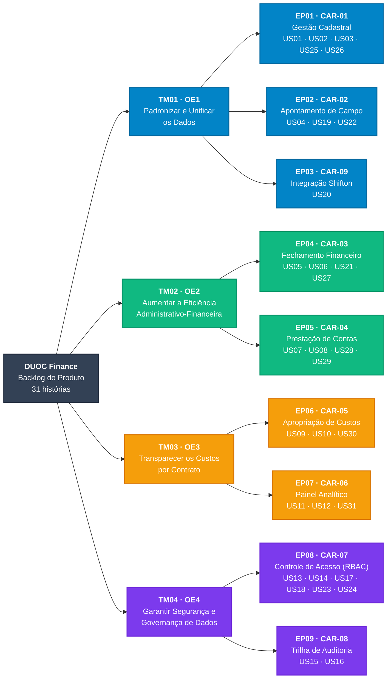
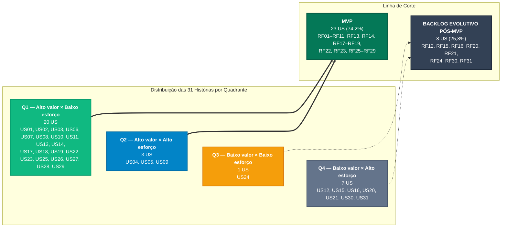

# Capítulo 10: Backlog do Produto e MVP

!!! info "Enquadramento Metodológico — Unidade 2 e Seção 10 do Template Oficial"
    Este capítulo decompõe o escopo do ***DUOC Finance*** em **Temas, Épicos e Histórias de Usuário (*User Stories*)**, atendendo à **Seção 10 do Template Oficial** da disciplina: a diretriz de **Backlog Geral** (Seção 10.1 do Template) é atendida pela seção [Backlog Geral](#backlog-geral) e a de **Priorização do Backlog e MVP** (Seção 10.2 do Template) pela seção [Priorização do Backlog e Linha de Corte do MVP](#priorizacao-do-backlog-e-linha-de-corte-do-mvp).

    Os códigos, nomenclaturas, notas de valor e de esforço adotados aqui são **reproduzidos sem alteração** da [Especificação de Requisitos (Capítulo 8)](../requisitos/index.md) e da [Priorização e MVP (Capítulo 8)](../requisitos/priorizacao.md). Este capítulo não redefine nenhum requisito, apenas o expressa na perspectiva do usuário e o ordena para a construção iterativa do modelo RAD.

---

## Estrutura Hierárquica do Backlog

O backlog é organizado em três níveis de abstração, com rastreabilidade vertical até os **Objetivos Específicos (OE1 a OE4)** definidos no [Capítulo 2: Solução Proposta](../visao-produto/capitulo-2/index.md):

1. **Tema (TM):** área estratégica de valor do produto. Cada tema corresponde a um **Objetivo Específico**, resultando em **4 temas** (TM01 a TM04).
2. **Épico (EP):** capacidade de negócio de grande porte, entregue ao longo de várias iterações. Cada épico corresponde a uma **Característica do Produto (CAR)** e herda o alinhamento ao OE da característica, resultando em **9 épicos** (EP01 a EP09).
3. **História de Usuário (US):** menor incremento de valor negociável com a cliente, redigido no padrão *"Como [papel], quero [ação], para que [benefício]"*. Cada história deriva de **exatamente um Requisito Funcional**, preservando a numeração (**US*nn*** ↔ **RF*nn***), resultando em **31 histórias** (US01 a US31).

### Temas e Épicos

| Tema | Objetivo Específico | Épicos |
| :---: | :--- | :--- |
| **TM01** | **OE1 — Padronizar e Unificar os Dados:** centralização cadastral de colaboradores e coleta estruturada de campo via Relatório de Viagem Técnica (RVT). | EP01, EP02, EP03 |
| **TM02** | **OE2 — Aumentar a Eficiência Administrativo-Financeira:** automação do fechamento de diárias técnicas e fluxos ágeis de reembolso e adiantamento operacional. | EP04, EP05 |
| **TM03** | **OE3 — Transparecer os Custos por Contrato:** apropriação clara de despesas e mão de obra por obra e centro de custo. | EP06, EP07 |
| **TM04** | **OE4 — Garantir Segurança e Governança de Dados:** autenticação segura, controle de acesso baseado em papéis (RBAC) e rastreabilidade probatória. | EP08, EP09 |

| Épico | Característica (CAR) | Tema / OE | Histórias de Usuário | Total | No MVP | Pós-MVP |
| :---: | :--- | :---: | :--- | :---: | :---: | :---: |
| **EP01** | **CAR-01** — Gestão Cadastral Unificada de Pessoal | TM01 · OE1 | US01, US02, US03, US25, US26 | 5 | 5 | 0 |
| **EP02** | **CAR-02** — Apontamento Móvel de Atividades e Registros de Campo | TM01 · OE1 | US04, US19, US22 | 3 | 3 | 0 |
| **EP03** | **CAR-09** — Integração com Shifton e Presenças Homologadas | TM01 · OE1 | US20 | 1 | 0 | 1 |
| **EP04** | **CAR-03** — Motor de Processamento e Fechamento Financeiro | TM02 · OE2 | US05, US06, US21, US27 | 4 | 3 | 1 |
| **EP05** | **CAR-04** — Fluxo Digital de Prestação de Contas e Reembolsos | TM02 · OE2 | US07, US08, US28, US29 | 4 | 4 | 0 |
| **EP06** | **CAR-05** — Apropriação e Rastreabilidade de Custos por Contrato | TM03 · OE3 | US09, US10, US30 | 3 | 2 | 1 |
| **EP07** | **CAR-06** — Painel Analítico de Custo Apropriado e Desvio Orçamentário | TM03 · OE3 | US11, US12, US31 | 3 | 1 | 2 |
| **EP08** | **CAR-07** — Controle de Acesso Baseado em Papéis (RBAC) | TM04 · OE4 | US13, US14, US17, US18, US23, US24 | 6 | 5 | 1 |
| **EP09** | **CAR-08** — Trilha de Auditoria e Histórico de Operações Sensíveis | TM04 · OE4 | US15, US16 | 2 | 0 | 2 |
| **Total** | **9 épicos** | **4 temas** | **31 histórias** | **31** | **23** | **8** |

---

## Backlog Geral

Esta seção atende à **Seção 10.1 do Template Oficial**. A tabela canônica a seguir mapeia **100% dos 31 Requisitos Funcionais** (RF01 a RF31) em Histórias de Usuário e vincula a cada história os **Requisitos Não Funcionais** (RNF01 a RNF20) aplicáveis. Os **RF32 a RF36** (revisão por pares de 12/10/2026) são tratados na [Priorização](../requisitos/priorizacao.md#requisitos-complementares-rf32-a-rf36-fora-da-linha-de-corte) como requisitos complementares, sem história nesta versão do backlog.

### Papéis de Usuário

Os papéis citados nas histórias são os **quatro papéis sistêmicos canônicos** da [Matriz Canônica de Papéis (RBAC)](../requisitos/index.md#atores-do-sistema-e-matriz-canonica-de-papeis-rbac) do Capítulo 8, atribuídos pelo **RF14** (US14). Na DUOC, as rotinas de RH/Departamento Pessoal e de finanças são centralizadas no **Administrador Financeiro**; por isso, não são usados cargos como "analista de RH" ou "analista financeiro".

| Papel Canônico (RBAC) | Código | Histórias em que atua |
| :--- | :---: | :--- |
| **Técnico de Campo / Diarista** | `TECNICO_CAMPO` | US04, US07, US19, US22, US28 (US07 também pelo Gestor Operacional de Obras) |
| **Gestor Operacional de Obras** | `GESTOR_OBRAS` | US10, US11, US12, US30, US31 (US10, US11, US12 e US30 compartilhadas com outros papéis) |
| **Administrador Financeiro** | `ADMIN_FINANCEIRO` | US01, US02, US03, US05, US06, US08, US09, US10, US11, US12, US15, US20, US21, US25, US26, US27, US29, US30 |
| **Administrador do Sistema** | `ADMIN_SISTEMA` | US11, US14, US15, US16, US23, US24 |
| **Qualquer usuário autenticado** | — | US13, US17, US18 (histórias transversais de acesso, sem restrição de papel) |

### Convenções de Rastreabilidade dos RNFs

- **RNFs específicos:** vinculados a cada história pela coluna *RFs Vinculados* da [Tabela de Classificação e Vinculação dos RNFs ao MVP](../requisitos/priorizacao.md#tabela-de-classificacao-e-vinculacao-dos-rnfs-ao-mvp). Os vínculos marcados com **¹** vêm da [Matriz-Síntese Geral de Rastreabilidade](../requisitos/index.md#matriz-sintese-geral-de-rastreabilidade), que associa o RNF à Característica (CAR) do épico.
- **Pacote Transversal (T):** **RNF03, RNF14, RNF15, RNF16, RNF17, RNF18, RNF19 e RNF20**. Esses atributos de segurança, auditoria, disponibilidade, acessibilidade e integridade de API são classificados como *Obrigatórios para o MVP* no Capítulo 8 e se aplicam a **todas** as histórias. Por isso, aparecem como **T** em cada linha, ao lado dos RNFs específicos.
- **RNFs evolutivos:** **RNF01** (modo *offline*) e **RNF08** (justificativa em estornos) permanecem vinculados às suas histórias, mas não bloqueiam a conclusão (*Done*) no MVP.
- **† Ratificação pendente:** histórias derivadas de requisitos incorporados ou redefinidos após a [Reunião 05](../atas/reuniao-05.md) (RF22 a RF31), cuja classificação de valor permanece preliminar até nova validação com a cliente.

### Tabela Canônica do Backlog Geral

| US | Épico | História de Usuário | RF de Origem | RNFs Relacionados | Linha de Corte |
| :---: | :---: | :--- | :---: | :--- | :---: |
| **US01** | EP01 · OE1 | Como **Administrador Financeiro**, quero cadastrar um novo colaborador com seus dados pessoais, bancários e trabalhistas, para que exista uma base única e validada por CPF que sustente os apontamentos e os pagamentos de diárias. | RF01 | RNF02 + **T** | **MVP** |
| **US02** | EP01 · OE1 | Como **Administrador Financeiro**, quero atualizar os dados cadastrais e bancários de um colaborador ativo, para que todos os módulos passem a usar imediatamente as informações corretas, sem perder a versão anterior da ficha. | RF02 | RNF02 + **T** | **MVP** |
| **US03** | EP01 · OE1 | Como **Administrador Financeiro**, quero registrar afastamentos, férias e desligamentos de um colaborador, para que sua situação funcional fique atualizada e o acesso de campo seja revogado, evitando pagamentos indevidos. | RF03 | RNF02 + **T** | **MVP** |
| **US25**† | EP01 · OE1 | Como **Administrador Financeiro**, quero classificar o colaborador como Diarista, CLT ou Prestador de Serviço, para que o sistema aplique as regras administrativas e financeiras do vínculo correto. | RF25 | RNF02 + **T** | **MVP** |
| **US26**† | EP01 · OE1 | Como **Administrador Financeiro**, quero consultar o histórico de alterações cadastrais e bancárias de um colaborador, com autor e data de cada mudança, para que divergências administrativas possam ser rastreadas e esclarecidas. | RF26 | RNF02 + **T** | **MVP** |
| **US04** | EP02 · OE1 | Como **Técnico de Campo**, quero enviar pelo dispositivo móvel as horas trabalhadas e o escopo executado ao final da jornada, para que meu apontamento chegue à supervisão sem depender de planilhas ou mensagens de WhatsApp. | RF04 | RNF01 *(evolutivo)*, RNF04 + **T** | **MVP** |
| **US19** | EP02 · OE1 | Como **Técnico de Campo**, quero consultar meus apontamentos e o status de cada um, para que eu acompanhe homologações e rejeições e possa retificá-los antes do fechamento. | RF19 | RNF04 + **T** | **MVP** |
| **US22**† | EP02 · OE1 | Como **Técnico de Campo**, quero anexar fotos e comprovantes com geolocalização ao meu apontamento, para que a execução da atividade fique comprovada no RVT. | RF22 | RNF04, RNF07 + **T** | **MVP** |
| **US20** | EP03 · OE1 | Como **Administrador Financeiro**, quero importar as presenças homologadas do *Shifton* por competência e contrato, para que as horas registradas no ponto biométrico sejam aproveitadas sem redigitação. | RF20 | RNF02¹ + **T** | Pós-MVP |
| **US05** | EP04 · OE2 | Como **Administrador Financeiro**, quero gerar a prévia de fechamento da competência com diárias e comissões já calculadas, para que eu confira os valores sem consolidar planilhas manualmente. | RF05 | RNF05, RNF06, RNF10 + **T** | **MVP** |
| **US06** | EP04 · OE2 | Como **Administrador Financeiro**, quero homologar o lote de fechamento após a conferência, para que os lançamentos fiquem bloqueados contra alterações diretas e o extrato final seja emitido com segurança. | RF06 | RNF05, RNF06, RNF10 + **T** | **MVP** |
| **US21** | EP04 · OE2 | Como **Administrador Financeiro**, quero estornar um fechamento já homologado mediante justificativa formal, para que inconsistências sejam corrigidas sem apagar o histórico do fechamento original. | RF21 | RNF08 *(evolutivo)* + **T** | Pós-MVP |
| **US27**† | EP04 · OE2 | Como **Administrador Financeiro**, quero cadastrar as categorias de diária técnica com valor e período de vigência, para que prévias e fechamentos usem sempre o valor vigente da competência. | RF27 | RNF06 + **T** | **MVP** |
| **US07** | EP05 · OE2 | Como **Técnico de Campo ou Gestor Operacional de Obras**, quero solicitar o reembolso de uma despesa operacional anexando o comprovante fiscal, para que eu seja ressarcido sem entregar recibos físicos ou enviar fotos avulsas. | RF07 | RNF07 + **T** | **MVP** |
| **US08** | EP05 · OE2 | Como **Administrador Financeiro**, quero aprovar ou reprovar as solicitações de reembolso com parecer obrigatório na reprovação, para que apenas despesas comprovadas sejam repassadas e o solicitante seja informado da decisão. | RF08 | RNF06 + **T** | **MVP** |
| **US28**† | EP05 · OE2 | Como **Técnico de Campo**, quero solicitar um adiantamento para uma despesa operacional de um contrato ativo, para que eu disponha dos recursos antes de executar a atividade. | RF28 | **T** | **MVP** |
| **US29**† | EP05 · OE2 | Como **Administrador Financeiro**, quero aprovar ou reprovar os adiantamentos pendentes de análise, para que a liberação de recursos seja formal, rastreável e comunicada ao solicitante. | RF29 | RNF06 + **T** | **MVP** |
| **US09** | EP06 · OE3 | Como **Administrador Financeiro**, quero disparar a apropriação dos custos homologados da competência aos respectivos contratos, para que eu conheça o custo real de cada obra sem duplicidade com a folha CLT. | RF09 | RNF10, RNF11 + **T** | **MVP** |
| **US10** | EP06 · OE3 | Como **Gestor Operacional de Obras ou Administrador Financeiro**, quero visualizar a origem completa de cada custo apropriado, para que eu possa justificar e auditar qualquer linha de despesa do contrato. | RF10 | RNF10 + **T** | **MVP** |
| **US30**† | EP06 · OE3 | Como **Gestor Operacional de Obras ou Administrador Financeiro**, quero comparar os custos apropriados de dois ou mais contratos em um período, para que eu utilize o histórico de obras anteriores em orçamentos e decisões futuras. | RF30 | RNF09, RNF10¹, RNF12 + **T** | Pós-MVP |
| **US11** | EP07 · OE3 | Como **Gestor Operacional de Obras, Administrador Financeiro ou Administrador do Sistema**, quero combinar filtros de período, contrato, colaborador e centro de custo no painel de custos, para que eu analise os custos diretos de cada obra no fechamento. | RF11 | RNF09, RNF10, RNF12 + **T** | **MVP** |
| **US12** | EP07 · OE3 | Como **Gestor Operacional de Obras ou Administrador Financeiro**, quero acompanhar o previsto, o realizado, o desvio e o percentual de execução orçamentária, para que eu identifique extrapolações do orçamento a tempo de agir. | RF12 | RNF09, RNF10¹, RNF12 + **T** | Pós-MVP |
| **US31**† | EP07 · OE3 | Como **Gestor Operacional de Obras**, quero configurar o percentual de execução orçamentária que dispara alertas no painel e por e-mail, para que eu seja avisado antes que o orçamento seja ultrapassado. | RF31 | RNF09, RNF10¹, RNF12 + **T** | Pós-MVP |
| **US13** | EP08 · OE4 | Como **usuário da plataforma**, quero entrar na plataforma com e-mail e senha corporativos, para que eu acesse somente as funcionalidades e os dados permitidos ao meu perfil. | RF13 | RNF13, RNF14 + **T** | **MVP** |
| **US14** | EP08 · OE4 | Como **Administrador do Sistema**, quero atribuir a cada usuário um papel de acesso, para que campo, gestão e financeiro visualizem apenas os dados da sua alçada (princípio do menor privilégio). | RF14 | RNF14 + **T** | **MVP** |
| **US17** | EP08 · OE4 | Como **colaborador que esqueceu a senha**, quero receber no e-mail corporativo um link de redefinição de uso único, para que eu recupere o acesso sem depender de *reset* manual pela gestão. | RF17 | **T** | **MVP** |
| **US18** | EP08 · OE4 | Como **usuário autenticado**, quero encerrar minha sessão manualmente, para que ninguém utilize meu acesso em um dispositivo compartilhado. | RF18 | RNF13¹ + **T** | **MVP** |
| **US23**† | EP08 · OE4 | Como **Administrador do Sistema**, quero que a conta seja bloqueada temporariamente após tentativas de login inválidas consecutivas, para que contas com acesso a dados sensíveis fiquem protegidas contra ataques de força bruta. | RF23 | **T** | **MVP** |
| **US24**† | EP08 · OE4 | Como **Administrador do Sistema**, quero que as senhas expirem periodicamente e não possam repetir as últimas utilizadas, para que credenciais antigas ou vazadas deixem de dar acesso ao sistema. | RF24 | **T** | Pós-MVP |
| **US15** | EP09 · OE4 | Como **Administrador do Sistema ou Administrador Financeiro**, quero pesquisar a trilha de auditoria por período, usuário, operação e módulo, para que eu identifique quem executou cada operação sensível e quando. | RF15 | RNF15¹, RNF16¹, RNF17¹ + **T** | Pós-MVP |
| **US16** | EP09 · OE4 | Como **Administrador do Sistema**, quero exportar um dossiê em PDF/CSV com o histórico imutável das operações auditadas, para que a DUOC comprove conformidade legal e trabalhista (CLT Art. 11). | RF16 | RNF15¹, RNF16¹, RNF17¹ + **T** | Pós-MVP |

!!! note "Critérios de aceitação"
    Os critérios de aceitação de cada história são os **Critérios de Aceitação** do RF de origem no [Capítulo 8](../requisitos/index.md#especificacao-modular-dos-requisitos), complementados pelos **Critérios Mensuráveis** dos RNFs relacionados. A entrada e a saída de cada história nas iterações seguem a [Definition of Ready e Definition of Done (Capítulo 9)](../dor-dod/index.md).

### Matriz de Rastreabilidade RNF × Histórias de Usuário

A matriz inversa garante a rastreabilidade bidirecional: para cada RNF, indica as histórias que devem satisfazer seu critério mensurável dentro e fora do MVP.

| RNF | Atributo de Qualidade | Abrangência | US no MVP | US Pós-MVP | Categoria no MVP (Cap. 8) |
| :---: | :--- | :---: | :--- | :--- | :---: |
| **RNF01** | Operar em modo *offline* em canteiros sem rede | Específica | US04 | — | **Evolutivo** |
| **RNF02** | Consulta cadastral com tempo ágil | Específica | US01, US02, US03, US25, US26 | US20¹ | **Associado ao MVP** |
| **RNF03** | Criptografia em repouso e em trânsito | Transversal (**T**) | Todas as 23 US do MVP | Todas as 8 US Pós-MVP | **Obrigatório para o MVP** |
| **RNF04** | Usabilidade e agilidade no RVT de campo | Específica | US04, US19, US22 | — | **Associado ao MVP** |
| **RNF05** | Fechamento financeiro com alta eficiência | Específica | US05, US06 | — | **Associado ao MVP** |
| **RNF06** | Exatidão aritmética centesimal | Específica | US05, US06, US08, US27, US29 | — | **Associado ao MVP** |
| **RNF07** | Validação no upload de comprovantes | Específica | US07, US22 | — | **Associado ao MVP** |
| **RNF08** | Justificativa mandatória em estornos | Específica | — | US21 | **Evolutivo** |
| **RNF09** | Carga do painel analítico ≤ 3 s | Específica | US11 | US12, US30, US31 | **Associado ao MVP** |
| **RNF10** | Restrição de dados financeiros conforme perfil | Específica | US05, US06, US09, US10, US11 | US12¹, US30¹, US31¹ | **Obrigatório para o MVP** |
| **RNF11** | Consistência ACID na apropriação de custos | Específica | US09 | — | **Associado ao MVP** |
| **RNF12** | Responsividade do painel em desktop e tablet | Específica | US11 | US12, US30, US31 | **Associado ao MVP** |
| **RNF13** | Expiração de token temporário em até 8 horas | Específica | US13, US18¹ | — | **Obrigatório para o MVP** |
| **RNF14** | Autorização RBAC em 100% das rotas de API | Transversal (**T**) | Todas as 23 US do MVP; ênfase em US13, US14 | Todas as 8 US Pós-MVP | **Obrigatório para o MVP** |
| **RNF15** | Atomicidade na gravação dos logs de auditoria | Transversal (**T**) | Todas as 23 US do MVP | Todas as 8 US Pós-MVP; ênfase em US15¹, US16¹ | **Obrigatório para o MVP** |
| **RNF16** | Retenção de logs por no mínimo 5 anos | Transversal (**T**) | Todas as 23 US do MVP | Todas as 8 US Pós-MVP; ênfase em US15¹, US16¹ | **Obrigatório para o MVP** |
| **RNF17** | Backup diário automático com restauração verificada | Transversal (**T**) | Todas as 23 US do MVP | Todas as 8 US Pós-MVP; ênfase em US15¹, US16¹ | **Obrigatório para o MVP** |
| **RNF18** | Disponibilidade mínima mensal do sistema | Transversal (**T**) | Todas as 23 US do MVP | Todas as 8 US Pós-MVP | **Obrigatório para o MVP** |
| **RNF19** | Acessibilidade digital nas interfaces | Transversal (**T**) | Todas as 23 US do MVP | Todas as 8 US Pós-MVP | **Obrigatório para o MVP** |
| **RNF20** | Integridade de payloads nas rotas de escrita da API | Transversal (**T**) | Todas as 23 US do MVP | Todas as 8 US Pós-MVP | **Obrigatório para o MVP** |

---

## Priorização do Backlog e Linha de Corte do MVP

Esta seção atende à **Seção 10.2 do Template Oficial**. A priorização das histórias reutiliza integralmente as notas formalizadas na [Tabela Consolidada das Avaliações](../requisitos/priorizacao.md#tabela-consolidada-das-avaliacoes) do Capítulo 8 e as expressa nos indicadores do template.

### Indicadores do Template Oficial

| Indicador | Sigla | Escala | Origem no Capítulo 8 |
| :--- | :---: | :---: | :--- |
| **Valor de Negócio** | **VB** | 1 a 4 | Coluna *Valor Negócio*, atribuída com a cliente na [Reunião 05](../atas/reuniao-05.md) conforme a [Rubrica de Julgamento (D1 a D4)](../requisitos/priorizacao.md#rubrica-de-julgamento-do-valor-de-negocio). |
| **Complexidade Técnica** | **CX** | 1 a 4 | Coluna *Complex.* da [escala de Complexidade Técnica](../requisitos/priorizacao.md#complexidade-tecnica). |
| **Esforço de Implementação** | **ES** | 1 a 4 | Nota da coluna *Esforço (h) / Nota*, da [escala de Esforço de Implementação](../requisitos/priorizacao.md#esforco-de-implementacao-tempo-em-horas). |
| **Lacuna de Capacidade** | **LC** | 1 a 4 | Coluna *Lacuna* da [escala de Lacuna de Capacidade](../requisitos/priorizacao.md#lacuna-de-capacidade-da-equipe). |
| **Esforço Consolidado** | **EC** | 1,00 a 4,00 | Calculado: média de ES, CX e LC, convertida na classe 1 a 4 da [Regra de Conversão](../requisitos/priorizacao.md#formula-de-consolidacao-e-regra-de-conversao) do Capítulo 8. |
| **Índice de Prioridade** | **IP** | 0,25 a 4,00 | Calculado: razão entre VB e a média EC. |

  EC
  =
  
    
      ES + CX + LC
    
    
      3
    
  
  
  IP
  =
  
    
      VB
    
    
      EC
    
  

Quanto **maior o IP**, maior o retorno de negócio por unidade de esforço técnico. O EC reproduz **exatamente** o Esforço Consolidado do Capítulo 8, com as três dimensões (esforço em horas, complexidade e lacuna de capacidade), e a classe 1 a 4 segue as mesmas faixas: 1,00–1,49; 1,50–2,49; 2,50–3,49; 3,50–4,00.

### Quadrantes e Prioridade Sugerida

O quadrante de cada história é obtido pelo cruzamento do **VB** com a **classe do EC** (classes 1 e 2: esforço baixo/moderado, EC < 2,50; classes 3 e 4: esforço alto, EC ≥ 2,50), usando os mesmos cortes da [Matriz 4 × 4](../requisitos/priorizacao.md#matriz-4-x-4-valor-de-negocio-x-esforco-tecnico) do Capítulo 8:

| Quadrante | Critério | Correspondência no Capítulo 8 | Prioridade Sugerida | Destinação |
| :---: | :--- | :--- | :--- | :---: |
| **Q1** | VB ≥ 3 e EC < 2,50 | Alto valor × esforço baixo/moderado — *"Candidatos ao MVP"* | **Alta — implementar no MVP** | MVP |
| **Q2** | VB ≥ 3 e EC ≥ 2,50 | Alto valor × esforço alto — *"Avaliar / Decompor"* | **Alta — MVP com escopo controlado** | MVP |
| **Q3** | VB ≤ 2 e EC < 2,50 | Valor moderado/baixo × esforço baixo/moderado — *"Oportunidade / Futuro"* | **Média — capacidade residual** | Pós-MVP |
| **Q4** | VB ≤ 2 e EC ≥ 2,50 | Valor moderado/baixo × esforço alto — *"Não Priorizar"* | **Baixa — backlog evolutivo** | Pós-MVP |

### Tabela Consolidada de Priorização

A ordem sugerida posiciona primeiro as histórias do MVP e, dentro de cada grupo, ordena por **IP decrescente**. Em caso de empate, prevalece o maior **VB** e, depois, o menor código.

| Ordem | US | RF | História de Usuário (resumo) | Épico | VB | ES | CX | LC | EC (classe) | IP | Quadrante | Prioridade Sugerida | Linha de Corte |
| :---: | :---: | :---: | :--- | :---: | :---: | :---: | :---: | :---: | :---: | :---: | :---: | :--- | :---: |
| 1 | **US13** | RF13 | Efetuar login no sistema | EP08 | **4** | 1 | 1 | 1 | 1,00 (1) | **4,00** | **Q1** | Alta — implementar no MVP | **MVP** |
| 2 | **US18** | RF18 | Encerrar sessão manualmente | EP08 | **3** | 1 | 1 | 1 | 1,00 (1) | **3,00** | **Q1** | Alta — implementar no MVP | **MVP** |
| 3 | **US01** | RF01 | Cadastrar colaborador | EP01 | **4** | 2 | 2 | 1 | 1,67 (2) | **2,40** | **Q1** | Alta — implementar no MVP | **MVP** |
| 4 | **US19** | RF19 | Consultar apontamentos registrados | EP02 | **4** | 2 | 2 | 1 | 1,67 (2) | **2,40** | **Q1** | Alta — implementar no MVP | **MVP** |
| 5 | **US27** | RF27 | Configurar tabela de valores de diárias técnicas | EP04 | **4** | 2 | 2 | 1 | 1,67 (2) | **2,40** | **Q1** | Alta — implementar no MVP | **MVP** |
| 6 | **US07** | RF07 | Submeter solicitação de reembolso | EP05 | **4** | 2 | 2 | 2 | 2,00 (2) | **2,00** | **Q1** | Alta — implementar no MVP | **MVP** |
| 7 | **US08** | RF08 | Deliberar solicitação de reembolso | EP05 | **4** | 2 | 2 | 2 | 2,00 (2) | **2,00** | **Q1** | Alta — implementar no MVP | **MVP** |
| 8 | **US02** | RF02 | Atualizar cadastro de colaborador | EP01 | **3** | 2 | 2 | 1 | 1,67 (2) | **1,80** | **Q1** | Alta — implementar no MVP | **MVP** |
| 9 | **US17** | RF17 | Recuperar credenciais de acesso | EP08 | **3** | 2 | 2 | 1 | 1,67 (2) | **1,80** | **Q1** | Alta — implementar no MVP | **MVP** |
| 10 | **US23** | RF23 | Bloquear acesso após tentativas falhas consecutivas | EP08 | **3** | 2 | 2 | 1 | 1,67 (2) | **1,80** | **Q1** | Alta — implementar no MVP | **MVP** |
| 11 | **US25** | RF25 | Cadastrar tipo de contratação do colaborador | EP01 | **3** | 2 | 2 | 1 | 1,67 (2) | **1,80** | **Q1** | Alta — implementar no MVP | **MVP** |
| 12 | **US06** | RF06 | Homologar fechamento financeiro | EP04 | **4** | 2 | 3 | 2 | 2,33 (2) | **1,71** | **Q1** | Alta — implementar no MVP | **MVP** |
| 13 | **US03** | RF03 | Registrar movimentação funcional | EP01 | **3** | 2 | 2 | 2 | 2,00 (2) | **1,50** | **Q1** | Alta — implementar no MVP | **MVP** |
| 14 | **US10** | RF10 | Consultar rastreabilidade de custos | EP06 | **3** | 2 | 2 | 2 | 2,00 (2) | **1,50** | **Q1** | Alta — implementar no MVP | **MVP** |
| 15 | **US11** | RF11 | Filtrar indicadores de custos | EP07 | **3** | 2 | 2 | 2 | 2,00 (2) | **1,50** | **Q1** | Alta — implementar no MVP | **MVP** |
| 16 | **US28** | RF28 | Submeter solicitação de adiantamento operacional | EP05 | **3** | 2 | 2 | 2 | 2,00 (2) | **1,50** | **Q1** | Alta — implementar no MVP | **MVP** |
| 17 | **US29** | RF29 | Deliberar solicitação de adiantamento operacional | EP05 | **3** | 2 | 2 | 2 | 2,00 (2) | **1,50** | **Q1** | Alta — implementar no MVP | **MVP** |
| 18 | **US04** | RF04 | Submeter apontamento de campo | EP02 | **4** | 3 | 3 | 3 | 3,00 (3) | **1,33** | **Q2** | Alta — MVP com escopo controlado | **MVP** |
| 19 | **US14** | RF14 | Gerenciar perfis de acesso | EP08 | **3** | 2 | 3 | 2 | 2,33 (2) | **1,29** | **Q1** | Alta — implementar no MVP | **MVP** |
| 20 | **US22** | RF22 | Anexar evidências e geolocalização ao apontamento | EP02 | **3** | 2 | 3 | 2 | 2,33 (2) | **1,29** | **Q1** | Alta — implementar no MVP | **MVP** |
| 21 | **US26** | RF26 | Consultar histórico de alterações cadastrais e bancárias | EP01 | **3** | 2 | 3 | 2 | 2,33 (2) | **1,29** | **Q1** | Alta — implementar no MVP | **MVP** |
| 22 | **US05** | RF05 | Solicitar prévia de fechamento | EP04 | **4** | 3 | 4 | 3 | 3,33 (3) | **1,20** | **Q2** | Alta — MVP com escopo controlado | **MVP** |
| 23 | **US09** | RF09 | Apropriar custos operacionais | EP06 | **3** | 3 | 4 | 3 | 3,33 (3) | **0,90** | **Q2** | Alta — MVP com escopo controlado | **MVP** |
| 24 | **US24** | RF24 | Expirar senha periodicamente e impedir reutilização | EP08 | **2** | 2 | 2 | 2 | 2,00 (2) | **1,00** | **Q3** | Média — capacidade residual | **Pós-MVP** |
| 25 | **US21** | RF21 | Estornar fechamento financeiro | EP04 | **2** | 3 | 3 | 2 | 2,67 (3) | **0,75** | **Q4** | Baixa — backlog evolutivo | **Pós-MVP** |
| 26 | **US30** | RF30 | Consultar comparativo histórico de custos entre contratos | EP06 | **2** | 3 | 3 | 2 | 2,67 (3) | **0,75** | **Q4** | Baixa — backlog evolutivo | **Pós-MVP** |
| 27 | **US31** | RF31 | Configurar alertas de execução orçamentária | EP07 | **2** | 3 | 3 | 2 | 2,67 (3) | **0,75** | **Q4** | Baixa — backlog evolutivo | **Pós-MVP** |
| 28 | **US12** | RF12 | Monitorar execução orçamentária | EP07 | **2** | 3 | 3 | 3 | 3,00 (3) | **0,67** | **Q4** | Baixa — backlog evolutivo | **Pós-MVP** |
| 29 | **US15** | RF15 | Consultar trilha de auditoria | EP09 | **2** | 3 | 3 | 3 | 3,00 (3) | **0,67** | **Q4** | Baixa — backlog evolutivo | **Pós-MVP** |
| 30 | **US20** | RF20 | Importar presenças homologadas | EP03 | **2** | 3 | 3 | 3 | 3,00 (3) | **0,67** | **Q4** | Baixa — backlog evolutivo | **Pós-MVP** |
| 31 | **US16** | RF16 | Exportar relatório de auditoria | EP09 | **1** | 3 | 3 | 3 | 3,00 (3) | **0,33** | **Q4** | Baixa — backlog evolutivo | **Pós-MVP** |

### Tratamento das Histórias do Quadrante Q2

As três histórias de **alto valor e alto esforço** permanecem no MVP com a estratégia de redução de escopo definida no [Tratamento dos Requisitos de Alto Valor e Alto Esforço](../requisitos/priorizacao.md#tratamento-dos-requisitos-de-alto-valor-e-alto-esforco) do Capítulo 8:

| História | EC | IP | Estratégia no MVP |
| :---: | :---: | :---: | :--- |
| **US04** — Submeter apontamento de campo | 3,00 | 1,33 | **Escopo controlado:** coleta dos campos essenciais de horas, contrato e escopo executado; a operação *offline* completa (**RNF01**) segue para a fase evolutiva. |
| **US05** — Solicitar prévia de fechamento | 3,33 | 1,20 | **Escopo concentrado:** regras contratuais ativas e valores vigentes de diárias (**US27**), sem encargos e provisões da folha CLT mantidos em sistemas contábeis externos. |
| **US09** — Apropriar custos operacionais | 3,33 | 0,90 | **Apropriação direta:** lotes homologados vinculados ao contrato ativo; comparativos históricos (**US30**) e alertas (**US31**) ficam para a evolução do produto. |

### Composição do MVP e do Backlog Evolutivo

A linha de corte segue a regra formalizada no Capítulo 8: histórias com **VB 3 ou 4** (quadrantes Q1 e Q2) compõem o MVP, e histórias com **VB 1 ou 2** (quadrantes Q3 e Q4) compõem o backlog evolutivo.

| Épico | OE | Histórias no MVP | Histórias no Backlog Pós-MVP |
| :--- | :---: | :--- | :--- |
| **EP01** — Gestão Cadastral Unificada de Pessoal | OE1 | US01, US02, US03, US25, US26 | — |
| **EP02** — Apontamento Móvel de Atividades e Registros de Campo | OE1 | US04, US19, US22 | — |
| **EP03** — Integração com Shifton e Presenças Homologadas | OE1 | — | US20 |
| **EP04** — Motor de Processamento e Fechamento Financeiro | OE2 | US05, US06, US27 | US21 |
| **EP05** — Fluxo Digital de Prestação de Contas e Reembolsos | OE2 | US07, US08, US28, US29 | — |
| **EP06** — Apropriação e Rastreabilidade de Custos por Contrato | OE3 | US09, US10 | US30 |
| **EP07** — Painel Analítico de Custo Apropriado e Desvio Orçamentário | OE3 | US11 | US12, US31 |
| **EP08** — Controle de Acesso Baseado em Papéis (RBAC) | OE4 | US13, US14, US17, US18, US23 | US24 |
| **EP09** — Trilha de Auditoria e Histórico de Operações Sensíveis | OE4 | — | US15, US16 |
| **Total** | — | **23 histórias** | **8 histórias** |

- **MVP (23 histórias):** US01, US02, US03, US04, US05, US06, US07, US08, US09, US10, US11, US13, US14, US17, US18, US19, US22, US23, US25, US26, US27, US28 e US29. Correspondem aos **23 RFs selecionados** na [Lista Consolidada dos Requisitos Funcionais do MVP](../requisitos/priorizacao.md#lista-consolidada-dos-requisitos-funcionais-do-mvp).
- **Backlog Evolutivo Pós-MVP (8 histórias):** US12, US15, US16, US20, US21, US24, US30 e US31. Correspondem aos **8 RFs postergados** em [Requisitos Funcionais Postergados (Backlog Pós-MVP)](../requisitos/priorizacao.md#requisitos-funcionais-postergados-backlog-pos-mvp), cujas justificativas permanecem válidas.
- **RNFs no MVP:** **18 de 20 RNFs** acompanham a primeira versão operacional (10 obrigatórios e 8 associados); **RNF01** e **RNF08** seguem com as histórias evolutivas, conforme a [Síntese Numérica da Distribuição dos RNFs](../requisitos/priorizacao.md#sintese-numerica-da-distribuicao-dos-rnfs).

---

## Histórico de Versão

| Versão | Data | Descrição | Autor(es) | Revisor(es) |
| :---: | :---: | :--- | :--- | :--- |
| `1.0` | 07/09/2026 | Criação e estruturação da página preliminar de backlog do produto e MVP (Unidade 2) | Matheus Ribeiro Szervinsk | Matheus Ribeiro Szervinsk |
| `1.1` | 07/09/2026 | Alinhamento da priorização com as iterações de construção do RAD | Matheus Ribeiro Szervinsk | Matheus Ribeiro Szervinsk |
| `2.0` | 12/10/2026 | Estruturação completa do capítulo conforme a Seção 10 do Template Oficial: hierarquia de 4 temas (OE1 a OE4), 9 épicos (CAR-01 a CAR-09) e 31 histórias de usuário derivadas de RF01 a RF31; tabela canônica do Backlog Geral (10.1) com vínculo aos RNFs específicos e ao pacote transversal, e matriz inversa RNF × US; priorização (10.2) com VB, CX, ES, PT, IP, quadrantes Q1 a Q4 e prioridade sugerida, sincronizada com a Matriz 4 × 4 do Capítulo 8; linha de corte com 23 histórias no MVP e 8 no backlog evolutivo pós-MVP. | Paulo Nery | — |
| `2.1` | 12/10/2026 | Numeração das seções do capítulo (10.1 e 10.2) e atualização dos vínculos para as seções 8.6 a 8.12 da Priorização; atores das histórias alinhados à Matriz Canônica de Papéis (RBAC) do Capítulo 8; priorização passa a usar as três dimensões do Esforço Consolidado (ES, CX e LC) no lugar da Pontuação Técnica de duas dimensões, com reordenação por IP; indicação dos RF32 a RF36 como requisitos complementares sem história. | Eric Araújo | — |
| `2.2` | 13/10/2026 | Remoção dos prefixos numéricos dos títulos de seção (10.1 e 10.2) e atualização das referências internas e âncoras para alinhamento com a estrutura da Unidade 2 | Matheus Ribeiro Szervinsk | Eric Araújo |
