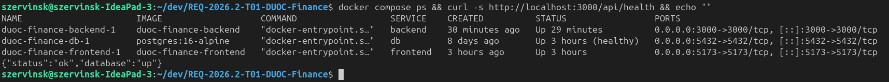
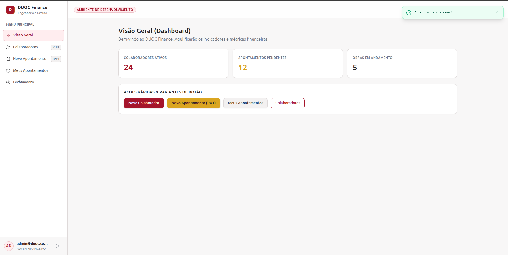
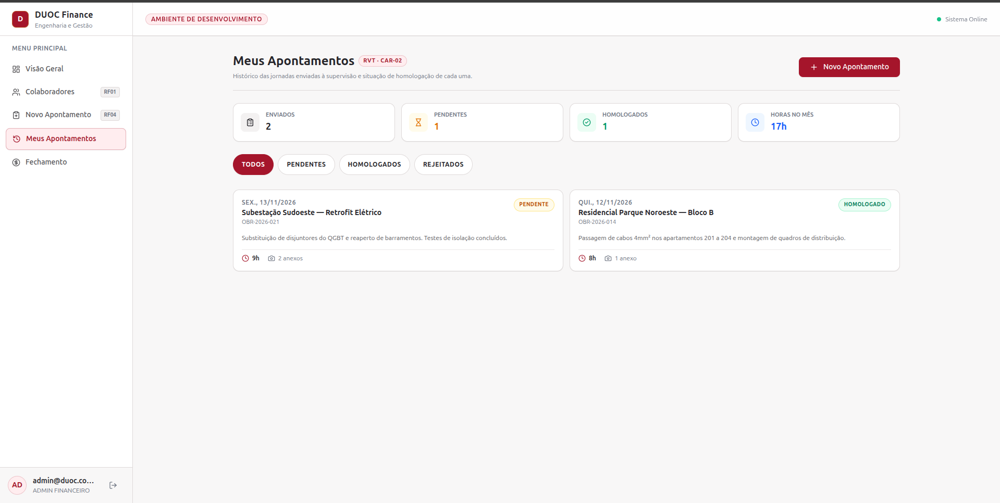
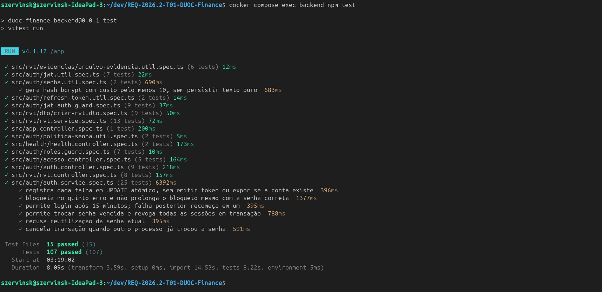
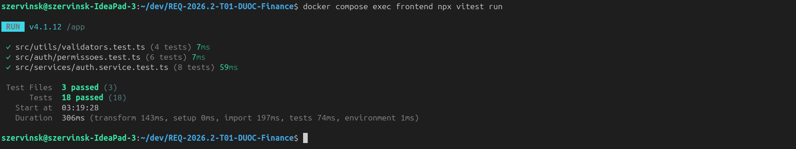
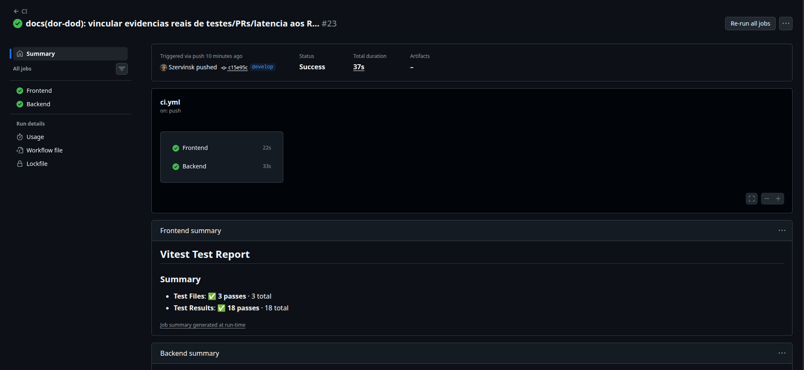

# Entrega 3 — Ponto de Controle 3 (Unidade 3)

!!! info "Ponto de Controle 3 — Consolidação dos Incrementos 1 e 2 e Organização do Backlog"
    * **Disciplina:** Requisitos de Software — Semestre 2026.2 (UnB - FGA)
    * **Equipe:** Cascata Ágil
    * **Projeto:** DUOC Finance (Gestão Financeira, Operacional e RH de Obras)
    * **Cliente Parceira:** Maria Beatryz Vieira de Sousa (Auxiliar Administrativa e Ponto Focal do Cliente na DUOC Arquitetura e Engenharia)
    * **Data de Fechamento do Marco:** 17 de Novembro de 2026 (publicação no GitHub Pages até as 08h; apresentações em 17 e 19/11/2026)
    * **Status da Entrega:** **Em Fechamento para Submissão (PC3)**
    * **Fase do Ciclo RAD:** *Fase 3: Construção Rápida (Rapid Construction) — Incrementos 1 e 2*
    * **Gravação da Apresentação:** *Espaço reservado — gravação técnica realizada em 16/11/2026; link do vídeo será inserido após publicação.*

---

## 1. O Que Foi Solicitado (Requisitos da Entrega 3)

Para o terceiro marco avaliativo (**Ponto de Controle 3 / Unidade 3**), além da evolução incremental do software em ambiente integrado, a entrega consolida as adequações solicitadas nas revisões docentes da Unidade 2 e as práticas de **Organização e Atualização do Backlog** (Capítulo 12):

* **Organização e Atualização Contínua do Escopo (Cap. 12 & DEEP):**
    * Centralização em **Fonte Única Canônica** (Catálogo Integrado sem listas paralelas ou divergentes).
    * Explicitação de refinamento progressivo (*Iceberg Backlog*), critérios DEEP, dependências e rotina de propagação de mudanças.
    * Boas práticas operacionais no GitHub (fluxo de branches `main`/`develop`, templates de Issue/PR, commits semânticos e CI/CD).
* **Rastreabilidade de Execução e Evidências Reais:**
    * Vinculação dos Requisitos Funcionais aos incrementos RAD, Issues e Pull Requests no GitHub, com status atualizado (`Concluído`, `Em Dev`, `Pronto DoR`, `Aguardando Ciclo`, `Pós-MVP`).
    * Evidências visuais das telas e fluxos funcionais executados em ambiente Docker/Staging.
* **Evolução do Produto (Incrementos 1 e 2):**
    * **Incremento 1 (Concluído):** Gestão de Colaboradores (`RF01`–`RF03`), Autenticação e Controle de Acesso RBAC (`RF13`, `RF17`, `RF18`) e Módulo Móvel de RVT em Campo (`RF04`, `RF19`, `RF22`).
    * **Incremento 2 (Em Desenvolvimento):** Deliberação e retificação de apontamentos (`RF32`, `RF35`) e submissão/deliberação de reembolsos e adiantamentos (`RF07`, `RF08`, `RF28`, `RF29`).
* **Apresentação e Vídeo Técnico:** Gravação audiovisual com demonstração do sistema em execução e participação distribuída dos 6 integrantes da equipe.

---

## 2. O Que Foi Desenvolvido e Entregue (Artefatos e Código)

A tabela abaixo consolida os principais artefatos de documentação, governança e engenharia entregues até o Ponto de Controle 3:

| Eixo | Artefato / Módulo | Síntese do Conteúdo Entregue | Link Direto |
| :--- | :--- | :--- | :---: |
| **Organização (Cap. 12)** | Organização & Atualização do Backlog | Fonte Única Canônica, anatomia dos cards, refinamento progressivo (DEEP / Iceberg), tratamento de dependências, propagação de mudanças e checklist de conformidade. | [Acessar Organização](../metodologia/planejamento.md#organizacao-e-atualizacao-dos-requisitos) |
| **Processo GitHub** | Boas Práticas no GitHub | Fluxo oficial de branches (`main`, `develop`, `feat/*`, `gh-pages`), templates em `.github/`, Conventional Commits, revisão de PRs e pipelines CI/CD. | [Acessar Boas Práticas](../metodologia/organizacao-e-boas-praticas.md) |
| **Requisitos** | Catálogo Integrado de Requisitos | 91 itens (`40 RFs`, `31 RNs`, `20 RNFs`) em cards compactos com status real por incremento, links para Issues/PRs, filtro *Execução (Ciclo)* e evidências visuais. | [Acessar Catálogo](../requisitos/index.md) |
| **Rastreabilidade** | Matrizes e Pirâmide Interativa | Rastreabilidade bidirecional (`OG ➔ OE ➔ CAR ➔ RF ➔ RN/RNF`) e matriz-síntese de cobertura do produto. | [Acessar Rastreabilidade](../requisitos/rastreabilidade.md) |
| **Priorização & MVP** | Priorização & Escopo do Produto | Abas metodológicas de Valor (`VB`) e Esforço (`EC`), fórmula corrigida, seletor dinâmico (*Características* vs *Matriz 4×4*), retificação assistida (`RF06 × RF21 × RF35`) e registro de validação. | [Acessar Priorização](../requisitos/priorizacao.md) |
| **Planejamento** | Cronograma e Detalhamento de Ciclos | Calendário semestral interativo desacoplado do calendário acadêmico, marco da gravação em `16/11/2026` e atualização do Ciclo 1 (*Concluído*) e Semana 11 (*Em Andamento*). | [Acessar Cronograma](../metodologia/cronograma.md) |
| **Código (Incr. 1)** | Gestão de Colaboradores, Auth/RBAC e RVT | Backend NestJS + Prisma/PostgreSQL (rotas `/api/auth`, `/api/rvt`, `/api/health`) e Frontend React/Vite com Docker Compose ([PR #167](https://github.com/mdsreq-fga-unb/REQ-2026.2-T01-DUOC-Finance/pull/167), [PR #170](https://github.com/mdsreq-fga-unb/REQ-2026.2-T01-DUOC-Finance/pull/170) e [PR #172](https://github.com/mdsreq-fga-unb/REQ-2026.2-T01-DUOC-Finance/pull/172)). | [Repositório](https://github.com/mdsreq-fga-unb/REQ-2026.2-T01-DUOC-Finance) · [Reconciliação das evidências](../requisitos/rastreabilidade.md#reconciliacao-entre-catalogo-e-evidencias-de-implementacao) |
| **Governança** | Atas e Lições Aprendidas | Registro das decisões da equipe e gravação da apresentação da Entrega 3 na **Reunião 07 (16/11/2026)**. | [Acessar Atas](../governanca/atas/index.md) |

---

## 3. Vídeo da Apresentação da Entrega 3

A gravação oficial do Ponto de Controle 3 (realizada em **16/11/2026**) apresenta a reorganização documental do portal, o catálogo integrado de requisitos com rastreabilidade ao GitHub, a metodologia de priorização do MVP, o planejamento dos ciclos RAD e a demonstração prática do sistema em execução local via Docker.

### Gravação Oficial da Apresentação

  <iframe 
    style="position: absolute; top: 0; left: 0; width: 100%; height: 100%; border: 0;" 
    src="https://www.youtube-nocookie.com/embed/U_35Or_Tm7M?si=qBFOgzxUXoIFzxFE" 
    title="Vídeo de Apresentação — Entrega 3 (Unidade 3) — Equipe Cascata Ágil" 
    allow="accelerometer; autoplay; clipboard-write; encrypted-media; gyroscope; picture-in-picture" 
    allowfullscreen>
  </iframe>

> Caso o player incorporado acima apresente restrições de rede ou dispositivo, utilize o acesso direto:
> **[Assistir à Apresentação da Entrega 2 no YouTube (Link Direto: youtu.be/JF_cYRJM7vk)](https://youtu.be/U_35Or_Tm7M?si=qBFOgzxUXoIFzxFE)**

### Distribuição dos Temas por Integrante

| Integrante | Matrícula | Papel no Projeto | Tópico Apresentado no Vídeo (PC3) |
| :--- | :---: | :--- | :--- |
| **Matheus Ribeiro Szervinsk** | 231011749 | Scrum Master (SM), Co-PO e Engenheiro de Requisitos | Visão Geral do Produto, Navegação, Ciclos RAD e Matriz de Rastreabilidade. |
| **Gustavo Bonifácio** | 241025659 | Gestão de Qualidade (QA) e DoR/DoD | Organização do Backlog (Cap. 12) e Boas Práticas no GitHub. |
| **Matheus Saraiva Camargo** | 241011475 | Arquiteto de Software e Banco de Dados | Catálogo Interativo de Requisitos, Filtros, Evidências e Pirâmide/Rastreabilidade. |
| **Giovana Ferreira** | 231034707 | Engenheira Frontend e Designer UI/UX | Escopo do Produto, Avaliação de Valor (`VB`) e Esforço (`EC`), Matriz 4×4 e Validação. |
| **Eric Araújo** | 200064053 | Product Owner (PO) e Engenheiro de Requisitos | Cronograma, Desacoplamento Metodológico e Método de Atualização de Requisitos no RAD. |
| **Paulo Nery** | 221008740 | Engenheiro Backend | Demonstração do Incremento 1 entregue (Colaboradores, Auth/RBAC, RVT) e escopo do Incremento 2. |

### Evidências de Execução e Qualidade (Staging/Docker, Testes e CI/CD)

  

    
    Containers Docker ativos (db, backend e frontend)
  

  

    
    Visão Geral (Dashboard) após login autenticado
  

  

    
    Módulo de Apontamentos de Campo (RVT) em execução
  

  

    
    107/107 testes backend aprovados
  

  

    
    18/18 testes frontend aprovados
  

  

    
    Workflows CI/CD e Deploy aprovados no GitHub Actions
  

---

## 4. Considerações e Próximos Passos

1. **Consolidação do Incremento 2:** Finalizar a implementação e os testes das rotas de deliberação/retificação (`RF32`, `RF35`) e fluxo de reembolsos e adiantamentos (`RF07`, `RF08`, `RF28`, `RF29`).
2. **Validação Formal com a Cliente:** Conduzir a sessão de homologação do corte final do MVP (`31 RFs` / `9 Pós-MVP`) e dos fluxos navegáveis em Staging com Maria Beatryz.
3. **Preparação para UAT e Entrega 4 (PC4):** Iniciar os 12 requisitos prontos (DoR) de fechamento financeiro (`RF05`, `RF06`, `RF27`) e contratos/centros de custo (`RF09`–`RF11`, `RF33`, `RF34`, `RF37`–`RF40`).

---

## Histórico de Versão

| Versão | Data | Descrição | Autor(es) | Revisor(es) |
| :---: | :---: | :--- | :--- | :--- |
| `0.1` | 07/09/2026 | Criação da página com alerta de documento em desenvolvimento | Matheus Ribeiro | Eric Araújo |
| `1.0` | 16/11/2026 | Estruturação completa da Entrega 3 (PC3) com matriz de artefatos, espaço reservado para o vídeo oficial e distribuição dos temas por integrante. | Matheus Ribeiro Szervinsk | Equipe Cascata Ágil |
| `1.1` | 27/11/2026 | Atendimento à Issue #193: inclusão do PR #172 e do vínculo para a reconciliação das evidências históricas de segurança e RBAC. | Gustavo Bonifácio | — |
