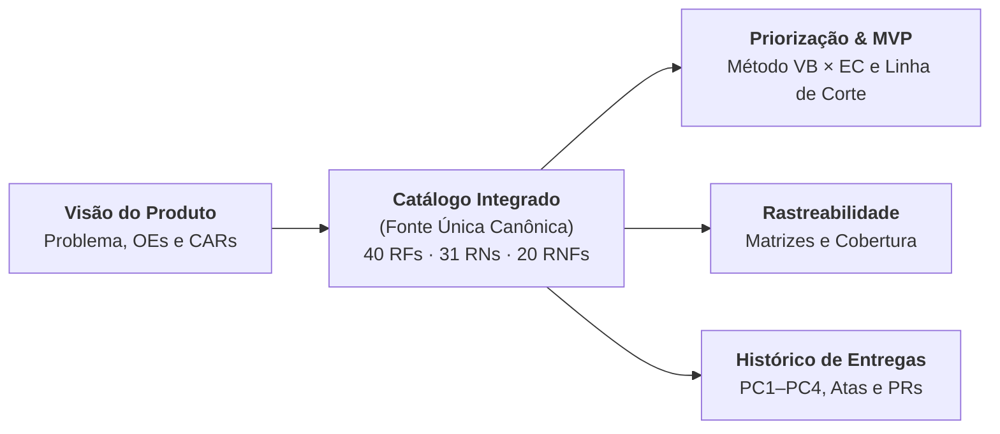

# Organização e Atualização dos Requisitos (Backlog de Software)

Este documento descreve a **estratégia de organização e atualização contínua dos requisitos e do backlog** do sistema ***DUOC Finance***, consolidando as práticas adotadas pela equipe **Cascata Ágil** a partir da Unidade 2 em conformidade com o modelo de **Catálogo Integrado (Fonte Única Canônica)** e os princípios de **Refinamento Progressivo** e **Backlog DEEP**.

---

## 1. Evolução da Estrutura: Da Repetição Distribuída à Fonte Única Canônica

Na Unidade 1 e no início da Unidade 2, as declarações de requisitos apareciam replicadas em múltiplos artefatos (listas de catálogo, página separada de Backlog do Produto, tabelas de priorização e matrizes de rastreabilidade). Conforme identificado nas revisões docentes, a manutenção distribuída gerava divergências de contagens e exigia conferência manual em vários arquivos a cada alteração.

Para eliminar inconsistências, a equipe reestruturou o portal em torno de uma **Fonte Única Canônica**:

### Papel de Cada Página sem Listas Paralelas

| Página / Seção | Propósito Específico | Relação com o Catálogo |
| :--- | :--- | :--- |
| [**Solução Proposta**](../visao-produto/solucao-proposta.md) | Define o Problema Central, Objetivo Geral (OG), Objetivos Específicos (`OE1`–`OE4`) e Características (`CAR-01`–`CAR-10`). | Origem estratégica que agrupa e dá sentido aos requisitos. |
| [**Catálogo Integrado**](../requisitos/index.md) | **Fonte única vigente** dos 91 itens (`RF01`–`RF40`, `RN01`–`RN31`, `RNF01`–`RNF20`), com declarações, atributos, critérios e vínculos. | Concentra toda a manutenção do conteúdo e estado dos requisitos. |
| [**Priorização & MVP**](../requisitos/priorizacao.md) | Formaliza o método de julgamento (`VB` e `EC`), fórmulas (`IP`), regra de corte, visão consolidada da Matriz 4×4 e validação com a cliente. | Não repete listas detalhadas; aponta diretamente para os cards `#rf01`–`#rf40`. |
| [**Rastreabilidade**](../requisitos/rastreabilidade.md) | Apresenta métricas de cobertura vertical/horizontal e matrizes de relacionamento. | Referencia os identificadores canônicos do catálogo. |
| [**DoR e DoD**](../mvp/dor-dod.md) | Define os critérios oficiais de prontidão (*Ready*) e conclusão (*Done*) aplicados aos incrementos. | Referenciado diretamente pela aba de critérios dos cards e pela interação com a cliente. |
| [**Entregas e Atas**](../entregas/index.md) | Preserva a memória histórica dos marcos (`PC1`–`PC4`) e decisões de reunião. | Registra o estado acordado em cada marco sem sobrescrever a referência vigente. |

---

## 2. Anatomia do Registro Único nos Cards Interativos

Cada item do [Catálogo Integrado de Requisitos](../requisitos/index.md) é estruturado como um card expansível (`
`) que reúne, em um único lugar, todos os atributos necessários para desenvolvimento, teste e auditoria:

1. **Identidade Estável:** Código imutável (`RF01`, `RN01`, `RNF01`), âncora universal (`#rf01`) e título objetivo.
2. **Situação de Entrega e Rastreamento no GitHub:** Badges no cabeçalho indicando a prioridade na Matriz 4×4, o **status real de execução e incremento** (`Concluído · Incr. 1`, `Em Dev · Incr. 2`, `Pronto (DoR)`, `Aguardando · Incr. 3`, `Pós-MVP · Rel. 2`) e links diretos para a **Issue** e **Pull Request (PR)** no repositório.
3. **Origem e Responsável:** Grade compacta com vínculo ao `OE`, à `CAR` e ao papel canônico `RBAC`.
4. **Declaração Vigente:** História de Usuário (`US01`–`US40`) em correspondência 1:1 com cada `RF`, preservando intenção e valor de negócio.
5. **Condições e Critérios de Aceitação (Aba 1):** Critério funcional verificável acompanhado dos vínculos diretos de **DoR** (`RNs`) e **DoD** (`RNFs`).
6. **Evidências e Validação (Aba 2):** Referência às atas de validação com a cliente (ex.: Ata 06) e protótipos de alta fidelidade no Figma.
7. **Rastreabilidade em Árvore (Aba 3):** Caminho completo `OG ➔ OE ➔ CAR ➔ RF` e chips navegáveis para todas as `RNs` e `RNFs` condicionantes.
8. **Priorização & Score 4×4 (Aba 4):** Notas individuais (`VB`, `CX`, `ES`, `LC`, `EC`, `IP`), quadrante (`Q1`–`Q4`) e link direto para a visualização dinâmica na Matriz 4×4.

---

## 3. Granularidade, Refinamento Progressivo e Critérios DEEP

Seguindo as diretrizes da disciplina para organização de Backlog de Software, a equipe adota uma abordagem **Just-in-Time** baseada no modelo **Iceberg Backlog** e nas quatro propriedades **DEEP**:

- **Granularidade em Três Níveis:**
  1. **Base (Granularidade Macro):** Objetivos Específicos (`OE1`–`OE4`) e Características do Produto (`CAR-01`–`CAR-10`), que agrupam o escopo por temas de negócio.
  2. **Meio (Granularidade Média):** Requisitos Funcionais e itens de evolução pós-MVP (`Q2`–`Q4`), mantidos com descrição suficiente para estimativa e priorização sem detalhamento prematuro.
  3. **Topo (Granularidade Fina — Prontos para o Ciclo):** Histórias de usuário atômicas e testáveis selecionadas para o incremento corrente (como o desmembramento de contratos e centros de custo de `RF33`/`RF34` nos itens atômicos [`RF37`](../requisitos/index.md#rf37)–[`RF40`](../requisitos/index.md#rf40)).
- **Aplicação do Acrônimo DEEP:**
  - ***Detailed appropriately* (Detalhado na medida certa):** Itens de maior prioridade (`Incr. 1` e `Incr. 2`) possuem protótipo Figma, critérios DoR/DoD e regras `RN`/`RNF` fechadas; itens do `Pós-MVP` mantêm escopo enxuto até sua priorização futura.
  - ***Estimated* (Estimado):** Todos os 40 RFs possuem estimativa composta (`ES`, `CX`, `LC` e `EC`) calibrada pela equipe técnica.
  - ***Emergent* (Emergente):** Novos requisitos descobertos durante o refinamento sociotécnico (como [`RF32`](../requisitos/index.md#rf32)–[`RF35`](../requisitos/index.md#rf35) para deliberação e retificação de RVT) foram incorporados ao catálogo e avaliados pela mesma régua metodológica.
  - ***Prioritized* (Priorizado):** Ordenação objetiva pelo Índice de Prioridade (`IP = VB / EC`) e linha de corte na Matriz 4×4.

### Tratamento de Dependências

Quando dependências técnicas entre histórias comprometiam a entrega incremental no MVP, a equipe aplicou técnicas de divisão e contorno operacional:
- **Decomposição Atômica:** Separação das regras de vinculação financeira e teto orçamentário em requisitos independentes (`RF37`–`RF40`) para evitar bloqueios em lote.
- **Contorno Operacional Assistido:** Diante da dependência entre o fechamento irrevogável ([`RF06`](../requisitos/index.md#rf06)) e o estorno em lote postergado ([`RF21`](../requisitos/index.md#rf21)), foi formalizado o [Procedimento Operacional de Retificação e Estorno Assistido](../requisitos/priorizacao.md#procedimento-operacional-de-retificacao-e-estorno-assistido-no-mvp) via [`RF35`](../requisitos/index.md#rf35).

---

## 4. Rotina de Atualização, Propagação de Mudanças e Memória Suficiente

Sempre que uma decisão com a cliente, teste ou revisão docente altera o entendimento do escopo, a equipe executa um ciclo estruturado de atualização em quatro etapas:

### Exemplos Reais de Propagação no Projeto

1. **Ajuste de Contagens e Desduplicação (Issues `#125`, `#130`, `#131` e PRs `#144`, `#148`, `#158`):** A inclusão dos requisitos decompostos `RF37`–`RF40` exigiu atualizar o Catálogo (`40 RFs / 40 USs`), recalibrar os totalizadores do MVP (`31 MVP / 9 Pós-MVP`) e remover listas conflitantes na página de Entrega 2 e na página de Interação com a Cliente.
2. **Alinhamento de Status por Incremento:** A conclusão das telas de cadastro/autenticação (`PR #167`) e do módulo móvel RVT (`PR #170`) foi propagada diretamente para as tags de execução dos cards no catálogo.

---

## 5. Verificação da Organização e Atualização (Critérios de Qualidade)

A tabela abaixo sintetiza a autoavaliação da equipe frente aos sete cuidados de organização e memória do backlog:

| Cuidado Metodológico | O que foi Verificado | Evidência no Portal |
| :--- | :--- | :--- |
| **1. Visibilidade do escopo** | Distinção clara entre itens concluídos, em desenvolvimento, prontos (DoR), aguardando ciclo e pós-MVP. | Badges de status e filtro *Execução (Ciclo)* no [Catálogo](../requisitos/index.md) e [Priorização](../requisitos/priorizacao.md). |
| **2. Relações úteis** | Localização direta de origem (`OG`/`OE`/`CAR`), regras (`RN`), qualidade (`RNF`) e dependências. | Aba *Rastreabilidade & Tags* em cada card e [Matrizes de Rastreabilidade](../requisitos/rastreabilidade.md). |
| **3. Prioridades visíveis** | Recuperação imediata de `VB`, `EC`, `IP`, quadrante e situação de validação pela cliente. | Aba *Priorização & Score 4×4* e tabela de deliberações em [Priorização](../requisitos/priorizacao.md#evidencia-e-registro-da-validacao-do-mvp-com-o-cliente). |
| **4. Refinamentos preservando identidade** | Desdobramentos (`RF37`–`RF40`) mantêm IDs próprios e vínculo explícito às origens (`RF33`, `RF34`). | Cards `#rf37`–`#rf40` no [Catálogo](../requisitos/index.md#rf37) e detalhamento na [Priorização](../requisitos/priorizacao.md). |
| **5. Incorporação de mudanças** | Decisões de revisão docente e feedbacks incorporados nos registros e nos vínculos afetados. | Histórico de versão consolidado e [Feedback & Pareceres](../requisitos/feedback.md). |
| **6. Limpeza do escopo** | Remoção de listas paralelas, páginas duplicadas de backlog e tabelas redundantes que competiam com o catálogo. | Estrutura unificada em [Requisitos](../requisitos/index.md) e [Entrega 2](../entregas/entrega-2.md). |
| **7. Memória suficiente** | Rastreamento de decisões, atas, issues e PRs sem congelar a evolução do escopo vigente. | [Atas de Reunião](../governanca/atas/index.md), links de Issue/PR nos cards e [Boas Práticas no GitHub](organizacao-e-boas-praticas.md). |

---

## Histórico de Versão

| Versão | Data | Descrição | Autor(es) | Revisor(es) |
| :---: | :---: | :--- | :--- | :--- |
| `1.0` | 16/11/2026 | Criação do documento detalhando a organização por Fonte Única Canônica, anatomia dos cards, refinamento progressivo (DEEP/Iceberg), propagação de mudanças e checklist de conformidade. | Matheus Ribeiro Szervinsk | Equipe Cascata Ágil |
