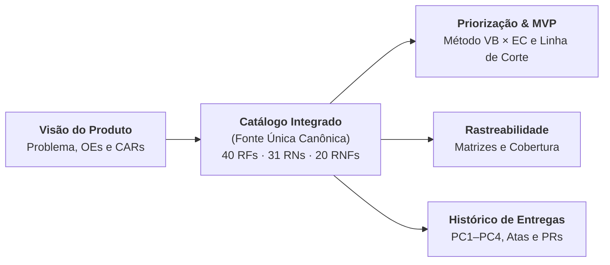
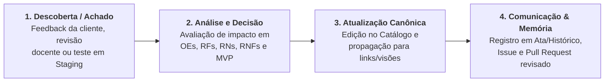

# Planejamento

Este capítulo centraliza a **organização, a atualização e o planejamento** do **DUOC Finance**: como o catálogo de requisitos é estruturado e mantido, como mudanças são propagadas, o racional metodológico do cronograma e as folgas de contingência. A execução semana a semana e o calendário estão no capítulo [Cronograma](cronograma.md), e o detalhamento de ciclos em [Detalhamento de Ciclos & Semanas](detalhamento-ciclos.md).

---

## Organização e Atualização dos Requisitos

Este documento descreve a **estratégia de organização e atualização contínua dos requisitos e do backlog** do sistema ***DUOC Finance***, consolidando as práticas adotadas pela equipe **Cascata Ágil** a partir da Unidade 2 em conformidade com o modelo de **Catálogo Integrado (Fonte Única Canônica)** e os princípios de **Refinamento Progressivo** e **Backlog DEEP**.

---

### 1. Evolução da Estrutura: Da Repetição Distribuída à Fonte Única Canônica

Na Unidade 1 e no início da Unidade 2, as declarações de requisitos apareciam replicadas em múltiplos artefatos (listas de catálogo, página separada de Backlog do Produto, tabelas de priorização e matrizes de rastreabilidade). Conforme identificado nas revisões docentes, a manutenção distribuída gerava divergências de contagens e exigia conferência manual em vários arquivos a cada alteração.

Para eliminar inconsistências, a equipe reestruturou o portal em torno de uma **Fonte Única Canônica**:

#### Papel de Cada Página sem Listas Paralelas

| Página / Seção | Propósito Específico | Relação com o Catálogo |
| :--- | :--- | :--- |
| [**Solução Proposta**](../visao-produto/solucao-proposta.md) | Define o Problema Central, Objetivo Geral (OG), Objetivos Específicos (`OE1`–`OE4`) e Características (`CAR-01`–`CAR-10`). | Origem estratégica que agrupa e dá sentido aos requisitos. |
| [**Catálogo Integrado**](../requisitos/index.md) | **Fonte única vigente** dos 91 itens (`RF01`–`RF40`, `RN01`–`RN31`, `RNF01`–`RNF20`), com declarações, atributos, critérios e vínculos. | Concentra toda a manutenção do conteúdo e estado dos requisitos. |
| [**Priorização & MVP**](../requisitos/priorizacao.md) | Formaliza o método de julgamento (`VB` e `EC`), fórmulas (`IP`), regra de corte, visão consolidada da Matriz 4×4 e validação com a cliente. | Não repete listas detalhadas; aponta diretamente para os cards `#rf01`–`#rf40`. |
| [**Rastreabilidade**](../requisitos/rastreabilidade.md) | Apresenta métricas de cobertura vertical/horizontal e matrizes de relacionamento. | Referencia os identificadores canônicos do catálogo. |
| [**DoR e DoD**](../mvp/dor-dod.md) | Define os critérios oficiais de prontidão (*Ready*) e conclusão (*Done*) aplicados aos incrementos. | Referenciado diretamente pela aba de critérios dos cards e pela interação com a cliente. |
| [**Entregas e Atas**](../entregas/index.md) | Preserva a memória histórica dos marcos (`PC1`–`PC4`) e decisões de reunião. | Registra o estado acordado em cada marco sem sobrescrever a referência vigente. |

---

### 2. Anatomia do Registro Único nos Cards Interativos

Cada item do [Catálogo Integrado de Requisitos](../requisitos/index.md) é estruturado como um card expansível (`
`) que reúne, em um único lugar, todos os atributos necessários para desenvolvimento, teste e auditoria:

1. **Identidade Estável:** Código imutável (`RF01`, `RN01`, `RNF01`), âncora universal (`#rf01`) e título objetivo.
2. **Situação de Entrega e Rastreamento no GitHub:** Badges no cabeçalho indicando a prioridade na Matriz 4×4, o **status real de execução e incremento** (`Concluído · Incr. 1`, `Em Dev · Incr. 2`, `Pronto (DoR)`, `Aguardando · Incr. 3`, `Pós-MVP · Rel. 2`) e links diretos para a **Issue** e **Pull Request (PR)** no repositório.
3. **Origem e Responsável:** Grade compacta com vínculo ao `OE`, à `CAR` e ao papel canônico `RBAC`.
4. **Declaração Vigente:** História de Usuário (`US01`–`US40`) em correspondência 1:1 com cada `RF`, preservando intenção e valor de negócio.
5. **Condições e Critérios de Aceitação (Aba 1):** Critério funcional verificável acompanhado dos vínculos diretos de **DoR** (`RNs`) e **DoD** (`RNFs`).
6. **Evidências e Validação (Aba 2):** Referência às atas de validação com a cliente (ex.: Ata 06) e protótipos de alta fidelidade no Figma.
7. **Rastreabilidade em Árvore (Aba 3):** Caminho completo `OG ➔ OE ➔ CAR ➔ RF` e chips navegáveis para todas as `RNs` e `RNFs` condicionantes.
8. **Priorização & Score 4×4 (Aba 4):** Notas individuais (`VB`, `CX`, `ES`, `LC`, `EC`, `IP`), quadrante (`Q1`–`Q4`) e link direto para a visualização dinâmica na Matriz 4×4.

---

### 3. Granularidade, Refinamento Progressivo e Critérios DEEP

Seguindo as diretrizes da disciplina para organização de Backlog de Software, a equipe adota uma abordagem **Just-in-Time** baseada no modelo **Iceberg Backlog** e nas quatro propriedades **DEEP**:

- **Granularidade em Três Níveis:**
  1. **Base (Granularidade Macro):** Objetivos Específicos (`OE1`–`OE4`) e Características do Produto (`CAR-01`–`CAR-10`), que agrupam o escopo por temas de negócio.
  2. **Meio (Granularidade Média):** Requisitos Funcionais e itens de evolução pós-MVP (`Q2`–`Q4`), mantidos com descrição suficiente para estimativa e priorização sem detalhamento prematuro.
  3. **Topo (Granularidade Fina — Prontos para o Ciclo):** Histórias de usuário atômicas e testáveis selecionadas para o incremento corrente (como o desmembramento de contratos e centros de custo de `RF33`/`RF34` nos itens atômicos [`RF37`](../requisitos/index.md#rf37)–[`RF40`](../requisitos/index.md#rf40)).
- **Aplicação do Acrônimo DEEP:**
  - ***Detailed appropriately* (Detalhado na medida certa):** Itens de maior prioridade (`Incr. 1` e `Incr. 2`) possuem protótipo Figma, critérios DoR/DoD e regras `RN`/`RNF` fechadas; itens do `Pós-MVP` mantêm escopo enxuto até sua priorização futura.
  - ***Estimated* (Estimado):** Todos os 40 RFs possuem estimativa composta (`ES`, `CX`, `LC` e `EC`) calibrada pela equipe técnica.
  - ***Emergent* (Emergente):** Novos requisitos descobertos durante o refinamento sociotécnico (como [`RF32`](../requisitos/index.md#rf32)–[`RF35`](../requisitos/index.md#rf35) para deliberação e retificação de RVT) foram incorporados ao catálogo e avaliados pela mesma régua metodológica.
  - ***Prioritized* (Priorizado):** Ordenação objetiva pelo Índice de Prioridade (`IP = VB / EC`) e linha de corte na Matriz 4×4.

#### Tratamento de Dependências

Quando dependências técnicas entre histórias comprometiam a entrega incremental no MVP, a equipe aplicou técnicas de divisão e contorno operacional:
- **Decomposição Atômica:** Separação das regras de vinculação financeira e teto orçamentário em requisitos independentes (`RF37`–`RF40`) para evitar bloqueios em lote.
- **Contorno Operacional Assistido:** Diante da dependência entre o fechamento irrevogável ([`RF06`](../requisitos/index.md#rf06)) e o estorno em lote postergado ([`RF21`](../requisitos/index.md#rf21)), foi formalizado o [Procedimento Operacional de Retificação e Estorno Assistido](../requisitos/priorizacao.md#procedimento-operacional-de-retificacao-e-estorno-assistido-no-mvp) via [`RF35`](../requisitos/index.md#rf35).

---

### 4. Rotina de Atualização, Propagação de Mudanças e Memória Suficiente

Esta etapa consolida a **estratégia de atualização do projeto**, tanto dos **requisitos** quanto do **cronograma**. Ela se apoia no livro-texto da disciplina (MARSICANO, 2026, cap. 12 — *Organização e Atualização*; seção 11.5 — *Walkthroughs e Checklists*), segundo o qual atualizar requisitos é *manter vivo o entendimento*: incorporar ao escopo organizado os efeitos de novas descobertas, decisões e evidências, de modo que o que está registrado não continue representando um entendimento que deixou de vigorar. Três princípios orientam a rotina:

1. **A mudança raramente fica confinada ao registro onde foi percebida.** Alterar o texto de uma regra sem revisar critérios de aceitação, mensagens de interface, protótipos, prioridade e rastreabilidade deixa o conjunto contraditório; por isso toda atualização passa por análise de impacto e propagação.
2. **A intensidade é proporcional ao risco.** Uma correção local exige atualizar o registro e o que o acompanha; uma mudança que afete várias regras, entregas ou marcos exige tornar explícitos os efeitos, registrar a razão e comunicar.
3. **Preservar memória não é preservar obsoletos como vigentes.** Itens substituídos saem das visões correntes e permanecem acessíveis no histórico (atas, issues, PRs e histórico de versão).

#### 4.1 Ciclo de Atualização e Propagação de Mudanças

Sempre que uma decisão com a cliente, teste ou revisão docente altera o entendimento do escopo, a equipe executa um ciclo estruturado de atualização em quatro etapas:

##### Exemplos Reais de Propagação no Projeto

1. **Ajuste de Contagens e Desduplicação (Issues `#125`, `#130`, `#131` e PRs `#144`, `#148`, `#158`):** A inclusão dos requisitos decompostos `RF37`–`RF40` exigiu atualizar o Catálogo (`40 RFs / 40 USs`), recalibrar os totalizadores do MVP (`31 MVP / 9 Pós-MVP`) e remover listas conflitantes na página de Entrega 2 e na página de Interação com a Cliente.
2. **Alinhamento de Status por Incremento:** A conclusão das telas de cadastro/autenticação (`PR #167`) e do módulo móvel RVT (`PR #170`) foi propagada diretamente para as tags de execução dos cards no catálogo.

Os **sete movimentos recorrentes de cuidado com o escopo** do livro-texto (Quadro 71) não são etapas sequenciais, mas perspectivas sobre o mesmo cuidado contínuo. A tabela a seguir os relaciona às práticas do projeto:

| Movimento (livro-texto) | Prática no DUOC Finance | Onde se verifica |
| :--- | :--- | :--- |
| **Dar visibilidade ao escopo** | Badges de status e incremento nos cards (concluído, em desenvolvimento, pronto, aguardando, pós-MVP). | [Catálogo Integrado](../requisitos/index.md) |
| **Organizar por relações úteis** | Rastreabilidade `OG ➔ OE ➔ CAR ➔ RF` com chips de `RN` e `RNF`. | [Rastreabilidade](../requisitos/rastreabilidade.md) |
| **Manter decisões de prioridade visíveis** | `VB`, `EC`, `IP` e quadrante da Matriz 4×4 em cada card. | [Priorização e MVP](../requisitos/priorizacao.md) |
| **Refletir refinamentos na estrutura** | Desdobramentos mantêm identidade própria (`RF37`–`RF40` a partir de `RF33`/`RF34`). | Cards `#rf37` a `#rf40` |
| **Incorporar aprendizagem e mudanças** | Decisões de ata, validação e revisão docente propagadas a requisito, critério, protótipo e cronograma. | Atas e histórico de versão |
| **Limpar o escopo** | Remoção de listas paralelas e páginas duplicadas; itens retirados saem das visões vigentes. | Estrutura única em [Requisitos](../requisitos/index.md) |
| **Preservar memória suficiente** | Atas, issues, PRs e histórico de versão vinculados aos registros. | [Atas](../governanca/atas/index.md) e GitHub |

##### Exemplos de propagação no cronograma

1. **Replanejamento de 10/11/2026:** o atraso do Incremento 1 (Semanas 08 a 10) foi propagado para os Incrementos 2 e 3, para as folgas (seção 6), para o calendário e para a Visão Consolidada do [Cronograma](cronograma.md).
2. **Remarcação da validação do Incremento 2 (13/11 para 16/11):** a nova data foi refletida no calendário, no registro mensal e na Semana 11, e a evidência permanece `pendente` até o registro da ata.

#### 4.2 Método de Atualização dos Requisitos no RAD

O [catálogo de requisitos](../requisitos/index.md) não é um artefato congelado: seguindo o modelo **RAD**, ele evolui junto com os incrementos, em três pontos de revisão por ciclo, cada um ancorado em uma fase do RAD:

1. **Início do incremento: fase de Planejamento (*Plan*).** A equipe revisita o catálogo URPS+ e o backlog, confirma quais requisitos entram no incremento (por meio da priorização pela Matriz 4×4) e registra as inclusões, alterações e exclusões. O resultado é o *baseline* de requisitos do incremento, que alimenta o DoR.
2. **Após cada ciclo de validação: fase de *User Design*.** A cada sessão de validação sociotécnica com a cliente (ou validação assíncrona, quando acionada a folga de indisponibilidade), os requisitos afetados são revisados e validados. Novos requisitos, ajustes de regra e rejeições registrados em ata retornam ao catálogo e ao backlog antes de seguir para a construção.
3. **Após a construção e o Cutover: revisão final.** Depois da construção e dos testes de aceitação (UAT), o catálogo é reconciliado com o que foi efetivamente construído, aceito e adiado para o backlog evolutivo, e a matriz de rastreabilidade é atualizada. É a última revisão do ciclo de vida do projeto.

Toda alteração é registrada no GitHub Projects e na ata correspondente, e o capítulo de requisitos informa a versão e os totais vigentes.

##### Diagrama: Pontos de Atualização dos Requisitos nos Incrementos do RAD

```mermaid
flowchart LR
    subgraph I1["Incremento 1"]
        direction LR
        P1["Plan<br/>Atualiza requisitos"] --> U1["User Design<br/>Prototipa e valida"]
        U1 --> R1{{"Revisão e validação<br/>dos requisitos"}}
        R1 --> C1["Construction<br/>Lógica e persistência"]
    end
    subgraph I2["Incremento 2"]
        direction LR
        P2["Plan<br/>Atualiza requisitos"] --> U2["User Design<br/>Prototipa e valida"]
        U2 --> R2{{"Revisão e validação<br/>dos requisitos"}}
        R2 --> C2["Construction<br/>Lógica e persistência"]
    end
    subgraph I3["Incremento 3"]
        direction LR
        P3["Plan<br/>Atualiza requisitos"] --> U3["User Design<br/>Prototipa e valida"]
        U3 --> R3{{"Revisão e validação<br/>dos requisitos"}}
        R3 --> C3["Construction<br/>Lógica e persistência"]
    end
    subgraph CUT["Cutover"]
        direction LR
        UAT["UAT e Aceite"] --> RF["Revisão final<br/>dos requisitos"]
    end
    C1 --> P2
    C2 --> P3
    C3 --> UAT
    style P1 fill:#1565c0,color:#fff
    style P2 fill:#1565c0,color:#fff
    style P3 fill:#1565c0,color:#fff
    style R1 fill:#ef6c00,color:#fff
    style R2 fill:#ef6c00,color:#fff
    style R3 fill:#ef6c00,color:#fff
    style RF fill:#2e7d32,color:#fff
```

Legenda: azul, atualização no início do incremento (*Plan*); laranja, revisão e validação após cada ciclo de *User Design*; verde, revisão final após a construção e o Cutover.

| Ponto de atualização | Fase do RAD | Quando ocorre | Registro |
| :--- | :--- | :--- | :--- |
| Atualização inicial | *Plan* | Início de cada incremento (Incr. 1: 20/10; Incr. 2: 12/11) | Baseline de requisitos do incremento; backlog no GitHub Projects |
| Revisão e validação | *User Design* | Após cada ciclo de validação com a cliente (Incr. 1: 02/10 e Semana 10; Incr. 2: 16/11, remarcada de 13/11) | Ata da sessão; catálogo atualizado |
| Revisão final | *Construction* / *Cutover* | Após o UAT e o aceite (28 a 30/11) | Catálogo reconciliado; matriz de rastreabilidade completa |

#### 4.3 Governança e Atualização do Cronograma

O cronograma do DUOC Finance é um **artefato vivo** sujeito a refinamento contínuo. Sua governança respeita as seguintes diretrizes:

1. **Sincronização com o GitHub Projects:** O progresso diário de tarefas é monitorado no quadro kanban do GitHub Projects ([Acessar Projeto #119](https://github.com/orgs/mdsreq-fga-unb/projects/119/)), servindo de fonte de verdade para a atualização deste capítulo.
2. **Revisões de Marco Avaliativo:** Ao final de cada Ponto de Controle, o cronograma é revisado para registrar desvios e propostas de recalibração. **A revisão do planejamento não autoriza alterar retroativamente o material do GitHub Pages após o prazo oficial de avaliação**, sob risco de atraso conforme a seção 9.1 do Plano de Ensino; correções posteriores devem ser identificadas como revisões subsequentes.
3. **Gestão de Riscos Operacionais e Acionamento de Folgas:** Caso ocorram impedimentos técnicos em regras financeiras ou reagendamentos com a cliente, o Product Owner aciona os buffers de contingência pactuados neste capítulo e no [Capítulo 7.3 — Processo de Validação](../metodologia/interacao-cliente.md#73-processo-de-validacao-sociotecnica-e-homologacao-com-a-cliente).
4. **Replanejamento pela Realidade Executada:** Marcos fixados no tempo e já ocorridos são marcados como concluídos; atividades atrasadas são reposicionadas nos incrementos seguintes, preservando os marcos externos (PC1 a PC4). O replanejamento de 10/11/2026 (versão 3.0) registra o atraso do Incremento 1 e condensa os Incrementos 2 e 3.

#### 4.4 Estratégia Consolidada de Atualização

A tabela unifica os gatilhos de atualização de requisitos e de cronograma, com o artefato afetado, o responsável e o registro exigido:

| Gatilho | Requisitos afetados | Cronograma afetado | Responsável | Registro |
| :--- | :--- | :--- | :--- | :--- |
| Início de incremento (*Plan*) | Baseline do incremento; priorização 4×4; DoR | Abertura do incremento; metas semanais | Product Owner e equipe | Backlog no GitHub Projects; ata de planejamento |
| Sessão de validação com a cliente (*User Design*) | Declarações, critérios de aceitação e protótipo | Data efetiva ou remarcação; estado da validação | Quem conduz a sessão | Ata da sessão |
| Atraso ou prorrogação de entregável | Estado nos cards (status e incremento) | Estado da semana, entregáveis pendentes com justificativa, replanejamento | Product Owner | Visão Consolidada; histórico de versão |
| Feedback docente ou achado de revisão | Itens revistos e vínculos afetados | Ajustes de marcos e redação do capítulo | Revisor designado | Histórico de versão; issue e PR |
| Conclusão da construção, UAT e Cutover | Reconciliação do catálogo com o aceito | Fechamento das semanas e marcos | Equipe | Ata de UAT; termo de aceite; matriz de rastreabilidade |

#### 4.5 Fontes e Critérios de Atualização

- **Calendário acadêmico:** Plano de Ensino assinado de Requisitos de Software (REQ), turma 01, semestre 2026.2, versão de 10/08/2026, especialmente seções 3, 9.1 e 11. Eventuais atualizações posteriores publicadas pelo professor prevalecem sobre o calendário aqui reproduzido.
- **Registro de acontecimentos efetivos:** [Atas de Reunião](../governanca/atas/index.md). Reuniões internas não são descritas como validações com a cliente. Compromissos previstos sem ata/evidência permanecem classificados como planejados ou pendentes de confirmação.
- **Escopo atual de requisitos:** [Capítulo 8 — Especificação](../requisitos/index.md) (**40 RFs e 20 RNFs**) e [Capítulo 8 — Priorização e MVP](../requisitos/priorizacao.md#linha-de-corte-do-mvp), que mantém a correspondência atual entre RFs e histórias de usuário. Quantitativos históricos de atas não são reescritos retroativamente.
- **Marco de referência desta revisão:** 09/11/2026; marcos fixados antes dessa data foram marcados como concluídos. Status futuros e entregas efetivamente concluídas devem ser conferidos no [GitHub Projects](https://github.com/orgs/mdsreq-fga-unb/projects/119/) antes da publicação.

##### Checklists de Atualização

Os checklists são curtos, observáveis e contextualizados. Servem como disparadores de análise e **não substituem o julgamento da equipe**.

**Checklist A — Atualização de requisitos** (aplicar a cada mudança incorporada)

- [ ] A mudança tem origem registrada (ata, issue, feedback docente ou teste em *Staging*)?
- [ ] O impacto foi analisado em `OE`, `CAR`, `RF`, `RN`, `RNF`, critérios de aceitação, mensagens de interface e protótipo?
- [ ] O card do catálogo foi atualizado (declaração, critérios, vínculos e badges de status e incremento)?
- [ ] A prioridade (`VB`, `EC`, `IP`, quadrante) reflete a decisão vigente?
- [ ] Vínculos e itens obsoletos saíram das visões vigentes, com histórico preservado?
- [ ] Os totalizadores (40 RFs, 31 RNs, 20 RNFs, MVP e pós-MVP) estão consistentes em todas as páginas?
- [ ] A rastreabilidade e as matrizes foram atualizadas?
- [ ] A alteração foi registrada em ata, histórico de versão, issue e PR?

**Checklist B — Qualidade do requisito atualizado** 

- [ ] Está claro e compreensível, sem ambiguidade relevante?
- [ ] Está completo o suficiente para o propósito do incremento?
- [ ] É necessário e orientado a valor para a cliente?
- [ ] É viável no prazo e na arquitetura do incremento?
- [ ] É verificável, com critério de aceitação que descreva resultado observável?
- [ ] É coerente com os requisitos e regras relacionados?
- [ ] Atende aos critérios `DEEP` (detalhado na medida certa, estimado, emergente e priorizado)?

**Checklist C — Atualização do cronograma** (aplicar a cada revisão semanal e de marco)

- [ ] O estado de cada semana confere com o GitHub Projects, os PRs e as atas?
- [ ] Marcos fixos já ocorridos estão como concluídos e os não cumpridos como pendentes, com `pendente: motivo`?
- [ ] Cada entregável gerado tem evidência com link (PR, issue, ata ou artefato)?
- [ ] As datas dos pontos de controle seguem o Plano de Ensino vigente?
- [ ] As folgas foram recalculadas após o replanejamento?
- [ ] O replanejamento foi registrado no histórico de versão e propagado ao calendário e à Visão Consolidada?

##### Walkthroughs de Atualização

| Walkthrough | Momento no RAD | Conduz | Participantes | Material percorrido | Saída e registro |
| :--- | :--- | :--- | :--- | :--- | :--- |
| **W1 — Baseline do incremento** | Início do incremento (*Plan*) | Autor dos requisitos do incremento | Equipe Cascata Ágil | Cards do catálogo, histórias INVEST e critérios de aceitação | Lista de dúvidas e ajustes; baseline aprovada para o DoR |
| **W2 — Validação das telas** | Após o *User Design* | Quem conduz a sessão (ex.: Ata 06) | Maria Beatryz e equipe | Protótipo no Figma e frontend navegável | Ata com deliberações; requisitos revisados e validados |
| **W3 — Leitura do cronograma** | Revisão semanal e de marco | Product Owner | Equipe | Visão Consolidada, semanas e calendário | Estados atualizados; pendências com justificativa |
| **W4 — Revisão final** | Após construção, UAT e Cutover | Autor do catálogo | Equipe e, quando possível, a cliente | Catálogo versus sistema aceito e matriz de rastreabilidade | Catálogo reconciliado; itens adiados ao backlog evolutivo |

Em cada sessão, o participante que não é o autor lê o requisito e explica com as próprias palavras o que entendeu; divergências são registradas como achados e tratadas pelo Checklist A ou B.

#### 4.6 Verificação da Organização e Atualização (Critérios de Qualidade)

A tabela abaixo sintetiza a autoavaliação da equipe frente aos sete cuidados de organização e memória do backlog:

| Cuidado Metodológico | O que foi Verificado | Evidência no Portal |
| :--- | :--- | :--- |
| **1. Visibilidade do escopo** | Distinção clara entre itens concluídos, em desenvolvimento, prontos (DoR), aguardando ciclo e pós-MVP. | Badges de status e filtro *Execução (Ciclo)* no [Catálogo](../requisitos/index.md) e [Priorização](../requisitos/priorizacao.md). |
| **2. Relações úteis** | Localização direta de origem (`OG`/`OE`/`CAR`), regras (`RN`), qualidade (`RNF`) e dependências. | Aba *Rastreabilidade & Tags* em cada card e [Matrizes de Rastreabilidade](../requisitos/rastreabilidade.md). |
| **3. Prioridades visíveis** | Recuperação imediata de `VB`, `EC`, `IP`, quadrante e situação de validação pela cliente. | Aba *Priorização & Score 4×4* e tabela de deliberações em [Priorização](../requisitos/priorizacao.md#evidencia-e-registro-da-validacao-do-mvp-com-o-cliente). |
| **4. Refinamentos preservando identidade** | Desdobramentos (`RF37`–`RF40`) mantêm IDs próprios e vínculo explícito às origens (`RF33`, `RF34`). | Cards `#rf37`–`#rf40` no [Catálogo](../requisitos/index.md#rf37) e detalhamento na [Priorização](../requisitos/priorizacao.md). |
| **5. Incorporação de mudanças** | Decisões de revisão docente e feedbacks incorporados nos registros e nos vínculos afetados. | Histórico de versão consolidado e [Feedback & Pareceres](../requisitos/feedback.md). |
| **6. Limpeza do escopo** | Remoção de listas paralelas, páginas duplicadas de backlog e tabelas redundantes que competiam com o catálogo. | Estrutura unificada em [Requisitos](../requisitos/index.md) e [Entrega 2](../entregas/entrega-2.md). |
| **7. Memória suficiente** | Rastreamento de decisões, atas, issues e PRs sem congelar a evolução do escopo vigente. | [Atas de Reunião](../governanca/atas/index.md), links de Issue/PR nos cards e [Boas Práticas no GitHub](organizacao-e-boas-praticas.md). |

---

### 5. Racional Metodológico do Cronograma

#### Desacoplamento entre Período Acadêmico e Ciclos do RAD

Na Engenharia de Requisitos moderna e no modelo **RAD (Rapid Application Development)**, as funcionalidades e regras de negócio do sistema não são impostas prematuramente em cascata, mas emergem e refinam-se através de ciclos iterativos de elicitação, modelagem conceitual, prototipação participativa, construção rápida e validação sociotécnica contínua.

As quatro Unidades letivas da disciplina de Engenharia de Requisitos (Unidades 1, 2, 3 e 4) atuam como **marcos avaliativos externos e restrições de calendário (Pontos de Controle PC1 a PC4)**. O produto DUOC Finance é desenvolvido em **Ciclos RAD Contínuos e Incrementos de Produto**, nos quais cada incremento passa por:

!!! info "Datas oficiais dos Pontos de Controle — Plano de Ensino REQ 2026.2, Turma 01"

    O Plano de Ensino assinado (seção 11, versão de 10/08/2026) apresenta **PC1 em 08 e 10/09; PC2 em 13 e 15/10; PC3 em 17 e 19/11; e PC4 em 01 e 03/12**. Conforme a seção 9.1 do Plano, o conteúdo no GitHub Pages precisa estar finalizado **até o início da aula (08h) do primeiro dia de apresentações**: respectivamente, **08/09, 13/10, 17/11 e 01/12/2026**. O segundo dia é continuação das apresentações, **não uma extensão do prazo de publicação**. O calendário pode ser alterado por comunicação posterior do docente; até confirmação de eventual retificação, este capítulo segue o Plano de Ensino assinado.

    **Datas das unidades acadêmicas não se confundem com os ciclos RAD:** as atividades acadêmicas da Unidade 4 prosseguem até 10/12, embora o corte de entrega do PC4 seja 01/12. Acompanhamento de tarefas, implementação e validações com a cliente mantêm seu próprio calendário e devem ter o estado de execução confirmado no [GitHub Projects](https://github.com/orgs/mdsreq-fga-unb/projects/119/) e nas atas.

1. **Planejamento do Incremento:** Delimitação de escopo, seleção de Histórias de Usuário e alinhamento de restrições;
2. **Design do Usuário e Prototipagem Evolutiva no Frontend (UI-First):** Estabelecimento da identidade visual, tokens e wireframes estruturais essenciais no Figma como guia; construção e estabelecimento dos designs de telas, formulários e componentes diretamente no Frontend (React SPA / Tailwind CSS) operando com dados mockados; e sessões síncronas de validação sociotécnica invertida com Maria Beatryz para homologação de IHC e atendimento formal ao DoR antes de qualquer esforço de infraestrutura de backend ou banco de dados;
3. **Construção Rápida da Lógica e Persistência:** Uma vez estabilizados e validados os designs de interface no Frontend, implementação da **lógica de negócio por trás** (algoritmos do motor financeiro, regras de apuração de diárias, validações contratuais, DDL/migrations no Supabase/PostgreSQL e endpoints de API), acoplando a interface validada aos serviços definitivos com cobertura de testes unitários;
4. **Verificação e Demonstração:** Deploy contínuo em ambiente de *Staging* na Vercel, inspeções estáticas (Fagan) e demonstrações funcionais com a cliente;
5. **Refinamento do Incremento Seguinte:** Coleta estruturada de feedbacks, identificação de atritos de IHC e repriorização contínua do backlog;
6. **Estabilização e Cutover ao Final:** *Code Freeze*, suíte de testes de regressão, Testes de Aceitação de Usuário (UAT) executados com antecedência, **janela dedicada para correção de defeitos pós-UAT**, assinatura do Termo de Aceite Formal, transição operacional com publicação do Manual do Usuário e capacitação.

#### Diagrama 1: Microvisão do Ciclo UI-First e Portões de Qualidade (DoR e DoD)

O diagrama a seguir detalha a dinâmica interna de cada Incremento RAD: o design de interface é estabelecido com base no Figma e prototipado diretamente no Frontend com dados mockados; uma vez validado sociotecnicamente pela cliente e atendido o portão DoR, constrói-se a lógica de negócio por trás e a persistência:

{ .img-light-mode }
{ .img-dark-mode }

  <strong>Figura 2:</strong> Ciclo de Prototipagem UI-First e Portões DoR / DoD (Clique na imagem para ampliar em tela cheia).

---

### 6. Gestão de Folgas Técnicas e Riscos Operacionais (Buffers Explícitos)

Para mitigar incertezas inerentes à engenharia de software e garantir estabilidade nas entregas acadêmicas e operacionais, o cronograma incorpora quatro categorias de folga (*buffers* de contingência). Após o replanejamento de 10/11/2026, as folgas foram reajustadas à realidade do Incremento 1, que se estendeu até a Semana 10:

1. **Folga para Mudanças de Requisitos e Regras Financeiras Complexas:** A apuração de diárias de campo, adiantamentos e fechamento de obras envolve regras matemáticas sensíveis. A construção do motor financeiro (CAR-03) ocupa a Semana 12 (20 a 24/11) e conta com uma folga técnica de **1 dia útil (24/11)** para validação de discrepâncias aritméticas em relação às planilhas originais da DUOC. A folga original de 3 dias úteis foi absorvida pelo atraso do Incremento 1 e este é o principal risco do cronograma vigente.
2. **Folga para Indisponibilidade da Cliente:** A rotina de gestão de obras da cliente parceira pode impor imprevistos de agenda. A equipe instituiu um protocolo de contingência: caso uma sessão síncrona não possa ocorrer na data prevista, disponibiliza-se um vídeo navegável explicativo (Loom) e o link da aplicação web em ambiente de preview/staging (com telas e mocks) para validação assíncrona em até 48 horas, além de janela alternativa de reagendamento síncrono, sempre que a data do marco permitir.
3. **Janela Dedicada de Correção de Defeitos pós-UAT (Buffer de 3 Dias):** A sessão formal de Testes de Aceitação de Usuário (UAT) com Maria Beatryz está prevista para **27/11/2026** (a confirmar). Entre o UAT e o Termo de Aceite Formal (30/11), mantém-se uma janela de **três dias corridos (28, 29 e 30/11)** para saneamento de divergências, correção de bugs de interface ou ajustes de fórmulas, garantindo que o aceite formal não seja assinado sobre software com defeitos pendentes.
4. **Margem de Contingência Pré-Banca Final:** O ensaio da apresentação (*dry-run*), a consolidação final dos artefatos no MkDocs e a gravação do vídeo institucional concentram-se em **30/11**, véspera do Ponto de Controle 4 (publicação até 01/12/2026, às 08h). A margem original de dois dias foi reduzida; qualquer atraso no aceite impacta diretamente esta janela.

---

## Histórico de Versão

| Versão | Data | Descrição | Autor(es) | Revisor(es) |
| :---: | :---: | :--- | :--- | :--- |
| `1.0` | 10/11/2026 | Criação do capítulo a partir da separação do antigo "Cronograma e Planejamento de Entregas": racional metodológico, folgas técnicas, governança e fontes; atualização do catálogo para 40 RFs e 20 RNFs e inclusão do método de atualização de requisitos no RAD com diagrama. | Eric Araújo | — |
| `1.1` | 11/11/2026 | Revisão da referência à linha de corte canônica e eliminação da repetição de quantitativos na seção metodológica, preservando a natureza histórica dos marcos. | Gustavo Bonifácio | — |
| `1.2` | 16/11/2026 | Criação do documento detalhando a organização por Fonte Única Canônica, anatomia dos cards, refinamento progressivo (DEEP/Iceberg), propagação de mudanças e checklist de conformidade. | Matheus Ribeiro Szervinsk | Equipe Cascata Ágil |
| `2.0` | 17/11/2026 | Integração do documento *Organização e Atualização dos Requisitos* ao Planejamento: seções 1 a 6 reorganizadas; unificação de governança do cronograma, fontes e critérios, método RAD e verificação na seção 4; estratégia consolidada de atualização de requisitos e cronograma com base no livro-texto (cap. 12 e seção 11.5); inclusão de checklists e walkthroughs. | Eric Araújo | — |
