# Definition of Done (DoD) — Acordos e Resultados por Incremento

O **DoD** é o portão de saída que confirma que um incremento está funcional, integrado, verificado por testes automatizados, revisado por pares e documentado. Para evitar ambiguidades entre commits técnicos e entregas de valor, a equipe distingue o **DoD Técnico por Pull Request** da **Homologação Sociotécnica por Incremento RAD Consolidado**.

> Para consultar os critérios de entrada e prontidão, acesse [Definition of Ready (DoR)](dor.md).

---

## 1. Checklist Operacional de Conclusão (Critérios Oficiais)

| Dimensão | Critério de Conclusão | Evidência Esperada |
| :--- | :--- | :--- |
| **Incremento funcional** | Fluxo operável ponta a ponta no ambiente de demonstração (Docker/Staging), integrando interface, API e persistência. | Containers ativos ou ambiente Staging + links dos PRs. |
| **Critérios de aceitação** | **100%** dos critérios aplicáveis ao requisito verificados sem pendências ocultas. | Saída de testes automatizados / checklist ligado à Issue ou PR. |
| **Código e inspeção por pares** | Código tipado e formatado conforme padrões do repositório; checks de CI (`lint`, `tsc`, `build`) aprovados e revisão por revisor diferente do autor. | Checklist preenchido no PR, aprovação de revisor e CI verde. |
| **Testes automatizados** | Suítes de testes unitários e de integração pertinentes executadas e aprovadas. | Relatório/print da suíte Vitest no PR e CI. |
| **Requisitos não funcionais** | RNFs aplicáveis ao incremento e ao ambiente vigente verificados por testes ou medições; RNFs exclusivos de produção (ex.: SLA 99,5% e backup produtivo) avaliados no *Cutover*. | Resultados de testes de segurança/RBAC/payload e medições de latência. |
| **Documentação — Docs as Code** | Documentação e catálogo atualizados sem avisos em `mkdocs build --strict`. | Commits documentais e saída limpa do build MkDocs. |
| **Homologação sociotécnica** | Ao fechamento de cada **incremento RAD consolidado**, o fluxo é demonstrado à cliente em sessão UAT com dados sintéticos, registrando aceite ou ajustes. | Ata de validação do incremento / sessão UAT com Maria Beatryz. |

### Procedimento de Inspeção por Pares (Pull Request)
1. **Preparação:** O autor abre o PR usando `.github/PULL_REQUEST_TEMPLATE.md`, vincula a Issue e lista os critérios atendidos.
2. **Inspeção:** Um revisor distinto do autor verifica regras de negócio, tratamento de erros, segurança/RNFs, testes e documentação.
3. **Aprovação e CI:** Todos os apontamentos são resolvidos e o workflow `.github/workflows/ci.yml` deve estar verde antes do *merge* em `develop` ou `main`.

---

## 2. Resultados do DoD — Incremento 1 (Concluído Tecnicamente)

Registro critério por critério para os **10 Requisitos Funcionais entregues no Incremento 1** ([`RF01`](../requisitos/index.md#rf01)–[`RF04`](../requisitos/index.md#rf04), [`RF13`](../requisitos/index.md#rf13), [`RF17`](../requisitos/index.md#rf17)–[`RF19`](../requisitos/index.md#rf19), [`RF22`](../requisitos/index.md#rf22), [`RF23`](../requisitos/index.md#rf23)) e os RNFs avaliados no incremento (`RNF02`, `RNF03`, `RNF04`, `RNF07`, `RNF13`, `RNF14`, `RNF20`).

| Critério do DoD | Situação | Evidência Comprobatória (PRs &amp; Registros) |
| :--- | :---: | :--- |
| **Incremento funcional (Docker / Staging)** | **Atendido** | PostgreSQL (`5432`), API NestJS (`3000`) e Frontend React (`5173`) operacionais; fluxos integrados nos PRs [#167](https://github.com/mdsreq-fga-unb/REQ-2026.2-T01-DUOC-Finance/pull/167), [#170](https://github.com/mdsreq-fga-unb/REQ-2026.2-T01-DUOC-Finance/pull/170) e [#172](https://github.com/mdsreq-fga-unb/REQ-2026.2-T01-DUOC-Finance/pull/172). |
| **Testes automatizados (Backend e Frontend)** | **Atendido** | **107/107 testes backend** aprovados em 15 suítes Vitest + **18/18 testes frontend** aprovados em 3 suítes ([PR #172](https://github.com/mdsreq-fga-unb/REQ-2026.2-T01-DUOC-Finance/pull/172) e [PR #168](https://github.com/mdsreq-fga-unb/REQ-2026.2-T01-DUOC-Finance/pull/168)). |
| **Código, tipagem e inspeção por pares (CI/CD)** | **Atendido** | Checks `lint`, `tsc --noEmit` e `npm run build` em `.github/workflows/ci.yml` ([PR #168](https://github.com/mdsreq-fga-unb/REQ-2026.2-T01-DUOC-Finance/pull/168)) + checklist de revisão preenchido nos PRs. |
| **RNF02 — desempenho da consulta cadastral** | **Pendente de verificação específica** | Os registros existentes divergem: informam `0,020s` e `0,337s` em `/api/health`, além de `0,011s` e `0,055s` em `/api/rvt/contratos-ativos`. Esses endpoints não correspondem à consulta cadastral de colaboradores e não comprovam o limite de `2,0s`. Falta medir essa consulta e registrar ambiente, volume de dados, número de requisições e método. |
| **RNF03 — proteção de dados em repouso e em trânsito** | **Parcialmente verificado** | O teste de `bcrypt` com custo `>= 10` comprova o hash das senhas. Não comprova a criptografia em repouso dos demais dados pessoais e cadastrais nem a proteção do tráfego. A descrição do PR #172 menciona HTTPS, mas não apresenta evidência da verificação de TLS. |
| **RNF04 — usabilidade no preenchimento de apontamentos** | **Pendente de verificação** | A Ata 06 registra a aprovação guiada do protótipo, mas não um teste da tarefa com usuários em primeiro uso. Os registros consultados não informam número de passos nem taxa de conclusão. Falta comprovar os critérios mensuráveis do RNF04. |
| **Outros RNFs verificados no incremento** | **Atendido** | `RNF07` (SHA-256 + MIME real), `RNF13` (JWT 900s), `RNF14` (RBAC HTTP 401/403) e `RNF20` (validação DTO). |
| **Documentação — Docs as Code** | **Atendido** | Catálogo atualizado com evidências visuais ([PR #174](https://github.com/mdsreq-fga-unb/REQ-2026.2-T01-DUOC-Finance/pull/174)) e `mkdocs build --strict` sem erros nem links quebrados. |
| **Homologação sociotécnica do incremento** | **Pendente de UAT** | Protótipos e telas validados na [Ata 06](../governanca/atas/reuniao-06.md); sessão formal de UAT do fluxo integrado em Staging com Maria Beatryz prevista para 27/11/2026 ([Semana 12](../metodologia/detalhamento-ciclos.md#semana-12)). |

### Evidências Visuais Comprobatórias (DoD — Incremento 1)

??? info "1. Incremento Funcional — Containers Docker e Telas Integradas"
    

      

        
        Containers Docker ativos (db, backend, frontend)
      

      

        
        Dashboard autenticado (ADMIN_FINANCEIRO)
      

      

        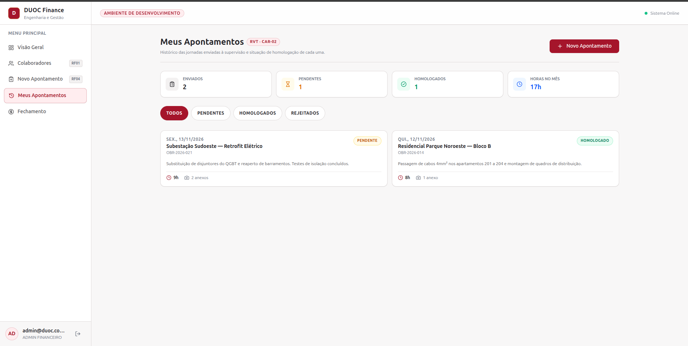
        Módulo de Apontamentos RVT em execução
      

    

??? info "2. Testes Automatizados — Suítes Backend (107/107) e Frontend (18/18)"
    

      

        
        Backend Vitest: 15 suítes / 107 testes aprovados
      

      

        
        Frontend Vitest: 3 suítes / 18 testes aprovados
      

    

??? info "3. Inspeção por Pares, CI/CD, Latência de API e Build Docs as Code"
    

      

        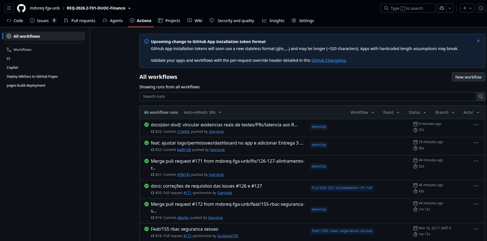
        Pipelines GitHub Actions (CI e Deploy)
      

      

        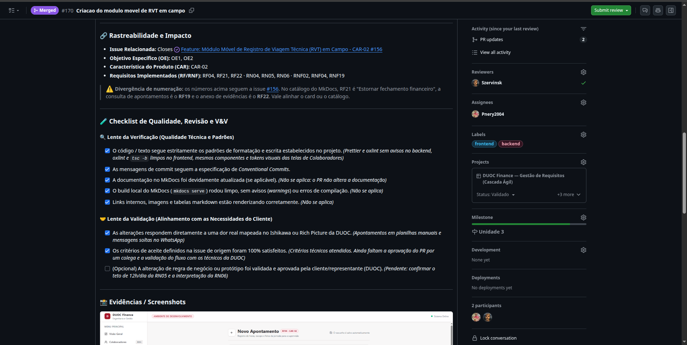
        Checklist e rastreabilidade no PR
      

      

        
        Latência 20ms / 11ms (HTTP 401 RBAC) e mkdocs --strict
      

    

---

## 3. Resultados do DoD — Incrementos 2, 3 e Pós-MVP (Não Concluídos)

Para evitar qualquer ambiguidade, **nenhum requisito fora do Incremento 1 possui DoD declarado como concluído**:

| Conjunto de Requisitos | Situação do DoD | Pendências Objetivas para Conclusão |
| :--- | :---: | :--- |
| **Incremento 2 em Desenvolvimento (6 RFs):** [`RF07`](../requisitos/index.md#rf07), [`RF08`](../requisitos/index.md#rf08), [`RF28`](../requisitos/index.md#rf28), [`RF29`](../requisitos/index.md#rf29), [`RF32`](../requisitos/index.md#rf32), [`RF35`](../requisitos/index.md#rf35) | **DoD Pendente (Em Execução)** | Implementação das rotas e telas de deliberação/reembolsos, testes automatizados, PR revisado e homologação em UAT. |
| **Prontos para Dev (12 RFs):** [`RF05`](../requisitos/index.md#rf05), [`RF06`](../requisitos/index.md#rf06), [`RF27`](../requisitos/index.md#rf27), [`RF09`](../requisitos/index.md#rf09)–[`RF11`](../requisitos/index.md#rf11), [`RF33`](../requisitos/index.md#rf33), [`RF34`](../requisitos/index.md#rf34), [`RF37`](../requisitos/index.md#rf37)–[`RF40`](../requisitos/index.md#rf40) | **DoD Não Iniciado** | Aguardando início da codificação nos próximos ciclos do Incremento 2/3. |
| **Aguardando Ciclo (3 RFs) e Pós-MVP (9 RFs)** | **DoD Não Iniciado** | Itens fora do ciclo atual (`RF14`, `RF25`, `RF26` e `Release 2`). |
| **RNFs funcionais de ciclos futuros (`RNF05`, `RNF06`, `RNF08`–`RNF12`, `RNF01`)** | **DoD Não Iniciado** | Verificação nos ciclos que implementarem as funcionalidades correspondentes. |
| **RNF15 — auditoria transacional** | **Pendente** | Nos incrementos que incluírem mutações abrangidas, comprovar a gravação atômica do registro de auditoria e a métrica de latência definida no requisito. |
| **RNF16 — retenção de auditoria** | **Pendente para operação** | Prever e comprovar a política que impede a exclusão dos registros antes do prazo definido, antes da entrada em operação. |
| **RNF17 — backup e restauração** | **Pendente para Cutover** | Comprovar rotina diária de backup e testes de restauração quando a infraestrutura operacional estiver disponível. |
| **RNF18 — disponibilidade mensal** | **Pendente para produção** | Comprovar a meta de 99,5% por monitoramento contínuo em ambiente produtivo. |
| **RNF19 — acessibilidade das interfaces** | **Pendente de verificação por incremento** | Avaliar os critérios WCAG nas telas entregues em cada incremento; essa verificação não depende da entrada em produção. |

---

## 4. Registro Automático de Evidências por PR

As evidências visuais (prints de interface, logs de testes e critérios marcados) anexadas nos Pull Requests mergeados na `develop` são coletadas automaticamente para `docs/assets/images/evidencias/pr-<numero>/` via GitHub Actions:

<!-- AUTO-EVIDENCIAS-PR:START -->

<!-- PR-189:START -->
??? info "PR #189 — Feat/184 prestacao contas reembolsos (Gustavo2703 • 2026-11-21)"

    - **Pull Request:** [#189](https://github.com/mdsreq-fga-unb/REQ-2026.2-T01-DUOC-Finance/pull/189) • **Issues:** #184 • **Requisitos:** `CAR-04`, `CAR-05`, `RF07`, `RF08`
    - **CI / Verificações:** 2/3 check(s) aprovado(s) • **Critérios marcados:** 7 aceito(s), 1 pendente(s)

    

      

        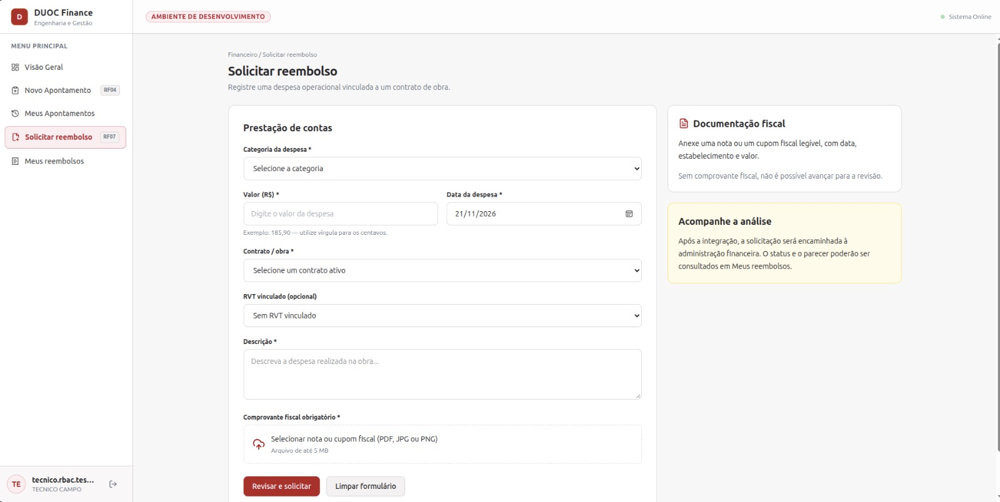
        Formulário integrado de solicitação de reembolso (<code>pr-189/01-formulario-integrado-de-solicitacao-de-reembolso.png</code>)
      

      

        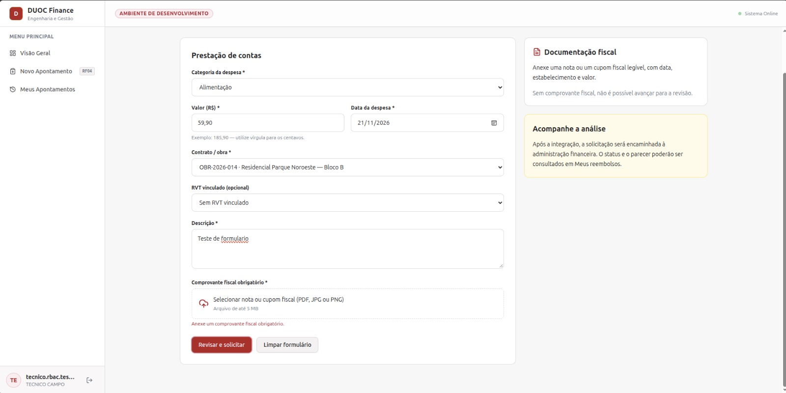
        Validação da obrigatoriedade do comprovante fiscal (<code>pr-189/02-validacao-da-obrigatoriedade-do-comprovante-fisc.png</code>)
      

      

        
        Consulta SQL da solicitação pendente (<code>pr-189/03-consulta-sql-da-solicitacao-pendente.png</code>)
      

      

        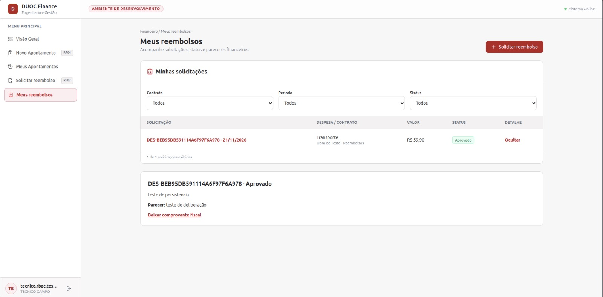
        Solicitação aprovada e parecer consultável pelo técnico (<code>pr-189/04-solicitacao-aprovada-e-parecer-consultavel-pelo-.png</code>)
      

      

        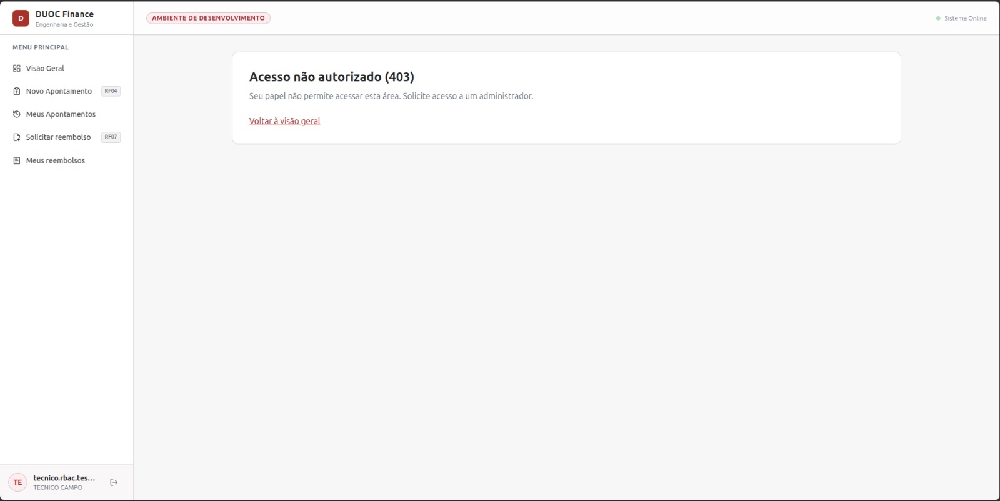
        Tela de acesso não autorizado para técnico (<code>pr-189/05-tela-de-acesso-nao-autorizado-para-tecnico.png</code>)
      

      

        
        Consulta SQL da aprovação financeira e parecer (<code>pr-189/06-consulta-sql-da-aprovacao-financeira-e-parecer.png</code>)
      

      

        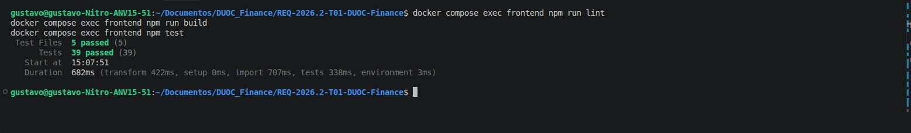
        Resultado de 39 testes do frontend aprovados (<code>pr-189/07-resultado-de-39-testes-do-frontend-aprovados.png</code>)
      

      

        
        Resultado de 205 testes do backend aprovados antes da integração com RVT (<code>pr-189/08-resultado-de-205-testes-do-backend-aprovados-ant.png</code>)
      

      

        
        Protótipo do histórico com estados pendente aprovado rejeitado (<code>pr-189/09-prototipo-do-historico-com-estados-pendente-apro.png</code>)
      

      

        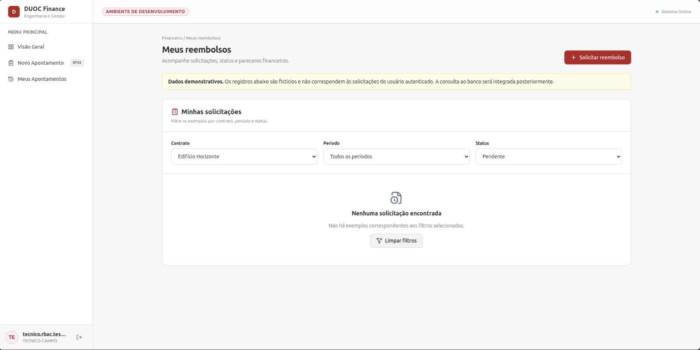
        Protótipo de estado vazio após filtrar (<code>pr-189/10-prototipo-de-estado-vazio-apos-filtrar.png</code>)
      

      

        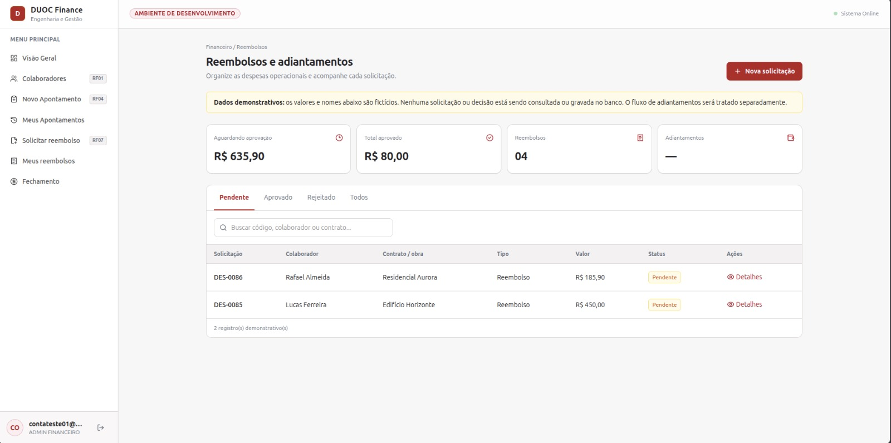
        Protótipo do painel financeiro de reembolsos (<code>pr-189/11-prototipo-do-painel-financeiro-de-reembolsos.png</code>)
      

      

        
        Protótipo da aba de aprovados (<code>pr-189/12-prototipo-da-aba-de-aprovados.png</code>)
      

      

        
        Protótipo da busca administrativa (<code>pr-189/13-prototipo-da-busca-administrativa.png</code>)
      

      

        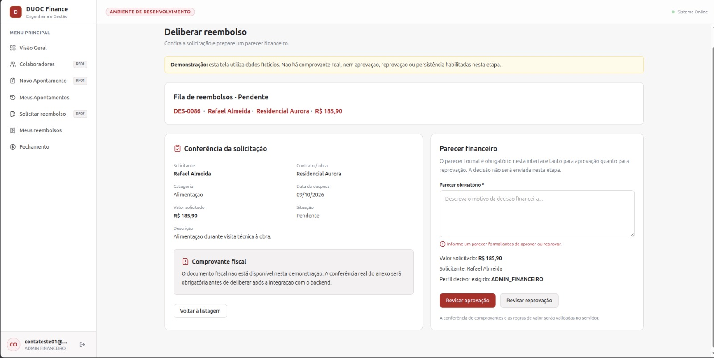
        Protótipo da validação de parecer obrigatório (<code>pr-189/14-prototipo-da-validacao-de-parecer-obrigatorio.png</code>)
      

      

        
        Protótipo da revisão de aprovação financeira (<code>pr-189/15-prototipo-da-revisao-de-aprovacao-financeira.png</code>)
      

    

<!-- PR-189:END -->

<!-- PR-185:START -->
??? info "PR #185 — Feat/181 rbac perfis protecao rotas (gih7915 • 2026-11-21)"

    - **Pull Request:** [#185](https://github.com/mdsreq-fga-unb/REQ-2026.2-T01-DUOC-Finance/pull/185) • **Issues:** #181 • **Requisitos:** `CAR-07`, `RF25`, `RNF01`, `RNF07`
    - **CI / Verificações:** 2/3 check(s) aprovado(s) • **Critérios marcados:** 5 aceito(s), 3 pendente(s)

    

      

        
        Gestão de Acessos — dados demonstrativos (<code>pr-185/01-gestao-de-acessos-dados-demonstrativos.png</code>)
      

      

        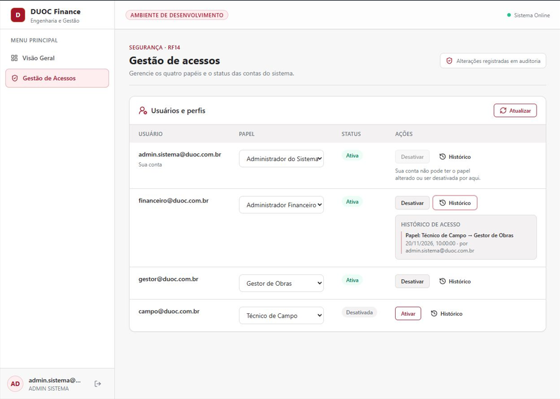
        Histórico de acesso — dados demonstrativos (<code>pr-185/02-historico-de-acesso-dados-demonstrativos.png</code>)
      

      

        
        Menu por perfil — ADMIN_FINANCEIRO (<code>pr-185/03-menu-por-perfil-admin-financeiro.png</code>)
      

      

        
        Menu por perfil — GESTOR_OBRAS (<code>pr-185/04-menu-por-perfil-gestor-obras.png</code>)
      

      

        
        Menu por perfil — TECNICO_CAMPO (<code>pr-185/05-menu-por-perfil-tecnico-campo.png</code>)
      

      

        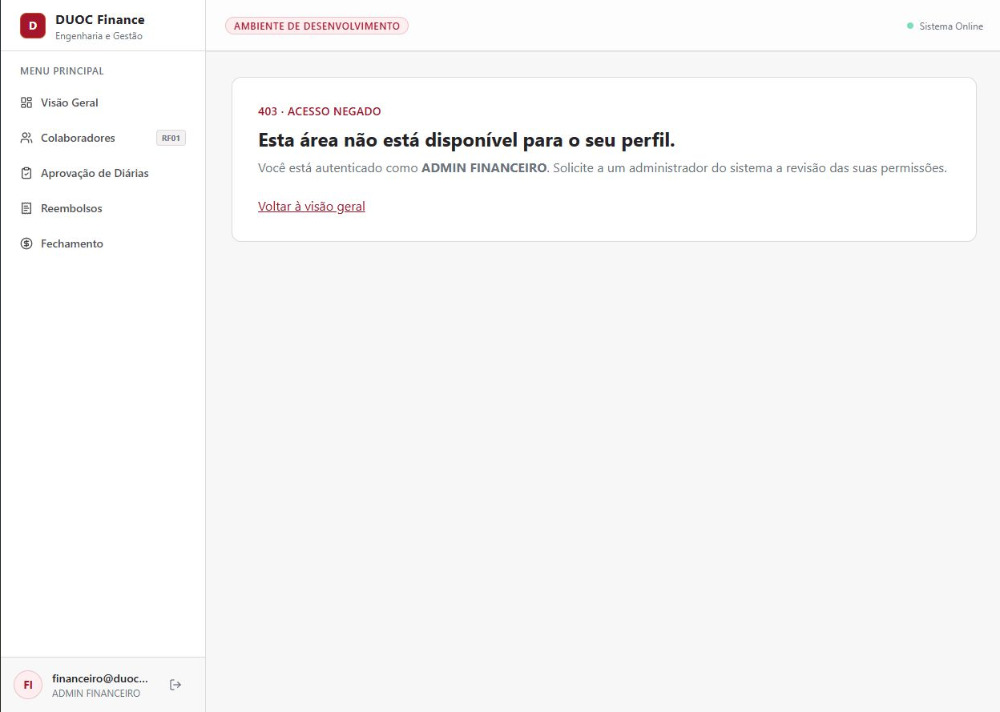
        403 — perfil sem permissão para Gestão de Acessos (<code>pr-185/06-403-perfil-sem-permissao-para-gestao-de-acessos.png</code>)
      

      

        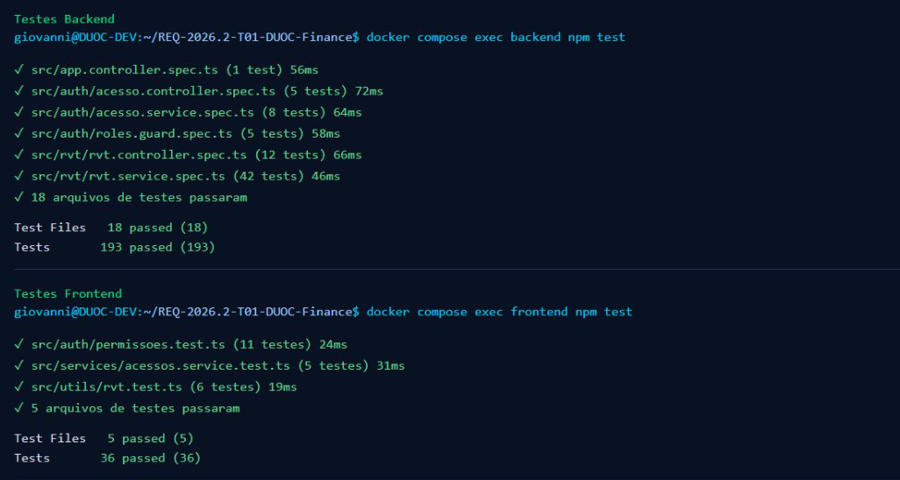
        image (<code>pr-185/07-image.png</code>)
      

    

<!-- PR-185:END -->

<!-- PR-188:START -->
??? info "PR #188 — feat(ci): sincronização automática de evidências de PR para o GitHub Pages (Szervinsk • 2026-11-21)"

    - **Pull Request:** [#188](https://github.com/mdsreq-fga-unb/REQ-2026.2-T01-DUOC-Finance/pull/188) • **Issues:** #178 • **Requisitos:** —
    - **CI / Verificações:** 2/3 check(s) aprovado(s) • **Critérios marcados:** 6 aceito(s), 0 pendente(s)

    

      

        
        image (<code>pr-188/01-image.png</code>)
      

    

<!-- PR-188:END -->

<!-- AUTO-EVIDENCIAS-PR:END -->

---

## Histórico de Versão

| Versão | Data | Descrição | Autor(es) | Revisor(es) |
| :---: | :---: | :--- | :--- | :--- |
| `1.0` | 17/11/2026 | Desmembramento do DoD em documento próprio com evidências visuais em blocos expansíveis (largura total) e status explícito dos demais incrementos. | Matheus Ribeiro Szervinsk | Equipe Cascata Ágil |
| `1.1` | 24/11/2026 | Revisão dos registros do DoD para distinguir RNFs verificados, parcialmente verificados e pendentes no Incremento 1. | Matheus Saraiva Camargo | Matheus Ribeiro Szervinsk |