# Definition of Done (DoD) — Acordos e Resultados por Incremento

O **DoD** é o portão de saída que confirma que um incremento está funcional, integrado, verificado por testes automatizados, revisado por pares e documentado. Para evitar ambiguidades entre commits técnicos e entregas de valor, a equipe distingue o **DoD Técnico por Pull Request** da **Homologação Sociotécnica por Incremento RAD Consolidado**.

> Para consultar os critérios de entrada e prontidão, acesse [Definition of Ready (DoR)](dor.md).

---

## 1. Checklist Operacional de Conclusão (Critérios Oficiais)

| Dimensão | Critério de Conclusão | Evidência Esperada |
| :--- | :--- | :--- |
| **Incremento funcional** | Fluxo operável ponta a ponta no ambiente de demonstração (Docker/Staging), integrando interface, API e persistência. | Containers ativos ou ambiente Staging + links dos PRs. |
| **Critérios de aceitação** | **100%** dos critérios aplicáveis ao requisito verificados sem pendências ocultas. | Saída de testes automatizados / checklist ligado à Issue ou PR. |
| **Código e inspeção por pares** | Código tipado e formatado conforme padrões do repositório; checks de CI (`lint`, `tsc`, `build`) aprovados e revisão por revisor diferente do autor. | Checklist preenchido no PR, aprovação de revisor e CI verde. |
| **Testes automatizados** | Suítes de testes unitários e de integração pertinentes executadas e aprovadas. | Relatório/print da suíte Vitest no PR e CI. |
| **Requisitos não funcionais** | RNFs aplicáveis ao incremento e ao ambiente vigente verificados por testes ou medições; RNFs exclusivos de produção (ex.: SLA 99,5% e backup produtivo) avaliados no *Cutover*. | Resultados de testes de segurança/RBAC/payload e medições de latência. |
| **Documentação — Docs as Code** | Documentação e catálogo atualizados sem avisos em `mkdocs build --strict`. | Commits documentais e saída limpa do build MkDocs. |
| **Homologação sociotécnica** | Ao fechamento de cada **incremento RAD consolidado**, o fluxo é demonstrado à cliente em sessão UAT com dados sintéticos, registrando aceite ou ajustes. | Ata de validação do incremento / sessão UAT com Maria Beatryz. |

### Procedimento de Inspeção por Pares (Pull Request)
1. **Preparação:** O autor abre o PR usando `.github/PULL_REQUEST_TEMPLATE.md`, vincula a Issue e lista os critérios atendidos.
2. **Inspeção:** Um revisor distinto do autor verifica regras de negócio, tratamento de erros, segurança/RNFs, testes e documentação.
3. **Aprovação e CI:** Todos os apontamentos são resolvidos e o workflow `.github/workflows/ci.yml` deve estar verde antes do *merge* em `develop` ou `main`.

---

## 2. Resultados do DoD — Incremento 1 (Concluído Tecnicamente)

Registro critério por critério para os **10 Requisitos Funcionais entregues no Incremento 1** ([`RF01`](../requisitos/index.md#rf01)–[`RF04`](../requisitos/index.md#rf04), [`RF13`](../requisitos/index.md#rf13), [`RF17`](../requisitos/index.md#rf17)–[`RF19`](../requisitos/index.md#rf19), [`RF22`](../requisitos/index.md#rf22), [`RF23`](../requisitos/index.md#rf23)) e os **7 RNFs verificados** (`RNF02`, `RNF03`, `RNF04`, `RNF07`, `RNF13`, `RNF14`, `RNF20`).

| Critério do DoD | Situação | Evidência Comprobatória (PRs &amp; Registros) |
| :--- | :---: | :--- |
| **Incremento funcional (Docker / Staging)** | **Atendido** | PostgreSQL (`5432`), API NestJS (`3000`) e Frontend React (`5173`) operacionais; fluxos integrados nos PRs [#167](https://github.com/mdsreq-fga-unb/REQ-2026.2-T01-DUOC-Finance/pull/167), [#170](https://github.com/mdsreq-fga-unb/REQ-2026.2-T01-DUOC-Finance/pull/170) e [#172](https://github.com/mdsreq-fga-unb/REQ-2026.2-T01-DUOC-Finance/pull/172). |
| **Testes automatizados (Backend e Frontend)** | **Atendido** | **107/107 testes backend** aprovados em 15 suítes Vitest + **18/18 testes frontend** aprovados em 3 suítes ([PR #172](https://github.com/mdsreq-fga-unb/REQ-2026.2-T01-DUOC-Finance/pull/172) e [PR #168](https://github.com/mdsreq-fga-unb/REQ-2026.2-T01-DUOC-Finance/pull/168)). |
| **Código, tipagem e inspeção por pares (CI/CD)** | **Atendido** | Checks `lint`, `tsc --noEmit` e `npm run build` em `.github/workflows/ci.yml` ([PR #168](https://github.com/mdsreq-fga-unb/REQ-2026.2-T01-DUOC-Finance/pull/168)) + checklist de revisão preenchido nos PRs. |
| **RNFs verificáveis no incremento** | **Atendido** | `RNF02` (latência `0,020s` em `/api/health` e `0,011s` em `/api/rvt/contratos-ativos`), `RNF03` (`bcrypt` custo >= 10), `RNF07` (SHA-256 + MIME real), `RNF13` (JWT 900s), `RNF14` (RBAC HTTP 401/403) e `RNF20` (DTOs). |
| **Documentação — Docs as Code** | **Atendido** | Catálogo atualizado com evidências visuais ([PR #174](https://github.com/mdsreq-fga-unb/REQ-2026.2-T01-DUOC-Finance/pull/174)) e `mkdocs build --strict` sem erros nem links quebrados. |
| **Homologação sociotécnica do incremento** | **Pendente de UAT** | Protótipos e telas validados na [Ata 06](../governanca/atas/reuniao-06.md); sessão formal de UAT do fluxo integrado em Staging com Maria Beatryz prevista para 27/11/2026 ([Semana 12](../metodologia/detalhamento-ciclos.md#semana-12)). |

### Evidências Visuais Comprobatórias (DoD — Incremento 1)

??? info "1. Incremento Funcional — Containers Docker e Telas Integradas"
    

      

        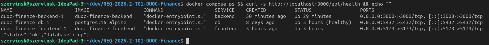
        Containers Docker ativos (db, backend, frontend)
      

      

        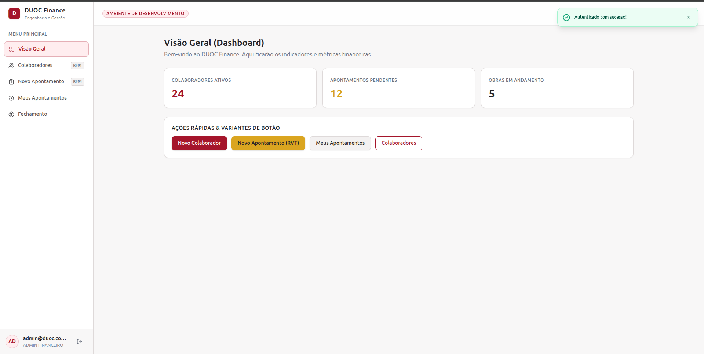
        Dashboard autenticado (ADMIN_FINANCEIRO)
      

      

        
        Módulo de Apontamentos RVT em execução
      

    

??? info "2. Testes Automatizados — Suítes Backend (107/107) e Frontend (18/18)"
    

      

        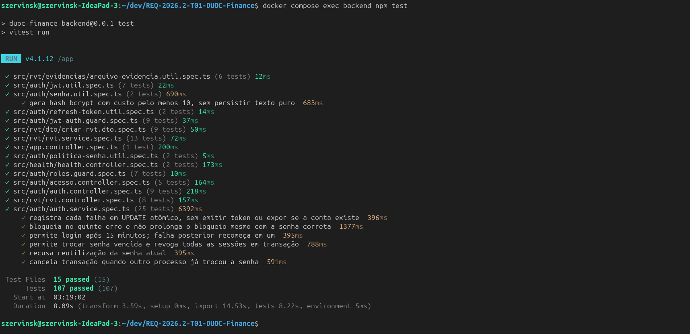
        Backend Vitest: 15 suítes / 107 testes aprovados
      

      

        
        Frontend Vitest: 3 suítes / 18 testes aprovados
      

    

??? info "3. Inspeção por Pares, CI/CD, Latência de API e Build Docs as Code"
    

      

        
        Pipelines GitHub Actions (CI e Deploy)
      

      

        
        Checklist e rastreabilidade no PR
      

      

        
        Latência 20ms / 11ms (HTTP 401 RBAC) e mkdocs --strict
      

    

### Rastreabilidade dos testes aos critérios de aceitação

O título e os estados do quadro acima correspondem ao registro histórico do PC3, não à comprovação integral de cada requisito. O [PR #172](https://github.com/mdsreq-fga-unb/REQ-2026.2-T01-DUOC-Finance/pull/172) registra a aprovação das suítes de backend e frontend indicadas acima. A matriz associa os comportamentos exercitados pelos testes da [versão histórica integrada](https://github.com/mdsreq-fga-unb/REQ-2026.2-T01-DUOC-Finance/tree/e8ecfec498f5e3ac5609c9a0a3b2e19496dd2034) aos critérios do catálogo vigente. A aprovação é reportada por suíte; não foi realizada nova execução para esta revisão. Onde a evidência é parcial ou não foi localizada, a lacuna permanece explícita. Os identificadores históricos nos nomes dos testes não substituem os identificadores do catálogo.

| Requisito | Evidência histórica | Comportamento exercitado | Alcance e pendências |
| :---: | :--- | :--- | :--- |
| [RF01](../requisitos/index.md#rf01) | [`validators.test.ts`](https://github.com/mdsreq-fga-unb/REQ-2026.2-T01-DUOC-Finance/blob/e8ecfec498f5e3ac5609c9a0a3b2e19496dd2034/frontend/src/utils/validators.test.ts) | Validação de CPF (dígitos verificadores, repetição e invalidade) e formato de e-mail. | Parcial: não comprova unicidade no banco, dados bancários/trabalhistas, persistência com identificador único ou envio de link de ativação. |
| [RF02](../requisitos/index.md#rf02) | — | Não localizado teste específico na suíte histórica. | Pendente: atualização atômica, histórico imutável e propagação aos módulos financeiros em menos de 500 ms. |
| [RF03](../requisitos/index.md#rf03) | [`auth.service.spec.ts`](https://github.com/mdsreq-fga-unb/REQ-2026.2-T01-DUOC-Finance/blob/e8ecfec498f5e3ac5609c9a0a3b2e19496dd2034/backend/src/auth/auth.service.spec.ts); [`jwt-auth.guard.spec.ts`](https://github.com/mdsreq-fga-unb/REQ-2026.2-T01-DUOC-Finance/blob/e8ecfec498f5e3ac5609c9a0a3b2e19496dd2034/backend/src/auth/jwt-auth.guard.spec.ts) | Rejeição de login e de acesso por usuário desativado. | Parcial: não comprova movimentações funcionais e revogação do acesso na mesma transação. |
| [RF04](../requisitos/index.md#rf04) | [`criar-rvt.dto.spec.ts`](https://github.com/mdsreq-fga-unb/REQ-2026.2-T01-DUOC-Finance/blob/e8ecfec498f5e3ac5609c9a0a3b2e19496dd2034/backend/src/rvt/dto/criar-rvt.dto.spec.ts); [`rvt.service.spec.ts`](https://github.com/mdsreq-fga-unb/REQ-2026.2-T01-DUOC-Finance/blob/e8ecfec498f5e3ac5609c9a0a3b2e19496dd2034/backend/src/rvt/rvt.service.spec.ts); [`rvt.controller.spec.ts`](https://github.com/mdsreq-fga-unb/REQ-2026.2-T01-DUOC-Finance/blob/e8ecfec498f5e3ac5609c9a0a3b2e19496dd2034/backend/src/rvt/rvt.controller.spec.ts) | Validação de contrato, horas, data e escopo; gravação vinculada ao colaborador com status inicial PENDENTE. | Parcial: falta comprovar o fluxo integrado de submissão com anexos e disponibilização ao gestor responsável. |
| [RF13](../requisitos/index.md#rf13) | [`auth.service.spec.ts`](https://github.com/mdsreq-fga-unb/REQ-2026.2-T01-DUOC-Finance/blob/e8ecfec498f5e3ac5609c9a0a3b2e19496dd2034/backend/src/auth/auth.service.spec.ts); [`auth.controller.spec.ts`](https://github.com/mdsreq-fga-unb/REQ-2026.2-T01-DUOC-Finance/blob/e8ecfec498f5e3ac5609c9a0a3b2e19496dd2034/backend/src/auth/auth.controller.spec.ts) | Login válido emite JWT e perfil; credenciais inválidas recebem HTTP 401 com mensagem genérica. | Cobertura direta dos comportamentos de autenticação e rejeição; não é aceite do fluxo pela cliente. |
| [RF17](../requisitos/index.md#rf17) | — | Não localizado teste específico de primeiro acesso ou recuperação na suíte histórica. | Pendente: envio, uso único, validade de 30 minutos, não enumeração e definição de senha nos dois fluxos. |
| [RF18](../requisitos/index.md#rf18) | [`auth.service.spec.ts`](https://github.com/mdsreq-fga-unb/REQ-2026.2-T01-DUOC-Finance/blob/e8ecfec498f5e3ac5609c9a0a3b2e19496dd2034/backend/src/auth/auth.service.spec.ts); [`acesso.controller.spec.ts`](https://github.com/mdsreq-fga-unb/REQ-2026.2-T01-DUOC-Finance/blob/e8ecfec498f5e3ac5609c9a0a3b2e19496dd2034/backend/src/auth/acesso.controller.spec.ts); [`auth.service.test.ts`](https://github.com/mdsreq-fga-unb/REQ-2026.2-T01-DUOC-Finance/blob/e8ecfec498f5e3ac5609c9a0a3b2e19496dd2034/frontend/src/services/auth.service.test.ts) | Logout revoga sessão; JWT revogado é rejeitado mesmo antes de expirar; limpeza da sessão local. | Parcial: redirecionamento à tela de login não comprovado pelos testes vinculados. |
| [RF19](../requisitos/index.md#rf19) | [`rvt.controller.spec.ts`](https://github.com/mdsreq-fga-unb/REQ-2026.2-T01-DUOC-Finance/blob/e8ecfec498f5e3ac5609c9a0a3b2e19496dd2034/backend/src/rvt/rvt.controller.spec.ts); [`rvt.service.spec.ts`](https://github.com/mdsreq-fga-unb/REQ-2026.2-T01-DUOC-Finance/blob/e8ecfec498f5e3ac5609c9a0a3b2e19496dd2034/backend/src/rvt/rvt.service.spec.ts) | Listagem restrita ao colaborador autenticado e ordenação cronológica decrescente. | Parcial: não comprova a apresentação de todos os campos/status e do histórico completo de pareceres. |
| [RF22](../requisitos/index.md#rf22) | [`rvt.controller.spec.ts`](https://github.com/mdsreq-fga-unb/REQ-2026.2-T01-DUOC-Finance/blob/e8ecfec498f5e3ac5609c9a0a3b2e19496dd2034/backend/src/rvt/rvt.controller.spec.ts); [`rvt.service.spec.ts`](https://github.com/mdsreq-fga-unb/REQ-2026.2-T01-DUOC-Finance/blob/e8ecfec498f5e3ac5609c9a0a3b2e19496dd2034/backend/src/rvt/rvt.service.spec.ts); [`arquivo-evidencia.util.spec.ts`](https://github.com/mdsreq-fga-unb/REQ-2026.2-T01-DUOC-Finance/blob/e8ecfec498f5e3ac5609c9a0a3b2e19496dd2034/backend/src/rvt/evidencias/arquivo-evidencia.util.spec.ts) | Recepção multipart, vínculo do arquivo ao apontamento, validação de formato real e rejeição acima de 5 MB. | Parcial: limite histórico de 5 MB diverge dos 10 MB vigentes; geolocalização, ausência/recusa de GPS e remoção antes do envio não comprovadas. |
| [RF23](../requisitos/index.md#rf23) | [`auth.service.spec.ts`](https://github.com/mdsreq-fga-unb/REQ-2026.2-T01-DUOC-Finance/blob/e8ecfec498f5e3ac5609c9a0a3b2e19496dd2034/backend/src/auth/auth.service.spec.ts) | Bloqueio na quinta falha, rejeição durante o bloqueio e recuperação da autenticação após o prazo histórico de 15 minutos. | Parcial: prazo vigente é de 30 minutos após cinco falhas em até 15 minutos; falta comprovar esse comportamento completo. |
| [RNF02](../requisitos/index.md#rnf02) | Medições de API exibidas nas evidências visuais. | Latência de endpoints de saúde e contratos ativos. | Pendente: consulta cadastral em até 2 s no p95 sob a carga nominal do requisito não foi medida nessas evidências. |
| [RNF03](../requisitos/index.md#rnf03) | [`senha.util.spec.ts`](https://github.com/mdsreq-fga-unb/REQ-2026.2-T01-DUOC-Finance/blob/e8ecfec498f5e3ac5609c9a0a3b2e19496dd2034/backend/src/auth/senha.util.spec.ts) | Geração de hash bcrypt com custo mínimo 10, sem texto puro. | Evidência complementar: não comprova criptografia AES-256 dos dados cadastrais em repouso ou TLS 1.3 em trânsito. |
| [RNF04](../requisitos/index.md#rnf04) | — | Não localizado teste de usabilidade com a métrica do requisito. | Pendente: taxa de conclusão de pelo menos 90% em primeiro uso, sem treinamento e em até cinco passos/telas. |
| [RNF07](../requisitos/index.md#rnf07) | [`arquivo-evidencia.util.spec.ts`](https://github.com/mdsreq-fga-unb/REQ-2026.2-T01-DUOC-Finance/blob/e8ecfec498f5e3ac5609c9a0a3b2e19496dd2034/backend/src/rvt/evidencias/arquivo-evidencia.util.spec.ts); [`rvt.service.spec.ts`](https://github.com/mdsreq-fga-unb/REQ-2026.2-T01-DUOC-Finance/blob/e8ecfec498f5e3ac5609c9a0a3b2e19496dd2034/backend/src/rvt/rvt.service.spec.ts) | Identificação de JPEG/PNG/PDF por magic bytes, rejeição de formatos incompatíveis e sanitização de nomes; registro de hash. | Parcial: não comprova varredura contra ameaças, legibilidade após compressão e aplicação do critério ao fluxo de reembolsos. |
| [RNF13](../requisitos/index.md#rnf13) | [`auth.service.spec.ts`](https://github.com/mdsreq-fga-unb/REQ-2026.2-T01-DUOC-Finance/blob/e8ecfec498f5e3ac5609c9a0a3b2e19496dd2034/backend/src/auth/auth.service.spec.ts); [`jwt-auth.guard.spec.ts`](https://github.com/mdsreq-fga-unb/REQ-2026.2-T01-DUOC-Finance/blob/e8ecfec498f5e3ac5609c9a0a3b2e19496dd2034/backend/src/auth/jwt-auth.guard.spec.ts); [`jwt.util.spec.ts`](https://github.com/mdsreq-fga-unb/REQ-2026.2-T01-DUOC-Finance/blob/e8ecfec498f5e3ac5609c9a0a3b2e19496dd2034/backend/src/auth/jwt.util.spec.ts) | JWT com validade de 900 s e rejeição de token expirado. | Parcial: não comprova a exigência de nova autenticação ao término do período máximo do requisito. |
| [RNF14](../requisitos/index.md#rnf14) | [`roles.guard.spec.ts`](https://github.com/mdsreq-fga-unb/REQ-2026.2-T01-DUOC-Finance/blob/e8ecfec498f5e3ac5609c9a0a3b2e19496dd2034/backend/src/auth/roles.guard.spec.ts); [`acesso.controller.spec.ts`](https://github.com/mdsreq-fga-unb/REQ-2026.2-T01-DUOC-Finance/blob/e8ecfec498f5e3ac5609c9a0a3b2e19496dd2034/backend/src/auth/acesso.controller.spec.ts) | Decisão de autorização por papel e rejeição HTTP 403 nos cenários exercitados; HTTP 401 para ausência de autenticação. | Parcial: não comprova cobertura de 100% das rotas protegidas nem latência do guard inferior a 15 ms no p95 sob carga nominal. |
| [RNF20](../requisitos/index.md#rnf20) | [`criar-rvt.dto.spec.ts`](https://github.com/mdsreq-fga-unb/REQ-2026.2-T01-DUOC-Finance/blob/e8ecfec498f5e3ac5609c9a0a3b2e19496dd2034/backend/src/rvt/dto/criar-rvt.dto.spec.ts); [`auth.controller.spec.ts`](https://github.com/mdsreq-fga-unb/REQ-2026.2-T01-DUOC-Finance/blob/e8ecfec498f5e3ac5609c9a0a3b2e19496dd2034/backend/src/auth/auth.controller.spec.ts); [`rvt.controller.spec.ts`](https://github.com/mdsreq-fga-unb/REQ-2026.2-T01-DUOC-Finance/blob/e8ecfec498f5e3ac5609c9a0a3b2e19496dd2034/backend/src/rvt/rvt.controller.spec.ts) | Validação de campos, descarte de campos extras e retorno HTTP 400 para payloads inválidos exercitados. | Parcial: não comprova schema e sanitização contra injection em 100% das rotas de escrita. |

---

## 3. Resultados do DoD — Incrementos 2, 3 e Pós-MVP (Não Concluídos)

Para evitar qualquer ambiguidade, **nenhum requisito fora do Incremento 1 possui DoD declarado como concluído**:

| Conjunto de Requisitos | Situação do DoD | Pendências Objetivas para Conclusão |
| :--- | :---: | :--- |
| **Incremento 2 em Desenvolvimento (6 RFs):** [`RF07`](../requisitos/index.md#rf07), [`RF08`](../requisitos/index.md#rf08), [`RF28`](../requisitos/index.md#rf28), [`RF29`](../requisitos/index.md#rf29), [`RF32`](../requisitos/index.md#rf32), [`RF35`](../requisitos/index.md#rf35) | **DoD Pendente (Em Execução)** | Implementação das rotas e telas de deliberação/reembolsos, testes automatizados, PR revisado e homologação em UAT. |
| **Prontos para Dev (12 RFs):** [`RF05`](../requisitos/index.md#rf05), [`RF06`](../requisitos/index.md#rf06), [`RF27`](../requisitos/index.md#rf27), [`RF09`](../requisitos/index.md#rf09)–[`RF11`](../requisitos/index.md#rf11), [`RF33`](../requisitos/index.md#rf33), [`RF34`](../requisitos/index.md#rf34), [`RF37`](../requisitos/index.md#rf37)–[`RF40`](../requisitos/index.md#rf40) | **DoD Não Iniciado** | Aguardando início da codificação nos próximos ciclos do Incremento 2/3. |
| **Aguardando Ciclo (3 RFs) e Pós-MVP (9 RFs)** | **DoD Não Iniciado** | Itens fora do ciclo atual (`RF14`, `RF25`, `RF26` e `Release 2`). |
| **RNFs de Ciclos Futuros / Produção (`RNF05`, `RNF06`, `RNF08`–`RNF12`, `RNF15`–`RNF19`, `RNF01`)** | **DoD Não Iniciado** | Verificação condicionada à entrega do motor financeiro, auditoria e infraestrutura de produção (*Cutover*). |

---

## 4. Registro Automático de Evidências por PR

As evidências visuais (prints de interface, logs de testes e critérios marcados) anexadas nos Pull Requests mergeados na `develop` são coletadas automaticamente para `docs/assets/images/evidencias/pr-<numero>/` via GitHub Actions:

<!-- AUTO-EVIDENCIAS-PR:START -->

<!-- PR-189:START -->
??? info "PR #189 — Feat/184 prestacao contas reembolsos (Gustavo2703 • 2026-11-21)"

    - **Pull Request:** [#189](https://github.com/mdsreq-fga-unb/REQ-2026.2-T01-DUOC-Finance/pull/189) • **Issues:** #184 • **Requisitos:** `CAR-04`, `CAR-05`, `RF07`, `RF08`
    - **CI / Verificações:** 2/3 check(s) aprovado(s) • **Critérios marcados:** 7 aceito(s), 1 pendente(s)

    

      

        
        Formulário integrado de solicitação de reembolso (<code>pr-189/01-formulario-integrado-de-solicitacao-de-reembolso.png</code>)
      

      

        
        Validação da obrigatoriedade do comprovante fiscal (<code>pr-189/02-validacao-da-obrigatoriedade-do-comprovante-fisc.png</code>)
      

      

        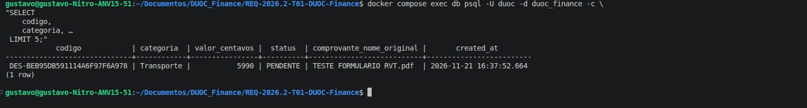
        Consulta SQL da solicitação pendente (<code>pr-189/03-consulta-sql-da-solicitacao-pendente.png</code>)
      

      

        
        Solicitação aprovada e parecer consultável pelo técnico (<code>pr-189/04-solicitacao-aprovada-e-parecer-consultavel-pelo-.png</code>)
      

      

        
        Tela de acesso não autorizado para técnico (<code>pr-189/05-tela-de-acesso-nao-autorizado-para-tecnico.png</code>)
      

      

        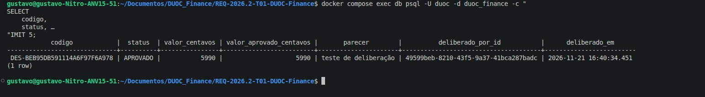
        Consulta SQL da aprovação financeira e parecer (<code>pr-189/06-consulta-sql-da-aprovacao-financeira-e-parecer.png</code>)
      

      

        
        Resultado de 39 testes do frontend aprovados (<code>pr-189/07-resultado-de-39-testes-do-frontend-aprovados.png</code>)
      

      

        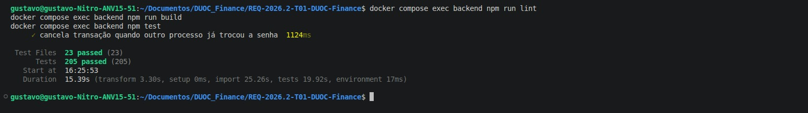
        Resultado de 205 testes do backend aprovados antes da integração com RVT (<code>pr-189/08-resultado-de-205-testes-do-backend-aprovados-ant.png</code>)
      

      

        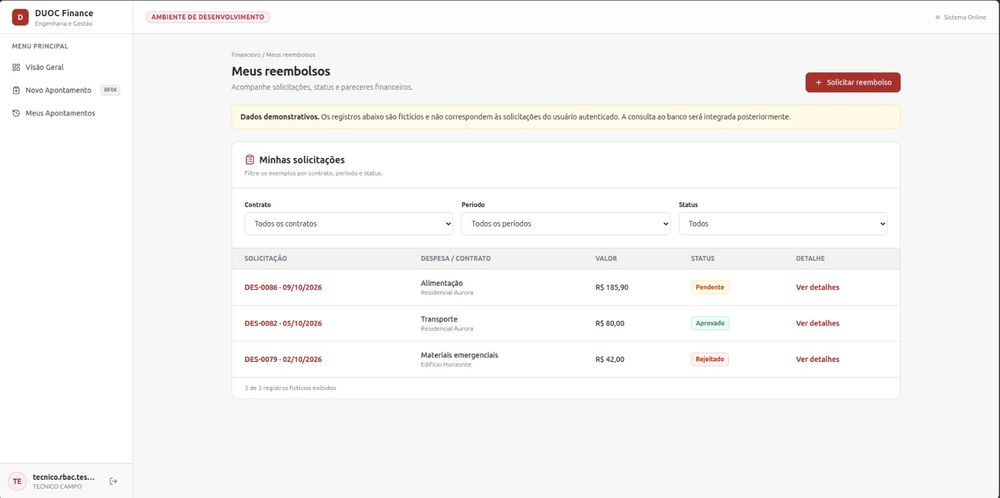
        Protótipo do histórico com estados pendente aprovado rejeitado (<code>pr-189/09-prototipo-do-historico-com-estados-pendente-apro.png</code>)
      

      

        
        Protótipo de estado vazio após filtrar (<code>pr-189/10-prototipo-de-estado-vazio-apos-filtrar.png</code>)
      

      

        
        Protótipo do painel financeiro de reembolsos (<code>pr-189/11-prototipo-do-painel-financeiro-de-reembolsos.png</code>)
      

      

        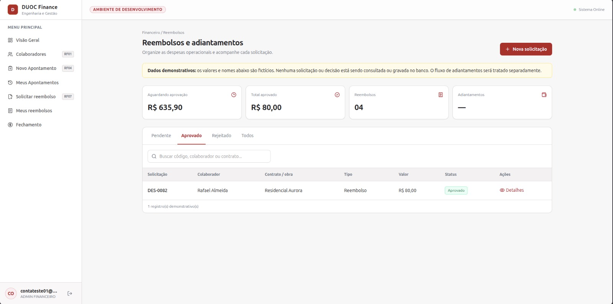
        Protótipo da aba de aprovados (<code>pr-189/12-prototipo-da-aba-de-aprovados.png</code>)
      

      

        
        Protótipo da busca administrativa (<code>pr-189/13-prototipo-da-busca-administrativa.png</code>)
      

      

        
        Protótipo da validação de parecer obrigatório (<code>pr-189/14-prototipo-da-validacao-de-parecer-obrigatorio.png</code>)
      

      

        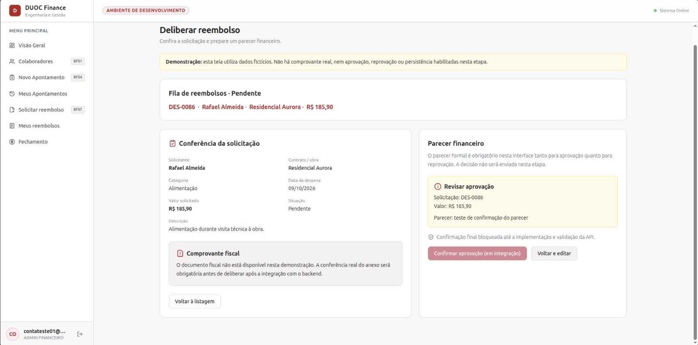
        Protótipo da revisão de aprovação financeira (<code>pr-189/15-prototipo-da-revisao-de-aprovacao-financeira.png</code>)
      

    

<!-- PR-189:END -->

<!-- PR-185:START -->
??? info "PR #185 — Feat/181 rbac perfis protecao rotas (gih7915 • 2026-11-21)"

    - **Pull Request:** [#185](https://github.com/mdsreq-fga-unb/REQ-2026.2-T01-DUOC-Finance/pull/185) • **Issues:** #181 • **Requisitos:** `CAR-07`, `RF25`, `RNF01`, `RNF07`
    - **CI / Verificações:** 2/3 check(s) aprovado(s) • **Critérios marcados:** 5 aceito(s), 3 pendente(s)

    

      

        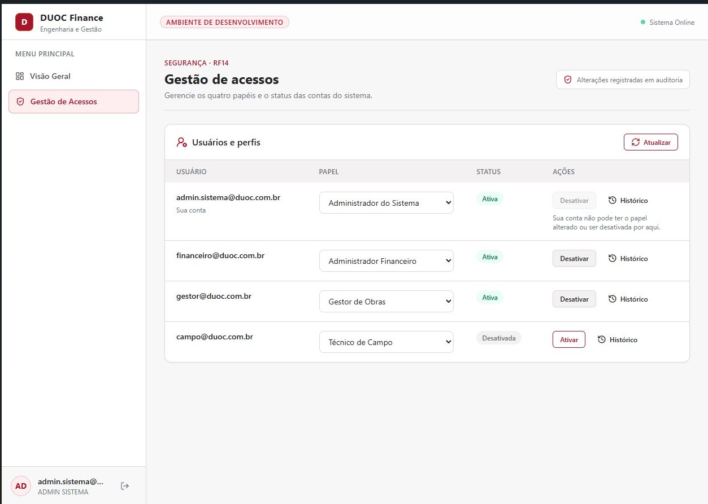
        Gestão de Acessos — dados demonstrativos (<code>pr-185/01-gestao-de-acessos-dados-demonstrativos.png</code>)
      

      

        
        Histórico de acesso — dados demonstrativos (<code>pr-185/02-historico-de-acesso-dados-demonstrativos.png</code>)
      

      

        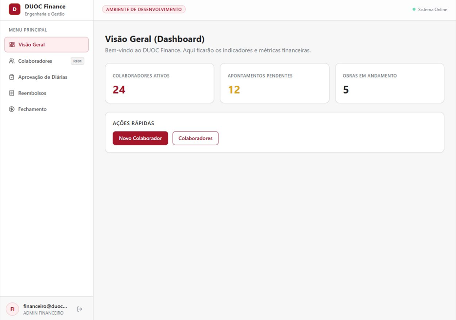
        Menu por perfil — ADMIN_FINANCEIRO (<code>pr-185/03-menu-por-perfil-admin-financeiro.png</code>)
      

      

        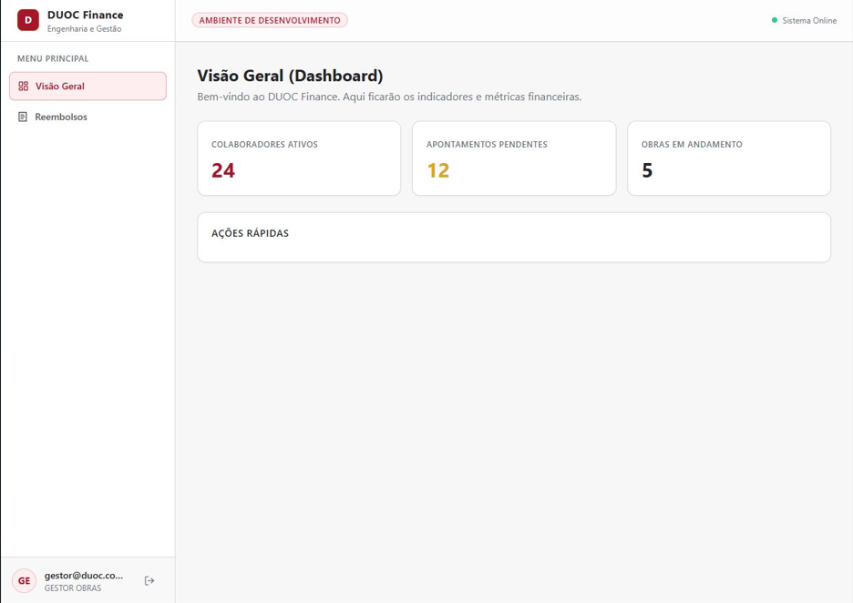
        Menu por perfil — GESTOR_OBRAS (<code>pr-185/04-menu-por-perfil-gestor-obras.png</code>)
      

      

        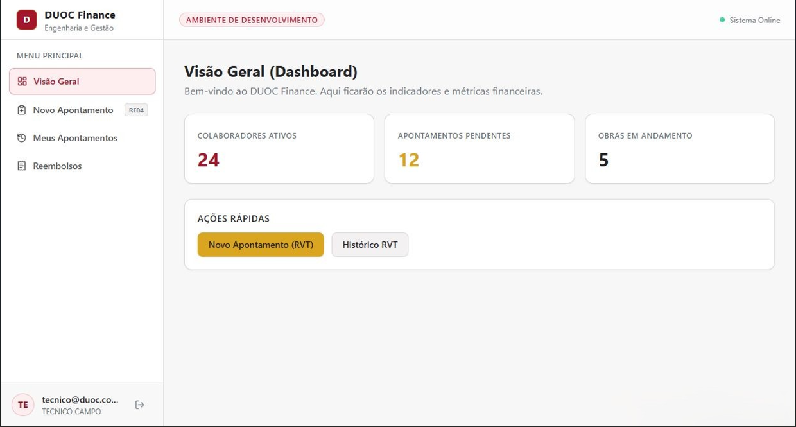
        Menu por perfil — TECNICO_CAMPO (<code>pr-185/05-menu-por-perfil-tecnico-campo.png</code>)
      

      

        
        403 — perfil sem permissão para Gestão de Acessos (<code>pr-185/06-403-perfil-sem-permissao-para-gestao-de-acessos.png</code>)
      

      

        
        image (<code>pr-185/07-image.png</code>)
      

    

<!-- PR-185:END -->

<!-- PR-188:START -->
??? info "PR #188 — feat(ci): sincronização automática de evidências de PR para o GitHub Pages (Szervinsk • 2026-11-21)"

    - **Pull Request:** [#188](https://github.com/mdsreq-fga-unb/REQ-2026.2-T01-DUOC-Finance/pull/188) • **Issues:** #178 • **Requisitos:** —
    - **CI / Verificações:** 2/3 check(s) aprovado(s) • **Critérios marcados:** 6 aceito(s), 0 pendente(s)

    

      

        
        image (<code>pr-188/01-image.png</code>)
      

    

<!-- PR-188:END -->

<!-- AUTO-EVIDENCIAS-PR:END -->

---

## Histórico de Versão

| Versão | Data | Descrição | Autor(es) | Revisor(es) |
| :---: | :---: | :--- | :--- | :--- |
| `1.0` | 17/11/2026 | Desmembramento do DoD em documento próprio com evidências visuais em blocos expansíveis (largura total) e status explícito dos demais incrementos. | Matheus Ribeiro Szervinsk | Equipe Cascata Ágil |
