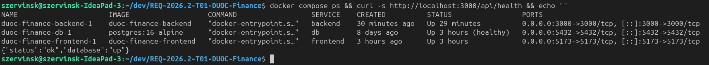
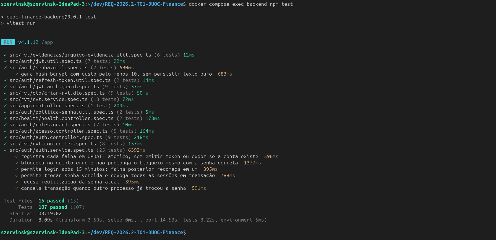
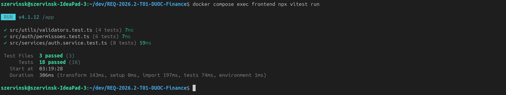
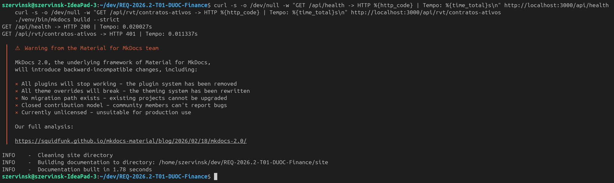
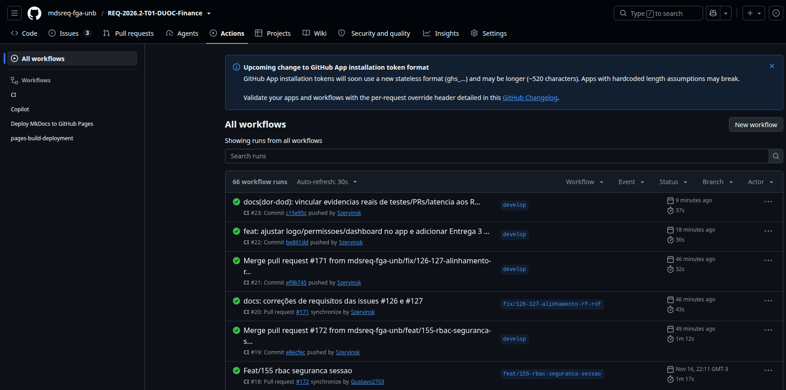
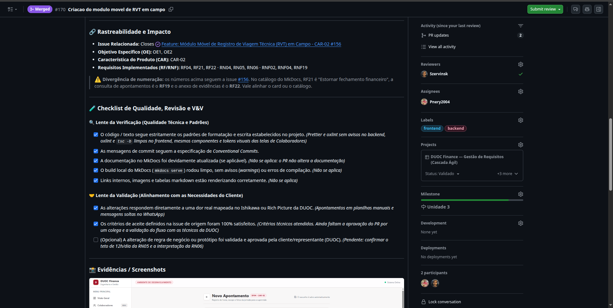

# Critérios de Aceitação: Definition of Ready (DoR) e Definition of Done (DoD)

Este capítulo formaliza os acordos de trabalho da equipe **Cascata Ágil** para selecionar itens aptos à construção e verificar quando um incremento do **DUOC Finance** está concluído. Os critérios consideram o contexto sociotécnico da DUOC, a participação da cliente parceira **Maria Beatryz** e o processo **RAD UI-First**, constituindo o artefato transversal de Governança e Qualidade da **Unidade 2** em atendimento à Seção 9 do Template Oficial da disciplina (**Definition of Ready — DoR** e **Definition of Done — DoD**).

## Definition of Ready (DoR)

O **DoR** é o acordo de prontidão para iniciar a construção da lógica de negócio e da persistência definitiva de cada item do backlog; não é um requisito para iniciar qualquer atividade de desenvolvimento. No ciclo UI-First, a prototipagem do frontend com dados mockados e a validação da interface acontecem antes do DoR. A passagem para a implementação da lógica e da persistência só pode ocorrer quando **todos** os critérios abaixo forem atendidos e houver evidência registrada. Assim, o DoR não substitui a validação UI-First nem autoriza antecipar a construção de backend ou banco de dados.

### Checklist operacional de entrada

| Verificação | Pergunta de controle | Evidência esperada |
| :--- | :--- | :--- |
| **Problema e escopo claros** | Está claro quem precisa da funcionalidade, qual problema operacional ela resolve, qual resultado é esperado e o que está fora do escopo? As pessoas envolvidas usam os termos de negócio com o mesmo significado? | História e descrição da Issue revisadas; termos e decisões relevantes registrados. |
| **Sem ambiguidades impeditivas** | Duas pessoas da equipe interpretariam da mesma forma os dados de entrada, as regras e o resultado esperado? Dúvidas que mudariam a solução foram resolvidas com a cliente ou registradas como decisão explícita? | Regras de negócio identificadas e decisões ou dependências documentadas. |
| **Tamanho adequado ao incremento** | O item entrega valor observável e cabe em um ciclo/incremento RAD planejado? Se não, foi dividido em fatias menores, cada uma verificável e priorizável? | Escopo e prioridade do item associados ao incremento no backlog/GitHub Projects. |
| **História canônica e INVEST** | A história segue “Como [papel], quero [ação], para [benefício]”? Ela atende aos critérios **INVEST** (**Independente**, **Negociável**, **Valiosa**, **Estimável**, **Pequena** e **Testável**)? | História registrada no backlog em formato INVEST, vinculada aos requisitos funcionais aplicáveis. |
| **Critérios de aceitação objetivos** | Cada critério descreve um resultado observável em lista estruturada de regras de negócio, podendo ser aprovado ou reprovado sem interpretação subjetiva? Os critérios contemplam fluxo principal, validações e limites operacionais? | Critérios de aceitação objetivos documentados na história de usuário e cenários de homologação associados. |
| **Regras de negócio explícitas** | Cálculos, permissões, estados, exceções, dados necessários e restrições estão identificados? Há regra financeira ou de acesso que precise de confirmação? | Regras de negócio referenciadas ou descritas no requisito; dúvidas bloqueadoras resolvidas. |
| **Qualidade, dados e dependências** | O contrato de dados preliminar (schemas JSON / DTOs de API) está estabelecido? Foram identificados os RNFs aplicáveis, dependências de integração, restrições legais e riscos? Seus critérios mensuráveis estão claros? | Contrato de dados e RNFs vinculados; critérios quantitativos referenciados no Capítulo 8, sem criar limites novos para o item. |
| **Base visual preparada** | A interface tem referência visual no Figma (identidade, tokens ou wireframe pertinente) e o fluxo completo foi estabelecido no Frontend, navegável e com dados sintéticos/mockados? | Link para Figma e preview do protótipo no Frontend associados à Issue. |
| **Validação sociotécnica concluída** | Maria Beatryz conseguiu percorrer o fluxo e validar campos, linguagem, sequência e resultado visual antes da implementação da lógica e da persistência? Os ajustes solicitados foram incorporados ou acordados? | Aprovação ou ressalvas registradas em ata/sessão; link, data e pendências associadas ao item. |

**Decisão do portão:** marque o item como **Pronto (DoR)** somente quando todas as respostas forem afirmativas e as evidências estiverem acessíveis à equipe. Se algum critério não for atendido, o item permanece em **Refinamento**; registre a dúvida, dependência ou ação pendente na Issue. A aprovação da tela não equivale à aprovação da lógica de negócio, que será verificada no DoD.

### Registro de aplicação — Incremento 1 (Atualizado em 16/11/2026)

O checklist DoR foi aplicado e evidenciado para as histórias entregues no **Incremento 1** (`US01`–`US04`, `US13`, `US17`–`US19`, `US22`, `US23`), com rastreabilidade direta para o catálogo, protótipo Figma, atas e Pull Requests de entrega:

| Verificação | Estado | Evidência Rastreável no Repositório |
| :--- | :---: | :--- |
| **Problema e escopo claros** | **Atendido** | Histórias `US01`–`US04`, `US13`, `US17`–`US19`, `US22`, `US23` descritas no [Catálogo Integrado](../requisitos/index.md#rf01) e alinhadas aos gargalos TR-01 a TR-04. |
| **Sem ambiguidades impeditivas** | **Atendido** | Regras `RN01`–`RN23` e decisões de escopo documentadas nos cards e na [Ata 05](../governanca/atas/reuniao-05.md). |
| **Tamanho adequado ao incremento** | **Atendido** | Itens priorizados no MVP na [Priorização](../requisitos/priorizacao.md#linha-de-corte-do-mvp) com estimativas de esforço até 16h. |
| **História canônica e INVEST** | **Atendido** | Todas as histórias seguem o formato *"Como [papel], quero [ação], para [benefício]"* nos cards do [Catálogo](../requisitos/index.md). |
| **Critérios de aceitação objetivos** | **Atendido** | Critérios funcionais, DoR e DoD especificados por requisito no [Catálogo](../requisitos/index.md) e validados por suítes Vitest. |
| **Regras de negócio explícitas** | **Atendido** | Validações de CPF (`RN01`), RBAC (`RN15`/`RN16`), bloqueio de login (`RF23`) e anexos RVT (`RN06`) formalizadas. |
| **Qualidade, dados e dependências** | **Atendido** | Contratos DTO/Prisma (`schema.prisma` e migrations `auth_usuarios_sessoes` e `rvt_apontamento_campo`) e RNFs vinculados. |
| **Base visual preparada** | **Atendido** | Telas prototipadas no Figma (*Node 1:3*) e implementadas no Frontend React ([PR #167](https://github.com/mdsreq-fga-unb/REQ-2026.2-T01-DUOC-Finance/pull/167) e [PR #170](https://github.com/mdsreq-fga-unb/REQ-2026.2-T01-DUOC-Finance/pull/170)). |
| **Validação sociotécnica concluída** | **Atendido (Incr. 1)** | Telas do Incremento 1 validadas presencialmente com Maria Beatryz na [Ata 06 (02/10/2026)](../governanca/atas/reuniao-06.md) antes da construção do backend/persistência. |

### Perguntas rápidas para refinamento

- Qual papel de usuário executa a ação e qual benefício operacional obtém?
- Que dados entram, que resultado deve ser apresentado e quais regras condicionam o fluxo?
- Como demonstrar objetivamente que cada critério de aceitação foi satisfeito?
- O item é pequeno o bastante para ser construído, verificado e demonstrado dentro do incremento planejado?
- A cliente validou o fluxo real no Frontend com mocks, e ficou registrado o que foi aprovado ou precisa mudar?

## Definition of Done (DoD)

O **DoD** é o portão de saída: confirma que a história ou incremento está funcional, integrado, verificado e **homologado pela cliente**. Neste acordo, **Concluído (Done)** significa que a homologação ocorreu e foi aceita, além de todos os demais critérios aplicáveis terem sido verificados e registrados; estar apenas pronto ou apto para homologação não é suficiente. A publicação/entrega em produção não é implícita no Done e, quando fizer parte do escopo, deve seguir o processo de liberação correspondente.

### Checklist operacional de conclusão

| Dimensão | Critério de conclusão | Evidência esperada |
| :--- | :--- | :--- |
| **Incremento funcional** | O fluxo da história está operável de ponta a ponta no ambiente definido para demonstração. A interface validada no DoR está integrada à lógica e à persistência previstas para o item; quando aplicável, está disponível em *Staging*. | Demonstração ou link do ambiente; PR/Issue identifica o incremento e seus componentes. |
| **Critérios de aceitação** | **100%** dos critérios aprovados. Nenhum critério permanece sem execução, resultado ou justificativa acordada. | Resultado da verificação de cada critério/caso de teste ligado à Issue ou PR. |
| **Código e inspeção por pares** | O código segue os padrões do repositório e tipagem estrita; passou por inspeção estruturada por pares, adaptada à realidade da equipe e inspirada no fluxo de Fagan; os checks de CI (lint e types) foram aprovados. | Checklist de inspeção preenchido no PR, registro de achados e respectivas resoluções, aprovação de revisor diferente do autor e checks de CI aprovados. |
| **Testes automatizados** | Testes automatizados pertinentes à alteração foram executados e aprovados. Regras de domínio e cálculos têm cobertura de testes apropriada; integrações e regressões afetadas foram verificadas. | Relatório de execução do CI e links/saídas dos testes. |
| **Requisitos não funcionais** | Os RNFs aplicáveis ao incremento e ao ambiente vigente (ex.: `RNF02`, `RNF03`, `RNF04`, `RNF07`, `RNF13`, `RNF14`, `RNF20`) foram verificados contra seus critérios mensuráveis via testes automatizados ou medições locais/Staging. Requisitos exclusivos de infraestrutura produtiva (ex.: SLA 99,5% em `RNF18` ou backup em produção em `RNF17`) são avaliados na etapa de implantação (*Cutover*). | Resultado de testes Vitest, medições `curl` ou inspeções vinculadas ao PR e ao card do RNF no [Catálogo](../requisitos/index.md). |
| **Documentação — Docs as Code** | Documentação afetada foi atualizada no repositório/MkDocs, incluindo orientações operacionais ou técnicas necessárias para compreender e usar o incremento. A compilação local do site termina sem warnings. | Alterações documentais no PR e saída bem-sucedida de `mkdocs build --strict`. |
| **Homologação sociotécnica** | Ao fechamento de cada **incremento RAD consolidado**, o fluxo é demonstrado à cliente em ambiente navegável (Docker/Staging) com dados sintéticos, registrando aceite ou ajustes em ata/issue. *(Não exigida individualmente a cada commit ou PR técnico intermediário.)* | Ata de validação do incremento ou registro de sessão UAT com a cliente Maria Beatryz. |
| **Rastreabilidade e encerramento** | Requisito, história, critérios de aceitação, testes e PR permanecem vinculados. Pendências não impeditivas, se houver, têm responsável, prioridade e destino acordados; não são declaradas como concluídas por omissão. | Links cruzados no GitHub Projects/Issue/PR e registro explícito de pendências acordadas. |

**Decisão do portão:** marque como **Concluído (DoD)** somente quando todos os critérios aplicáveis forem aprovados, a homologação tiver sido realizada e aceita pela cliente e as evidências estiverem registradas. Falha ou homologação pendente mantém o item em **Verificação** ou **Validação**, conforme o fluxo; registre o defeito ou a pendência e retorne à construção/refinamento necessário. Um RNF não aplicável ao escopo deve ser identificado como tal, não tratado como aprovado sem verificação.

### Procedimento e registro da inspeção por pares

A equipe realizará uma inspeção estruturada por pares, inspirada nas etapas de preparação, inspeção, tratamento de achados e acompanhamento do método de Fagan, sem afirmar que aplica o método formal completo. O registro será mantido no próprio **Pull Request (PR)** do GitHub:

1. **Preparação:** o autor abre o PR, vincula a Issue e resume o escopo e os critérios de aceitação afetados.
2. **Inspeção:** pelo menos uma pessoa diferente do autor revisa as alterações e preenche no PR um checklist com o resultado de cada verificação (**aprovado**, **ajustar** ou **não aplicável**) e uma referência à evidência ou ao trecho revisado. O checklist verifica regras de negócio e critérios de aceitação, tratamento de erros e limites, segurança/RNFs aplicáveis, testes e documentação.
3. **Tratamento e acompanhamento:** achados são registrados como comentários ou solicitação de alterações no PR. O autor corrige ou responde a cada achado; o revisor confirma a resolução antes de aprovar. Itens não aplicáveis devem vir acompanhados de justificativa.

O PR aprovado, com checklist preenchido, comentários/alterações resolvidos e verificações de CI aprovadas, é o registro comprobatório da inspeção. A aprovação do PR não substitui a homologação pela cliente nem os demais critérios do DoD.

### Registro mínimo de evidências

Para cada item concluído, a Issue ou PR deve permitir localizar:

1. História de usuário e requisitos/RNs/RNFs relacionados;
2. Critérios de aceitação e resultados dos testes correspondentes;
3. Evidência da validação visual do DoR e da homologação do DoD;
4. PR aprovado, checklist e resolução dos achados da inspeção por pares, verificações automatizadas e estado de integração;
5. Atualização documental pertinente e resultado do build MkDocs.

## Aplicação no processo RAD e rastreabilidade

Os portões se aplicam a cada história/incremento, não apenas aos marcos acadêmicos. No ciclo **UI-First**, primeiro se planeja e refina a história, estabelece-se a interface com base no Figma e prototipa-se no Frontend com mocks; a validação pela cliente satisfaz a etapa visual do DoR. Só então se constrói a lógica e a persistência. Em seguida, o incremento passa por verificação, demonstração/homologação e refinamento do ciclo seguinte.

O acordo complementa as fases e a adaptação do processo **RAD** descritas no [Capítulo 4 — Estratégias de Engenharia de Software](../metodologia/estrategias-esw.md#adaptacao-do-processo-rad-ao-contexto-da-duoc) e o ciclo UI-First, o fluxo `Backlog do Produto → Refinamento → Pronto (DoR) → Em Desenvolvimento → Em Verificação → Em Validação → Concluído (DoD)` e o planejamento por incrementos descritos no [Capítulo 6 — Cronograma](../metodologia/planejamento.md#5-racional-metodologico-do-cronograma). Os critérios de requisitos, regras de negócio e métricas de qualidade devem ser rastreados à [especificação do Capítulo 8](../requisitos/index.md), e a interação de validação/homologação segue o [processo com a cliente no Capítulo 7](../metodologia/interacao-cliente.md#73-processo-de-validacao-sociotecnica-e-homologacao-com-a-cliente).

Na **Unidade 2 / Incremento 1**, o marco de 15/10/2026 associa telas homologadas pela cliente, DoR, DER e backlog INVEST. O marco acadêmico é um ponto de controle; não substitui o avanço contínuo dos ciclos RAD nem dispensa o DoD de cada incremento.

### Registro da Aplicação do DoD — Incremento 1 (Atualizado em 16/11/2026)

A tabela abaixo registra a comprovação objetiva de cada critério do DoD para os itens do **Incremento 1** (`RF01`–`RF04`, `RF13`, `RF17`–`RF19`, `RF22`, `RF23`), com redirecionamento direto para os Pull Requests onde constam os prints, checklists e saídas de execução:

| Critério do DoD | Situação Atual | Evidência Comprobatória Direta (PR / Artefato) |
| :--- | :---: | :--- |
| **Incremento funcional (Docker/Staging)** | **Atendido** | Banco PostgreSQL (`db`), API NestJS (`backend:3000`) e Frontend React (`frontend:5173`) operacionais; telas integradas em [PR #167](https://github.com/mdsreq-fga-unb/REQ-2026.2-T01-DUOC-Finance/pull/167), [PR #170](https://github.com/mdsreq-fga-unb/REQ-2026.2-T01-DUOC-Finance/pull/170) e [PR #172](https://github.com/mdsreq-fga-unb/REQ-2026.2-T01-DUOC-Finance/pull/172). |
| **Testes automatizados (Backend e Frontend)** | **Atendido** | **107/107 testes backend** aprovados em 15 suítes Vitest + **18/18 testes frontend** aprovados em 3 suítes, registrados no [PR #172](https://github.com/mdsreq-fga-unb/REQ-2026.2-T01-DUOC-Finance/pull/172) e validados em CI no [PR #168](https://github.com/mdsreq-fga-unb/REQ-2026.2-T01-DUOC-Finance/pull/168). |
| **Código, tipagem e inspeção por pares** | **Atendido** | Checks `lint`, `tsc --noEmit` e `npm run build` aprovados em `.github/workflows/ci.yml` ([PR #168](https://github.com/mdsreq-fga-unb/REQ-2026.2-T01-DUOC-Finance/pull/168)) e revisão por pares nos PRs `#167`, `#170` e `#172`. |
| **RNFs verificáveis no incremento** | **Atendido** | `RNF02` (latência `/api/health` em `0,337s`, abaixo de `2,0s`), `RNF03` (`bcrypt` custo >= 10 em `senha.util.spec.ts`), `RNF07` (SHA-256 + MIME real em [PR #170](https://github.com/mdsreq-fga-unb/REQ-2026.2-T01-DUOC-Finance/pull/170)), `RNF13` (JWT 900s), `RNF14` (`RolesGuard` HTTP 401/403 em [PR #172](https://github.com/mdsreq-fga-unb/REQ-2026.2-T01-DUOC-Finance/pull/172)) e `RNF20` (validação DTO). |
| **Documentação — Docs as Code** | **Atendido** | Catálogo de requisitos atualizado com evidências visuais ([PR #174](https://github.com/mdsreq-fga-unb/REQ-2026.2-T01-DUOC-Finance/pull/174)) e `mkdocs build --strict` sem erros/avisos. |
| **Homologação sociotécnica do incremento** | **Pendente de sessão UAT** | Telas validadas previamente na [Ata 06](../governanca/atas/reuniao-06.md); homologação do fluxo integrado em Staging agendada na sessão de UAT com Maria Beatryz (27/11/2026). |

### Galeria de Evidências Visuais (Execução, Testes, Latência e CI/CD)

  

    
    Containers Docker ativos (PostgreSQL, NestJS e Vite)
  

  

    
    Backend Vitest: 15 suítes e 107/107 testes aprovados
  

  

    
    Frontend Vitest: 3 suítes e 18/18 testes aprovados
  

  

    
    Latência medida (20ms / 11ms HTTP 401) e mkdocs build --strict
  

  

    
    Pipelines GitHub Actions (CI e Deploy GH Pages)
  

  

    
    Revisão por pares e checklist de Pull Request
  

## Histórico de Versão

| Versão | Data | Descrição | Autor(es) | Revisor(es) |
| :---: | :---: | :--- | :--- | :--- |
| `1.0` | 07/09/2026 | Estruturação inicial dos acordos de Definition of Ready (DoR) e Definition of Done (DoD). | Matheus Ribeiro Szervinsk | Matheus Ribeiro Szervinsk |
| `1.5` | 13/10/2026 | Auditoria de governança metodológica: critérios objetivos de aceitação no DoR e inspeção Fagan no DoD. | Matheus Ribeiro Szervinsk | Eric Araújo |
| `2.0` | 28/10/2026 | Consolidação do status de aplicação do DoR na US04 e esclarecimento dos registros comprobatórios de DoD. | Giovana Ferreira Santos | Matheus Ribeiro Szervinsk |
| `2.1` | 17/11/2026 | Atualização dos registros reais de DoR e DoD do Incremento 1 com links diretos aos PRs (`#167`, `#168`, `#170`, `#172`, `#174`), resultados de testes (`107` backend / `18` frontend), latência medida e ajuste da homologação sociotécnica por incremento. | Matheus Ribeiro Szervinsk | Lucas Zanetti |
