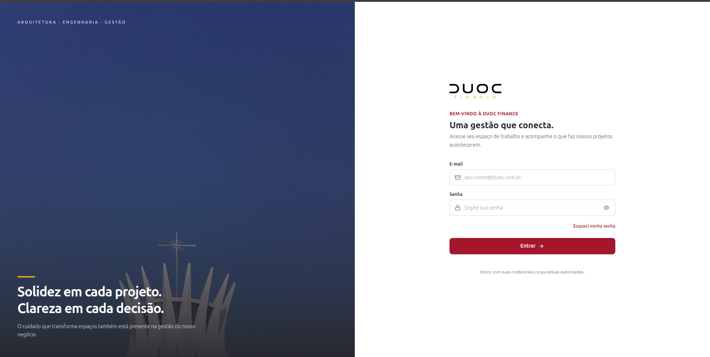
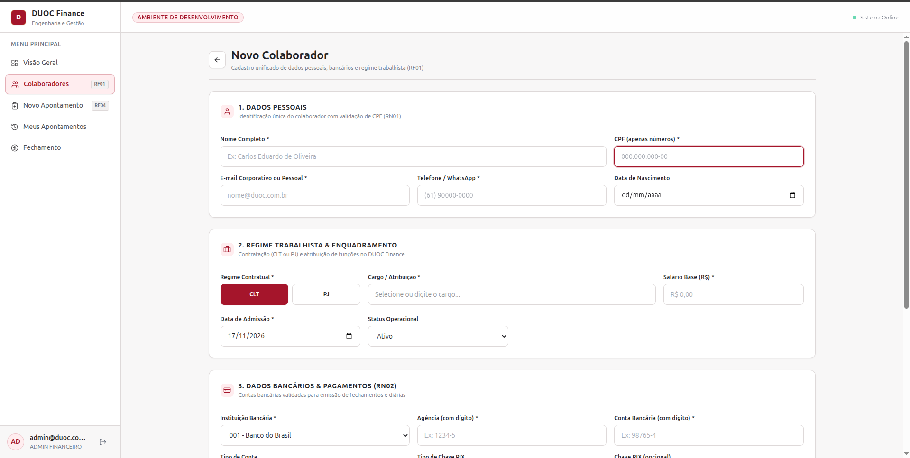
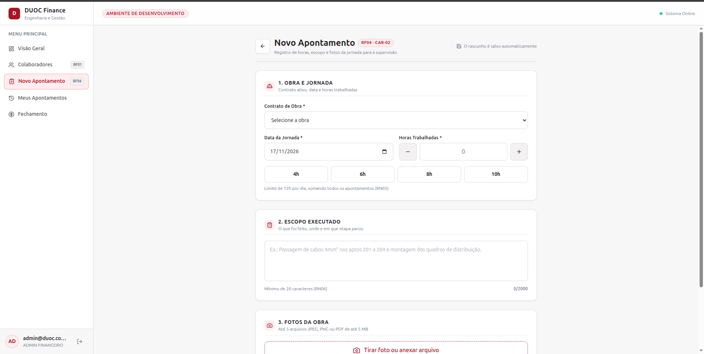

# Definition of Ready (DoR) — Acordos e Resultados por Incremento

O **DoR** é o acordo de prontidão para iniciar a construção da lógica de negócio e da persistência definitiva de cada item do backlog. No ciclo **RAD UI-First** da equipe **Cascata Ágil**, a prototipação do frontend e a validação visual com a cliente **Maria Beatryz** acontecem antes da passagem pelo portão DoR.

> Para consultar os critérios de saída e conclusão, acesse [Definition of Done (DoD)](dod.md).

---

## 1. Checklist Operacional de Entrada (Critérios Oficiais)

| Verificação | Pergunta de Controle | Evidência Esperada |
| :--- | :--- | :--- |
| **Problema e escopo claros** | Está claro quem precisa da funcionalidade, qual problema operacional resolve e o que está fora do escopo? | História e descrição da Issue revisadas; termos alinhados. |
| **Sem ambiguidades impeditivas** | Regras e entradas têm interpretação única? Dúvidas que mudariam a solução foram resolvidas com a cliente? | Regras de negócio identificadas e decisões registradas. |
| **Tamanho adequado ao incremento** | O item entrega valor observável e cabe em um incremento RAD? | Escopo e prioridade associados ao incremento. |
| **História canônica e INVEST** | A história segue *"Como [papel], quero [ação], para [benefício]"* e atende aos critérios **INVEST**? | História registrada no [Catálogo](../requisitos/index.md) em formato 1:1. |
| **Critérios de aceitação objetivos** | Cada critério descreve um resultado observável passível de aprovação/reprovação? | Critérios verificáveis documentados no card do requisito. |
| **Regras de negócio explícitas** | Cálculos, permissões, estados e exceções estão explicitados? | Regras `RN01`–`RN31` vinculadas ao requisito. |
| **Qualidade, dados e dependências** | O contrato de dados preliminar (DTOs / Prisma) e os RNFs aplicáveis estão claros? | Contrato de dados e RNFs vinculados no catálogo. |
| **Base visual preparada** | Há referência no Figma e fluxo navegável no Frontend antes do backend? | Link para Figma e preview/telas no Frontend associados à Issue. |
| **Validação sociotécnica concluída** | Maria Beatryz percorreu e validou campos, linguagem e sequência visual antes da persistência? | Aprovação ou ressalvas registradas em ata/sessão. |

### Perguntas Rápidas para Refinamento
- Qual papel de usuário executa a ação e qual benefício operacional obtém?
- Que dados entram, que resultado deve ser apresentado e quais regras condicionam o fluxo?
- Como demonstrar objetivamente que cada critério de aceitação foi satisfeito?
- O item é pequeno o bastante para ser construído, verificado e demonstrado dentro do incremento?

---

## 2. Resultados do DoR — Incremento 1 (Concluído)

Aplicado integralmente às 10 histórias/requisitos do **Incremento 1** ([`RF01`](../requisitos/index.md#rf01)–[`RF04`](../requisitos/index.md#rf04), [`RF13`](../requisitos/index.md#rf13), [`RF17`](../requisitos/index.md#rf17)–[`RF19`](../requisitos/index.md#rf19), [`RF22`](../requisitos/index.md#rf22), [`RF23`](../requisitos/index.md#rf23)):

| Verificação DoR | Estado | Evidência Rastreável |
| :--- | :---: | :--- |
| **Escopo, INVEST e Critérios Objetivos** | **Atendido (10/10 RFs)** | Histórias `US01`–`US04`, `US13`, `US17`–`US19`, `US22`, `US23` e regras `RN01`–`RN23` consolidadas no [Catálogo Integrado](../requisitos/index.md) e [Priorização do MVP](../requisitos/priorizacao.md#linha-de-corte-do-mvp). |
| **Contratos de Dados e RNFs Vinculados** | **Atendido** | Schemas Prisma (`schema.prisma`), migrations (`auth_usuarios_sessoes`, `rvt_apontamento_campo`) e DTOs validados nos PRs [#170](https://github.com/mdsreq-fga-unb/REQ-2026.2-T01-DUOC-Finance/pull/170) e [#172](https://github.com/mdsreq-fga-unb/REQ-2026.2-T01-DUOC-Finance/pull/172). |
| **Base Visual (Figma + Telas Frontend UI-First)** | **Atendido** | Telas de Login, Colaboradores e Apontamento RVT prototipadas e implementadas no Frontend React ([PR #167](https://github.com/mdsreq-fga-unb/REQ-2026.2-T01-DUOC-Finance/pull/167) e [PR #170](https://github.com/mdsreq-fga-unb/REQ-2026.2-T01-DUOC-Finance/pull/170)). |
| **Validação Sociotécnica Prévia** | **Atendido** | Fluxos e telas aprovados presencialmente por Maria Beatryz na [Ata da Reunião 06 (02/10/2026)](../governanca/atas/reuniao-06.md) antes do avanço da persistência. |

??? info "Evidências Visuais do DoR — Telas Base do Incremento 1 (Clique para expandir)"
    

      

        
        Login Corporativo (RF13)
      

      

        
        Novo Colaborador (RF01)
      

      

        
        Novo Apontamento RVT (RF04/RF22)
      

    

---

## 3. Resultados do DoR — Incrementos 2 e 3 (Em Andamento)

| Conjunto de Requisitos | Situação do DoR | Observação Operacional |
| :--- | :---: | :--- |
| **Incremento 2 em Desenvolvimento (6 RFs):** [`RF07`](../requisitos/index.md#rf07), [`RF08`](../requisitos/index.md#rf08), [`RF28`](../requisitos/index.md#rf28), [`RF29`](../requisitos/index.md#rf29), [`RF32`](../requisitos/index.md#rf32), [`RF35`](../requisitos/index.md#rf35) | **DoR Aprovado** | Histórias, regras (`RN06`–`RN08`, `RN14`), critérios e fluxos visuais refinados e liberados para codificação no Ciclo 2. |
| **Prontos para Dev / Incr. 2–3 (12 RFs):** [`RF05`](../requisitos/index.md#rf05), [`RF06`](../requisitos/index.md#rf06), [`RF27`](../requisitos/index.md#rf27), [`RF09`](../requisitos/index.md#rf09)–[`RF11`](../requisitos/index.md#rf11), [`RF33`](../requisitos/index.md#rf33), [`RF34`](../requisitos/index.md#rf34), [`RF37`](../requisitos/index.md#rf37)–[`RF40`](../requisitos/index.md#rf40) | **DoR Aprovado** | Especificações atômicas, regras centesimais e contratos de centro de custo validados; aguardando execução em sprint. |
| **Aguardando Ciclo (3 RFs) e Pós-MVP (9 RFs)** | **DoR Não Iniciado** | Mantidos em refinamento/backlog futuro até atingirem seu ciclo correspondente. |

---

## Histórico de Versão

| Versão | Data | Descrição | Autor(es) | Revisor(es) |
| :---: | :---: | :--- | :--- | :--- |
| `1.0` | 17/11/2026 | Desmembramento do DoR em documento próprio com resultados por incremento e evidências visuais em bloco expansível. | Matheus Ribeiro Szervinsk | Equipe Cascata Ágil |
