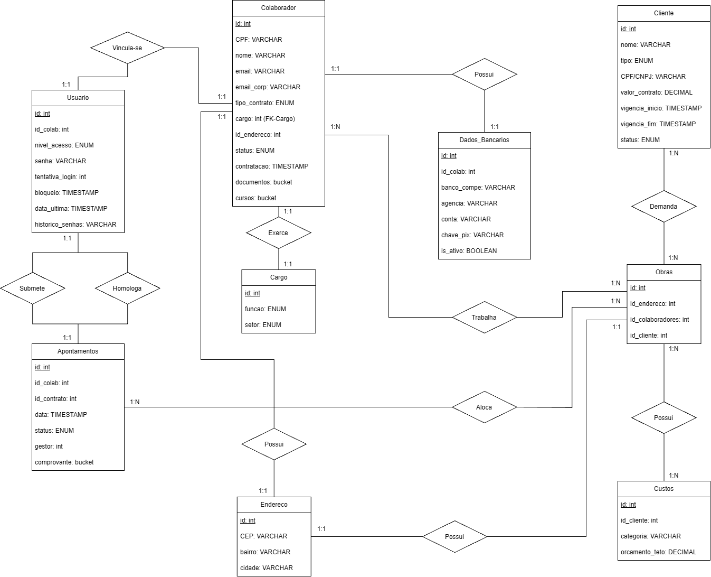

# Estrutura do Banco de Dados e Diagrama Entidade-Relacionamento

Este documento detalha a arquitetura de dados do sistema **DUOC Finance**, projetada para suportar as operações de apontamento de campo (RVT), controle orçamentário e fechamento financeiro. A modelagem garante a integridade referencial e isola o domínio de gestão de recursos humanos (Colaborador) da camada de segurança e acesso (Usuário), assegurando o Princípio do Menor Privilégio e conformidade estrita com a LGPD.

## 1. Diagrama Entidade-Relacionamento (DER)

Abaixo está a representação visual unificada das entidades, cardinalidades e relacionamentos do sistema, baseada no arquivo base `DER_DUOC_Finance.drawio.png`:

---

## 2. Dicionário de Dados: Entidades e Atributos

A arquitetura está dividida em 9 entidades principais, agrupadas por contexto de domínio. Os tipos de dados e atributos foram mapeados para sustentar os Requisitos Funcionais (RFs) e Regras de Negócio (RNs) do projeto.

### 2.1. Domínio de Identidade, Acesso e RH
Separação lógica entre a ficha cadastral do colaborador e suas credenciais de acesso, permitindo a gestão segura de autenticação.

| Entidade | Atributo | Descrição / Contexto de Negócio |
| :--- | :--- | :--- |
| **Colaborador** | `id` | Identificador único do colaborador (PK). |
| | `cpf` | Chave única (UK), validada sistemicamente. |
| | `nome` | Nome completo do profissional. |
| | `email` | E-mail de contato pessoal. |
| | `email corporativo` | E-mail oficial da empresa. |
| | `tipo contrato` | Enquadramento (CLT, Diarista, Prestador). |
| | `cargo` | FK para a entidade Cargo. |
| | `id_endereço` | FK para a entidade Endereço. |
| | `status` | Situação funcional (Ativo, Afastado, Desligado). |
| | `contratação` | Data de admissão ou início do vínculo. |
| | `documentos` | Referência ao *Bucket* de arquivos estáticos (S3/Supabase). |
| | `cursos` | Referência ao *Bucket* de certificados e capacitações. |
| **Usuário** | `id` | Identificador único de autenticação (PK). |
| | `id_colab` | FK associando o usuário ao seu perfil de `Colaborador`. |
| | `nivel_acesso` | Papel RBAC estruturado (Gestor, Admin, Técnico). |
| | `senha` | Hash criptografado (AES-256). |
| | `tentativa_login` | Contador para bloqueio *anti-brute force* (RN20). |
| | `bloqueio` | Status/Timestamp de restrição de acesso temporário. |
| | `data_ultima` | Timestamp do último acesso autenticado. |
| | `historico_senhas` | Registro das últimas senhas para impedir reuso (RN21). |
| **Cargo** | `id` | Identificador único (PK). |
| | `função` | Título do cargo/função desempenhada. |
| | `setor` | Departamento de alocação (Operacional, Administrativo). |

### 2.2. Domínio de Base Financeira e Operacional
Gestão de contas para repasses, reembolsos e mapeamento geográfico.

| Entidade | Atributo | Descrição / Contexto de Negócio |
| :--- | :--- | :--- |
| **Dados_Bancários** | `id` | Identificador único (PK). |
| | `id_colab` | FK para a entidade Colaborador. |
| | `banco_compe` | Código de compensação (Padrão Febraban). |
| | `agencia` | Agência bancária com dígito. |
| | `conta` | Conta corrente ou poupança. |
| | `chave_pix` | Chave validada para transferência direta. |
| | `is_ativo` | Booleano para controle de versionamento cadastral (RN23). |
| **Endereço** | `id` | Identificador único (PK). |
| | `CEP` | Código Postal. |
| | `bairro` | Bairro do endereço. |
| | `cidade` | Município/UF de localização. |

### 2.3. Domínio de Obras, Contratos e Custos
Estrutura orçamentária (Centros de Custo) associada às demandas e clientes da DUOC.

| Entidade | Atributo | Descrição / Contexto de Negócio |
| :--- | :--- | :--- |
| **Cliente** | `id` | Identificador único do cliente (PK). |
| | `nome` | Razão Social ou Nome Fantasia. |
| | `tipo` | Natureza jurídica (Pessoa Física ou Jurídica). |
| | `CPF/CNPJ` | Documento unívoco de faturamento. |
| | `valor_contrato` | Montante global pactuado. |
| | `vigencia_inicio` | Data de início contratual. |
| | `vigencia_fim` | Data de encerramento do contrato. |
| | `status` | Ativo, Suspenso ou Encerrado. |
| **Obras** | `id` | Identificador único do centro de obra (PK). |
| | `id_endereço` | FK para a entidade Endereço (localização física). |
| | `id_colaboradores` | Chaves de equipes alocadas na respectiva obra. |
| | `id_cliente` | FK indicando a quem a obra pertence. |
| **Custos** | `id` | Identificador único do centro de custo (PK). |
| | `id_cliente` | FK de amarração com o cliente faturado. |
| | `categoria` | Classificação da despesa (Material, Hospedagem, etc). |
| | `orçamento_teto` | Limite financeiro máximo para disparo de alertas (RN13/RN29). |

### 2.4. Domínio de Prestação de Contas (Transacional)
Gestão de relatórios de viagem, diárias e comprovantes.

| Entidade | Atributo | Descrição / Contexto de Negócio |
| :--- | :--- | :--- |
| **Apontamentos** | `id` | Identificador único do RVT/apontamento (PK). |
| | `id_colab` | FK do colaborador (autor do apontamento). |
| | `id_contrato` | FK da obra/contrato onde o custo será alocado. |
| | `data` | Timestamp da execução da atividade (controle de janela D+1). |
| | `status` | Pendente, Homologado ou Rejeitado (RN30). |
| | `gestor` | FK referenciando o `id_colab` do responsável pela avaliação. |
| | `comprovante` | Referência de bucket (anexos e fotos geolocalizadas - RN24). |

---

## 3. Matriz de Relacionamentos e Cardinalidade

As interações entre as entidades foram mapeadas no banco de dados assegurando as políticas de integridade referencial. Abaixo a síntese da semântica dos relacionamentos (Verbos) e de suas respectivas cardinalidades sistêmicas:

* **Usuário `(1)`** — `<Vincula-se>` — **`(1)` Colaborador** *(Separação de Identidade / Autenticação)*
* **Usuário `(1)`** — `<Submete>` — **`(1)` Apontamentos** *(Rastreio exato da autoria do RVT)*
* **Usuário `(1)`** — `<Homologa>` — **`(1)` Apontamentos** *(Registro do gestor responsável pelo aceite/recusa)*
* **Colaborador `(1)`** — `<Exerce>` — **`(1)` Cargo**
* **Colaborador `(1)`** — `<Possui>` — **`(1)` Endereço**
* **Colaborador `(1)`** — `<Possui>` — **`(1)` Dados_Bancários**
* **Colaborador `(N)`** — `<Trabalha>` — **`(1)` Obras** *(Equipes alocadas no canteiro)*
* **Apontamentos `(N)`** — `<Aloca>` — **`(1)` Obras** *(Rateio de custos associado ao centro da obra)*
* **Obras `(1)`** — `<Possui>` — **`(1)` Endereço**
* **Cliente `(1)`** — `<Demanda>` — **`(N)` Obras** *(Um cliente pode possuir múltiplos contratos simultâneos)*
* **Obras `(1)`** — `<Possui>` — **`(N)` Custos** *(Rateio e quebra de categorias financeiras por projeto)*