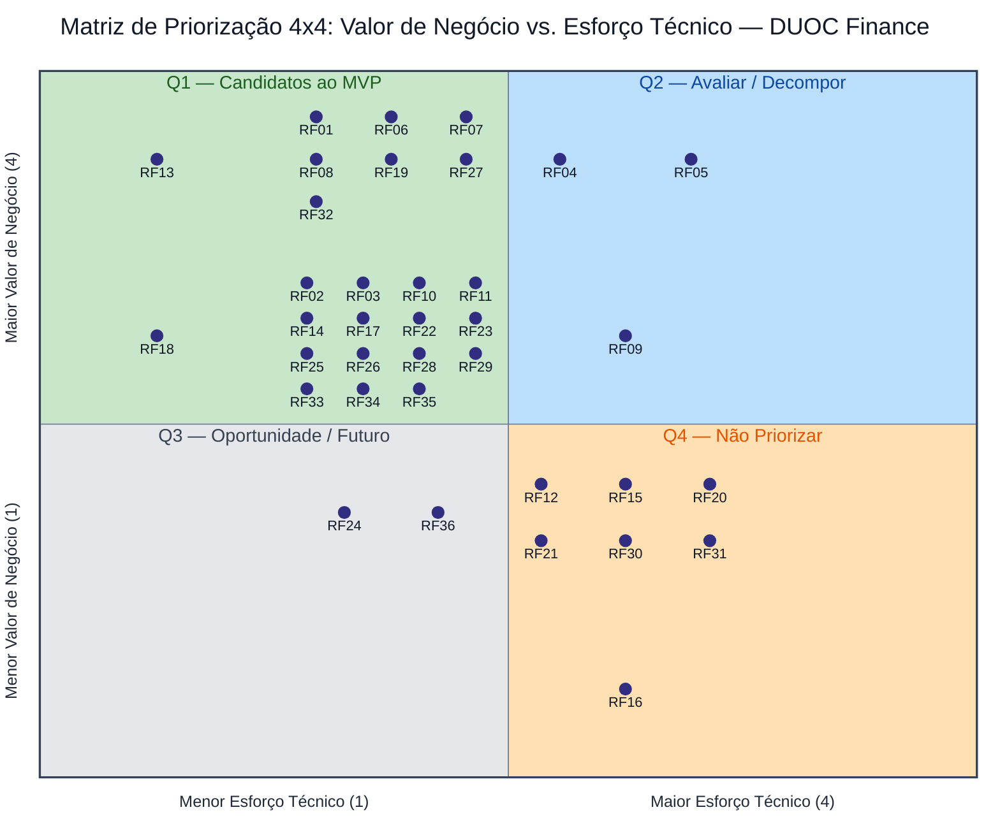

# Priorização e Escopo do Produto (Linha de Corte do MVP)

Este documento consolida o **modelo metodológico integrado de priorização e delimitação do escopo de produto** do sistema ***DUOC Finance***, articulando os **Requisitos Funcionais (RF)** e **Requisitos Não Funcionais (RNF)** sob duas perspectivas analíticas complementares:

<div class="catalog-nav-deck">
  <a href="../" class="catalog-nav-btn">
    <span class="nav-btn-badge">91</span>
    <span class="nav-btn-text">Catálogo Geral de Requisitos ↗</span>
  </a>
  <a href="../rastreabilidade/" class="catalog-nav-btn catalog-nav-btn-ext">
    <span class="nav-btn-text">Pirâmide & Rastreabilidade ↗</span>
  </a>
  <a href="../governanca-conformidade/#61-matriz-canonica-de-papeis-rbac" class="catalog-nav-btn catalog-nav-btn-ext">
    <span class="nav-btn-text">Atores & Papéis RBAC ↗</span>
  </a>
  <a href="../../mvp/backlog/#priorizacao-do-backlog-e-linha-de-corte-do-mvp" class="catalog-nav-btn catalog-nav-btn-ext">
    <span class="nav-btn-text">Backlog & Linha de Corte ↗</span>
  </a>
</div>

<div class="grid cards" markdown>

-   :material-clipboard-check-outline: **Valor de Negócio (Eixo Vertical)**

    ---
    Critérios qualitativos e quantitativos derivados dos gargalos operacionais (**TR-01 a TR-04**), redução de horas administrativas e governança jurídica.

-   :material-clipboard-text-clock-outline: **Esforço Técnico (Eixo Horizontal)**

    ---
    Estimativa composta calculada pela equipe **Cascata Ágil** a partir de horas de codificação, complexidade arquitetural e lacuna de domínio técnico.

</div>

Os resultados convergem diretamente na [**Matriz 4 × 4 (Valor × Esforço)**](#matriz-4-x-4), fornecendo o embasamento analítico para delimitar a linha de corte do **Produto Mínimo Viável (MVP)**, o tratamento dos requisitos de alto valor e alto esforço, a vinculação dos atributos de qualidade (RNFs) e a evolução contínua do produto, atendendo à Seção 10.2 do Template Oficial da disciplina.

A delimitação do escopo do MVP articula os **40 Requisitos Funcionais (RF01 a RF40)** do catálogo de requisitos e as histórias mapeadas no [Catálogo Integrado de Requisitos](index.md): o **MVP consolida 27 requisitos funcionais** (os 23 do núcleo inicial mais RF32, RF33, RF34 e RF35) e **9 requisitos no backlog evolutivo pós-MVP** (os 8 do núcleo inicial mais o RF36), totalizando as 36 histórias de usuário do backlog (27 no MVP e 9 pós-MVP). Os requisitos resultantes da decomposição atômica de contratos e centros de custo (RF37 a RF40) aguardam estimativas isoladas para os refinamentos dos ciclos de construção.

---

<a id="8-6-avaliacao-do-valor-de-negocio"></a>
<a id="101-avaliacao-do-valor-de-negocio"></a>
<a id="avaliacao-do-valor-de-negocio"></a>
<a id="criterios-qualitativos-de-negocio"></a>
<a id="criterios-quantitativos-de-negocio"></a>
<a id="rubrica-de-julgamento-do-valor-de-negocio"></a>
## Avaliação do Valor de Negócio

A Engenharia de Requisitos orientada ao valor assegura que os esforços de modelagem, prototipação ágil (*UI-First*) e implementação concentrem-se prioritariamente nas funcionalidades que geram o mais alto retorno operacional e mitigam os maiores riscos institucionais da organização parceira.

Navegue pelas abas abaixo para consultar as diretrizes metodológicas do julgamento de valor:

=== "Escala de Valor (1 a 4)"

    Para tornar a avaliação auditável e comparável, o valor de cada requisito é expresso em uma **escala quantitativa de 1 a 4**. Não há classificação categórica adicional: a priorização decorre exclusivamente do cruzamento **Valor de Negócio × Esforço Técnico** na Matriz 4 × 4.

    | Pontuação | Nível de Valor | Interpretação e Impacto no Negócio | Diretriz Operacional para o MVP |
    | :---: | :---: | :--- | :--- |
    | **4** | **Muito alto**<br>*(Crítico)* | **Indispensável:** sem esta funcionalidade, o sistema torna-se operacionalmente inviável ou juridicamente vulnerável. Sua ausência paralisa o processo central ou impede a substituição das rotinas manuais prioritárias. | **Inclusão obrigatória no MVP.** Bloqueante para a primeira versão operacional. |
    | **3** | **Alto**<br>*(Importante)* | **Muito importante:** resolve atritos operacionais severos ou automatiza etapas de suporte direto ao fluxo principal. O produto ainda pode operar temporariamente sem ela mediante contorno manual assistido a curtíssimo prazo. | **Inclusão prioritária no MVP** para garantir sustentabilidade da rotina de trabalho. |
    | **2** | **Moderado**<br>*(Desejável)* | **Agrega valor e conveniência:** melhora a experiência do usuário ou oferece recursos analíticos avançados, mas sua ausência não degrada a execução dos fluxos financeiros e cadastrais essenciais. | **Inclusão condicionada à capacidade residual** ou postergada para o ciclo seguinte. |
    | **1** | **Baixo**<br>*(Postergável)* | **Não prioritário para a versão atual:** requisito reconhecido como valoroso para a maturidade corporativa futura, mas postergado por não atender às dores imediatas ou possuir melhor alternativa temporária. | **Fora do MVP.** Registrado formalmente no *roadmap* pós-implantação. |

=== "Dimensões da Rubrica (D1 a D4)"

    As notas de 1 a 4 são atribuídas à luz de quatro dimensões de julgamento operacional. As faixas de economia de horas são calculadas sobre a base de referência de **mais de 30 h/mês** de conferência manual da auxiliar-administradora:

    | Dimensão de Julgamento | **Nota 4** — Valor muito alto | **Nota 3** — Valor alto | **Nota 2** — Valor moderado | **Nota 1** — Valor baixo |
    | :--- | :--- | :--- | :--- | :--- |
    | **D1 — Impacto nos gargalos TR-01 a TR-04** | Sem o requisito, ao menos um fluxo TR-01 a TR-04 não se completa ou não pode ser conferido. | Automatiza ou dá visibilidade a etapa de suporte direto a um TR; o TR ainda se completa com contorno assistido. | Oferece análise avançada ou comparativa (histórico, alertas, previsto × realizado) sobre dado de um TR já atendido. | Sem vínculo direto com um TR; contornável pela fase piloto. |
    | **D2 — Economia de horas administrativas** | ≥ 25% da economia mensal estimada (≈ 8 h/mês ou mais). | De 10% a 25% (≈ 3 a 8 h/mês). | Inferior a 10% (< 3 h/mês) ou ganho apenas indireto. | Sem economia mensurável no primeiro ciclo. |
    | **D3 — Risco jurídico-trabalhista, fiscal e LGPD** | Ausência gera exposição direta e imediata: reembolso sem comprovante fiscal (RN06), acesso sem autenticação a dados pessoais e bancários (RN15, RN16) ou lançamento financeiro sem base cadastral válida (RN01, RN03). | Controle preventivo ou de rastreabilidade que reduz a probabilidade ou o impacto do risco (ex.: RN04, RN14, RN23). | Risco indireto ou residual, com controle compensatório existente (ex.: gravação de logs pelo backend, RN19). | Risco tratável por suporte técnico pontual. |
    | **D4 — Frequência de operação** | Contínua: a cada apontamento, transação ou acesso, ou pré-requisito de todos os perfis. | Recorrente: por solicitação, por competência ou por evento de cadastro. | Ocasional: análise gerencial periódica ou política de manutenção. | Eventual ou de exceção. |

=== "Gargalos Operacionais (TR-01 a TR-04)"

    A priorização ancora-se diretamente nos gargalos mapeados no [Cenário Atual](../visao-produto/cenario-atual.md#diagrama-de-causa-e-efeito-ishikawa):

    | Gargalo | Fluxo Operacional na DUOC | Capacidades de Software Vinculadas | Nível de Valor Predominante |
    | :---: | :--- | :--- | :---: |
    | **TR-01** | Envio e homologação do Relatório de Viagem Técnica (RVT) | Coleta móvel, fotos de evidência, deliberação e consulta pelo diarista | **4 / 3** (Crítico) |
    | **TR-02** | Submissão e conferência de comprovantes de despesa | Prestação de contas digital, adiantamentos e validação de cupons fiscais | **4 / 3** (Crítico) |
    | **TR-03** | Consolidação de diárias técnicas e comissões | Prévia automatizada, cálculo centesimal e homologação irrevogável | **4 / 2** (Crítico) |
    | **TR-04** | Apropriação de custo por contrato e centro de custo | Vinculação direta de despesas a obras e painel orçamentário | **3 / 2** (Importante) |
    | **Transversal** | Base cadastral unificada, autenticação e auditoria probatória | Cadastro validado por CPF, perfis RBAC, logs append-only e retenção CLT | **4 a 1** (Fundacional) |

=== "Regras de Consolidação & MVP"

    **Regra de Consolidação:** A nota final é definida pelo **maior grau atingido entre D1 e D3** (fatores bloqueantes de processo ou de exposição de risco). As dimensões **D2 e D4** funcionam como critérios de ajuste: confirmam a nota ou podem deslocá-la em no máximo 1 ponto quando convergirem.
    
    A linha de corte do MVP decorre diretamente do eixo de Valor de Negócio: **requisitos de valor 4 ou 3 integram o MVP** e requisitos de **valor 2 ou 1 integram o backlog de evolução pós-MVP**. O esforço técnico não elimina requisitos de alto valor; orienta a decomposição arquitetural.

    ```mermaid
    flowchart LR
        subgraph NIVEIS["Distribuição dos 36 RFs do Backlog por Valor de Negócio"]
            direction TB
            V4["<b>VALOR 4 — Muito alto (Crítico)</b><br>10 RFs (27,8%) · RF01, RF04, RF05, RF06, RF07, RF08, RF13, RF19, RF27, RF32"]
            V3["<b>VALOR 3 — Alto (Importante)</b><br>17 RFs (47,2%) · RF02, RF03, RF09, RF10, RF11, RF14, RF17, RF18, RF22, RF23, RF25, RF26, RF28, RF29, RF33, RF34, RF35"]
            V2["<b>VALOR 2 — Moderado (Desejável)</b><br>8 RFs (22,2%) · RF12, RF15, RF20, RF21, RF24, RF30, RF31, RF36"]
            V1["<b>VALOR 1 — Baixo (Postergável)</b><br>1 RF (2,8%) · RF16"]
            V4 ~~~ V3
            V3 ~~~ V2
            V2 ~~~ V1
        end

        subgraph DEST["Linha de Corte e Destinação"]
            direction TB
            MVP["<b>PRODUTO MÍNIMO VIÁVEL (MVP)</b><br>27 RFs selecionados (75,0% do Backlog)<br>Núcleo operacional completo para a DUOC"]
            POST["<b>BACKLOG DE EVOLUÇÃO PÓS-MVP</b><br>9 RFs postergados (25,0% do Backlog)<br>Ciclos posteriores e capacidade residual"]
            MVP ~~~ POST
        end

        V4 ==> MVP
        V3 ==> MVP
        V2 -.-> POST
        V1 -.-> POST

        classDef v4Class fill:#10b981,stroke:#059669,stroke-width:2px,color:#ffffff;
        classDef v3Class fill:#0284c7,stroke:#0369a1,stroke-width:2px,color:#ffffff;
        classDef v2Class fill:#f59e0b,stroke:#d97706,stroke-width:2px,color:#ffffff;
        classDef v1Class fill:#64748b,stroke:#475569,stroke-width:2px,color:#ffffff;
        classDef mvpClass fill:#047857,stroke:#065f46,stroke-width:3px,color:#ffffff;
        classDef postClass fill:#334155,stroke:#1e293b,stroke-width:2px,color:#ffffff;

        class V4 v4Class;
        class V3 v3Class;
        class V2 v2Class;
        class V1 v1Class;
        class MVP mvpClass;
        class POST postClass;
    ```

---

<a id="8-7-avaliacao-do-esforco-tecnico"></a>
<a id="102-avaliacao-do-esforco-tecnico"></a>
<a id="avaliacao-do-esforco-tecnico"></a>
<a id="escalas-tecnicas"></a>
<a id="esforco-de-implementacao-tempo-em-horas"></a>
<a id="complexidade-tecnica"></a>
<a id="lacuna-de-capacidade-da-equipe"></a>
<a id="formula-de-consolidacao-e-regra-de-conversao"></a>
## Avaliação do Esforço Técnico

O esforço técnico consolidado é composto por três dimensões mensuráveis, orientadas no mesmo sentido (onde **1 representa menor barreira e 4 representa maior desafio**):

Navegue pelas abas abaixo para consultar as escalas e a regra de conversão:

=== "Tempo de Implementação (Horas)"

    Mede o volume de trabalho em pessoa-hora para desenvolvimento de backend, frontend, persistência e testes automatizados:

    | Pontuação | Classificação | Faixa de Tempo Estimada | Descrição Operacional |
    | :---: | :--- | :---: | :--- |
    | **1** | Esforço baixo | Até 2 h | Alteração pontual, fluxo direto com tela simples e validação básica. |
    | **2** | Esforço moderado | Mais de 2 h até 8 h | Fluxo de complexidade média, com formulários, validações e persistência relacional padrão. |
    | **3** | Esforço alto | Mais de 8 h até 16 h | Fluxo abrangente, com múltiplas etapas, processamentos condicionais ou manipulação de arquivos/tokens. |
    | **4** | Esforço muito alto | Mais de 16 h | Rotina de alta densidade algorítmica, concorrência crítica, reconciliação em lote ou integração com incertezas. |

=== "Complexidade Arquitetural (CX)"

    Avalia as dependências arquiteturais, regras de validação cruzada e requisitos de integridade transacional:

    | Pontuação | Classificação | Interpretação Técnica |
    | :---: | :--- | :--- |
    | **1** | Baixa | Utiliza padrão CRUD conhecido, com poucas dependências locais e consultas simples. |
    | **2** | Moderada | Exige parametrizações de filtros, validações condicionais simples ou integridade entre tabelas relacionais. |
    | **3** | Alta | Possui regras de negócio estritas (imutabilidade, bloqueio retroativo, validações centesimais ou upload de mídia). |
    | **4** | Muito alta | Apresenta consistência transacional ACID mandatória, segregação RBAC em camadas, auditoria atômica ou integração externa legada. |

=== "Lacuna de Capacidade (LC)"

    Mede a distância entre o domínio tecnológico/conceitual necessário e a experiência prévia dos integrantes:

    | Pontuação | Classificação | Interpretação Técnica |
    | :---: | :--- | :--- |
    | **1** | Domínio pleno | A equipe domina plenamente os conceitos e as tecnologias envolvidas (React/TypeScript, NestJS, PostgreSQL). |
    | **2** | Conhecimento suficiente | A equipe possui conhecimento teórico e prático satisfatório, demandando apenas pesquisa pontual de padrões conhecidos. |
    | **3** | Aprendizagem relevante | A equipe precisa desenvolver conceitos específicos (ponto fixo centesimal, isolamento RBAC rígido e concorrência). |
    | **4** | Lacuna crítica | A equipe ainda não possui experiência prévia com o padrão, demandando investigação aprofundada ou prova de conceito. |

=== "Cálculo & Conversão Ordinal"

    Para consolidar as três dimensões em um indicador único e reprodutível, adota-se a média aritmética simples:

    $$\text{Média Consolidada} = \frac{\text{Horas (Nota)} + \text{Complexidade} + \text{Lacuna}}{3}$$

    A média decimal resultante é convertida para a escala ordinal inteira de **1 a 4** da Matriz 4 × 4:

    | Intervalo da Média | Esforço Consolidado | Coluna na Matriz 4 × 4 | Interpretação Técnica |
    | :---: | :---: | :---: | :--- |
    | **1,00 a 1,49** | **1 — Baixo** | 1ª Coluna | Demanda técnica muito reduzida, tecnologia dominada e rápida entrega. |
    | **1,50 a 2,49** | **2 — Moderado** | 2ª Coluna | Demanda balanceada, regras claras e execução controlada no ciclo regular. |
    | **2,50 a 3,49** | **3 — Alto** | 3ª Coluna | Demanda substancial, regras de negócio densas e atenção especial a testes. |
    | **3,50 a 4,00** | **4 — Muito alto** | 4ª Coluna | Elevada incerteza, múltiplos componentes acoplados ou risco de retrabalho. |

---

<a id="8-8-tabela-consolidada-das-avaliacoes"></a>
<a id="tabela-consolidada-das-avaliacoes"></a>
<a id="revisao-e-calibracao-do-esforco-tecnico-frente-a-matriz-4-x-4"></a>
<a id="revisao-e-calibracao-do-esforco-tecnico-frente-a-matriz-4-4"></a>
## Calibração e Distribuição do Esforço Técnico

!!! info "Consulta Individualizada das Notas por Requisito e Unificação de Escopo"
    Em consonância com a reformulação de **Priorização & Escopo do Produto**, as pontuações e métricas atômicas de cada requisito (**VB** — Valor de Negócio, **CX** — Complexidade Técnica, **ES** — Esforço de Implementação em horas/nota, **LC** — Lacuna de Capacidade, **EC** — Esforço Consolidado e **IP** — Índice de Prioridade) foram integradas diretamente aos **[Cards Interativos do Catálogo Geral de Requisitos](index.md)** (Aba *"Priorização & Score 4×4"*), unificando também as respectivas **Histórias de Usuário (US)**, critérios de aceitação e rastreabilidade tática em um único local. A ordenação e especificações de cada história de usuário encontram-se unificadas nos cards do **[Catálogo Integrado de Requisitos](index.md)**.

A revisão do esforço técnico verificou a coerência analítica entre as três dimensões técnicas e as colunas ocupadas na Matriz 4 × 4:

1. **Aderência das horas à faixa:** Todos os requisitos situam-se em estimativas realistas até 16 h (nenhum requisito atinge a nota 4 isolada de esforço graças à decomposição de escopo).
2. **Consistência dimensional:** A complexidade supera a nota de horas apenas quando há regra estrutural que aumenta o risco sem aumentar a codificação bruta (ex.: cálculo monetário no RF05, imutabilidade no RF06 e RBAC em camadas no RF14).
3. **Distribuição do Esforço Consolidado:**

| Esforço Consolidado | Coluna na Matriz | Total de RFs | Requisitos Alocados |
| :---: | :---: | :---: | :--- |
| **1 — Baixo** | 1ª Coluna | 2 | [RF13](index.md#rf13), [RF18](index.md#rf18) |
| **2 — Moderado** | 2ª Coluna | 24 | [RF01](index.md#rf01), [RF02](index.md#rf02), [RF03](index.md#rf03), [RF06](index.md#rf06), [RF07](index.md#rf07), [RF08](index.md#rf08), [RF10](index.md#rf10), [RF11](index.md#rf11), [RF14](index.md#rf14), [RF17](index.md#rf17), [RF19](index.md#rf19), [RF22](index.md#rf22), [RF23](index.md#rf23), [RF24](index.md#rf24), [RF25](index.md#rf25), [RF26](index.md#rf26), [RF27](index.md#rf27), [RF28](index.md#rf28), [RF29](index.md#rf29), [RF32](index.md#rf32), [RF33](index.md#rf33), [RF34](index.md#rf34), [RF35](index.md#rf35), [RF36](index.md#rf36) |
| **3 — Alto** | 3ª Coluna | 10 | [RF04](index.md#rf04), [RF05](index.md#rf05), [RF09](index.md#rf09), [RF12](index.md#rf12), [RF15](index.md#rf15), [RF16](index.md#rf16), [RF20](index.md#rf20), [RF21](index.md#rf21), [RF30](index.md#rf30), [RF31](index.md#rf31) |
| **4 — Muito alto** | 4ª Coluna | 0 | *Coluna vazia: os requisitos de maior complexidade foram tratados preventivamente por decomposição e redução de escopo.* |

---

<a id="8-9-matriz-4-x-4"></a>
<a id="8-9-matriz-4-x-4-valor-de-negocio-x-esforco-tecnico"></a>
<a id="104-matriz-4-x-4"></a>
<a id="matriz-4-x-4"></a>
<a id="matriz-4-x-4-valor-de-negocio-x-esforco-tecnico"></a>
<a id="representacao-visual-da-matriz-4-x-4-diagrama-cartesiano"></a>
<a id="representacao-visual-da-matriz-4-4-diagrama-cartesiano"></a>
<a id="fundamentacao-matematica-das-coordenadas-cartesianas"></a>
## Matriz 4 × 4 — Valor de Negócio × Esforço Técnico

O cruzamento bidimensional entre o **Valor de Negócio** (eixo vertical, crescendo de baixo para cima) e o **Esforço Técnico Consolidado** (eixo horizontal, crescendo da esquerda para a direita) estrutura a distribuição analítica dos requisitos funcionais:



<a id="tabela-da-matriz-4-x-4"></a>
<a id="tabela-da-matriz-4-4"></a>
### Tabela da Matriz 4 × 4

| Valor de Negócio ↓ / Esforço Técnico → | 1 — Baixo | 2 — Moderado | 3 — Alto | 4 — Muito alto |
| :---: | :--- | :--- | :--- | :---: |
| **4 — Muito alto** | [**RF13**](index.md#rf13) *(Efetuar login)*<br><br><small><strong>Prioridade máxima</strong></small> | [**RF01**](index.md#rf01) *(Cadastrar colaborador)*<br>[**RF06**](index.md#rf06) *(Homologar fechamento)*<br>[**RF07**](index.md#rf07) *(Submeter reembolso)*<br>[**RF08**](index.md#rf08) *(Deliberar reembolso)*<br>[**RF19**](index.md#rf19) *(Consultar apontamentos)*<br>[**RF27**](index.md#rf27) *(Configurar diárias técnicas)*<br>[**RF32**](index.md#rf32) *(Deliberar apontamento)*<br><br><small><strong>Forte candidato ao MVP</strong></small> | [**RF04**](index.md#rf04) *(Submeter apontamento)*<br>[**RF05**](index.md#rf05) *(Solicitar prévia fechamento)*<br><br><small><strong>Avaliar viabilidade / Decompor para MVP</strong></small> | —<br><br><small><strong>Planejar ou decompor</strong></small> |
| **3 — Alto** | [**RF18**](index.md#rf18) *(Encerrar sessão)*<br><br><small><strong>Forte candidato ao MVP</strong></small> | [**RF02**](index.md#rf02) *(Atualizar cadastro)*<br>[**RF03**](index.md#rf03) *(Registrar movimentação)*<br>[**RF10**](index.md#rf10) *(Rastreabilidade de custos)*<br>[**RF11**](index.md#rf11) *(Filtrar indicadores)*<br>[**RF14**](index.md#rf14) *(Gerenciar perfis RBAC)*<br>[**RF17**](index.md#rf17) *(Ativar acesso e recuperar)*<br>[**RF22**](index.md#rf22) *(Anexar evidências/GPS)*<br>[**RF23**](index.md#rf23) *(Bloquear tentativas falhas)*<br>[**RF25**](index.md#rf25) *(Cadastrar tipo contratação)*<br>[**RF26**](index.md#rf26) *(Consultar histórico cadastral)*<br>[**RF28**](index.md#rf28) *(Submeter adiantamento)*<br>[**RF29**](index.md#rf29) *(Deliberar adiantamento)*<br>[**RF33**](index.md#rf33) *(Cadastrar contrato)*<br>[**RF34**](index.md#rf34) *(Cadastrar centro de custo)*<br>[**RF35**](index.md#rf35) *(Retificar apontamento)*<br><br><small><strong>Candidatos ao MVP</strong></small> | [**RF09**](index.md#rf09) *(Apropriar custos)*<br><br><small><strong>Avaliar contexto / Reduzir escopo para MVP</strong></small> | —<br><br><small><strong>Entrega futura</strong></small> |
| **2 — Moderado** | —<br><br><small><strong>Avaliar oportunidade</strong></small> | [**RF24**](index.md#rf24) *(Impor renovação de senhas)*<br>[**RF36**](index.md#rf36) *(Exportar dados em planilha)*<br><br><small><strong>Entrega futura / Residual</strong></small> | [**RF12**](index.md#rf12) *(Monitorar execução orçamentária)*<br>[**RF15**](index.md#rf15) *(Consultar trilha de auditoria)*<br>[**RF20**](index.md#rf20) *(Importar presenças FLIT)*<br>[**RF21**](index.md#rf21) *(Estornar fechamento)*<br>[**RF30**](index.md#rf30) *(Comparativo histórico de custos)*<br>[**RF31**](index.md#rf31) *(Alertas de execução orçamentária)*<br><br><small><strong>Entrega futura</strong></small> | —<br><br><small><strong>Baixa prioridade</strong></small> |
| **1 — Baixo** | —<br><br><small><strong>Avaliar oportunidade</strong></small> | —<br><br><small><strong>Baixa prioridade</strong></small> | [**RF16**](index.md#rf16) *(Exportar relatório de auditoria)*<br><br><small><strong>Não priorizar agora</strong></small> | —<br><br><small><strong>Não priorizar agora</strong></small> |

### Análise Estratégica dos Quadrantes

Navegue pelas abas abaixo para consultar o racional de engenharia aplicado a cada quadrante:

=== "Q1 — Alta Prioridade (Candidatos ao MVP)"

    Requisitos que combinam **Valor de Negócio 4 ou 3** com **Esforço Técnico 1 ou 2**. Formam a espinha dorsal indispensável da primeira entrega operacional:
    
    * **Controle de Acesso e Sessão:** [RF13](index.md#rf13) (Login) e [RF18](index.md#rf18) (Logout manual) garantem proteção básica com baixíssimo esforço.
    * **Cadastros e Gestão de Pessoal:** [RF01](index.md#rf01), [RF02](index.md#rf02), [RF03](index.md#rf03), [RF25](index.md#rf25) e [RF26](index.md#rf26) centralizam os dados da equipe técnica.
    * **Operação de Campo e Fechamento:** [RF19](index.md#rf19), [RF22](index.md#rf22), [RF32](index.md#rf32), [RF35](index.md#rf35), [RF06](index.md#rf06), [RF07](index.md#rf07), [RF08](index.md#rf08), [RF27](index.md#rf27), [RF28](index.md#rf28) e [RF29](index.md#rf29) viabilizam a apuração e prestação de contas. O **RF32** é pré-condição crítica (sem homologação do gestor, o apontamento não vai para fechamento).
    * **Custos e Governança:** [RF10](index.md#rf10), [RF11](index.md#rf11), [RF14](index.md#rf14), [RF17](index.md#rf17), [RF23](index.md#rf23), [RF33](index.md#rf33) e [RF34](index.md#rf34) conferem visibilidade e segurança.

=== "Q2 — Alto Valor & Alto Esforço (Estratégia de Escopo)"

    Requisitos vitais para o negócio (**Valor 4 ou 3**), porém com **Esforço 3 (Alto)**. Em vez de descartá-los (o que inviabilizaria o sistema), a equipe adotou **redução deliberada de escopo** no MVP:
    
    * **[RF04](index.md#rf04) (Submeter apontamento de campo):** No MVP, foca na coleta responsiva dos campos essenciais de horas, contrato e escopo. O suporte offline completo foi postergado (RNF01).
    * **[RF05](index.md#rf05) (Solicitar prévia de fechamento):** Concentra o cálculo nas diárias técnicas ativas e comissões simplificadas (RN31), delegando provisões e encargos CLT complexos à contabilidade externa.
    * **[RF09](index.md#rf09) (Apropriar custos operacionais):** Vincula diretamente lotes homologados aos contratos ativos, deixando comparativos temporais complexos para a evolução.

=== "Q3 — Oportunidade & Backlog Residual"

    Requisitos de **Valor Moderado (Nota 2)** e **Esforço Moderado (Nota 2)** que trazem melhorias incrementais, mas não bloqueiam o fluxo principal:
    
    * **[RF24](index.md#rf24) (Impor renovação de senhas):** Política de segurança complementar que pode ser gerenciada administrativamente no ciclo piloto.
    * **[RF36](index.md#rf36) (Exportar dados em planilha):** As telas nativas do sistema já atendem à necessidade imediata de conferência da auxiliar-administradora.

=== "Q4 — Baixa Prioridade (Postergados para Pós-MVP)"

    Requisitos de **Valor 2 ou 1** com **Esforço 3**: dependem de histórico de dados consolidado, integrações com ferramentas terceiras ou constituem rotinas raras de exceção:
    
    * **[RF12](index.md#rf12), [RF30](index.md#rf30), [RF31](index.md#rf31):** Painéis avançados e comparativos históricos dependem da formação prévia da base de custos.
    * **[RF20](index.md#rf20):** Integração externa com FLIT; no piloto, o preenchimento do RVT interno supre a necessidade.
    * **[RF21](index.md#rf21):** Estorno financeiro é operação de exceção assistida no primeiro ciclo.
    * **[RF15](index.md#rf15), [RF16](index.md#rf16):** Consulta avançada e exportação formal de auditoria (os logs atômicos continuam sendo gravados no banco via RNF15/RNF16).

---

<a id="8-10-definicao-dos-requisitos-funcionais-do-mvp"></a>
<a id="105-definicao-dos-requisitos-funcionais-do-mvp"></a>
<a id="definicao-dos-requisitos-funcionais-do-mvp"></a>
<a id="tratamento-dos-requisitos-de-alto-valor-e-alto-esforco"></a>
<a id="lista-consolidada-dos-requisitos-funcionais-do-mvp"></a>
<a id="requisitos-funcionais-postergados-backlog-pos-mvp"></a>
<a id="102-priorizacao-do-backlog-e-mvp"></a>
<a id="priorizacao-do-backlog-e-linha-de-corte-do-mvp"></a>
<a id="linha-de-corte-do-mvp"></a>
<a id="requisitos-complementares-rf32-a-rf36-fora-da-linha-de-corte"></a>
## Proposta de Definição dos Requisitos Funcionais do MVP e Linha de Corte

A delimitação do Produto Mínimo Viável (MVP) assegura a entrega de uma jornada operacional completa e segura para a DUOC, contemplando cadastro, apontamentos de campo, fechamento de diárias, prestação de contas, apropriação direta de custos e controle de acesso.

A linha de corte oficial consolida **27 Requisitos Funcionais no MVP (75,0%)** e **9 Requisitos Funcionais no backlog evolutivo pós-MVP (25,0%)**, cobrindo com exatidão as 36 histórias de usuário do produto (US01 a US36).

### Indicadores e Fórmulas de Cálculo do Template Oficial

Para assegurar total transparência e padronização com a Seção 10.2 do Template Oficial da disciplina, a priorização e ordenação das entregas utiliza o cálculo composto entre o **Valor de Negócio (VB)** e as três dimensões analíticas do **Esforço Técnico**:

| Indicador | Sigla | Escala | Descrição e Origem Metodológica |
| :--- | :---: | :---: | :--- |
| **Valor de Negócio** | **VB** | 1 a 4 | Atribuído com a cliente parceira Maria Beatryz na [Reunião 05](../governanca/atas/reuniao-05.md), segundo a [Rubrica de Julgamento de Negócio](#rubrica-de-julgamento-do-valor-de-negocio) (D1 a D4). |
| **Complexidade Técnica** | **CX** | 1 a 4 | Avaliação estrutural de arquitetura, acoplamento e regras de negócio conforme a [Escala de Complexidade](#complexidade-tecnica). |
| **Esforço de Implementação** | **ES** | 1 a 4 | Nota derivada das horas estimadas de codificação conforme a [Escala de Esforço de Implementação](#esforco-de-implementacao-tempo-em-horas). |
| **Lacuna de Capacidade** | **LC** | 1 a 4 | Avaliação de domínio técnico e familiaridade da equipe com a stack (React SPA, Vite, NestJS, Supabase/PostgreSQL) conforme a [Escala de Lacuna](#lacuna-de-capacidade-da-equipe). |
| **Esforço Consolidado** | **EC** | 1,00 a 4,00 | Média aritmética de ES, CX e LC, convertida na classe de 1 a 4 segundo a [Regra de Conversão](#formula-de-consolidacao-e-regra-de-conversao). |
| **Índice de Prioridade** | **IP** | 0,25 a 4,00 | Razão direta entre o Valor de Negócio (VB) e o Esforço Consolidado (EC), determinando a ordem prioritária de implementação. |

<div style="background-color: var(--md-code-bg-color); border-left: 3px solid var(--duoc-gold, #DAA520); border-radius: 4px; padding: 10px 16px; margin: 16px auto; text-align: center; font-size: 0.94rem; max-width: 900px; box-shadow: 0 1px 3px rgba(0,0,0,0.08);">
  <span style="font-weight: 700; color: var(--duoc-gold, #DAA520);">EC</span>
  <span style="margin: 0 8px; font-weight: bold; font-size: 14px;">=</span>
  <span style="display: inline-block; vertical-align: middle; text-align: center;">
    <span style="display: block; border-bottom: 1.5px solid currentColor; padding: 0 8px 3px 8px; font-weight: 600;">
      ES + CX + LC
    </span>
    <span style="display: block; padding-top: 3px; font-weight: 700; font-size: 1.1em;">
      3
    </span>
  </span>
  <span style="margin: 0 28px;"></span>
  <span style="font-weight: 700; color: var(--duoc-gold, #DAA520);">IP</span>
  <span style="margin: 0 8px; font-weight: bold; font-size: 14px;">=</span>
  <span style="display: inline-block; vertical-align: middle; text-align: center;">
    <span style="display: block; border-bottom: 1.5px solid currentColor; padding: 0 8px 3px 8px; font-weight: 600;">
      VB
    </span>
    <span style="display: block; padding-top: 3px; font-weight: 700; font-size: 1.1em;">
      EC
    </span>
  </span>
</div>

Quanto **maior o IP**, maior o retorno operacional de negócio por unidade de esforço despendido. Os quadrantes de destinação cruzam o **VB** com a **classe do EC** (classes 1 e 2: EC < 2,50; classes 3 e 4: EC ≥ 2,50):
* **Q1 (VB ≥ 3 e EC < 2,50):** Alto valor e esforço baixo/moderado ➔ **Alta Prioridade (MVP)**.
* **Q2 (VB ≥ 3 e EC ≥ 2,50):** Alto valor e esforço alto ➔ **Planejado com escopo controlado (MVP)**.
* **Q3 (VB ≤ 2 e EC < 2,50):** Valor moderado/baixo e esforço baixo/moderado ➔ **Evolutivo (Pós-MVP)**.
* **Q4 (VB ≤ 2 e EC ≥ 2,50):** Valor moderado/baixo e esforço alto ➔ **Não Priorizar no ciclo inicial (Pós-MVP)**.

### Tratamento dos Requisitos de Alto Valor e Alto Esforço

| Código | Requisito Funcional | Desafio Técnico | Estratégia de Engenharia Adotada no MVP |
| :---: | :--- | :--- | :--- |
| **[RF04](index.md#rf04)** | **Submeter apontamento de campo** | Formulário de RVT e manipulação de evidências em dispositivo móvel em canteiro. | **Escopo controlado:** foco na coleta dos campos essenciais de horas, contrato e escopo executado via web responsiva. A operação offline completa foi desacoplada para a fase evolutiva (RNF01). |
| **[RF05](index.md#rf05)** | **Solicitar prévia de fechamento** | Consolidação de apontamentos e cálculo automático de diárias. | **Escopo concentrado:** a prévia utiliza as regras contratuais ativas, valores vigentes de diárias técnicas e comissões simplificadas (RN31), sem incorporar encargos da folha CLT mantidos em sistemas externos. |
| **[RF09](index.md#rf09)** | **Apropriar custos operacionais** | Múltiplas transações vinculando despesas a contratos e centros de custo. | **Apropriação direta:** o motor vincula os lotes homologados de diárias e reembolsos diretamente ao contrato ativo, deixando comparativos históricos e alertas orçamentários para a evolução do produto. |

### Distribuição Modular do Escopo

<div class="grid cards" markdown>

-   :material-check-decagram: **Escopo do MVP (27 RFs — 75%)**

    ---
    * **Módulo 1 (OE1):** 10 RFs (RF01, RF02, RF03, RF04, RF19, RF22, RF25, RF26, RF32, RF35)
    * **Módulo 2 (OE2):** 7 RFs (RF05, RF06, RF07, RF08, RF27, RF28, RF29)
    * **Módulo 3 (OE3):** 5 RFs (RF09, RF10, RF11, RF33, RF34)
    * **Módulo 4 (OE4):** 5 RFs (RF13, RF14, RF17, RF18, RF23)
    
    Consulte as histórias e critérios nos cards do [Catálogo Integrado de Requisitos](index.md).

-   :material-clock-fast: **Backlog Evolutivo Pós-MVP (9 RFs — 25%)**

    ---
    * **Módulo 1 (OE1):** RF20 (FLIT) e RF36 (Planilhas)
    * **Módulo 2 (OE2):** RF21 (Estorno de fechamento)
    * **Módulo 3 (OE3):** RF12, RF30, RF31 (Análise orçamentária e histórico)
    * **Módulo 4 (OE4):** RF15, RF16 (Auditoria analítica) e RF24 (Expiração periódica de senhas)
    
    Consulte os requisitos pós-MVP no [Catálogo Integrado de Requisitos](index.md).

</div>

### Requisitos de Granularidade Decompostos (RF37 a RF40)

Para solucionar o apontamento de granularidade da revisão docente (Issue #126), os requisitos RF33 e RF34 foram desdobrados para isolar ações atômicas de atualização, consulta e tetos orçamentários:

| RF | Requisito Funcional | Módulo / OE | CAR | Ação Decomposta | Observação |
| :---: | :--- | :---: | :---: | :--- | :--- |
| **[RF37](index.md#rf37)** | Atualizar contrato de obra | Módulo 3 (OE3) | CAR-05 | Atualização de vigência, objeto e valores de contrato | Decomposição atômica de edição do RF33 (RN09, RN11). |
| **[RF38](index.md#rf38)** | Consultar contratos de obra | Módulo 3 (OE3) | CAR-05 | Consulta operacional e financeira da listagem de contratos | Decomposição atômica de consulta do RF33 (RNF10). |
| **[RF39](index.md#rf39)** | Atualizar centro de custo de obra | Módulo 3 (OE3) | CAR-06 | Atualização de parâmetros de centro de custo | Decomposição atômica de edição do RF34 (RN09, RN11). |
| **[RF40](index.md#rf40)** | Definir tetos orçamentários de obra | Módulo 3 (OE3) | CAR-06 | Estipulação de limites monetários orçados por centro de custo | Decomposição de parametrização orçamentária do RF34 (RN13, RN29). |

---

<a id="8-11-tratamento-dos-requisitos-nao-funcionais-rnfs"></a>
<a id="tratamento-dos-requisitos-nao-funcionais-rnfs"></a>
<a id="tabela-de-classificacao-e-vinculacao-dos-rnfs-ao-mvp"></a>
<a id="sintese-numerica-da-distribuicao-dos-rnfs"></a>
## Tratamento dos Requisitos Não Funcionais (RNFs)

Os atributos de qualidade e restrições técnicas do sistema receberam análise individualizada e foram vinculados ao escopo do MVP, garantindo que aspectos críticos de segurança, confiabilidade, desempenho e conformidade acompanhem a primeira versão operacional.

Navegue pelas abas abaixo para consultar o enquadramento dos RNFs:

=== "Classificação dos RNFs no MVP"

    | RNF | Requisitos Funcionais Vinculados | Classificação no MVP | Justificativa da Decisão Técnica |
    | :---: | :--- | :--- | :--- |
    | **[RNF01](index.md#rnf01)** | [RF04](index.md#rf04) | **Evolutivo** | O funcionamento offline completo foi postergado para reduzir a complexidade da primeira versão. |
    | **[RNF02](index.md#rnf02)** | [RF01](index.md#rf01), [RF02](index.md#rf02), [RF03](index.md#rf03), [RF25](index.md#rf25), [RF26](index.md#rf26) | **Associado ao MVP** | Desempenho necessário às operações cadastrais selecionadas. |
    | **[RNF03](index.md#rnf03)** | Transversal | **Obrigatório para o MVP** | Proteção dos dados pessoais, cadastrais e financeiros (AES-256 e TLS 1.3). |
    | **[RNF04](index.md#rnf04)** | [RF04](index.md#rf04), [RF19](index.md#rf19), [RF22](index.md#rf22) | **Associado ao MVP** | Usabilidade da coleta e consulta de apontamentos de campo. |
    | **[RNF05](index.md#rnf05)** | [RF05](index.md#rf05), [RF06](index.md#rf06) | **Associado ao MVP** | Desempenho da prévia e da homologação financeira. |
    | **[RNF06](index.md#rnf06)** | [RF05](index.md#rf05), [RF06](index.md#rf06), [RF08](index.md#rf08), [RF27](index.md#rf27), [RF29](index.md#rf29) | **Associado ao MVP** | Precisão dos cálculos e valores financeiros (tolerância zero a desvios). |
    | **[RNF07](index.md#rnf07)** | [RF07](index.md#rf07), [RF22](index.md#rf22) | **Associado ao MVP** | Integridade e segurança dos comprovantes fiscais e anexos (MIME magic numbers). |
    | **[RNF08](index.md#rnf08)** | [RF21](index.md#rf21) | **Evolutivo** | Acompanha o estorno financeiro, postergado para o pós-MVP. |
    | **[RNF09](index.md#rnf09)** | [RF11](index.md#rf11), [RF12](index.md#rf12), [RF30](index.md#rf30), [RF31](index.md#rf31) | **Associado ao MVP** | No MVP, aplica-se ao desempenho das consultas do RF11. |
    | **[RNF10](index.md#rnf10)** | [RF05](index.md#rf05), [RF06](index.md#rf06), [RF09](index.md#rf09), [RF10](index.md#rf10), [RF11](index.md#rf11) | **Obrigatório para o MVP** | Proteção de informações remuneratórias e sigilo financeiro. |
    | **[RNF11](index.md#rnf11)** | [RF09](index.md#rf09) | **Associado ao MVP** | Integridade transacional ACID da apropriação de custos. |
    | **[RNF12](index.md#rnf12)** | [RF11](index.md#rf11), [RF12](index.md#rf12), [RF30](index.md#rf30), [RF31](index.md#rf31) | **Associado ao MVP** | No MVP, assegura a usabilidade do painel disponibilizado pelo RF11. |
    | **[RNF13](index.md#rnf13)** | [RF13](index.md#rf13) | **Obrigatório para o MVP** | Controle da validade das sessões autenticadas (JWT com expiração). |
    | **[RNF14](index.md#rnf14)** | [RF13](index.md#rf13), [RF14](index.md#rf14) e rotas protegidas | **Obrigatório para o MVP** | Aplicação estrita das permissões RBAC aos dados protegidos. |
    | **[RNF15](index.md#rnf15)** | Operações de escrita | **Obrigatório para o MVP** | Integridade da gravação atômica dos eventos de auditoria. |
    | **[RNF16](index.md#rnf16)** | Transversal | **Obrigatório para o MVP** | Preservação dos registros probatórios por 5 anos (Art. 11 da CLT). |
    | **[RNF17](index.md#rnf17)** | Transversal | **Obrigatório para o MVP** | Backup diário automatizado com restauração verificada. |
    | **[RNF18](index.md#rnf18)** | Transversal | **Obrigatório para o MVP** | Disponibilidade operacional da plataforma (99,5%). |
    | **[RNF19](index.md#rnf19)** | Transversal | **Obrigatório para o MVP** | Acessibilidade das interfaces segundo diretrizes WCAG 2.1 AA. |
    | **[RNF20](index.md#rnf20)** | Operações de escrita da API | **Obrigatório para o MVP** | Sanitização e validação de payloads com rejeição preventiva. |

=== "Síntese Numérica & Cobertura"

    <div class="grid cards" markdown>

    -   :material-check-circle: **Obrigatórios para o MVP**

        ---
        **10 requisitos (50,0%)**  
        Segurança da informação, privacidade, conformidade CLT/LGPD e integridade de dados (RNF03, RNF10, RNF13 a RNF20).

    -   :material-link-variant: **Associados a RFs do MVP**

        ---
        **8 requisitos (40,0%)**  
        Atributos de usabilidade, precisão e desempenho vinculados a RFs selecionados (RNF02, RNF04 a RNF07, RNF09, RNF11 e RNF12).

    -   :material-timer-sand: **Evolutivos (Pós-MVP)**

        ---
        **2 requisitos (10,0%)**  
        Modo offline completo (RNF01) e auditoria de reversões de exceção (RNF08).

    -   :material-shield-star: **Total no MVP**

        ---
        **18 de 20 RNFs (90,0%)** entram diretamente na primeira versão operacional entregue à DUOC.

    </div>

---

<a id="8-12-evidencia-e-registro-da-validacao-do-mvp-com-o-cliente"></a>
<a id="107-evidencia-e-registro-da-validacao-do-mvp-com-o-cliente"></a>
<a id="evidencia-e-registro-da-validacao-do-mvp-com-o-cliente"></a>
## Registro da Priorização Interna e Deliberações da Equipe

A [Ata da Reunião 05](../governanca/atas/reuniao-05.md) registra uma sessão interna da equipe realizada em 24/09/2026 para revisar requisitos, calibrar a Matriz 4 × 4 e propor o escopo do MVP:

| Tópico Deliberado | Decisão Técnica Interna | Status Perante a Cliente | Evidência Rastreável |
| :--- | :--- | :--- | :--- |
| **Linha de corte do MVP** | Escopo consolidado em 27 RFs aprovado internamente. | **Pendente de validação** | [Ata 05, Decisão D5](../governanca/atas/reuniao-05.md#decisao-d5-mvp) e [Linha de Corte do MVP](#linha-de-corte-do-mvp). |
| **Inclusão de indicadores (RF11)** | Incluir a filtragem de custos por obra no escopo prioritário do MVP. | **Pendente de validação** | [Ata 05, Decisão D1](../governanca/atas/reuniao-05.md#decisao-d1-rf11) e [Especificação do RF11](index.md#rf11). |
| **Tratamento do estorno (RF21)** | Retirar o estorno automático do MVP e manter tratamento operacional assistido. | **Pendente de validação** | [Ata 05, Decisão D2](../governanca/atas/reuniao-05.md#decisao-d2-rf21) e [Especificação do RF21](index.md#rf21). |
| **Postergação do modo offline (RNF01)** | Classificar a operação offline completa como evolutiva. | **Pendente de validação** | [Ata 05, Decisão D4](../governanca/atas/reuniao-05.md#decisao-d4-rnf01) e [Classificação dos RNFs](#tabela-de-classificacao-e-vinculacao-dos-rnfs-ao-mvp). |
| **Exportação de auditoria (RF16)** | Manter relatórios avançados de auditoria fora do escopo inicial do MVP. | **Pendente de validação** | [Ata 05, Decisão D3](../governanca/atas/reuniao-05.md#decisao-d3-rf16) e [Especificação do RF16](index.md#rf16). |
| **Segurança e infraestrutura** | Registrar como mandatórios no MVP os requisitos de login, RBAC e integridade. | **Pendente de validação** | [Ata 05, Decisão D6](../governanca/atas/reuniao-05.md#decisao-d6-seguranca-infraestrutura) e [Classificação dos RNFs](#tabela-de-classificacao-e-vinculacao-dos-rnfs-ao-mvp). |

---

## Histórico de Versão

| Versão | Data | Descrição | Autor(es) | Revisor(es) |
| :---: | :---: | :--- | :--- | :--- |
| `1.0` | 24/09/2026 | Estruturação da metodologia de valor de negócio dos RFs (escala 1 a 4 associada ao MoSCoW), critérios qualitativos/quantitativos e pontuação preliminar pactuada na Reunião 05 com a cliente Maria Beatryz. | Matheus Ribeiro e Eric Araújo | — |
| `1.1` | 25/09/2026 | Refatoração estrutural da priorização com desmembramento em categorias MoSCoW e inclusão de diagrama cartesiano inicial de valor versus urgência. | Matheus Ribeiro e Eric Araújo | — |
| `1.2` | 28/09/2026 | Estruturação da proposta inicial da Matriz 4×4 (Valor × Esforço), definição preliminar do corte de RFs do MVP e justificativa dos itens postergados. | Gustavo Bonifácio | Matheus Ribeiro |
| `1.3` | 28/09/2026 | Incorporação da metodologia de classificação e vinculação dos Requisitos Não Funcionais (RNF01 a RNF16) às categorias do MVP (Obrigatórios, Associados e Evolutivos). | Paulo Nery | Matheus Ribeiro |
| `1.4` | 28/09/2026 | Adição da metodologia de estimativa de esforço técnico (escalas de horas, complexidade técnica e lacuna de capacidade) e tabela com médias consolidadas. | Giovana Ferreira | Matheus Ribeiro |
| `2.0` | 28/09/2026 | Unificação e consolidação canônica do capítulo de Priorização e MVP: harmonização das perspectivas de negócio e esforço técnico, integração das correções da avaliação em pares, calibração dos quadrantes cartesianos, fluxo contínuo do MVP e formalização da validação com a cliente. | Matheus Ribeiro | Eric Araújo |
| `2.1` | 28/09/2026 | Revisão do escopo de priorização, validação da distribuição dos RFs então existentes na Matriz 4×4, auditoria das vinculações dos RNFs ao MVP e homologação dos critérios de aceite. | Eric Araújo | Matheus Ribeiro |
| `2.2` | 30/09/2026 | Alinhamento com a Reunião 05: promoção do RF11 (Should have / MVP), rebaixamento do RF21 (Could have / Pós-MVP), registro da versão então vigente do RF22, confirmação de RNF01 e RNF08 como evolutivos e RNF09 como associado ao MVP; atualização dos diagramas, fluxo funcional e matriz 4×4. | Matheus Ribeiro | Eric Araújo |
| `2.3` | 06/10/2026 | Inclusão de RF23 e RF24 (Módulo 4/CAR-07) na avaliação de valor/esforço, na Matriz 4×4 e nos diagramas MoSCoW; RF23 promovido ao MVP e RF24 postergado ao backlog. Inclusão de RNF18 a RNF20 (transversais) na classificação do MVP. | Matheus Saraiva Camargo | Matheus Ribeiro |
| `2.4` | 07/10/2026 | Sincronização integral com a especificação atual de 31 RFs e 20 RNFs: redefinição do RF22, inclusão de RF25 a RF31, atualização da distribuição MoSCoW, Matriz 4×4, fluxo funcional, linha de corte do MVP e backlog evolutivo; atualização da integração externa para *FLIT*; revisão da classificação de RNF12 e RNF19; e distinção explícita entre requisitos validados na Reunião 05 e refinamentos posteriores sujeitos à ratificação da cliente. | Matheus Saraiva Camargo | Matheus Ribeiro |
| `2.5` | 08/10/2026 | Refatoração da priorização (Unidade 2): remoção do diagrama cartesiano MoSCoW de Valor × Urgência; inclusão da rubrica de valor (D1 a D4) e da rastreabilidade TR-01 a TR-04; faixas de horas mutuamente exclusivas e revisão de coerência do esforço técnico vinculada às colunas da Matriz 4×4. | Eric Araújo | Matheus Ribeiro |
| `2.6` | 10/10/2026 | Remoção integral da técnica MoSCoW: escala de valor 1 a 4 mantida com os pesos previstos pela cliente e renomeada para níveis de valor; linha de corte do MVP formalizada pelo eixo de valor da matriz (valor 3 ou 4 no MVP; 2 ou 1 no backlog). | Eric Araújo | Matheus Ribeiro |
| `2.7` | 11/10/2026 | Harmonização hierárquica do título do documento com a estrutura do Capítulo 8 no menu de navegação e inserção de nota de conformidade com a Seção 10.2 do Template Oficial. | Matheus Ribeiro Szervinsk | Matheus Saraiva Camargo |
| `2.8` | 12/10/2026 | Saneamento e ajustes decorrentes da revisão por pares: incorporação de RF32 a RF36 na matriz 4×4 e listas de priorização; expansão do MVP para 27 RFs (75,0%) com inclusão de RF32, RF33, RF34 e RF35; alocação de RF36 ao backlog de evolução (9 RFs / 25,0%). | Matheus Ribeiro Szervinsk | Eric Araújo e Matheus Saraiva Camargo |
| `2.9` | 12/10/2026 | Aprimoramento da qualidade dos requisitos não funcionais e adequação legal/conceitual: redefinição de RNF07 e RNF08; desambiguação de RNF10, RNF14, RNF15 e RNF16; reclassificação do RNF16 para Reliability / Legal (+); explicitação da fundamentação jurídica da retenção probatória (Art. 11 da CLT e Art. 16 da LGPD). | Matheus Ribeiro Szervinsk | Eric Araújo e Matheus Saraiva Camargo |
| `3.0` | 12/10/2026 | Alinhamento com o Backlog do Produto (Capítulo 10): linha de corte aplicada aos 31 RFs com histórias; RF32 a RF36 tratados como requisitos complementares, avaliados na matriz mas fora da contagem. | Eric Araújo | — |
| `3.1` | 13/10/2026 | Remoção dos prefixos numéricos das seções principais e de referências numéricas internas em aderência ao padrão textual dos Capítulos 8, 9 e 10, com preservação de âncoras para integridade de links externos. | Matheus Ribeiro Szervinsk | Eric Araújo |
| `3.2` | 13/10/2026 | Remoção de caixas de alerta com integração direta à narrativa fluida do texto. | Matheus Ribeiro Szervinsk | Eric Araújo |
| `3.3` | 13/10/2026 | Auditoria metodológica e padronização: alinhamento do RF24 ao padrão "Impor renovação periódica de senhas", adequação de critérios objetivos para RNF02, RNF05 e RNF18 e sincronização com o Capítulo 8. | Matheus Ribeiro Szervinsk | Eric Araújo |
| `3.4` | 22/10/2026 | Adequação da priorização à decomposição de RF33 e RF34; inclusão dos RF37 a RF40 como requisitos complementares pendentes de avaliação individual. | Matheus Saraiva Camargo | Matheus Ribeiro |
| `3.5` | 29/10/2026 | Simplificação das tabelas de MVP, pós-MVP e RNFs; atualização das referências às especificações e registro das estimativas pendentes de revisão. | Matheus Saraiva Camargo | Matheus Ribeiro Szervinsk |
| `3.6` | 02/11/2026 | Harmonização da linha de corte do MVP (27 RFs no MVP / 75% e 9 no Pós-MVP / 25%) em sincronia com as 36 US do Backlog do Produto e explicitação dos RF37 a RF40 como desdobramentos atômicos. | Matheus Ribeiro Szervinsk | Equipe Cascata Ágil |
| `3.7` | 02/11/2026 | Reformulação metodológica centrada no processo avaliativo: reestruturação em abas interativas (Valor de Negócio, Esforço Técnico, Quadrantes e RNFs), remoção da tabela de resultados de 40 RFs em prol do catálogo interativo e eliminação de fórmulas matemáticas complexas de coordenadas cartesianas. | Matheus Ribeiro Szervinsk | Equipe Cascata Ágil |
| `3.8` | 03/11/2026 | Unificação de Priorização e Escopo do Produto: formalização explícita das métricas e siglas de cálculo (VB, CX, ES, LC, EC, IP) na linha de corte do MVP; integração das notas individuais e Histórias de Usuário diretamente nos cards interativos do Catálogo de Requisitos; atualização da navegação estrutural. | Matheus Ribeiro Szervinsk | Equipe Cascata Ágil |
