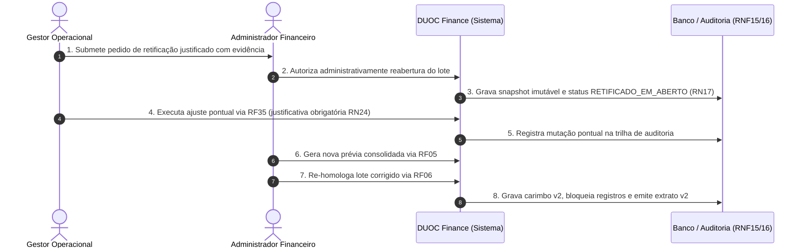

# Priorização e Escopo do Produto (Linha de Corte do MVP)

Este documento consolida o **modelo metodológico integrado de priorização e delimitação do escopo** do sistema ***DUOC Finance***. O método fundamenta-se no cruzamento analítico entre o **Valor de Negócio (VB)** e o **Esforço Técnico Consolidado (EC)**, orientando a linha de corte do **Produto Mínimo Viável (MVP)**.

  <a href="../" class="catalog-nav-btn">
    91
    Catálogo Geral de Requisitos ↗
  </a>
  <a href="../rastreabilidade/" class="catalog-nav-btn catalog-nav-btn-ext">
    Pirâmide & Rastreabilidade ↗
  </a>
  <a href="../governanca-conformidade/#61-matriz-canonica-de-papeis-rbac" class="catalog-nav-btn catalog-nav-btn-ext">
    Atores & Papéis RBAC ↗
  </a>
  <a href="#linha-de-corte-do-mvp" class="catalog-nav-btn catalog-nav-btn-ext">
    Linha de Corte do MVP ↗
  </a>

  

    31 <small>/ 40</small>
    Requisitos Funcionais no MVP (77,5%)
  

  

    18 <small>/ 20</small>
    Requisitos Não Funcionais no MVP (90,0%)
  

  

    270 <small>horas</small>
    Capacidade Líquida (Demanda: 266,5 h)
  

  

    9 <small>RFs</small>
    Backlog Evolutivo Pós-MVP
  

---

## O fluxo que precisa funcionar de ponta a ponta

O recorte do MVP foi definido para garantir que o ciclo operacional completo da DUOC Finance funcione de ponta a ponta já na primeira versão em produção:

  

    
1

    <h4 class="journey-title">Cadastro e Identificação</h4>
    
Cadastro único e validado de colaboradores, dados bancários e funções técnicas de campo.

    

      <a href="../#rf01" class="req-tag req-tag-rf"># RF01</a>
      <a href="../#rf02" class="req-tag req-tag-rf"># RF02</a>
      <a href="../#rf03" class="req-tag req-tag-rf"># RF03</a>
      <a href="../#rf25" class="req-tag req-tag-rf"># RF25</a>
      <a href="../#rf26" class="req-tag req-tag-rf"># RF26</a>
    

  

  

    
2

    <h4 class="journey-title">Apontamento em Campo</h4>
    
Registro digital de horas trabalhadas em canteiros com GPS, fotos de evidência e retificações.

    

      <a href="../#rf04" class="req-tag req-tag-rf"># RF04</a>
      <a href="../#rf19" class="req-tag req-tag-rf"># RF19</a>
      <a href="../#rf22" class="req-tag req-tag-rf"># RF22</a>
      <a href="../#rf32" class="req-tag req-tag-rf"># RF32</a>
      <a href="../#rf35" class="req-tag req-tag-rf"># RF35</a>
    

  

  

    
3

    <h4 class="journey-title">Fechamento e Reembolsos</h4>
    
Cálculo automático de diárias técnicas, prévias, deliberação de despesas e homologação bloqueada.

    

      <a href="../#rf05" class="req-tag req-tag-rf"># RF05</a>
      <a href="../#rf06" class="req-tag req-tag-rf"># RF06</a>
      <a href="../#rf07" class="req-tag req-tag-rf"># RF07</a>
      <a href="../#rf08" class="req-tag req-tag-rf"># RF08</a>
      <a href="../#rf27" class="req-tag req-tag-rf"># RF27</a>
      <a href="../#rf28" class="req-tag req-tag-rf"># RF28</a>
      <a href="../#rf29" class="req-tag req-tag-rf"># RF29</a>
    

  

  

    
4

    <h4 class="journey-title">Apropriação por Obra</h4>
    
Vinculação de cada centavo aos respectivos contratos vigentes, garantindo rastreabilidade contábil.

    

      <a href="../#rf09" class="req-tag req-tag-rf"># RF09</a>
      <a href="../#rf10" class="req-tag req-tag-rf"># RF10</a>
      <a href="../#rf33" class="req-tag req-tag-rf"># RF33</a>
      <a href="../#rf37" class="req-tag req-tag-rf"># RF37</a>
      <a href="../#rf38" class="req-tag req-tag-rf"># RF38</a>
    

  

  

    
5

    <h4 class="journey-title">Painel e Governança</h4>
    
Visão de centros de custo, login seguro corporativo, autenticação RBAC e bloqueio de ataques.

    

      <a href="../#rf11" class="req-tag req-tag-rf"># RF11</a>
      <a href="../#rf34" class="req-tag req-tag-rf"># RF34</a>
      <a href="../#rf39" class="req-tag req-tag-rf"># RF39</a>
      <a href="../#rf40" class="req-tag req-tag-rf"># RF40</a>
      <a href="../#rf13" class="req-tag req-tag-rf"># RF13</a>
      <a href="../#rf14" class="req-tag req-tag-rf"># RF14</a>
      <a href="../#rf17" class="req-tag req-tag-rf"># RF17</a>
      <a href="../#rf18" class="req-tag req-tag-rf"># RF18</a>
      <a href="../#rf23" class="req-tag req-tag-rf"># RF23</a>
    

  

---

## O que entrou, por característica

A distribuição dos **40 Requisitos Funcionais** entre as 10 Características do Produto (CAR-01 a CAR-10) evidencia a robustez do corte. **Verde preenchido** indica requisito selecionado para o MVP; **cinza tracejado** indica item alocado no backlog evolutivo pós-MVP. Clique em qualquer requisito para navegar diretamente ao seu card:

  

    CAR-01
    Gestão Cadastral Unificada
    

      
      
      <a href="../#rf03" class="feat-cov-sq on" title="RF03: Registrar movimentação funcional (MVP)">RF03</a>
      <a href="../#rf25" class="feat-cov-sq on" title="RF25: Cadastrar tipo de contratação (MVP)">RF25</a>
      <a href="../#rf26" class="feat-cov-sq on" title="RF26: Consultar histórico de alterações (MVP)">RF26</a>
    

    5 / 5
  

  

    CAR-02
    Apontamento de Campo (RVT)
    

      <a href="../#rf04" class="feat-cov-sq on" title="RF04: Submeter apontamento de campo (MVP)">RF04</a>
      <a href="../#rf19" class="feat-cov-sq on" title="RF19: Consultar apontamentos registrados (MVP)">RF19</a>
      <a href="../#rf22" class="feat-cov-sq on" title="RF22: Anexar evidências e GPS (MVP)">RF22</a>
      <a href="../#rf32" class="feat-cov-sq on" title="RF32: Deliberar apontamento de campo (MVP)">RF32</a>
      <a href="../#rf35" class="feat-cov-sq on" title="RF35: Retificar apontamento de campo (MVP)">RF35</a>
    

    5 / 5
  

  

    CAR-03
    Fechamento Financeiro
    

      <a href="../#rf05" class="feat-cov-sq on" title="RF05: Solicitar prévia de fechamento (MVP)">RF05</a>
      <a href="../#rf06" class="feat-cov-sq on" title="RF06: Homologar fechamento financeiro (MVP)">RF06</a>
      <a href="../#rf27" class="feat-cov-sq on" title="RF27: Configurar tabela de diárias (MVP)">RF27</a>
      <a href="../#rf21" class="feat-cov-sq off" title="RF21: Estornar fechamento financeiro (Pós-MVP)">RF21</a>
    

    3 / 4
  

  

    CAR-04
    Prestação de Contas e Reembolsos
    

      <a href="../#rf07" class="feat-cov-sq on" title="RF07: Submeter solicitação de reembolso (MVP)">RF07</a>
      <a href="../#rf08" class="feat-cov-sq on" title="RF08: Deliberar solicitação de reembolso (MVP)">RF08</a>
      <a href="../#rf28" class="feat-cov-sq on" title="RF28: Submeter adiantamento operacional (MVP)">RF28</a>
      <a href="../#rf29" class="feat-cov-sq on" title="RF29: Deliberar adiantamento operacional (MVP)">RF29</a>
    

    4 / 4
  

  

    CAR-05
    Apropriação de Custos por Contrato
    

      <a href="../#rf09" class="feat-cov-sq on" title="RF09: Apropriar custos operacionais (MVP)">RF09</a>
      <a href="../#rf10" class="feat-cov-sq on" title="RF10: Consultar rastreabilidade de custos (MVP)">RF10</a>
      <a href="../#rf33" class="feat-cov-sq on" title="RF33: Cadastrar contrato de obra (MVP)">RF33</a>
      <a href="../#rf37" class="feat-cov-sq on" title="RF37: Atualizar contrato de obra (MVP)">RF37</a>
      <a href="../#rf38" class="feat-cov-sq on" title="RF38: Consultar contratos de obra (MVP)">RF38</a>
      <a href="../#rf30" class="feat-cov-sq off" title="RF30: Consultar comparativo de custos (Pós-MVP)">RF30</a>
    

    5 / 6
  

  

    CAR-06
    Painel Orçamentário e Centros de Custo
    

      <a href="../#rf11" class="feat-cov-sq on" title="RF11: Filtrar indicadores de custos (MVP)">RF11</a>
      <a href="../#rf34" class="feat-cov-sq on" title="RF34: Cadastrar centro de custo de obra (MVP)">RF34</a>
      <a href="../#rf39" class="feat-cov-sq on" title="RF39: Atualizar centro de custo de obra (MVP)">RF39</a>
      <a href="../#rf40" class="feat-cov-sq on" title="RF40: Definir tetos orçamentários de obra (MVP)">RF40</a>
      <a href="../#rf12" class="feat-cov-sq off" title="RF12: Monitorar execução orçamentária (Pós-MVP)">RF12</a>
      <a href="../#rf31" class="feat-cov-sq off" title="RF31: Configurar alertas orçamentários (Pós-MVP)">RF31</a>
    

    4 / 6
  

  

    CAR-07
    Controle de Acesso (RBAC) e Segurança
    

      <a href="../#rf13" class="feat-cov-sq on" title="RF13: Efetuar login no sistema (MVP)">RF13</a>
      <a href="../#rf14" class="feat-cov-sq on" title="RF14: Gerenciar perfis de acesso (MVP)">RF14</a>
      <a href="../#rf17" class="feat-cov-sq on" title="RF17: Ativar acesso inicial e recuperar credenciais (MVP)">RF17</a>
      <a href="../#rf18" class="feat-cov-sq on" title="RF18: Encerrar sessão manualmente (MVP)">RF18</a>
      <a href="../#rf23" class="feat-cov-sq on" title="RF23: Bloquear acesso após tentativas falhas (MVP)">RF23</a>
      <a href="../#rf24" class="feat-cov-sq off" title="RF24: Impor renovação periódica de senhas (Pós-MVP)">RF24</a>
    

    5 / 6
  

  

    CAR-08
    Trilha de Auditoria
    

      <a href="../#rf15" class="feat-cov-sq off" title="RF15: Consultar trilha de auditoria (Pós-MVP)">RF15</a>
      <a href="../#rf16" class="feat-cov-sq off" title="RF16: Exportar relatório de auditoria (Pós-MVP)">RF16</a>
    

    0 / 2
  

  

    CAR-09
    Integração Externa FLIT
    

      <a href="../#rf20" class="feat-cov-sq off" title="RF20: Importar presenças homologadas (Pós-MVP)">RF20</a>
    

    0 / 1
  

  

    CAR-10
    Exportação de Planilhas
    

      <a href="../#rf36" class="feat-cov-sq off" title="RF36: Exportar dados em planilha (Pós-MVP)">RF36</a>
    

    0 / 1
  

---

## Como priorizamos: Critérios e Fórmulas

A priorização opera por duas dimensões analíticas independentes:

1. **Valor de Negócio (VB: 1 a 4):** Avalia o impacto na operação e conformidade legal (4 = Muito Alto / Obrigatório; 3 = Alto / Prioritário; 2 = Moderado / Desejável; 1 = Baixo / Postergável). Requisitos com **VB 3 ou 4 integram o MVP**.
2. **Esforço Técnico Consolidado (EC: 1 a 4):** Média aritmética entre Esforço em horas (**ES**), Complexidade Técnica (**CX**) e Lacuna de Capacidade (**LC**).

  

    Esforço Técnico Consolidado (EC)
    

      EC = 
      

        ES + CX + LC
        3
      

    

    
Média das notas técnicas de 1 a 4: Esforço em horas (ES), Complexidade arquitetural (CX) e Lacuna de domínio da equipe (LC).

  

  

    Índice de Prioridade (IP)
    

      IP = 
      

        VB
        EC
      

    

    
Razão direta entre Valor de Negócio (VB) e Esforço Consolidado (EC). Quanto maior o IP, maior o retorno por hora investida.

  

  <strong>Exemplo Prático Único Demonstrativo: <a href="../#rf06">RF06 — Homologar Fechamento Financeiro</a></strong>
  
Com Valor de Negócio <strong>VB = 4</strong> (crítico para encerrar competência), Esforço <strong>ES = 2</strong> (6 horas), Complexidade <strong>CX = 3</strong> (bloqueio de edição e carimbo UTC) e Lacuna <strong>LC = 2</strong> (domínio de transações relacionais):

  

    • <strong>EC</strong> = (2 + 3 + 2) ÷ 3 = 7 ÷ 3 = <strong>2,33</strong> (Classe 2 · Esforço Moderado) 
    • <strong>IP</strong> = 4 ÷ 2,33 = <strong>1,71</strong> ➔ Posicionado no <strong>Quadrante Q1 (Alta Prioridade · MVP)</strong>
  

*(As notas individuais e cálculos detalhados dos 40 requisitos estão disponíveis diretamente nos cards do [Catálogo Integrado de Requisitos](index.md) na aba "Priorização & Score 4×4").*

---

## Matriz 4 × 4 Dinâmica de Priorização

A matriz cruza o **Valor de Negócio (VB: 1 a 4)** no eixo vertical com o **Esforço Consolidado (EC: 1 a 4)** no eixo horizontal. Cada quadrante organiza a destinação dos requisitos.

**Clique em qualquer requisito para navegar diretamente ao seu card e detalhes de cálculo no catálogo:**

  

    ▲ Valor de Negócio (VB: 1 a 4)
  

  

    <!-- QUADRANTE Q1 -->
    

      

        

          Q1
          <h4 class="quad-title">Alta Prioridade · MVP</h4>
        

        28 RFs
      

      
Alto Valor (3-4) · Baixo/Médio Esforço (1-2) — Espinha dorsal indispensável

      

        
        
        <a href="../#rf03" class="quad-rf-btn btn-mvp" title="RF03: Registrar movimentação funcional | VB: 3 · EC: 2,00 (2) · IP: 1,50">RF03</a>
        <a href="../#rf06" class="quad-rf-btn btn-mvp" title="RF06: Homologar fechamento financeiro | VB: 4 · EC: 2,33 (2) · IP: 1,71">RF06</a>
        <a href="../#rf07" class="quad-rf-btn btn-mvp" title="RF07: Submeter solicitação de reembolso | VB: 4 · EC: 2,00 (2) · IP: 2,00">RF07</a>
        <a href="../#rf08" class="quad-rf-btn btn-mvp" title="RF08: Deliberar solicitação de reembolso | VB: 4 · EC: 2,00 (2) · IP: 2,00">RF08</a>
        <a href="../#rf10" class="quad-rf-btn btn-mvp" title="RF10: Consultar rastreabilidade de custos | VB: 3 · EC: 2,00 (2) · IP: 1,50">RF10</a>
        <a href="../#rf11" class="quad-rf-btn btn-mvp" title="RF11: Filtrar indicadores de custos | VB: 3 · EC: 2,00 (2) · IP: 1,50">RF11</a>
        <a href="../#rf13" class="quad-rf-btn btn-mvp" title="RF13: Efetuar login no sistema | VB: 4 · EC: 1,00 (1) · IP: 4,00">RF13</a>
        <a href="../#rf14" class="quad-rf-btn btn-mvp" title="RF14: Gerenciar perfis de acesso | VB: 3 · EC: 2,33 (2) · IP: 1,29">RF14</a>
        <a href="../#rf17" class="quad-rf-btn btn-mvp" title="RF17: Ativar acesso inicial e recuperar credenciais | VB: 3 · EC: 1,67 (2) · IP: 1,80">RF17</a>
        <a href="../#rf18" class="quad-rf-btn btn-mvp" title="RF18: Encerrar sessão manualmente | VB: 3 · EC: 1,00 (1) · IP: 3,00">RF18</a>
        <a href="../#rf19" class="quad-rf-btn btn-mvp" title="RF19: Consultar apontamentos registrados | VB: 4 · EC: 1,67 (2) · IP: 2,40">RF19</a>
        <a href="../#rf22" class="quad-rf-btn btn-mvp" title="RF22: Anexar evidências e GPS ao apontamento | VB: 3 · EC: 2,33 (2) · IP: 1,29">RF22</a>
        <a href="../#rf23" class="quad-rf-btn btn-mvp" title="RF23: Bloquear acesso após tentativas falhas | VB: 3 · EC: 1,67 (2) · IP: 1,80">RF23</a>
        <a href="../#rf25" class="quad-rf-btn btn-mvp" title="RF25: Cadastrar tipo de contratação | VB: 3 · EC: 1,67 (2) · IP: 1,80">RF25</a>
        <a href="../#rf26" class="quad-rf-btn btn-mvp" title="RF26: Consultar histórico cadastral e bancário | VB: 3 · EC: 2,33 (2) · IP: 1,29">RF26</a>
        <a href="../#rf27" class="quad-rf-btn btn-mvp" title="RF27: Configurar tabela de diárias técnicas | VB: 4 · EC: 1,67 (2) · IP: 2,40">RF27</a>
        <a href="../#rf28" class="quad-rf-btn btn-mvp" title="RF28: Submeter adiantamento operacional | VB: 3 · EC: 2,00 (2) · IP: 1,50">RF28</a>
        <a href="../#rf29" class="quad-rf-btn btn-mvp" title="RF29: Deliberar adiantamento operacional | VB: 3 · EC: 2,00 (2) · IP: 1,50">RF29</a>
        <a href="../#rf32" class="quad-rf-btn btn-mvp" title="RF32: Deliberar apontamento de campo | VB: 4 · EC: 1,67 (2) · IP: 2,40">RF32</a>
        <a href="../#rf33" class="quad-rf-btn btn-mvp" title="RF33: Cadastrar contrato de obra | VB: 3 · EC: 1,67 (2) · IP: 1,80">RF33</a>
        <a href="../#rf34" class="quad-rf-btn btn-mvp" title="RF34: Cadastrar centro de custo de obra | VB: 3 · EC: 1,67 (2) · IP: 1,80">RF34</a>
        <a href="../#rf35" class="quad-rf-btn btn-mvp" title="RF35: Retificar apontamento de campo | VB: 3 · EC: 1,67 (2) · IP: 1,80">RF35</a>
        <a href="../#rf37" class="quad-rf-btn btn-mvp" title="RF37: Atualizar contrato de obra | VB: 3 · EC: 1,67 (2) · IP: 1,80">RF37</a>
        <a href="../#rf38" class="quad-rf-btn btn-mvp" title="RF38: Consultar contratos de obra | VB: 3 · EC: 1,00 (1) · IP: 3,00">RF38</a>
        <a href="../#rf39" class="quad-rf-btn btn-mvp" title="RF39: Atualizar centro de custo de obra | VB: 3 · EC: 1,67 (2) · IP: 1,80">RF39</a>
        <a href="../#rf40" class="quad-rf-btn btn-mvp" title="RF40: Definir tetos orçamentários de obra | VB: 3 · EC: 2,00 (2) · IP: 1,50">RF40</a>
      

    

    <!-- QUADRANTE Q2 -->
    

      

        

          Q2
          <h4 class="quad-title">Escopo Controlado · MVP</h4>
        

        3 RFs
      

      
Alto Valor (3-4) · Alto Esforço (3) — Viabilizados por redução planejada de escopo

      

        <a href="../#rf04" class="quad-rf-btn btn-mvp" title="RF04: Submeter apontamento de campo | VB: 4 · EC: 3,00 (3) · IP: 1,33">RF04</a>
        <a href="../#rf05" class="quad-rf-btn btn-mvp" title="RF05: Solicitar prévia de fechamento | VB: 4 · EC: 3,33 (3) · IP: 1,20">RF05</a>
        <a href="../#rf09" class="quad-rf-btn btn-mvp" title="RF09: Apropriar custos operacionais | VB: 3 · EC: 3,33 (3) · IP: 0,90">RF09</a>
      

    

    <!-- QUADRANTE Q3 -->
    

      

        

          Q3
          <h4 class="quad-title">Oportunidade · Pós-MVP</h4>
        

        2 RFs
      

      
Valor Moderado (2) · Baixo/Médio Esforço (2) — Recursos de conveniência

      

        <a href="../#rf24" class="quad-rf-btn btn-pos" title="RF24: Impor renovação periódica de senhas | VB: 2 · EC: 2,00 (2) · IP: 1,00">RF24</a>
        <a href="../#rf36" class="quad-rf-btn btn-pos" title="RF36: Exportar dados em planilha | VB: 2 · EC: 1,67 (2) · IP: 1,20">RF36</a>
      

    

    <!-- QUADRANTE Q4 -->
    

      

        

          Q4
          <h4 class="quad-title">Evolutivo · Pós-MVP</h4>
        

        7 RFs
      

      
Valor Moderado/Baixo (1-2) · Alto Esforço (3) — Demandam histórico ou integrações

      

        <a href="../#rf12" class="quad-rf-btn btn-pos" title="RF12: Monitorar execução orçamentária | VB: 2 · EC: 3,00 (3) · IP: 0,67">RF12</a>
        <a href="../#rf15" class="quad-rf-btn btn-pos" title="RF15: Consultar trilha de auditoria | VB: 2 · EC: 3,00 (3) · IP: 0,67">RF15</a>
        <a href="../#rf16" class="quad-rf-btn btn-pos" title="RF16: Exportar relatório de auditoria | VB: 1 · EC: 3,00 (3) · IP: 0,33">RF16</a>
        <a href="../#rf20" class="quad-rf-btn btn-pos" title="RF20: Importar presenças homologadas | VB: 2 · EC: 3,00 (3) · IP: 0,67">RF20</a>
        <a href="../#rf21" class="quad-rf-btn btn-pos" title="RF21: Estornar fechamento financeiro | VB: 2 · EC: 2,67 (3) · IP: 0,75">RF21</a>
        <a href="../#rf30" class="quad-rf-btn btn-pos" title="RF30: Consultar comparativo de custos | VB: 2 · EC: 2,67 (3) · IP: 0,75">RF30</a>
        <a href="../#rf31" class="quad-rf-btn btn-pos" title="RF31: Configurar alertas orçamentários | VB: 2 · EC: 2,67 (3) · IP: 0,75">RF31</a>
      

    

  

  

    Esforço Técnico Consolidado (EC: 1 a 4) ►
  

---

## Como o recorte foi fechado (Viabilidade do MVP)

A linha de corte oficial consolida **31 Requisitos Funcionais no MVP** e **9 no Pós-MVP**, com viabilidade técnica e temporal estritamente comprovada:

  

    
<b>Semana 08 · Módulo 1</b>Cadastro e Campo

    

    68 h
  

  

    
<b>Semana 09 · Módulo 2</b>Fechamento e Reembolsos

    

    54 h
  

  

    
<b>Semana 10 · Módulo 3</b>Custos e Contratos

    

    64 h
  

  

    
<b>Semana 11 · Módulo 4</b>Governança e RBAC

    

    19 h
  

  

    
<b>Semana 12 · Reserva 30%</b>Testes, CI/CD e UAT

    

    61,5 h
  

*   **Balanço de Capacidade:** A demanda total de **266,5 horas** (205 h de codificação direta + 61,5 h de reserva técnica compulsória de 30%) cabe integralmente na **capacidade líquida de 270 horas** da equipe (6 desenvolvedores × 10 h/sem × 5 semanas úteis com 90% de foco), garantindo folga positiva.
*   **Granularidade Atômica (RF37 a RF40):** Os requisitos de contratos e centros de custo foram desmembrados em ações atômicas independentes ([RF33](index.md#rf33) cadastro, [RF37](index.md#rf37) atualização, [RF38](index.md#rf38) consulta; [RF34](index.md#rf34) cadastro, [RF39](index.md#rf39) atualização, [RF40](index.md#rf40) tetos), garantindo que cada um possua sua própria História de Usuário (US01 a US40) em mapeamento 1:1.
*   **Tratamento dos RNFs no MVP:** Dos 20 Requisitos Não Funcionais, **18 integram o primeiro ciclo** (10 obrigatórios e 8 associados), assegurando integridade transacional, retenção probatória (Art. 11 da CLT) e conformidade LGPD. Apenas [RNF01](index.md#rnf01) (modo offline) e [RNF08](index.md#rnf08) (auditoria de estornos) ficaram para o pós-MVP.

---

## Procedimento Operacional de Retificação e Estorno Assistido no MVP

Com a postergação do estorno automático em lote ([RF21](index.md#rf21)), instituiu-se o fluxo assistido de retificação para correções pós-fechamento no MVP sem ferir a imutabilidade dos lançamentos:

1. O `GESTOR_OPERACIONAL` solicita o ajuste com justificativa e comprovação; o `ADMIN_FINANCEIRO` analisa e autoriza a reabertura do lote.
2. O lote original é preservado imutável (*append-only*); o ajuste pontual é efetuado via **[RF35](index.md#rf35)** com justificativa obrigatória registrada em banco.
3. O lote é recalculado via **[RF05](index.md#rf05)** e re-homologado via **[RF06](index.md#rf06)**, gerando nova versão do extrato sem violar o histórico probatório.

---

## Por que algo ficou de fora (Pós-MVP)

Nenhum requisito foi descartado por falta de valor. Os **9 Requisitos Funcionais alocados no pós-MVP** foram postergados por motivos operacionais e técnicos objetivos:

*   **[RF21](index.md#rf21) · Estornar fechamento financeiro:** Operação excepcional de reversão em lote; contornada de forma segura pelo fluxo assistido de retificação ([RF35](index.md#rf35) + [RF06](index.md#rf06)).
*   **[RF24](index.md#rf24) · Impor renovação periódica de senhas:** Política de expiração forçada gera atrito no piloto inicial; as salvaguardas de bloqueio ([RF23](index.md#rf23)) e requisitos de complexidade suprem plenamente a segurança da v1.
*   **[RF36](index.md#rf36) · Exportar dados consolidados em planilha:** Os relatórios nativos em tela no frontend cobrem a validação operacional imediata sem dependência de gerador XLSX/CSV no backend.
*   **[RF12](index.md#rf12) · Monitorar execução orçamentária preditiva:** Projeções orçamentárias demandam histórico acumulado de meses de execução para produzir indicadores estatísticos válidos.
*   **[RF15](index.md#rf15) e [RF16](index.md#rf16) · Consultar e exportar trilha de auditoria:** Os logs estruturados do banco de dados (PostgreSQL/Supabase) já gravam todas as mutações (*append-only* via [RNF15](index.md#rnf15)), dispensando tela administrativa própria no primeiro ciclo.
*   **[RF20](index.md#rf20) · Importar presenças da FLIT:** Integração externa via API de terceiro cuja especificação de endpoints e chaves de acesso depende de liberação pelo parceiro externo.
*   **[RF30](index.md#rf30) · Consultar comparativo de custos entre contratos:** Análise comparativa entre obras requer banco consolidado com massa de dados de múltiplos projetos encerrados.
*   **[RF31](index.md#rf31) · Configurar alertas de execução orçamentária:** Disparo automatizado de notificações assíncronas planejado para a segunda fase de evolução.

---

## Registro da Priorização e Validação com a Cliente

A priorização do escopo foi construída em estreita colaboração com a cliente parceira **Maria Beatryz** (DUOC Engenharia):

1. **Alinhamento Inicial de Prioridades (Reunião 05 — 24/09/2026):** A cliente participou da calibração das dores centrais do negócio, aprovando com ressalvas o escopo preliminar e determinando a priorização máxima para os fluxos de campo e fechamento ([Ata da Reunião 05 — Decisão D5](../governanca/atas/reuniao-05.md#decisao-d5-mvp)).
2. **Validação Operacional e de Interfaces (Reunião 06 — 03/11/2026):** Em reunião presencial com a equipe, a cliente Maria Beatryz validou as telas, fluxos de apontamento, deliberação de despesas e cálculos de diárias apresentados no protótipo de alta fidelidade ([Ata da Reunião 06](../governanca/atas/reuniao-06.md)).
3. **Próximo Passo (Homologação Formal do Corte Final):** A composição canônica de **31 RFs no MVP e 9 no Pós-MVP** (incorporando a granularidade atômica dos RF37 a RF40) está formalizada para assinatura e ratificação definitiva no início do Ciclo RAD.

---

## Histórico de Versão

| Versão | Data | Descrição | Autor(es) | Revisor(es) |
| :---: | :---: | :--- | :--- | :--- |
| `1.0` | 24/09/2026 | Estruturação inicial do método de priorização por Valor de Negócio (1 a 4) e Esforço Técnico (ES, CX, LC). | Matheus Ribeiro e Eric Araújo | Giovana Ferreira |
| `2.0` | 28/09/2026 | Consolidação da Matriz 4×4 cartesiana e definição do primeiro corte preliminar do MVP alinhado na Reunião 05. | Matheus Ribeiro | Eric Araújo |
| `3.0` | 10/11/2026 | Expansão atômica para 40 RFs (31 no MVP / 9 Pós-MVP) com desmembramento de contratos e centros de custo (RF37 a RF40) em mapeamento 1:1 com Histórias de Usuário. | Paulo Nery | Matheus Ribeiro |
| `4.0` | 16/11/2026 | Reformulação visual inspirada no padrão MindCycle: resumo por cards estatísticos, fluxo ponta a ponta, cobertura visual por CAR (CAR-01 a CAR-10), fórmulas limpas em HTML sem LaTeX, eliminação de bordas pesadas na Matriz 4x4, comprovação de capacidade e procedimento de retificação assistida. | Matheus Ribeiro Szervinsk | Equipe Cascata Ágil |
