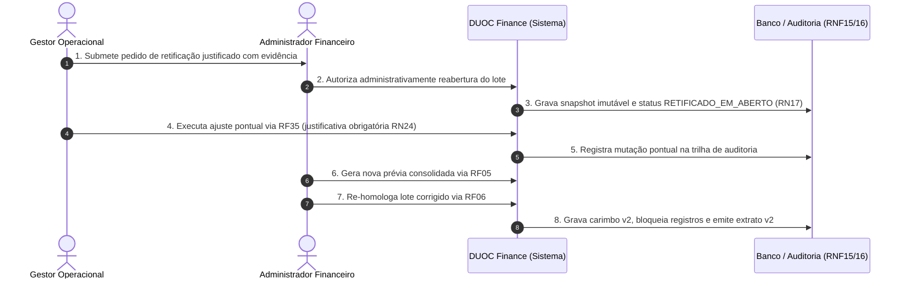

# Priorização e Escopo do Produto (Linha de Corte do MVP)

Este documento estabelece o **modelo metodológico integrado de priorização e delimitação do escopo** do sistema ***DUOC Finance***. O método fundamenta-se no cruzamento analítico entre o **Valor de Negócio (VB)** e o **Esforço Técnico Consolidado (EC)**, orientando a linha de corte do **Produto Mínimo Viável (MVP)**.

  <a href="../" class="catalog-nav-btn">
    91
    Catálogo Geral de Requisitos ↗
  </a>
  <a href="../rastreabilidade/" class="catalog-nav-btn catalog-nav-btn-ext">
    Pirâmide & Rastreabilidade ↗
  </a>
  <a href="../governanca-conformidade/#61-matriz-canonica-de-papeis-rbac" class="catalog-nav-btn catalog-nav-btn-ext">
    Atores & Papéis RBAC ↗
  </a>
  <a href="#linha-de-corte-do-mvp" class="catalog-nav-btn catalog-nav-btn-ext">
    Linha de Corte do MVP ↗
  </a>

!!! tip "Onde Consultar as Pontuações e Métricas Individuais de Cada Requisito"
    Para evitar redundância textual e tabelas repetidas, as notas e estimativas individuais de cada um dos 40 requisitos (**VB**, **CX**, **ES**, **LC**, **EC** e **IP**) estão centralizadas diretamente nos cards interativos do **[Catálogo Integrado de Requisitos](index.md)** (aba *"Priorização & Score 4×4"*), integradas às respectivas **Histórias de Usuário (US01 a US40)**, critérios de aceitação e casos de teste.

A linha de corte oficial consolida **31 Requisitos Funcionais no MVP (77,5%)** e **9 Requisitos Funcionais no backlog evolutivo pós-MVP (22,5%)**, cobrindo com exatidão as 40 histórias de usuário em mapeamento 1:1.

---

## 1. Avaliação do Valor de Negócio (VB)

O Valor de Negócio expressa o impacto operacional, a mitigação de riscos regulatórios e o retorno financeiro gerado por cada funcionalidade para a organização parceira, mensurado em uma **escala inteira de 1 a 4**:

| Nota | Nível de Valor | Diretriz Metodológica de Julgamento | Destinação no Escopo |
| :---: | :---: | :--- | :---: |
| **4** | **Muito Alto** *(Crítico)* | **Indispensável:** viabiliza o processo central de coleta e fechamento de despesas, ou elimina vulnerabilidade jurídica imediata (CLT/LGPD). Sem ele, a operação manual não pode ser substituída. | **Obrigatório no MVP** |
| **3** | **Alto** *(Importante)* | **Prioritário:** automatiza etapas de suporte direto aos gargalos centrais (TR-01 a TR-04), garante governança orçamentária ou economiza mais de 3 h/mês de conferência manual. | **Prioritário no MVP** |
| **2** | **Moderado** *(Desejável)* | **Evolutivo:** agrega conveniência ou recursos analíticos complementares; sua ausência no ciclo piloto é contornável sem paralisar o negócio. | **Pós-MVP** |
| **1** | **Baixo** *(Postergável)* | **Futuro:** requisito válido para maturidade futura (ex.: exportações analíticas avançadas), porém de baixa frequência ou não urgente no ciclo inicial. | **Pós-MVP** |

### Dimensões de Julgamento do Valor
A atribuição da nota considera o **maior grau atingido** entre três fatores bloqueantes e um critério de ajuste:
1. **Impacto nos Gargalos Operacionais (TR-01 a TR-04):** Resolução das dores de prestação de contas de campo (RVT), conferência de comprovantes de despesa, consolidação de diárias e apropriação por obra.
2. **Mitigação de Riscos Jurídico-Trabalhistas e Fiscais:** Rastreabilidade probatória exigida pelo Art. 11 da CLT, comprovação fiscal para ressarcimentos e conformidade com a LGPD.
3. **Economia de Horas Administrativas:** Redução do retrabalho sobre a base de mais de 30 h/mês de digitação manual da auxiliar-administradora.
4. **Frequência de Uso:** Uso diário/contínuo vs. rotinas excepcionais ou de suporte.

*Regra de Corte de Negócio:* Requisitos com **VB 4 ou 3 integram o MVP**; requisitos com **VB 2 ou 1 integram o Pós-MVP**.

---

## 2. Avaliação do Esforço Técnico

O esforço técnico mensura a barreira de engenharia para entrega de cada requisito, integrando três dimensões analíticas avaliadas na mesma direção (**1 = menor barreira; 4 = maior desafio**):

| Dimensão | Sigla | Escala (1 a 4) | Critério de Julgamento |
| :--- | :---: | :---: | :--- |
| **Esforço de Implementação** | **ES** | 1 a 4 | **Pessoa-hora de desenvolvimento e testes:** • Nota 1: Até 2 h (telas simples, ajustes pontuais) • Nota 2: > 2 h a 8 h (formulários e CRUDs relacionais padrão) • Nota 3: > 8 h a 16 h (múltiplas etapas, validações condicionais) • Nota 4: > 16 h (alta densidade algorítmica — evitada por decomposição) |
| **Complexidade Arquitetural** | **CX** | 1 a 4 | **Densidade de regras e acoplamento:** • Nota 1: CRUD básico isolado • Nota 2: Filtros compostos e validações relacionais • Nota 3: Regras estritas (imutabilidade, bloqueio retroativo, cálculo centesimal) • Nota 4: Consistência ACID mandatória, controle RBAC estrito e auditoria em lote |
| **Lacuna de Capacidade** | **LC** | 1 a 4 | **Familiaridade da equipe com a stack (React, NestJS, Supabase/PostgreSQL):** • Nota 1: Domínio pleno do padrão • Nota 2: Conhecimento suficiente, pesquisa pontual • Nota 3: Demanda estudo específico (ponto fixo centesimal, RBAC multinível) • Nota 4: Lacuna crítica / necessidade de PoC |

---

### Fórmulas de Cálculo e Exemplo Prático Demonstrativo

Em conformidade com a Seção 10.2 do Template Oficial, a consolidação analítica e a priorização relativa operam por meio de duas fórmulas diretas:

$$\text{EC (Esforço Consolidado)} = \frac{\text{ES} + \text{CX} + \text{LC}}{3}$$

$$\text{IP (Índice de Prioridade)} = \frac{\text{VB}}{\text{EC}}$$

*   **Esforço Consolidado (EC):** Média aritmética simples das três dimensões técnicas. Para plotagem nos eixos discretos de 1 a 4 da Matriz 4 × 4, a média converte-se em classes ordinais: **Classe 1** (1,00 a 1,49); **Classe 2** (1,50 a 2,49); **Classe 3** (2,50 a 3,49); **Classe 4** (3,50 a 4,00).
*   **Índice de Prioridade (IP):** Razão matemática direta entre valor e esforço. Quanto maior o IP, maior o retorno operacional entregue por unidade de esforço técnico.

#### Exemplo Prático Demonstrativo: RF06 — Homologar Fechamento Financeiro
Para ilustrar a aplicação rigorosa do método em um requisito central do sistema:
*   **Valor de Negócio (VB) = 4:** Requisito bloqueante e crítico (D1, D3); encerra formalmente a competência financeira e previne alterações indevidas.
*   **Esforço de Implementação (ES) = 2:** Estimativa direta de 6 horas de codificação.
*   **Complexidade Técnica (CX) = 3:** Alta densidade de regras (bloqueio compulsório de edição, gravação atômica de carimbo UTC e emissão de extrato definitivo).
*   **Lacuna de Capacidade (LC) = 2:** A equipe possui domínio suficiente de transações relacionais no PostgreSQL/Supabase.
*   **Cálculo do Esforço Consolidado:**
    $$\text{EC} = \frac{2 + 3 + 2}{3} = \frac{7}{3} \approx 2,33 \quad \longrightarrow \quad \text{Classe 2 (Esforço Moderado)}$$
*   **Cálculo do Índice de Prioridade:**
    $$\text{IP} = \frac{\text{VB}}{\text{EC}} = \frac{4}{2,33} \approx 1,71$$
*   **Enquadramento:** $\text{VB} = 4$ e $\text{EC} = 2,33$ (< 2,50) posicionam o RF06 no **Quadrante Q1 (Alta Prioridade ➔ MVP)**.

*(Os cálculos e notas de todos os demais 39 requisitos estão disponíveis individualmente nos respectivos cards do [Catálogo Integrado de Requisitos](index.md)).*

---

## 3. Matriz 4 × 4 Dinâmica de Priorização

A matriz cruza o **Valor de Negócio (VB: 1 a 4)** no eixo vertical com o **Esforço Consolidado (EC: 1 a 4)** no eixo horizontal. Cada quadrante organiza os requisitos estratégicos da solução. 

**Clique em qualquer requisito para navegar diretamente ao seu card e detalhes de cálculo no catálogo:**

  

    ▲ Valor de Negócio (VB: 1 a 4)
  

  

    <!-- QUADRANTE Q1 -->
    

      

        

          Q1
          <h4 class="quad-title">Alta Prioridade · MVP</h4>
        

        28 RFs
      

      
Alto Valor (3-4) · Baixo/Médio Esforço (1-2) — Fundação operacional essencial

      

        
        
        <a href="index.md#rf03" class="quad-rf-btn btn-mvp" title="RF03: Registrar movimentação funcional | VB: 3 · EC: 2,00 (2) · IP: 1,50 | Clique para ver no catálogo">RF03</a>
        <a href="index.md#rf06" class="quad-rf-btn btn-mvp" title="RF06: Homologar fechamento financeiro | VB: 4 · EC: 2,33 (2) · IP: 1,71 | Clique para ver no catálogo">RF06</a>
        <a href="index.md#rf07" class="quad-rf-btn btn-mvp" title="RF07: Submeter solicitação de reembolso | VB: 4 · EC: 2,00 (2) · IP: 2,00 | Clique para ver no catálogo">RF07</a>
        <a href="index.md#rf08" class="quad-rf-btn btn-mvp" title="RF08: Deliberar solicitação de reembolso | VB: 4 · EC: 2,00 (2) · IP: 2,00 | Clique para ver no catálogo">RF08</a>
        <a href="index.md#rf10" class="quad-rf-btn btn-mvp" title="RF10: Consultar rastreabilidade de custos | VB: 3 · EC: 2,00 (2) · IP: 1,50 | Clique para ver no catálogo">RF10</a>
        <a href="index.md#rf11" class="quad-rf-btn btn-mvp" title="RF11: Filtrar indicadores de custos | VB: 3 · EC: 2,00 (2) · IP: 1,50 | Clique para ver no catálogo">RF11</a>
        <a href="index.md#rf13" class="quad-rf-btn btn-mvp" title="RF13: Efetuar login no sistema | VB: 4 · EC: 1,00 (1) · IP: 4,00 | Clique para ver no catálogo">RF13</a>
        <a href="index.md#rf14" class="quad-rf-btn btn-mvp" title="RF14: Gerenciar perfis de acesso | VB: 3 · EC: 2,33 (2) · IP: 1,29 | Clique para ver no catálogo">RF14</a>
        <a href="index.md#rf17" class="quad-rf-btn btn-mvp" title="RF17: Ativar acesso inicial e recuperar credenciais | VB: 3 · EC: 1,67 (2) · IP: 1,80 | Clique para ver no catálogo">RF17</a>
        <a href="index.md#rf18" class="quad-rf-btn btn-mvp" title="RF18: Encerrar sessão manualmente | VB: 3 · EC: 1,00 (1) · IP: 3,00 | Clique para ver no catálogo">RF18</a>
        <a href="index.md#rf19" class="quad-rf-btn btn-mvp" title="RF19: Consultar apontamentos registrados | VB: 4 · EC: 1,67 (2) · IP: 2,40 | Clique para ver no catálogo">RF19</a>
        <a href="index.md#rf22" class="quad-rf-btn btn-mvp" title="RF22: Anexar evidências e geolocalização ao apontamento | VB: 3 · EC: 2,33 (2) · IP: 1,29 | Clique para ver no catálogo">RF22</a>
        <a href="index.md#rf23" class="quad-rf-btn btn-mvp" title="RF23: Bloquear acesso após tentativas falhas consecutivas | VB: 3 · EC: 1,67 (2) · IP: 1,80 | Clique para ver no catálogo">RF23</a>
        
        <a href="index.md#rf26" class="quad-rf-btn btn-mvp" title="RF26: Consultar histórico de alterações cadastrais e bancárias | VB: 3 · EC: 2,33 (2) · IP: 1,29 | Clique para ver no catálogo">RF26</a>
        <a href="index.md#rf27" class="quad-rf-btn btn-mvp" title="RF27: Configurar tabela de valores de diárias técnicas | VB: 4 · EC: 1,67 (2) · IP: 2,40 | Clique para ver no catálogo">RF27</a>
        <a href="index.md#rf28" class="quad-rf-btn btn-mvp" title="RF28: Submeter solicitação de adiantamento operacional | VB: 3 · EC: 2,00 (2) · IP: 1,50 | Clique para ver no catálogo">RF28</a>
        <a href="index.md#rf29" class="quad-rf-btn btn-mvp" title="RF29: Deliberar solicitação de adiantamento operacional | VB: 3 · EC: 2,00 (2) · IP: 1,50 | Clique para ver no catálogo">RF29</a>
        <a href="index.md#rf32" class="quad-rf-btn btn-mvp" title="RF32: Deliberar apontamento de campo | VB: 4 · EC: 1,67 (2) · IP: 2,40 | Clique para ver no catálogo">RF32</a>
        <a href="index.md#rf33" class="quad-rf-btn btn-mvp" title="RF33: Cadastrar contrato de obra | VB: 3 · EC: 1,67 (2) · IP: 1,80 | Clique para ver no catálogo">RF33</a>
        <a href="index.md#rf34" class="quad-rf-btn btn-mvp" title="RF34: Cadastrar centro de custo de obra | VB: 3 · EC: 1,67 (2) · IP: 1,80 | Clique para ver no catálogo">RF34</a>
        <a href="index.md#rf35" class="quad-rf-btn btn-mvp" title="RF35: Retificar apontamento de campo | VB: 3 · EC: 1,67 (2) · IP: 1,80 | Clique para ver no catálogo">RF35</a>
        <a href="index.md#rf37" class="quad-rf-btn btn-mvp" title="RF37: Atualizar contrato de obra | VB: 3 · EC: 1,67 (2) · IP: 1,80 | Clique para ver no catálogo">RF37</a>
        <a href="index.md#rf38" class="quad-rf-btn btn-mvp" title="RF38: Consultar contratos de obra | VB: 3 · EC: 1,00 (1) · IP: 3,00 | Clique para ver no catálogo">RF38</a>
        <a href="index.md#rf39" class="quad-rf-btn btn-mvp" title="RF39: Atualizar centro de custo de obra | VB: 3 · EC: 1,67 (2) · IP: 1,80 | Clique para ver no catálogo">RF39</a>
        <a href="index.md#rf40" class="quad-rf-btn btn-mvp" title="RF40: Definir tetos orçamentários de obra | VB: 3 · EC: 2,00 (2) · IP: 1,50 | Clique para ver no catálogo">RF40</a>
      

    

    <!-- QUADRANTE Q2 -->
    

      

        

          Q2
          <h4 class="quad-title">Escopo Controlado · MVP</h4>
        

        3 RFs
      

      
Alto Valor (3-4) · Alto Esforço (3) — Viabilizados por redução de escopo

      

        <a href="index.md#rf04" class="quad-rf-btn btn-mvp" title="RF04: Submeter apontamento de campo | VB: 4 · EC: 3,00 (3) · IP: 1,33 | Clique para ver no catálogo">RF04</a>
        <a href="index.md#rf05" class="quad-rf-btn btn-mvp" title="RF05: Solicitar prévia de fechamento | VB: 4 · EC: 3,33 (3) · IP: 1,20 | Clique para ver no catálogo">RF05</a>
        <a href="index.md#rf09" class="quad-rf-btn btn-mvp" title="RF09: Apropriar custos operacionais | VB: 3 · EC: 3,33 (3) · IP: 0,90 | Clique para ver no catálogo">RF09</a>
      

    

    <!-- QUADRANTE Q3 -->
    

      

        

          Q3
          <h4 class="quad-title">Oportunidade · Pós-MVP</h4>
        

        2 RFs
      

      
Valor Moderado (2) · Baixo/Médio Esforço (2) — Melhorias de conveniência

      

        <a href="index.md#rf24" class="quad-rf-btn btn-pos" title="RF24: Impor renovação periódica de senhas | VB: 2 · EC: 2,00 (2) · IP: 1,00 | Clique para ver no catálogo">RF24</a>
        <a href="index.md#rf36" class="quad-rf-btn btn-pos" title="RF36: Exportar dados consolidados em planilha | VB: 2 · EC: 1,67 (2) · IP: 1,20 | Clique para ver no catálogo">RF36</a>
      

    

    <!-- QUADRANTE Q4 -->
    

      

        

          Q4
          <h4 class="quad-title">Evolutivo · Pós-MVP</h4>
        

        7 RFs
      

      
Valor Moderado/Baixo (1-2) · Alto Esforço (3) — Demandam histórico ou integrações

      

        <a href="index.md#rf12" class="quad-rf-btn btn-pos" title="RF12: Monitorar execução orçamentária | VB: 2 · EC: 3,00 (3) · IP: 0,67 | Clique para ver no catálogo">RF12</a>
        <a href="index.md#rf15" class="quad-rf-btn btn-pos" title="RF15: Consultar trilha de auditoria | VB: 2 · EC: 3,00 (3) · IP: 0,67 | Clique para ver no catálogo">RF15</a>
        <a href="index.md#rf16" class="quad-rf-btn btn-pos" title="RF16: Exportar relatório de auditoria | VB: 1 · EC: 3,00 (3) · IP: 0,33 | Clique para ver no catálogo">RF16</a>
        <a href="index.md#rf20" class="quad-rf-btn btn-pos" title="RF20: Importar presenças homologadas | VB: 2 · EC: 3,00 (3) · IP: 0,67 | Clique para ver no catálogo">RF20</a>
        <a href="index.md#rf21" class="quad-rf-btn btn-pos" title="RF21: Estornar fechamento financeiro | VB: 2 · EC: 2,67 (3) · IP: 0,75 | Clique para ver no catálogo">RF21</a>
        <a href="index.md#rf30" class="quad-rf-btn btn-pos" title="RF30: Consultar comparativo histórico de custos entre contratos | VB: 2 · EC: 2,67 (3) · IP: 0,75 | Clique para ver no catálogo">RF30</a>
        <a href="index.md#rf31" class="quad-rf-btn btn-pos" title="RF31: Configurar alertas de execução orçamentária | VB: 2 · EC: 2,67 (3) · IP: 0,75 | Clique para ver no catálogo">RF31</a>
      

    

  

  

    Esforço Técnico Consolidado (EC: 1 a 4) ►
  

### Racional Estratégico dos Quadrantes
*   **Q1 — Alta Prioridade · MVP (28 RFs):** Formam a espinha dorsal indispensável da primeira entrega operacional (controle de acesso, cadastro de equipe, lançamento de horas, prévia, deliberações e fechamento de despesas).
*   **Q2 — Escopo Controlado · MVP (3 RFs):** Requisitos de alto valor que demandariam esforço excessivo em sua forma plena. Em vez de descartá-los, a equipe aplicou **estratégias de controle de escopo**:
    *   **[RF04](index.md#rf04) (Apontamento de campo):** Foco na coleta responsiva móvel dos campos essenciais, postergando sincronização offline completa (RNF01).
    *   **[RF05](index.md#rf05) (Prévia de fechamento):** Foco em diárias técnicas ativas e comissões simplificadas (RN31), delegando provisões CLT à contabilidade externa.
    *   **[RF09](index.md#rf09) (Apropriar custos):** Vinculação direta de despesas a contratos vigentes, postergando comparativos históricos complexos.
*   **Q3 — Oportunidade · Pós-MVP (2 RFs):** [RF24](index.md#rf24) (renovação periódica de senhas) e [RF36](index.md#rf36) (exportação de planilhas). Trazem conveniência, mas não bloqueiam o fluxo contábil no piloto.
*   **Q4 — Baixa Prioridade / Evolutivo · Pós-MVP (7 RFs):** [RF12](index.md#rf12), [RF15](index.md#rf15), [RF16](index.md#rf16), [RF20](index.md#rf20), [RF21](index.md#rf21), [RF30](index.md#rf30) e [RF31](index.md#rf31). Requisitos que dependem de base de dados histórica prévia, integrações com softwares legados ou operações excepcionais.

---

## 4. Requisitos Decompostos e Granularidade Atômica (RF37 a RF40)

Para atender ao apontamento de granularidade da revisão docente (Issue #126), os requisitos originais de gerenciamento de contratos e centros de custo foram desdobrados em ações atômicas independentes, mantendo a correspondência estrita 1:1 entre requisitos e histórias de usuário:

*   **Contratos de Obra (CAR-05):** O **[RF33](index.md#rf33) / US33** foi restrito ao *Cadastro de Contrato* (8 h). A *Atualização de Aditivos e Prazos* foi isolada no **[RF37](index.md#rf37) / US37** (6 h) e a *Consulta de Contratos* no **[RF38](index.md#rf38) / US38** (2 h).
*   **Centros de Custo e Orçamentos (CAR-06):** O **[RF34](index.md#rf34) / US34** foi restrito ao *Cadastro de Centro de Custo* (8 h). A *Atualização de Parâmetros* foi isolada no **[RF39](index.md#rf39) / US39** (6 h) e a *Definição de Tetos Orçamentários* no **[RF40](index.md#rf40) / US40** (6 h).

Todos herdam o Valor de Negócio 3 e foram avaliados individualmente no Q1 (MVP), com critérios e estimativas próprias nos cards do catálogo, eliminando sobreposições e garantindo atomicidade.

---

## 5. Tratamento dos Requisitos Não Funcionais (RNFs) no MVP

Os 20 Requisitos Não Funcionais (RNF01 a RNF20) foram classificados para assegurar conformidade legal, segurança e desempenho desde o primeiro ciclo operacional:

*   **Obrigatórios para o MVP (10 requisitos — 50%):** Salvaguardas essenciais de segurança da informação, autenticação e controle de sessão, isolamento RBAC, integridade transacional, retenção probatória trabalhista (Art. 11 da CLT) e privacidade LGPD (RNF03, RNF10, RNF13 a RNF20).
*   **Associados ao MVP (8 requisitos — 40%):** Atributos de usabilidade, precisão centesimal e desempenho operacional acoplados diretamente aos RFs selecionados para o MVP (RNF02, RNF04 a RNF07, RNF09, RNF11 e RNF12).
*   **Evolutivos / Pós-MVP (2 requisitos — 10%):** Recursos de alta complexidade técnica cuja postergação foi alinhada com a cliente: operação offline completa (RNF01) e auditoria especializada de estornos (RNF08).

*Total no MVP: 18 de 20 RNFs (90,0%) integram diretamente o primeiro ciclo operacional.*

---

## 6. Análise de Viabilidade do Corte: Esforço Total versus Capacidade da Equipe

Para comprovar formalmente que o corte de 31 RFs cabe na capacidade da equipe durante os Ciclos RAD (Semanas 08 a 12), confrontou-se a demanda de desenvolvimento com a disponibilidade real de trabalho:

1.  **Demanda Direta de Codificação (31 RFs do MVP):** **205 horas** de desenvolvimento (Módulo 1: 68 h, Módulo 2: 54 h, Módulo 3: 64 h, Módulo 4: 19 h).
2.  **Reserva Técnica Compulsória de Engenharia (30%):** **61,5 horas** alocadas para infraestrutura de CI/CD, testes automatizados unitários/integração, revisões de código por pares (Fagan) e suporte ao UAT com a cliente.
3.  **Demanda Total Consolidada:** 205 h + 61,5 h = **266,5 horas**.
4.  **Capacidade Efetiva da Equipe:** 6 desenvolvedores ativos × 10 h semanais úteis × 5 semanas de construção RAD = **300 horas nominais**. Aplicando fator de eficiência e foco de 90% (desconto preventivo para coordenação e dúvidas), obtêm-se **270 horas líquidas**.
5.  **Balanço e Viabilidade:** **266,5 h demandadas ≤ 270,0 h de capacidade líquida** (margem de folga positiva de +3,5 h líquidas e +33,5 h nominais).
6.  **Gatilhos de Contingência:** Caso ocorram bloqueios externos, o plano prevê o desacoplamento progressivo do RF09 (16 h, Q2, IP 1,20) e dos cadastros secundários RF39/RF40 (12 h combinadas), mantendo 100% blindado o núcleo crítico de apontamento e fechamento (OE1 e OE2, total de 122 h).

---

## 7. Procedimento Operacional de Retificação e Estorno Assistido no MVP (RF06 × RF21 × RF35)

Com a postergação do estorno automático em lote ([RF21](index.md#rf21)) deliberada na Reunião 05, estabeleceu-se o **fluxo assistido de exceção** para permitir correções pós-fechamento no MVP sem ferir a imutabilidade nem a integridade contábil:

*   **Atores:** O `GESTOR_OPERACIONAL` solicita o ajuste com justificativa e evidência; o `ADMIN_FINANCEIRO` analisa, autoriza e reabre o lote (`RETIFICADO_EM_ABERTO`); a correção é executada via **[RF35](index.md#rf35)** com justificativa obrigatória (RN24).
*   **Imutabilidade e Trilha de Auditoria:** O lote anterior não é sobrescrito (*append-only*). O sistema armazena data/hora UTC, autor, justificativa e snapshot serializado dos dados anteriores (RN17, RNF15, RNF16, Art. 11 CLT).
*   **Reprocessamento e Nova Homologação:** A prévia é reprocessada via [RF05](index.md#rf05) e re-homologada pelo Administrador Financeiro via **[RF06](index.md#rf06)**, gerando o extrato definitivo v2.
*   **Verificação:** Rotina verificada pelo cenário de teste **CT-M2-02-B** e confirmada por auditoria direta no banco de dados durante o UAT.

---

## 8. Registro da Priorização e Validação com a Cliente

A [Ata da Reunião 05](../governanca/atas/reuniao-05.md) documenta a sessão de alinhamento entre a equipe e a cliente parceira realizada em 24/09/2026. A cliente avaliou a sistemática de priorização e aprovou com ressalvas o escopo preliminar. A composição consolidada de **31 RFs no MVP e 9 no Pós-MVP** encontra-se formalmente registrada como pendente de validação definitiva da cliente:

| Tópico Deliberado | Decisão Registrada | Status Perante a Cliente | Evidência Rastreável |
| :--- | :--- | :--- | :--- |
| **Linha de Corte do MVP** | Composição canônica consolidada em 31 RFs no MVP (inclusão de RF32 a RF35 e RF37 a RF40) e 9 no Pós-MVP. | **Pendente de validação** | [Ata 05, Decisão D5](../governanca/atas/reuniao-05.md#decisao-d5-mvp) e [Seção 3 deste documento](#3-matriz-4-x-4-dinamica-de-priorizacao). |
| **Inclusão de Indicadores (RF11)** | Inclusão da filtragem de custos por obra no escopo prioritário do MVP. | **Pendente de validação** | [Ata 05, Decisão D1](../governanca/atas/reuniao-05.md#decisao-d1-rf11) e [Especificação do RF11](index.md#rf11). |
| **Tratamento do Estorno (RF21)** | Retirada do estorno automático do MVP, adotando procedimento assistido pós-fechamento. | **Pendente de validação** | [Ata 05, Decisão D2](../governanca/atas/reuniao-05.md#decisao-d2-rf21) e [Seção 7 deste documento](#7-procedimento-operacional-de-retificacao-e-estorno-assistido-no-mvp-rf06-rf21-rf35). |
| **Postergação do Modo Offline (RNF01)** | Operação offline completa classificada como melhoria evolutiva pós-MVP. | **Pendente de validação** | [Ata 05, Decisão D4](../governanca/atas/reuniao-05.md#decisao-d4-rnf01) e [Seção 5 deste documento](#5-tratamento-dos-requisitos-nao-funcionais-rnfs-no-mvp). |
| **Exportação de Auditoria (RF16)** | Relatórios analíticos avançados de auditoria mantidos fora do ciclo inicial. | **Pendente de validação** | [Ata 05, Decisão D3](../governanca/atas/reuniao-05.md#decisao-d3-rf16) e [Especificação do RF16](index.md#rf16). |
| **Segurança e Infraestrutura** | Mandatoriedade no MVP dos requisitos de login corporativo, RBAC e integridade ACID. | **Pendente de validação** | [Ata 05, Decisão D6](../governanca/atas/reuniao-05.md#decisao-d6-seguranca-infraestrutura) e [Seção 5 deste documento](#5-tratamento-dos-requisitos-nao-funcionais-rnfs-no-mvp). |

---

## Histórico de Versão

| Versão | Data | Descrição | Autor(es) | Revisor(es) |
| :---: | :---: | :--- | :--- | :--- |
| `1.0` | 24/09/2026 | Estruturação da metodologia de valor de negócio dos RFs (escala 1 a 4 associada ao MoSCoW), critérios qualitativos/quantitativos e pontuação preliminar pactuada na Reunião 05 com a cliente Maria Beatryz. | Matheus Ribeiro e Eric Araújo | — |
| `1.1` | 25/09/2026 | Refatoração estrutural da priorização com desmembramento em categorias MoSCoW e inclusão de diagrama cartesiano inicial de valor versus urgência. | Matheus Ribeiro e Eric Araújo | — |
| `1.2` | 28/09/2026 | Estruturação da proposta inicial da Matriz 4×4 (Valor × Esforço), definição preliminar do corte de RFs do MVP e justificativa dos itens postergados. | Gustavo Bonifácio | Matheus Ribeiro |
| `1.3` | 28/09/2026 | Incorporação da metodologia de classificação e vinculação dos Requisitos Não Funcionais (RNF01 a RNF16) às categorias do MVP (Obrigatórios, Associados e Evolutivos). | Paulo Nery | Matheus Ribeiro |
| `1.4` | 28/09/2026 | Adição da metodologia de estimativa de esforço técnico (escalas de horas, complexidade técnica e lacuna de capacidade) e tabela com médias consolidadas. | Giovana Ferreira | Matheus Ribeiro |
| `2.0` | 28/09/2026 | Unificação e consolidação canônica do capítulo de Priorização e MVP: harmonização das perspectivas de negócio e esforço técnico, integração das correções da avaliação em pares, calibração dos quadrantes cartesianos, fluxo contínuo do MVP e formalização da validação com a cliente. | Matheus Ribeiro | Eric Araújo |
| `2.1` | 28/09/2026 | Revisão do escopo de priorização, validação da distribuição dos RFs então existentes na Matriz 4×4, auditoria das vinculações dos RNFs ao MVP e homologação dos critérios de aceite. | Eric Araújo | Matheus Ribeiro |
| `2.2` | 30/09/2026 | Alinhamento com a Reunião 05: promoção do RF11 (Should have / MVP), rebaixamento do RF21 (Could have / Pós-MVP), registro da versão então vigente do RF22, confirmação de RNF01 e RNF08 como evolutivos e RNF09 como associado ao MVP; atualização dos diagramas, fluxo funcional e matriz 4×4. | Matheus Ribeiro | Eric Araújo |
| `2.3` | 06/10/2026 | Inclusão de RF23 e RF24 (Módulo 4/CAR-07) na avaliação de valor/esforço, na Matriz 4×4 e nos diagramas MoSCoW; RF23 promovido ao MVP e RF24 postergado ao backlog. Inclusão de RNF18 a RNF20 (transversais) na classificação do MVP. | Matheus Saraiva Camargo | Matheus Ribeiro |
| `2.4` | 07/10/2026 | Sincronização integral com a especificação atual de 31 RFs e 20 RNFs: redefinição do RF22, inclusão de RF25 a RF31, atualização da distribuição MoSCoW, Matriz 4×4, fluxo funcional, linha de corte do MVP e backlog evolutivo; atualização da integração externa para *FLIT*; revisão da classificação de RNF12 e RNF19; e distinção explícita entre requisitos validados na Reunião 05 e refinamentos posteriores sujeitos à ratificação da cliente. | Matheus Saraiva Camargo | Matheus Ribeiro |
| `2.5` | 08/10/2026 | Refatoração da priorização (Unidade 2): remoção do diagrama cartesiano MoSCoW de Valor × Urgência; inclusão da rubrica de valor (D1 a D4) e da rastreabilidade TR-01 a TR-04; faixas de horas mutuamente exclusivas e revisão de coerência do esforço técnico vinculada às colunas da Matriz 4×4. | Eric Araújo | Matheus Ribeiro |
| `2.6` | 10/10/2026 | Remoção integral da técnica MoSCoW: escala de valor 1 a 4 mantida com os pesos previstos pela cliente e renomeada para níveis de valor; linha de corte do MVP formalizada pelo eixo de valor da matriz (valor 3 ou 4 no MVP; 2 ou 1 no backlog). | Eric Araújo | Matheus Ribeiro |
| `2.7` | 11/10/2026 | Harmonização hierárquica do título do documento com a estrutura do Capítulo 8 no menu de navegação e inserção de nota de conformidade com a Seção 10.2 do Template Oficial. | Matheus Ribeiro Szervinsk | Matheus Saraiva Camargo |
| `2.8` | 12/10/2026 | Saneamento e ajustes decorrentes da revisão por pares: incorporação de RF32 a RF36 na matriz 4×4 e listas de priorização; expansão do MVP para 27 RFs (75,0%) com inclusão de RF32, RF33, RF34 e RF35; alocação de RF36 ao backlog de evolução (9 RFs / 25,0%). | Matheus Ribeiro Szervinsk | Eric Araújo e Matheus Saraiva Camargo |
| `2.9` | 12/10/2026 | Aprimoramento da qualidade dos requisitos não funcionais e adequação legal/conceitual: redefinição de RNF07 e RNF08; desambiguação de RNF10, RNF14, RNF15 e RNF16; reclassificação do RNF16 para Reliability / Legal (+); explicitação da fundamentação jurídica da retenção probatória (Art. 11 da CLT e Art. 16 da LGPD). | Matheus Ribeiro Szervinsk | Eric Araújo e Matheus Saraiva Camargo |
| `3.0` | 12/10/2026 | Alinhamento com o Backlog do Produto (Capítulo 10): linha de corte aplicada aos 31 RFs com histórias; RF32 a RF36 tratados como requisitos complementares, avaliados na matriz mas fora da contagem. | Eric Araújo | — |
| `3.1` | 13/10/2026 | Remoção dos prefixos numéricos das seções principais e de referências numéricas internas em aderência ao padrão textual dos Capítulos 8, 9 e 10, com preservação de âncoras para integridade de links externos. | Matheus Ribeiro Szervinsk | Eric Araújo |
| `3.2` | 13/10/2026 | Remoção de caixas de alerta com integração direta à narrativa fluida do texto. | Matheus Ribeiro Szervinsk | Eric Araújo |
| `3.3` | 13/10/2026 | Auditoria metodológica e padronização: alinhamento do RF24 ao padrão "Impor renovação periódica de senhas", adequação de critérios objetivos para RNF02, RNF05 e RNF18 e sincronização com o Capítulo 8. | Matheus Ribeiro Szervinsk | Eric Araújo |
| `3.4` | 22/10/2026 | Adequação da priorização à decomposição de RF33 e RF34; inclusão dos RF37 a RF40 como requisitos complementares pendentes de avaliação individual. | Matheus Saraiva Camargo | Matheus Ribeiro |
| `3.5` | 29/10/2026 | Simplificação das tabelas de MVP, pós-MVP e RNFs; atualização das referências às especificações e registro das estimativas pendentes de revisão. | Matheus Saraiva Camargo | Matheus Ribeiro Szervinsk |
| `3.6` | 02/11/2026 | Harmonização da linha de corte do MVP (27 RFs no MVP / 75% e 9 no Pós-MVP / 25%) em sincronia com as 36 US do Backlog do Produto e explicitação dos RF37 a RF40 como desdobramentos atômicos. | Matheus Ribeiro Szervinsk | Equipe Cascata Ágil |
| `3.7` | 02/11/2026 | Reformulação metodológica centrada no processo avaliativo: reestruturação em abas interativas (Valor de Negócio, Esforço Técnico, Quadrantes e RNFs), remoção da tabela de resultados de 40 RFs em prol do catálogo interativo e eliminação de fórmulas matemáticas complexas de coordenadas cartesianas. | Matheus Ribeiro Szervinsk | Equipe Cascata Ágil |
| `3.8` | 03/11/2026 | Unificação de Priorização e Escopo do Produto: formalização explícita das métricas e siglas de cálculo (VB, CX, ES, LC, EC, IP) na linha de corte do MVP; integração das notas individuais e Histórias de Usuário diretamente nos cards interativos do Catálogo de Requisitos; atualização da navegação estrutural. | Matheus Ribeiro Szervinsk | Equipe Cascata Ágil |
| `3.9` | 10/11/2026 | Consolidação dos requisitos decompostos: inclusão de RF37 a RF40 na linha de corte (31 RFs no MVP / 77,5% e 9 no pós-MVP / 22,5%, 40 histórias US01 a US40); criação das histórias próprias US37 a US40 e restrição de US33 e US34 ao cadastro; ratificação das 8 h de RF33 e RF34 como estimativas restritas ao cadastro, com explicitação do esforço consolidado de contratos (16 h) e centros de custo (20 h); atualização da distribuição por valor, da calibração do esforço, da Matriz 4×4 e da distribuição modular. | Paulo Nery | — |
| `3.10` | 10/11/2026 | Alinhamento da coluna de RFs vinculados da classificação dos RNFs com os cards do catálogo: inclusão de RF20 e RF36 (RNF02), RF32 e RF35 (RNF04), RF28 e RF35 (RNF07), RF34, RF39 e RF40 (RNF09), RF12, RF30, RF31, RF33, RF34 e RF37 a RF40 (RNF10), RF33 e RF37 (RNF11), RF18 (RNF13) e RF17, RF23 e RF24 (RNF14); inclusão de RF19, RF22 e RF35 (RNF01), RF21 (RNF05), RF07, RF21 e RF28 (RNF06), RF04, RF08 e RF29 (RNF07) e RF10 e RF38 (RNF09), após a reconciliação dos vínculos bidirecionais do catálogo; classificações dos RNFs mantidas; correção do atalho "Backlog & Linha de Corte", que apontava para a página de backlog removida. | Paulo Nery | — |
| `3.11` | 16/11/2026 | Atendimento às diretrizes docentes de auditoria: inclusão da análise formal de viabilidade do corte (confronto entre 205 h de codificação + 30% de reserva técnica vs. 270 h de capacidade efetiva da equipe nos ciclos RAD); formalização do Procedimento Operacional de Exceção Assistida pós-fechamento (RF06 × RF21 × RF35) com diagrama de sequência e preservação de auditoria (RN17, RNF15, RNF16); e harmonização do status de pendente de validação formal para a linha de corte dos 31 RFs do MVP. | Matheus Ribeiro Szervinsk | Equipe Cascata Ágil |
| `3.12` | 16/11/2026 | Enxugamento metodológico e dinamização da priorização: remoção de tabelas de resultados redundantes e da distribuição modular em favor de foco estrito no método; simplificação de indicadores e fórmulas com exemplo prático único demonstrativo (RF06); consolidação da calibração com a Matriz 4×4 em gráfico dinâmico interativo com botões/links diretos para os cards dos requisitos; síntese das explicações de viabilidade e validação com a cliente. | Matheus Ribeiro Szervinsk | Equipe Cascata Ágil |
